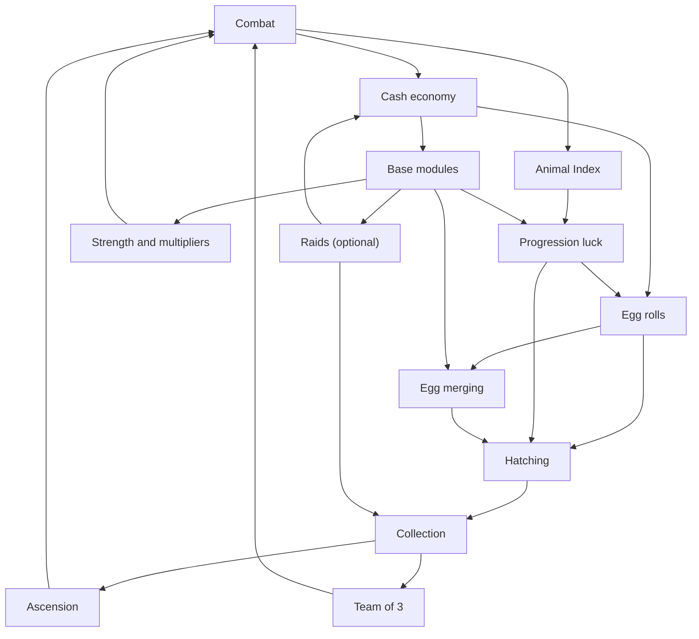

# Design Dashboard

The working view for game, systems, economy, combat, world and content designers. For engineering, see the [[Development Dashboard]].

## Design sources of truth

| What | Where |
|---|---|
| Owner decisions | [[Decision Register]] |
| Open questions | [[Open Questions]] |
| All proposed numbers | [[Canonical Proposed Values]] |
| Animal stats (generated) | [[Animal Statistics Database]] |
| Egg odds by progression (generated) | [[Dynamic Luck Probability Tables]] |
| Hatch pools (generated) | [[Hatch Pool Tables]] |

## Systems map

## Design areas

| Area | Index | Most important open question |
|---|---|---|
| Vision | [[Game Vision Index]] | — |
| Core gameplay | [[Core Gameplay Index]] | [[Open Questions#Q-022]] animal storage cap |
| World | [[World Design Index]] | [[Open Questions#Q-001]] world layout |
| Animals | [[Animal Index]] | [[Open Questions#Q-002]] final roster |
| Combat | [[Combat Index]] | [[Open Questions#Q-014]] defeat penalties |
| Eggs | [[Eggs and Hatching Index]] | [[Open Questions#Q-017]] luck formula |
| Ascension | [[Ascension and Progression Index]] | [[Open Questions#Q-005]] duplicate requirements |
| Bases | [[Player Bases Index]] | [[Open Questions#Q-007]] module list |
| PvP and raids | [[PvP and Raiding Index]] | [[Open Questions#Q-012]] raid duration |
| Economy | [[Economy and Monetisation Index]] | [[Open Questions#Q-020]] egg pricing model |
| UI/UX | [[UI and UX Index]] | — |

## Balance health checks

| Check | Where | Current result |
|---|---|---|
| 60 animals with the 12/11/10/9/8/6/4 split | [[Animal Index#Distribution check]] | Passes |
| Every animal's Power Index within ±0.06 of its role target | [[Animal Statistics Database#Balance audit]] | Passes (generator assertion) |
| Every hatch pool sums to 100% at P = 0, 0.3, 0.6, 1.0 | [[Hatch Pool Tables]] | Passes (generator assertion) |
| Egg-rarity odds sum to 100% at every sampled P | [[Dynamic Luck Probability Tables]] | Passes |
| Merge-chain shortcut versus direct rolls | [[Egg Merging Station]] · [[Expected Value Calculations]] | Analysed; tuning levers documented |
| Ascension time-to-complete | [[Ascension Expected Value Analysis]] | Analysed |

## Content counts

| Content | Count | Status |
|---|---:|---|
| Animals | 60 | **PROPOSED** roster, **CONFIRMED** target |
| Regions (plus hub) | 8 + 1 | **PROPOSED** |
| Mini-bosses | 8 | **PROPOSED** |
| World bosses | 4 | **PROPOSED** |
| Egg types | 7 | **CONFIRMED** rarities |
| Base modules | 7 + Egg Merging Station + Plot Expansion | Station **CONFIRMED**; others **PROPOSED** |
| Variants | 5 types | **CONFIRMED** to exist; eligibility **PROPOSED** |

## Related documents

[[Home]] · [[Balancing Methodology]] · [[Core Gameplay Loop]] · [[Progression Bottleneck Analysis]]
