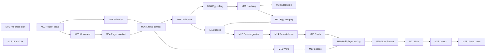

# Development Dashboard

The working view for engineers, QA and producers. For design, see the [[Design Dashboard]].

> [!danger] Implementation status
> No game code exists yet. All Luau in the vault is **illustrative** and has not been run in Roblox Studio. No test has been executed against a build. Probability tables were verified by a Python generator against the proposed formulas only.

## Milestones

The full plan, with dependencies and the critical path, is in [[Development Roadmap]]. Risks are in the [[Risk Register]].

## Engineering entry points

| Topic | Document |
|---|---|
| Architecture | [[Architecture Overview]] · [[Service Architecture]] · [[Roblox Project Hierarchy]] |
| Client/server contract | [[Remote Communication Contract]] · [[Server-Client Responsibilities]] |
| Implementation guides | [[Luau Implementation Index]] · [[Luau Coding Standards]] |
| Data | [[Data Architecture Overview]] · [[Save, Load and Recovery]] · [[Data Validation and Migration]] |
| Multiplayer | [[Multiplayer Architecture]] · [[Replication Strategy]] · [[Animal Scalability and Performance Budgets]] |
| Security | [[Security Architecture]] · [[Exploit Prevention]] · [[Threat Model]] |
| Performance | [[Performance Guidelines]] |
| Platform APIs | [[Roblox API Reference Notes]] |

## Server-authority checklist

Every one of these is validated on the server, never trusted from the client ([[Security Architecture]]):

| Validation | Owning service |
|---|---|
| Cash transactions | [[Service - EconomyService]] |
| Egg rolls and odds tokens | [[Service - EggService]] · [[Service - LuckService]] |
| Hatch results (at most 5 per request) | [[Service - HatchService]] |
| Animal ownership | [[Service - DataService]] |
| Ascension | [[Service - AscensionService]] |
| Egg merging | [[Service - MergeService]] |
| Inventory capacity (10 / 50) | [[Service - EggService]] |
| Combat damage | [[Service - CombatService]] |
| Team of 3 and base lock | [[Service - TeamService]] |
| Raid eligibility, offline protection, theft (KO first, max 3 animals) | [[Service - RaidService]] |
| Player progression and Progression Score | [[Service - ProgressionService]] |

## QA

| Need | Document |
|---|---|
| Strategy and coverage | [[QA Strategy]] · [[Test Plan Matrix]] |
| Probability verification | [[Statistical Testing of Probabilities]] |
| Bug process | [[Bug Reporting and Severity]] |
| Done criteria | [[Definition of Done]] |

## Backlog

The prioritised P0–P3 backlog is in [[Product Backlog]] ([[Backlog Index]]).

## Related documents

[[Home]] · [[Technical Architecture Index]] · [[Multiplayer and Security Index]] · [[QA and Testing Index]] · [[Roadmap Index]]
