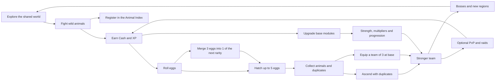

![[Title Treatment - Fight Animals for Eggs.svg]]

# Fight Animals for Eggs — Game Design Bible

> [!abstract] The single source of truth
> **Fight Animals for Eggs** is a Roblox animal-collection game built around real-time combat, egg hatching and base building. Players explore one large shared world, fight wild animals with a team of **three** companions, earn Cash, roll and hatch eggs across **seven** rarities, ascend their animals with duplicates, build modular bases, and can choose to join PvP and base raids.
>
> *Title art above is a concept placeholder, not the final logo ([[Visual Reference Placeholders]]).*

## Project status

| Area | State |
|---|---|
| Phase | Pre-production: design documentation ([[M01 - Pre-production]]) |
| Owner decisions recorded | 29 **CONFIRMED** in the [[Decision Register]] |
| Team proposals awaiting approval | 16 **PROPOSED** decisions (D-030 to D-045) |
| Open questions | 35 owner and team questions in [[Open Questions]], plus section-specific ones |
| Code | None written. All Luau in this vault is illustrative and has not been executed |
| Launch roster | 60 animals designed ([[Animal Index]]); roster **PROPOSED** |

## Core gameplay loop

Full loop analysis: [[Core Gameplay Loop]].

## Quick navigation

| Start here | Design | Production |
|---|---|---|
| [[How To Use This Vault]] | [[Design Dashboard]] | [[Development Dashboard]] |
| [[Vault Map]] | [[Canonical Proposed Values]] | [[Development Roadmap]] |
| [[Vision Statement and Pillars]] | [[Decision Register]] | [[Product Backlog]] |
| [[Glossary]] | [[Open Questions]] | [[QA Strategy]] |

## System dashboards

| System | Entry point | Key documents |
|---|---|---|
| Animals | [[Animal Index]] | [[Animal Statistics Database]] · [[Animal Roles]] · [[Animal Variants]] |
| Combat | [[Combat System Overview]] | [[Player Combat]] · [[Animal Combat Behaviour]] · [[Boss AI]] |
| Eggs and hatching | [[Egg System Overview]] | [[Egg Roll System]] · [[Hatch System]] · [[Dynamic Progression Luck]] · [[Egg Merging]] |
| Ascension and progression | [[Ascension System]] | [[Progression Score Specification]] · [[Player Progression and Levelling]] |
| Player bases | [[Player Base System]] | [[Base Upgrade System]] · [[Egg Merging Station]] · [[Base Defence Overview]] |
| PvP and raiding | [[PvP and Raiding Index]] | [[Base Raiding System]] · [[Animal Theft Rules]] · [[Egg Theft Rules]] |
| World | [[World Overview and Map]] | [[Hub - Hatchling Haven]] · [[Boss Design Overview]] |
| Economy | [[Economy Overview]] | [[Cash Sources and Sinks]] · [[Monetisation Principles]] |
| UI/UX | [[UI and UX Index]] | [[UI Navigation Map]] · [[UI - Main HUD]] |
| Art, animation, audio | [[Art Bible]] | [[Animation Bible]] · [[VFX Bible]] · [[Sound Bible]] |
| Technology | [[Architecture Overview]] | [[Service Architecture]] · [[Security Architecture]] · [[Data Architecture Overview]] |
| QA | [[QA and Testing Index]] | [[Test Plan Matrix]] · [[Statistical Testing of Probabilities]] |
| Live operations | [[Live Operations Framework]] | [[Content Update Pipeline]] · [[Versioning and Changelog Policy]] |

## Confirmed pillars at a glance

> [!success] CONFIRMED by the owner
> - **3** animals per team, changeable **only at your own base** ([[Team Equipping and Base Lock Rule]])
> - **7** rarities from Common to Secret; **two-stage** randomness: roll for egg rarity, then hatch from that rarity's pool
> - Hatch up to **5** eggs at once; every hatch is **independent**, with no duplicate protection
> - **Progression luck** improves odds, but the **actual odds are always shown** before you commit
> - Merge **3 → 1** egg of the next rarity at a purchasable, upgradeable **Egg Merging Station**
> - Storage: **10** backpack (never stealable) + **50** base = **60**
> - Raids are optional; only **knocked-out** defenders can be stolen; **max 3 animals** per successful raid; **offline bases are never raidable**
> - Fully playable without Robux

## Open decisions (owner attention needed)

> [!warning] UNDECIDED: top blockers
> | Question | Blocks |
> |---|---|
> | [[Open Questions#Q-012]] raid duration · [[Open Questions#Q-013]] egg theft limit | Raid beta |
> | [[Open Questions#Q-011]] PvP activation method | PvP prototype |
> | [[Open Questions#Q-014]] defeat penalties | Combat beta |
> | [[Open Questions#Q-023]] hatch timing · [[Open Questions#Q-034]] merge timing | Egg prototypes |
> | [[Open Questions#Q-033]] which animals defend bases | Raid prototype |
> | [[Open Questions#Q-009]] storage expansion currency | Economy beta |
>
> The full list is in [[Open Questions]]; the review queue is in [[Decisions Index]].

## Current priorities

1. **Owner review** of the proposed decisions D-030 to D-045 and the blocking questions above.
2. **Vertical slice** (P0): player combat, three-animal team AI, Whisperwood Forest, egg roll and hatch with odds disclosure ([[M03 - Player Movement]] to [[M09 - Hatching]]).
3. **Data and security foundations**: profile schema, session locking, the remote validation layer ([[Security Architecture]], [[Save, Load and Recovery]]).
4. **Statistical test harness** for egg and hatch odds before any external playtest ([[Statistical Testing of Probabilities]]).

## Latest changes

See the [[Changelog]]. Most recent: **v0.1.0 (2026-11-14)** — the vault was created, covering all 28 sections, 60 animals, 12 bosses and 8 regions.

## Related documents

[[Vault Map]] · [[Design Dashboard]] · [[Development Dashboard]] · [[Decisions Index]]
