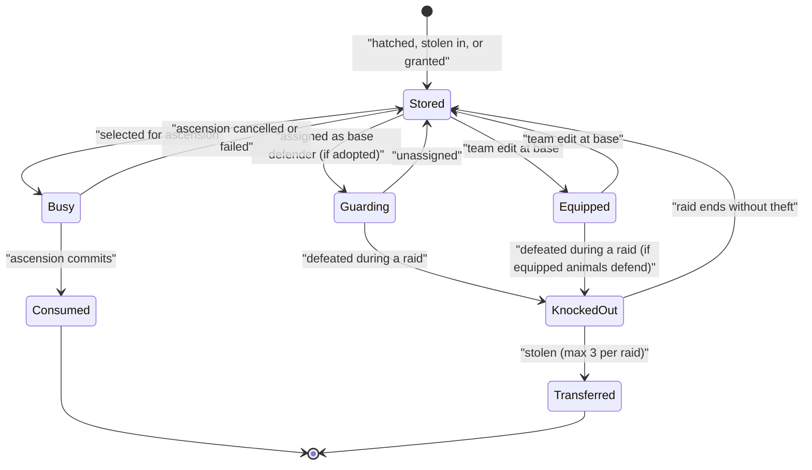

# Animal Collection System

The collection is every animal a player **owns**. It is distinct from the [[Animal Index Feature Specification|Animal Index]], which records what a player has **discovered** in the wild (D-029). This document owns the ownership model, duplicates, storage and the relationship with ascension, teams and raids.

> [!success] CONFIRMED
> 60 launch species across seven rarities (D-003, D-004). Hatches are independent and can produce duplicates (D-018). Ascension consumes duplicates and keeps the original (D-019). Selected species have variants (D-028). A defending animal can be stolen only after it is knocked out; at most three per successful raid (D-024).

## 1. Ownership model (PROPOSED)

Every owned animal is an **instance** with its own unique ID. Two Tigers are two instances.

| Field | Type | Notes |
|---|---|---|
| `uid` | string | Server-generated, unique per player profile, never reused |
| `speciesId` | string | Catalogue key, e.g. `TIGER` ([[Animal Index]]) |
| `variant` | string or nil | `nil` for the normal form; acquisition **UNDECIDED** ([[Open Questions#Q-006]]) |
| `ascension` | integer 0–5 | A0 = not ascended ([[Ascension System]]) |
| `acquiredAt` | Unix time | Server clock |
| `source` | enum | `HATCH`, `RAID_THEFT`, `STARTER`, `GRANT` (support/compensation) |
| `sourceRef` | string | Hatch transaction ID, raid ID, etc. for audit |
| `favourite` | boolean | Player flag; excludes the instance from bulk duplicate selection |
| `busy` | string or nil | ID of an in-flight transaction (ascension, theft); blocks all other use |

Stats are **not stored** per instance. They are derived from species, rarity, ascension and (if adopted) variant at runtime ([[Animal Statistics Database]], [[Animal Stat Budget Model]]). There is no per-animal XP at launch (D-042 **PROPOSED**, [[Open Questions#Q-021]]).

Schema: [[Schema - Animal Collection]].

### 1.1 Instance states

Whether a "Guarding" state exists, and which animals defend, are **UNDECIDED** ([[Open Questions#Q-033]], [[Open Questions#Q-035]]).

## 2. Duplicates

- Every hatch is independent (D-018). The pool does not know what the player owns, so duplicates are normal and expected.
- A **duplicate** is any instance whose `speciesId` matches another instance the player owns.
- Duplicates are kept as separate instances until consumed by ascension. They can also be equipped (team duplicates are **UNDECIDED**, Q-103, see [[Team Equipping and Base Lock Rule]]).
- The UI groups instances by species with a count badge and shows "×N available for ascension" ([[UI - Animal Inventory]]).

### 2.1 Which instance is "the original"?

D-019 says the original is kept. With identical instances, the **player chooses the target** in the ascension screen; every other selected instance is consumed. **PROPOSED** default selection: the highest-ascension instance as target; then normal-form, non-favourite, unequipped instances as duplicates, newest first.

> [!warning] UNDECIDED (Q-106)
> **Variants and ascension.** Can a variant instance (for example a Golden Tiger) be consumed as a duplicate for a normal Tiger, or be ascended using normal duplicates? **Recommendation (PROPOSED):** species is what counts, so both directions are allowed, but variant instances are never auto-selected as duplicates and require an extra confirmation. Depends on [[Open Questions#Q-006]] and [[Open Questions#Q-024]].

## 3. Storage

> [!warning] UNDECIDED (Q-022)
> **Owned-animal storage capacity.** Working assumption for prototyping: **100** owned animal instances ([[Canonical Proposed Values#7. Eggs, rolls and hatching]]). Whether capacity is expandable, and how, is not decided.

| Rule | Status |
|---|---|
| Capacity counts every instance: stored, equipped, guarding | **PROPOSED** |
| A hatch of *n* eggs is only allowed if `capacity − owned ≥ n`; checked before the hatch commits | **PROPOSED** |
| The hatch UI shows free animal slots next to the "Hatch ×5" button and disables options that do not fit ([[UI - Egg Hatching]]) | **PROPOSED** |
| Ascension frees capacity (duplicates are consumed) and is the main pressure valve | **PROPOSED** |
| Animal storage is separate from egg storage (10 backpack + 50 base, D-021) | **CONFIRMED** egg values; separation **PROPOSED** |

### 3.1 Raids and capacity

> [!warning] UNDECIDED (Q-105)
> **Raider storage full at the moment of theft.** What happens if a raider knocks out a defender but has no free animal slot? **Recommendation (PROPOSED):** a player cannot start a raid with fewer than 3 free animal slots (the maximum theft, D-024). This avoids overflow states entirely and is shown in [[UI - Raid Interface]]. Alternatives: block the individual theft, or hold the animal in a temporary claim slot.

### 3.2 Worked example

A player at the working-assumption cap of 100 instances holds 12 Rabbits, 8 Hedgehogs and 80 others. They want to hatch 5 eggs. The hatch screen shows "0 free animal slots" and suggests ascension. Ascending one Rabbit from A0 to A5 consumes 15 duplicates ([[Canonical Proposed Values#9. Ascension (PROPOSED — levels Q-004, duplicates Q-005)]]); with only 11 duplicates available they reach A4 (1 + 2 + 3 + 4 = 10 duplicates), freeing 10 slots. The five-egg hatch is now allowed.

## 4. Relationship to other systems

| System | Relationship | Owning document |
|---|---|---|
| Hatching | Creates instances; must check capacity first | [[Hatch System]] |
| Animal Index | Gaining a species sets its Owned flag; losing the last instance clears "currently owned" but keeps "ever owned" | [[Animal Index Feature Specification]] |
| Team | Up to 3 instances equipped; only edited at base | [[Team Equipping and Base Lock Rule]] |
| Ascension | Consumes duplicates; target retained; equipped instances cannot be consumed | [[Ascension System]] |
| Raids | Knocked-out defenders may be transferred, max 3 per successful raid; undefeated defenders never | [[Animal Theft Rules]] |
| Base pens | Possible physical display of owned animals (**UNDECIDED**, [[Open Questions#Q-008]]) | [[Module - Animal Pens]] |
| Progression Score | Unique species count via the index, not raw ownership (see the index spec) | [[Progression Score Specification]] |
| Trading | Not at launch (D-045 **PROPOSED**) | [[Open Questions#Q-026]] |

## 5. Transactions and integrity

All ownership changes run as server transactions ([[Data Consistency and Transactions]]):

1. **Hatch:** remove eggs + add instances in one profile write.
2. **Ascension:** mark target and duplicates `busy` → validate → remove duplicates, increment target, deduct Cash → clear `busy` ([[Implementation - Ascension Transaction]]).
3. **Theft:** victim and raider profiles are written in a two-phase pattern with an idempotent transfer ID so a crash cannot duplicate or delete an animal ([[Implementation - Raid Session Controller]]). What a stolen animal keeps (ascension, variant) is **UNDECIDED** ([[Open Questions#Q-025]]).

> [!danger] Data-loss risk
> Theft is the only cross-profile ownership change at launch. It must be logged with both user IDs, the instance UID and the raid ID, and be recoverable by support ([[Save, Load and Recovery]]).

## 6. Collection goals (PROPOSED)

| Goal type | Example | Reward |
|---|---|---|
| Species owned | Own all 12 Commons | Cosmetic title (**PROPOSED**) |
| Family sets | Own all 6 Big Cats | Index badge |
| Ascension | Any animal at A5 | Visual crest already shown on the animal (D-037 **PROPOSED**) |
| Variants | Own any variant | Depends on [[Open Questions#Q-006]] |

No collection goal grants odds bonuses outside the Progression Score inputs, so the disclosed-odds model stays simple ([[Dynamic Progression Luck]]).

## 7. Test hooks

- Hatch ×5 with 4 free slots → rejected before any egg is consumed.
- Ascension with a duplicate that becomes equipped mid-selection → `ANIMAL_BUSY` or `ANIMAL_EQUIPPED`.
- Theft transfer interrupted by server shutdown → instance exists in exactly one profile after recovery.
- Losing the last instance of a species → index shows "ever owned", collection count 0.

See [[Test Cases - Inventory and Storage]] and [[Test Cases - Raiding]].

## Related documents
- [[Core Gameplay Index]]
- [[Schema - Animal Collection]]
- [[UI - Animal Inventory]]
- [[Ascension System]]
- [[Animal Theft Rules]]
- [[Animal Index Feature Specification]]
- [[Animal Index]]
