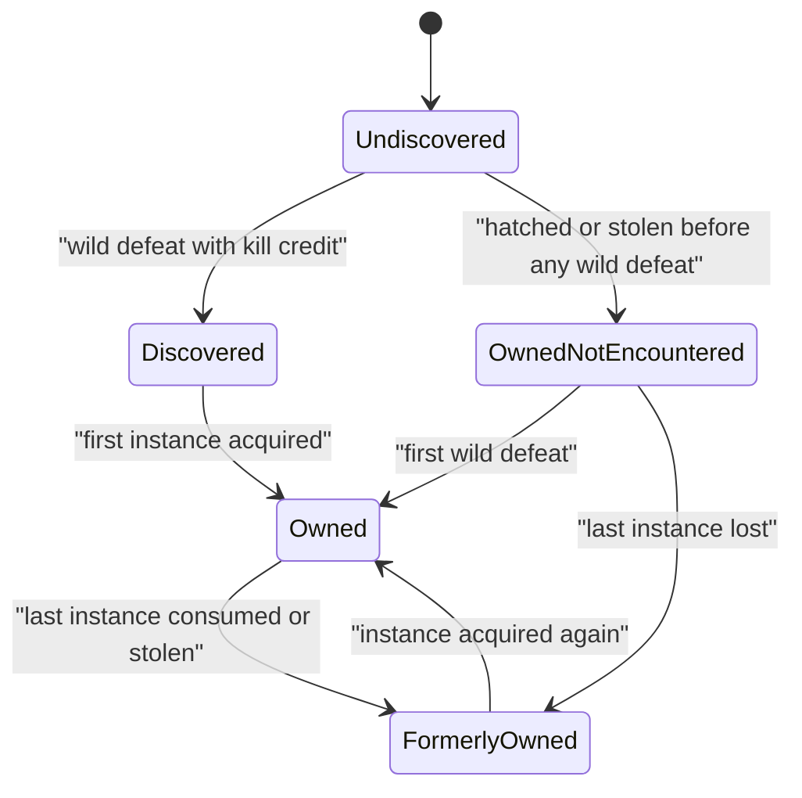
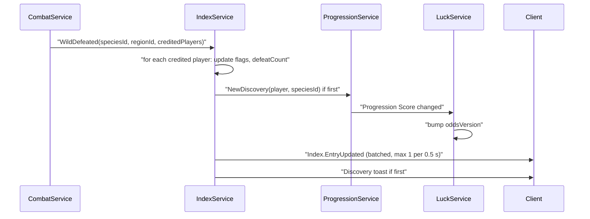

# Animal Index Feature Specification

The **Animal Index** is the in-game discovery record: a per-player book of all 60 species that tracks what the player has met in the wild, defeated, and owned. It is the player-facing feature; the static catalogue for designers is [[Animal Index]], and the screen layout is [[UI - Animal Index Screen]].

> [!success] CONFIRMED (D-029)
> Defeating wild animals registers them in the index. The index distinguishes **discovered** animals from **owned** animals.

> [!info] PROPOSED
> Everything else in this specification (data fields, states, the treatment of hatched-before-discovered animals, milestones and validation rules) is a proposal.

## 1. Purpose

1. **Goal board:** shows every species slot so collectors can see what remains.
2. **Travel diary:** records where and when the player first met each species.
3. **Progression input:** unique discoveries contribute to the Progression Score (3 points per species, 180 maximum, [[Progression Score Specification]]).
4. **Reference:** lets players read stats, role and abilities before deciding on a team.

## 2. Entry states

Each species entry has independent flags; the displayed state is derived from them.

| Flag | Set by | Cleared by |
|---|---|---|
| `seen` | Server: player within 40 studs of a live wild instance, or in combat with it (**PROPOSED** radius) | Never |
| `discovered` | Server: player received kill credit on a wild instance (D-029, kill credit per D-040) | Never |
| `everOwned` | Server: any instance of the species added to the collection | Never |
| `ownedCount` | Collection changes | Decrements when instances are consumed or stolen |
| `variantsOwned` | Collection changes | Updates when variant instances are lost |

### 2.1 Display states

| Display state | Condition | What the player sees |
|---|---|---|
| **Undiscovered** | not `discovered`, not `everOwned` | Dark silhouette, rarity frame colour, "???" name; home region shown once that region is unlocked; "Seen" eye icon if `seen` |
| **Discovered** | `discovered`, `ownedCount = 0` | Full art, name, species, rarity, habitat, stats, cash reward, abilities, discovery info; "Not owned" ribbon |
| **Owned** | `ownedCount ≥ 1` | Everything above plus owned count, highest ascension and owned-instance shortcut |
| **Owned, not encountered** | `ownedCount ≥ 1`, not `discovered` | As Owned, with a "Not yet encountered in the wild" badge and an empty discovery panel |
| **Owned variant** | any `variantsOwned` | Variant thumbnails lit on the variant strip; normal-form state shown separately |
| **Formerly owned** | `everOwned`, `ownedCount = 0` | As Discovered or Undiscovered-with-art, plus "Previously owned" note |

## 3. Hatching an undiscovered animal

**PROPOSED treatment:** a species hatched (or stolen in a raid) before it has been defeated in the wild **counts as owned immediately**. Full art and stats unlock so the player can use it, but the entry shows **"Not yet encountered in the wild"** and its discovery panel stays empty until a wild defeat.

### 3.1 Progression Score discovery points

> [!warning] UNDECIDED (Q-104)
> **Do index discovery points count wild defeats only, or wild defeats and ownership?** Both options below are proposals; the owner must choose.

| Option | Rule | For | Against |
|---|---|---|---|
| **A: Wild defeats only** | 3 PS per species with `discovered = true` | Matches D-029 literally ("defeating wild animals registers them"); rewards exploration; no luck → hatch → luck feedback loop | Secret species spawn in the wild only as rare events (10% per 45-minute window per server, [[Wild Animal Spawning and Respawn]]), so the last few points may take many hours |
| **B: Either route** | 3 PS per species that is `discovered` **or** `everOwned` | Simpler to explain; no "I own it but get no credit" frustration | Lucky hatches raise luck, which slightly compounds; less reason to explore |
| **C: Split credit** | 2 PS for `everOwned`, 3 PS for `discovered` (maximum 3 per species) | Keeps exploration valuable while acknowledging hatches | More complex to explain |

**Recommendation (PROPOSED):** **Option A**, because it follows the confirmed wording of D-029 and keeps the Progression Score tied to play rather than to luck. If beta data shows that Secret wild discoveries are a blocker, revisit the Secret rare-spawn rates before changing the rule. Any change to PS inputs must re-run the odds checks in [[Dynamic Luck Probability Tables]].

## 4. Data recorded per entry

### 4.1 Static data (from configuration, identical for all players)

| Field | Source |
|---|---|
| Name, species, family | [[Animal Index]], [[Animal Families]] |
| Rarity | [[Canonical Proposed Values#2. Launch roster (PROPOSED)]] |
| Habitat (home region) and secondary appearances | Region documents, e.g. [[Region - Whisperwood Forest]] |
| Role | [[Animal Roles]] |
| Combat stats (companion, A0) | [[Animal Statistics Database]] |
| Wild cash reward | `BaseCash(rarity) × RegionMultiplier(home)`; e.g. a Rare in Whisperwood pays 28 ([[Wild Animal Cash Rewards]]) |
| Abilities (name, manual or automatic, cooldown) | [[Animal Abilities Catalogue]] |
| Variants available | [[Animal Variants]] |

### 4.2 Per-player data

| Field | Type | Notes |
|---|---|---|
| `firstSeenAt` | Unix time | |
| `firstSeenRegion` | region ID | |
| `firstDefeatedAt` | Unix time | First wild defeat with kill credit |
| `firstDefeatedRegion` | region ID | Secondary appearances count; the region of the defeat is recorded |
| `defeatCount` | integer | Wild defeats with kill credit only; display caps at "999,999+" |
| `firstOwnedAt` | Unix time | |
| `firstOwnedSource` | enum | `HATCH`, `RAID_THEFT`, `STARTER`, `GRANT` |
| `ownedCount` | integer | Derived from the collection on load; cached for UI |
| `highestAscension` | 0–5 | Derived |
| `variantsOwned` | set of variant IDs | Derived |
| `variantsEverOwned` | set of variant IDs | Persistent |

Persistent fields live in [[Schema - Discovery Index]]; derived fields are recomputed from [[Schema - Animal Collection]] on load so the two can never disagree.

## 5. What counts as a wild defeat

| Situation | Counts? | Reason |
|---|---|---|
| Wild animal defeated, player has kill credit (≥10% of max HP dealt by player or their animals within the combat-tag window, D-040 **PROPOSED**) | Yes | Core rule |
| Wild animal defeated by others, player dealt less than 10% | No | No kill credit |
| Wild animal leashes back and resets (60-stud leash) | No | Not defeated |
| Rare-spawn Mythical or Secret defeated by a group | Yes, for every credited player | Shared credit |
| Boss defeated | No species entry | Bosses are tracked in [[Schema - Unlocks and Boss Progress]] |
| Boss-summoned adds (if any) | **PROPOSED:** no | Prevents farming discoveries in boss arenas |
| Raid defender knocked out | No | Not a wild animal |
| PvP opponent's animal knocked out | No | Not a wild animal |
| Hatched animal | No (`everOwned` only) | See §3 |

## 6. Server validation and flow

The client **never** reports a discovery. [[Service - IndexService]] subscribes to server-side defeat events from [[Service - CombatService]].

Validation and integrity rules (**PROPOSED**):
1. Defeat events carry the server instance ID of the wild animal; IndexService ignores duplicate events for the same instance (idempotency).
2. Writes to the session profile are immediate; DataStore persistence follows the normal autosave cadence ([[Service - DataService]]). A first discovery also triggers an early save request, subject to DataStore budget.
3. A first discovery raises the PS, which changes the disclosed odds. Any open roll confirmation carries the old `oddsVersion` and will be rejected and re-displayed (D-041 **PROPOSED**, [[Randomised Reward Compliance]]). The UI must explain why ("Your luck improved: new odds").
4. `defeatCount` increments are rate-checked against plausible kill rates for anomaly logging, not for blocking ([[Exploit Prevention]]).

## 7. Edge cases

| Case | Handling (PROPOSED) |
|---|---|
| Player disconnects in the same frame as the defeat | Kill credit is evaluated from server damage logs; if the player has left, no entry is written |
| Same species defeated in two regions | `firstDefeatedRegion` keeps the first; `defeatCount` aggregates |
| Species added after launch | Appears as Undiscovered for everyone; PS maximum rises, so PS normalisation must be reviewed ([[Content Expansion Guidelines]]) |
| Species stolen from the player | `ownedCount` decrements; `everOwned` stays true |
| Data correction removes an instance | Same as stolen; logged as `CORRECTION` |
| Region not yet unlocked | Undiscovered entries for that region hide the habitat line to avoid spoilers |
| Secret species silhouettes | Shown, but with a prismatic "?" frame instead of a readable outline (**PROPOSED** spoiler protection) |

## 8. Milestones (PROPOSED)

| Discovered species | Reward (PROPOSED, cosmetic only) |
|---:|---|
| 10 | Index cover colour |
| 25 | Title "Field Naturalist" |
| 40 | Animated index frame |
| 60 | Title "Keeper of the Index" and Trophy Hall plaque |

Milestones grant no odds or stat bonuses beyond the PS points already defined.

## 9. Link to the screen

[[UI - Animal Index Screen]] owns layout and interaction. Requirements from this spec:
- Filters: rarity, family, region, display state; sort by catalogue number, rarity, defeat count.
- Each entry opens a detail page with tabs: **Overview** (stats, role, abilities), **Discovery** (first seen, first defeated, region, timestamps, defeat count), **Owned** (count, highest ascension, variants).
- A completion bar shows "Discovered 23 / 60 · Owned 17 / 60".

## 10. Test hooks

| ID | Test | Expected |
|---|---|---|
| IX-01 | Defeat a new species with ≥10% damage | `discovered = true`, toast, PS +3 under Option A |
| IX-02 | Defeat with 9% damage | No change |
| IX-03 | Hatch an undiscovered species | Owned, "Not yet encountered in the wild", no PS change under Option A |
| IX-04 | Open roll confirmation, then gain a discovery, then confirm | Roll rejected with `STALE_ODDS`, new odds shown |
| IX-05 | Same defeat event delivered twice | `defeatCount` +1 only |
| IX-06 | Lose last instance via theft | "Previously owned" shown |

See [[Test Cases - Egg Rolls and Hatching]] and [[Test Cases - Persistence]].

## Related documents
- [[Core Gameplay Index]]
- [[UI - Animal Index Screen]]
- [[Service - IndexService]]
- [[Schema - Discovery Index]]
- [[Animal Collection System]]
- [[Progression Score Specification]]
- [[Wild Animal Spawning and Respawn]]
- [[Animal Index]]
