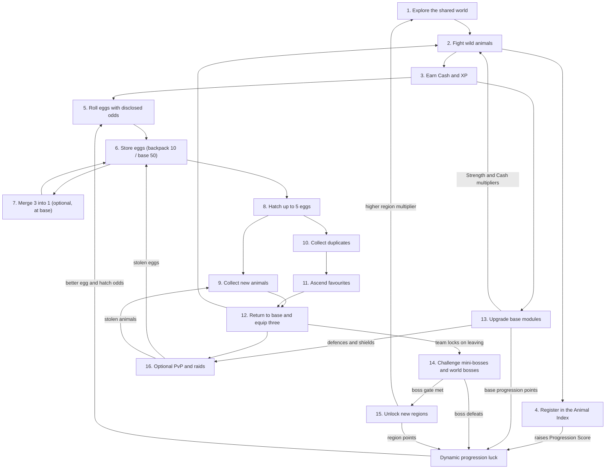
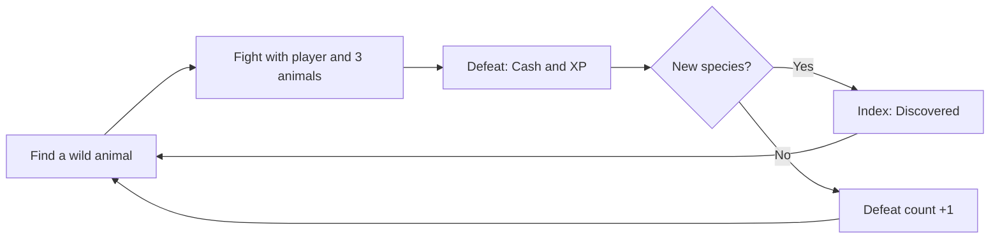
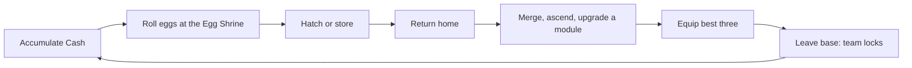
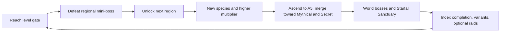

# Core Gameplay Loop

> [!success] CONFIRMED (D-002)
> Explore → fight wild animals → earn cash → register in index → roll eggs → hatch → collect duplicates → ascend → equip three → upgrade base → bosses → new areas → optional PvP and raids.

> [!info] PROPOSED expansion to 16 steps
> For production planning the confirmed loop is broken into **16 steps**. Three of them make explicit systems that are already confirmed elsewhere but are implicit in the D-002 sentence: egg storage (D-021), egg merging (D-020) and returning to base, which the base lock requires (D-010). The order and grouping are **PROPOSED**; the content of each step is confirmed.

## 1. The 16 loop steps

| # | Step | D-002 element | What the player does | Output that feeds the next step | Owning document |
|---:|---|---|---|---|---|
| 1 | Explore | Explore | Travels the shared world, finds spawn areas, landmarks and rare-spawn announcements. | Encounters | [[World Overview and Map]] |
| 2 | Fight wild animals | Fight wild animals | Real-time hybrid combat with three companions. | Defeats | [[Combat System Overview]] |
| 3 | Earn Cash and XP | Earn cash | Receives `BaseCash × RegionMultiplier × (1 + bonuses)` and XP. | Cash, levels, Strength | [[Combat Rewards]], [[Wild Animal Cash Rewards]] |
| 4 | Register in the index | Register in index | First wild defeat of a species marks it Discovered. | Discoveries → Progression Score | [[Animal Index Feature Specification]] |
| 5 | Roll eggs | Roll eggs | Spends 200 Cash (**PROPOSED**) per roll after viewing disclosed odds. | Eggs of a rarity | [[Egg Roll System]] |
| 6 | Store eggs | (implicit, D-021) | Eggs sit in the backpack (10) or base storage (50). | Egg inventory | [[Egg Storage]] |
| 7 | Merge eggs (optional) | (implicit, D-020) | Combines 3 same-rarity eggs into 1 of the next rarity at the base station. | Higher-rarity eggs | [[Egg Merging]] |
| 8 | Hatch eggs | Hatch | Hatches up to 5 at once; species drawn from the rarity pool. | New animals | [[Hatch System]] |
| 9 | Collect animals | (part of Hatch) | New species are added to the collection and index as Owned. | Collection breadth | [[Animal Collection System]] |
| 10 | Collect duplicates | Collect duplicates | Repeat species accumulate (independent hatches, D-018). | Ascension fuel | [[Independent Random Outcomes]] |
| 11 | Ascend | Ascend | Consumes duplicates; the original gains a star tier. | Stronger favourites | [[Ascension System]] |
| 12 | Return to base and equip three | Equip three | Chooses the best three for the next trip. Team locks on leaving. | Expedition team | [[Team Equipping and Base Lock Rule]] |
| 13 | Upgrade base | Upgrade base | Spends Cash on modules (Strength, Cash multiplier, defences, storage security). | Multipliers, Strength, PS | [[Base Upgrade System]] |
| 14 | Challenge bosses | Bosses | Fights the regional mini-boss and timed world bosses. | Gate progress, PS, rewards (**UNDECIDED**, [[Open Questions#Q-015]]) | [[Boss Design Overview]] |
| 15 | Unlock new regions | New areas | Meets level + boss gate; opens the next region and a hub portal. | Higher multipliers, new species | [[Region Unlock Progression]] |
| 16 | Optional PvP and raids | Optional PvP and raids | Opts into duels or raiding for rivalry and stakes. | Stolen eggs and animals, prestige | [[PvP System]], [[Base Raiding System]] |

## 2. Full loop diagram

## 3. How each system feeds the next

1. **Exploration → combat.** Regions decide which species appear and how strong they are (region multiplier ×1.0 to ×11.5). Luck never influences which wild animals appear (D-017).
2. **Combat → Cash, XP and discoveries.** Each defeat pays Cash and XP scaled by region. Shared kill credit (D-040 **PROPOSED**) means groups do not compete for rewards.
3. **Discoveries → luck.** Each discovered species adds 3 Progression Score points; level, bosses, regions and base modules add more ([[Progression Score Specification]]). PS shifts disclosed odds towards higher rarities.
4. **Cash → eggs.** A flat 200 Cash roll (D-039 **PROPOSED**) means that as region multipliers rise, rolls get relatively cheaper. This acceleration is intended.
5. **Eggs → decisions.** Hatch now, hold, or merge. Storage limits (10 + 50) force decisions and make base-stored eggs the stake in raids.
6. **Hatches → collection and duplicates.** New species broaden team choice; duplicates feed ascension (D-019).
7. **Ascension and base → power.** Ascension (+8% HP/ATK/DEF per level) and Training Grounds (+5% player Strength, +4% equipped animal stats per level) raise power without per-animal levelling (D-042 **PROPOSED**).
8. **Power → bosses → regions.** Mini-boss defeats are part of each region gate; two world bosses are part of the Starfall gate.
9. **Base → rivalry.** Defence Station, Shield Generator and Egg Vault make raids a contest. Raids redistribute eggs and up to three animals, which re-enter the loop at steps 6 and 9.

## 4. Short, mid and long loops

### 4.1 Short loop (10–60 seconds): fight and earn

Target: a Common wild animal at recommended level falls in roughly 4–8 seconds ([[Damage, Defence and Health Model]]); respawn of 20 seconds keeps a cluster live while the player moves between groups.

### 4.2 Mid loop (10–30 minutes): roll, hatch, re-equip

Target: at least one meaningful base visit per 20–30 minutes of play ([[Session Flow and Player Journey]]).

### 4.3 Long loop (days to months): gates, bosses, collection, rivalry

## 5. Progression bottlenecks (summary)

The full analysis, with simulations, lives in [[Progression Bottleneck Analysis]]. The loop-level view:

| Bottleneck | Where it bites | Intended? | Pressure valve |
|---|---|---|---|
| Early Cash per roll | Whisperwood: ~12 Cash average per defeat → about 17 defeats per 200-Cash roll | Yes: makes the first eggs feel earned | Rising region multipliers; Multiplier Shrine +10% per level |
| Level gates | XP to level 8 is 7,223; each later band needs roughly 2,000–2,700 defeats at its region's multiplier | Yes: paces regions at about 3–6 hours each | Boss XP, group play (full shared XP is **PROPOSED**) |
| Egg storage (60) | Mid game, when players hold eggs for merging | Yes: forces hatch/merge decisions | Expansion (currency and price **UNDECIDED**, [[Open Questions#Q-009]], [[Open Questions#Q-010]]) |
| Animal storage | Collectors holding duplicates for ascension | Partly | Capacity **UNDECIDED** ([[Open Questions#Q-022]]), working assumption 100 |
| High-rarity eggs | Legendary egg odds rise from 0.25% at P = 0 to 1.75% at P = 1 | Yes: rarity must feel rare | Merging (3 Epic → 1 Legendary at station level 3) |
| Ascension duplicates | Rare-pool Elusive species | Yes, long-term goal | Lower duplicate counts at high rarity ([[Ascension Progression Table]]) |
| Merge station costs | 250,000 and 1,000,000 Cash for levels 4–5 | Yes: main late-game sink (D-038) | Late-region multipliers |
| Starfall gate | Requires 2 different world bosses; cadence 45–60 minutes per boss | Yes: endgame social gate | Multiple world bosses per server, server hopping |
| Wild Secret discoveries | 10% chance per 45-minute window per species | Risky for PS completion | See [[Animal Index Feature Specification]] and its open question on hatch-based discovery |
| Late-region time-to-kill | Region ×11.5 versus player power growth | Needs simulation | [[Balance Simulation Plan]] |

## 6. Loop health metrics (PROPOSED)

| Metric | Healthy range (hypothesis) | Data source |
|---|---|---|
| Defeats per roll | Falls from ~17 early to under 5 by Frostfang Tundra | Combat and economy events |
| Base visits per hour | 2–4 | Team service lock/unlock events |
| Share of hatches that are duplicates | Rises over time; must still feel useful | Hatch logs |
| Share of eggs merged | 10–30% mid game | Merge logs |
| Players opting into raids | Any value; non-raiders must retain equally well | Raid opt-in state |

## Related documents
- [[Core Gameplay Index]]
- [[Session Flow and Player Journey]]
- [[Progression Bottleneck Analysis]]
- [[Economy Overview]]
- [[Cash Sources and Sinks]]
- [[Dynamic Progression Luck]]
- [[Decision Register]]
