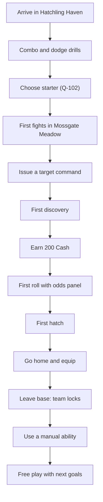

# New Player Onboarding

> [!info] PROPOSED
> The first-time user experience (FTUE) below is a proposal. It teaches confirmed rules (hybrid combat, discovery, two-stage eggs, disclosed odds, base lock) in the order the player needs them.

## 1. Goals

1. The player fights within **60 seconds** of spawning.
2. The player understands that **they and their animals fight together** (D-005).
3. The player rolls and hatches their first egg in the **first 15 minutes**, and sees the odds panel before committing (D-017).
4. The player experiences the **base lock** (D-010) in a safe, positive moment.
5. Nothing in the tutorial requires Robux or shows a store prompt (D-027).

## 2. Starter animal

> [!warning] UNDECIDED (Q-102)
> **How does a new player get their first animal?** Options:
> - **A. Starter choice (recommended, PROPOSED):** pick one of three Common animals with different roles: [[Rabbit]] (Skirmisher), [[Hedgehog]] (Tank) or [[Squirrel]] (Ranged). Not random, so it does not interact with hatch odds or D-018.
> - **B. Free first egg:** a free Common Egg hatched from the normal Common pool with odds shown. Teaches hatching earlier but makes the first companion random.
> - **C. None:** the player fights alone until the first roll. Purest loop, weakest first impression of hybrid combat.

## 3. Step-by-step flow

| Step | Location | Objective shown | Teaches | Completion trigger | Est. time |
|---:|---|---|---|---|---|
| 1 | [[Hub - Hatchling Haven]], arrival glade | "Strike the training stump" | Basic 3-hit combo | 3 combos landed | 0:30 |
| 2 | Hub | "Dodge the swinging log" | Dodge roll (0.3 s invulnerability) | 2 successful dodges | 0:30 |
| 3 | Hub, Starter Nest | "Choose your first companion" | Animal roles | Selection confirmed (per Q-102) | 0:45 |
| 4 | Hub → [[Region - Whisperwood Forest]] (Mossgate Meadow) | "Defeat 3 Rabbits with your companion" | Animals auto-target; player and animal damage both count | 3 defeats | 1:30 |
| 5 | Mossgate Meadow | "Command your companion: tap a target" | Manual target command (D-009) | 1 command issued, target defeated | 0:45 |
| 6 | Whisperwood | "Find something new" | Animal Index discovery toast | First discovery of a non-Rabbit species | 1:30 |
| 7 | Whisperwood | "Earn 200 Cash" | Cash from defeats (D-014); progress bar on HUD | 200 Cash held | 5:00 |
| 8 | Hub, Egg Shrine | "Roll an egg" | Roll → egg rarity; odds panel with plain-language line | Roll confirmed | 1:00 |
| 9 | Anywhere outside combat | "Hatch your egg" | Hatch picks a species from the rarity's pool (D-015) | Hatch complete | 0:30 |
| 10 | Hub → own base via base portal | "Go home and equip your team" | Team edits only at base | Team saved | 1:00 |
| 11 | Own base edge | "Head out" | Lock on leaving (lock icon, portraits) | Leaves boundary | 0:15 |
| 12 | Whisperwood | "Use your animal's ability" | Manual vs automatic abilities (D-008) | One manual ability used | 1:00 |
| 13 | Anywhere | Tutorial complete card | Next goals: level 8, Bramblehorn, first module | Dismissed | 0:15 |

Total guided time: about 15 minutes, of which roughly 5 minutes is free farming for the first 200 Cash (about 17 average Whisperwood defeats at 10–28 Cash each, [[Canonical Proposed Values#6. Wild rewards and respawn (PROPOSED)]]).

## 4. Teaching the odds honestly

At step 8 the odds panel is shown in full, with:
- The exact seven-rarity odds for this player now (at Progression Score near 0 these are approximately 71.9 / 19.9 / 6.4 / 1.5 / 0.25 / 0.03 / 0.001 %, from the formula in [[Canonical Proposed Values#8. Dynamic progression luck (PROPOSED — final formula UNDECIDED, Q-017)]]; exact displayed values come from [[Dynamic Luck Probability Tables]]).
- One sentence: "Your odds improve as you progress. The odds shown are exactly what this roll uses."
- A "How luck works" link ([[Design Principles and Fairness Charter]]).

> [!danger] Compliance
> The tutorial must never grant a fixed "guaranteed rare" first roll that contradicts the displayed odds. If a scripted first result is ever wanted, it must be presented as a non-random gift, not as a roll ([[Randomised Reward Compliance]]).

## 5. Teaching the base lock positively

The lock is introduced right after the player has equipped a fresh hatch, so it reads as "your team is ready" rather than "you are restricted". Copy (**PROPOSED**): "Team locked for this trip. Come home to change it." The HUD then shows the lock icon permanently while Away ([[Team Equipping and Base Lock Rule]]).

## 6. Deferred teaching (just in time)

| System | Taught when | Trigger |
|---|---|---|
| Ascension | First duplicate hatched | Toast: "Duplicate! Use it to ascend" |
| Egg storage limits | Backpack reaches 8 / 10 | Hint about base storage |
| Egg merging | First time holding 3 eggs of one rarity and owning a station | Station glows at base |
| Mini-boss gate | Reaching level 6 | Map marker on Bramblehorn's arena |
| World bosses | First announcement after level 10 | Announcement with "Recommended level 15" |
| Hazards | Entering the first hazard zone | One-line hint ([[Environmental Hazards]]) |
| PvP and raids | Level 20 (**PROPOSED**) | Opt-in explainer listing what is always safe ([[Design Principles and Fairness Charter]]) |

## 7. Accessibility and platform notes

- Every prompt has a touch, keyboard and gamepad glyph ([[UI Accessibility Standards]]).
- Objectives are text plus icon; no colour-only cues.
- Text uses short sentences; reading level suitable for younger players.
- Players can skip steps 1–2 if they have played before on another device (profile flag), but steps 3, 8 and 10 are mandatory once.

## 8. FTUE metrics (PROPOSED)

| Metric | Target |
|---|---|
| Reach step 4 (first fight) | ≥ 95% of new players |
| Complete step 8 (first roll) | ≥ 75% |
| Complete step 11 (first lock) | ≥ 65% |
| Median time to first roll | ≤ 15 min |
| Day-1 return | Measured, no target set until beta |

## 9. Test hooks

- Disconnect at each step → resume at the same step.
- Attempt to change team in the hub during step 10 → blocked with "Only at your base" (Q-101 does not apply because the base is the destination).
- Attempt a roll with 199 Cash → disabled button, progress bar shows "1 Cash to go".

## Related documents
- [[Core Gameplay Index]]
- [[Session Flow and Player Journey]]
- [[Hub - Hatchling Haven]]
- [[Region - Whisperwood Forest]]
- [[UI - Egg Rolling]]
- [[Team Equipping and Base Lock Rule]]
- [[Free-to-Play Experience]]
