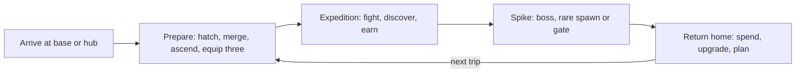
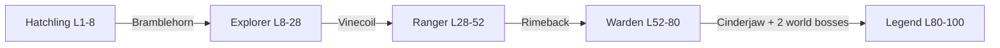

# Session Flow and Player Journey

> [!info] PROPOSED
> All pacing targets, session shapes and journey stages here are proposals derived from [[Canonical Proposed Values]] (XP curve, region multipliers, rewards). Time estimates assume combat-only XP and about 6 seconds per wild defeat including travel; they will be replaced by [[Balance Simulation Plan]] output.

This document describes **how a single session is shaped** and **how a player's journey unfolds across weeks**. The loop itself is defined in [[Core Gameplay Loop]].

## 1. Anatomy of a typical session

A standard session has five beats. Every beat should be completable on mobile in five minutes or less.

| Beat | Duration | Player goal | Systems | Design notes |
|---|---|---|---|---|
| Arrive | 0–1 min | Re-orient | [[UI - Notifications]], [[UI - Progression Interface]] | Summarise what changed since last session: world boss timers, shield status, eggs ready |
| Prepare | 1–5 min | Make expedition decisions | [[Hatch System]], [[Egg Merging]], [[Ascension System]], [[Team Equipping and Base Lock Rule]] | The base lock makes this beat matter |
| Expedition | 5–25 min | Earn Cash and XP, discover species | [[Combat System Overview]], [[Wild Animal Spawning and Respawn]] | Spawn clusters every 30–60 s of travel |
| Spike | 2–8 min | A memorable moment | [[Boss Design Overview]], rare spawns | World boss announcements 2 minutes ahead give natural spikes |
| Return | 2–5 min | Convert gains into permanent progress | [[Egg Roll System]], [[Base Upgrade System]] | At least one decision on every visit |

### 1.1 Session shapes by platform and intent

| Shape | Length | Typical pattern |
|---|---|---|
| Mobile check-in | 5–10 min | Arrive → hatch stored eggs → one short expedition → roll → leave |
| Standard | 25–45 min | Two expedition cycles, one boss attempt, one module upgrade |
| Long PC session | 60–120 min | Gate push: level up, mini-boss attempts, region unlock, world boss |
| Group session | 30–90 min | World boss rotation, rare-spawn hunting, optional raids |
| Rival session | 20–40 min | Opt into PvP or raiding; defend own base while online |

## 2. The first session (0–45 minutes)

Details of the tutorial steps are in [[New Player Onboarding]]. Pacing targets:

| Minute | Milestone | Level (approx.) |
|---:|---|---:|
| 0–2 | Spawn in [[Hub - Hatchling Haven]], learn the basic combo on a training dummy | 1 |
| 2–4 | Choose a starter animal (**PROPOSED**, see onboarding) and enter [[Region - Whisperwood Forest]] | 1 |
| 4–12 | Defeat around 20 Commons, discover 3–5 species, earn the first 200 Cash | 2–3 |
| 12–15 | First egg roll at the Egg Shrine, odds panel explained, first hatch | 3 |
| 15–20 | Visit own base, equip a team of 2–3, see the lock happen on leaving | 3–4 |
| 20–35 | Free play: more discoveries, second and third rolls, first module purchase (Animal Pens 1,000 Cash) | 4–5 |
| 35–45 | First look at [[Mini-Boss - Bramblehorn]] (recommended level 8–10; the gate needs level 8) | 5 |

## 3. Player journey stages

| Stage | Levels | Regions | Typical active hours (cumulative) | Primary goals | New systems introduced |
|---|---|---|---|---|---|
| **Hatchling** | 1–8 | Whisperwood | 0–1.25 | First team of three, first Uncommon | Combat, index, rolls, hatching, base lock |
| **Explorer** | 8–28 | Savanna, Canopy | 1.25–11 | First Rare and Epic, module levels 2–3, first world boss | Ascension, world bosses, merging (station level 1: 2,500 Cash) |
| **Ranger** | 28–52 | Coral Coast, Frostfang | 11–24 | Legendary eggs, A3+ favourites, station level 3 | Hazards with stronger effects, optional raids become relevant |
| **Warden** | 52–80 | Skyreach, Emberheart | 24–44 | Mythical rare spawns, station level 4, 2 world bosses for the Starfall gate | Rare-spawn hunting |
| **Legend** | 80–100+ | Starfall Sanctuary | 44+ | Secret animals, index completion, A5 Legendaries, variants | Endgame mini-boss, prestige goals ([[Long-Term Goals and Endgame]]) |

## 4. Solo and multiplayer journeys

| Aspect | Solo player | Group of friends |
|---|---|---|
| Wild farming | Full speed; no competition thanks to shared credit (D-040 **PROPOSED**) | Faster clears; each member gets full reward if ≥10% damage |
| Mini-bosses | Designed to be soloable at recommended level ([[Boss Design Overview]]) | HP scales with participants; faster overall |
| World bosses | Possible but long (roughly 5 minutes solo at recommended level, **PROPOSED** target) | Intended way to play; 2–3 minutes for a group |
| Rare spawns | Must be present at announcement | Groups can split up to cover regions |
| Raids | Optional | Optional; group raids depend on [[Raid Eligibility and Offline Protection]] |

## 5. Re-engagement hooks (PROPOSED)

| Hook | Cadence | Notes |
|---|---|---|
| World boss timers | 45–60 min per boss | Visible in hub and HUD |
| Mythical rare-spawn windows | 15 min | 25% chance each, server announcement |
| Secret rare-spawn windows | 45 min | 10% chance each |
| Base shield status | Per raid | Shield acquisition **UNDECIDED** ([[Open Questions#Q-030]]) |
| Stored eggs awaiting hatch or merge | Always | Shown on arrival |
| Seasonal events | Live ops | [[Seasonal and Limited-Time Events]] |

No hook punishes absence: there are no daily streaks that reset progress, and offline bases cannot be raided (D-024).

## 6. Friction review

| Friction point | Why it exists | Mitigation |
|---|---|---|
| Must go home to change team | D-010 expedition decision | Short Return Home action; hub portal to base ([[Team Equipping and Base Lock Rule]]) |
| Base-stored eggs only hatch at base | Canonical hatch-location proposal | Backpack eggs hatch anywhere outside combat |
| Long level gates mid game | Pacing | Region variety, bosses, merging goals between gates |
| Storage limits | Decisions and raid stakes | Merge and ascension free space |

## Related documents
- [[Core Gameplay Index]]
- [[Core Gameplay Loop]]
- [[New Player Onboarding]]
- [[Region Unlock Progression]]
- [[Long-Term Goals and Endgame]]
- [[Progression Bottleneck Analysis]]
- [[Target Audience and Player Motivations]]
