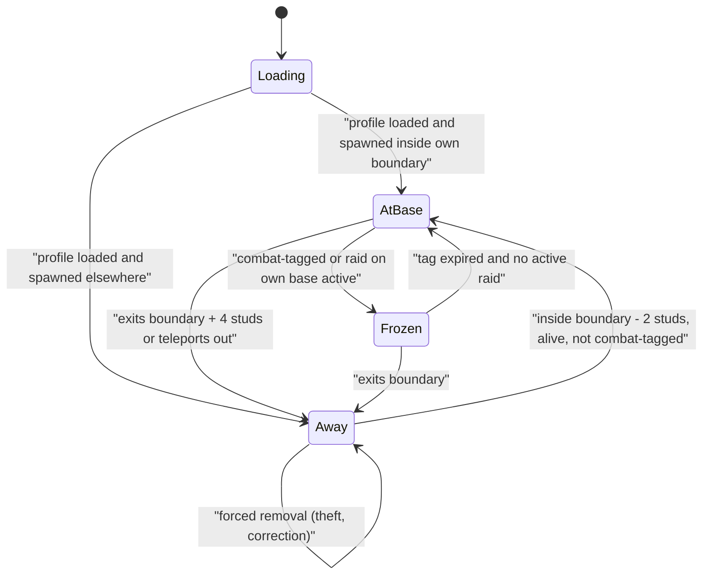

# Team Equipping and Base Lock Rule

> [!success] CONFIRMED (D-006, D-010)
> A player equips **exactly three** animals. The team can be changed **only at the player's own base**. It is **locked from the moment the player leaves the base until they return**.

> [!info] PROPOSED
> The technical definition of "at base", the boundary geometry, hysteresis, state machine, edge-case handling and the remote contract below are proposals for implementation by [[Service - TeamService]].

## 1. Why the rule exists

The base lock turns the team into an **expedition decision**. Before leaving home the player commits to three animals, for example a Tank, an Assassin and a Support for a boss attempt, or three fast Skirmishers for farming. Mid-trip, the player adapts through **target commands and manual abilities** ([[Targeting and Command System]]), not by swapping. This makes the base the strategic hub of the game ([[Vision Statement and Pillars]], Pillar 4).

## 2. Rule semantics

| # | Rule | Status |
|---|---|---|
| R1 | The team has exactly **3 slots**. | **CONFIRMED** (D-006) |
| R2 | A team edit (equip, unequip, reorder, swap) is accepted only while the server considers the player **At Base** at their **own** base. | **CONFIRMED** principle (D-010); definition **PROPOSED** |
| R3 | When the player leaves their base, the current team becomes the **locked team** until the player is At Base again. | **CONFIRMED** (D-010) |
| R4 | Being at another player's base (visiting or raiding) never counts as At Base. | **PROPOSED** (direct reading of "own base") |
| R5 | Team edits are frozen while the player is combat-tagged (8 s timeout, [[Canonical Proposed Values#4. Combat values (PROPOSED)]]), even inside the boundary. | **PROPOSED** |
| R6 | Team edits are frozen while a raid on the player's base is active. | **PROPOSED** (prevents swapping fresh defenders mid-raid; depends on [[Open Questions#Q-033]] and [[Open Questions#Q-035]]) |
| R7 | Slot order matters only for UI and hotkeys (ability keys 1–3). | **PROPOSED** |
| R8 | The server may **remove** an animal from a locked team when that animal stops being owned or eligible (theft, data correction). It never **adds** or **substitutes** an animal while locked. | **PROPOSED** |
| R9 | Ascension changes an animal's power, not team composition, so it is not a team edit. | **PROPOSED** |

> [!warning] UNDECIDED (Q-101)
> **Partial teams.** D-006 says exactly three are equipped. May a player who owns three or more eligible animals deliberately leave the base with fewer than three equipped? **Recommendation (PROPOSED):** allow it with a confirmation prompt ("You are leaving with 2 of 3 animals"), because forced auto-filling could equip an animal the player wants to keep safe in raids. Slots may be empty without a prompt when the player owns fewer than three eligible animals (for example in [[New Player Onboarding]]) or after a forced removal (R8).

> [!warning] UNDECIDED (Q-103)
> **Duplicate species in one team.** May the team contain two or three instances of the same species? **Recommendation (PROPOSED):** allow it; each instance is a separate owned animal ([[Animal Collection System]]). Revisit if a single species dominates boss metas.

## 3. The base boundary

### 3.1 Definition (PROPOSED)

The **base boundary** is the server-side volume of the player's plot, derived from plot data owned by [[Base Layout and Plot Expansion]]:

- An oriented box (`CFrame` + `Vector3` size) matching the current plot footprint, extended **40 studs upward** and **10 studs below** the plot floor.
- It grows automatically when plot expansion stages are purchased; it is recomputed from saved plot data, never from client geometry.
- It is a logic volume, not a physical wall. The visible plot edge (fence, banner line) should match it within 2 studs for readability ([[Base Art Direction]]).

### 3.2 Hysteresis

To avoid flickering at the edge:

| Transition | Condition (PROPOSED) |
|---|---|
| Away → At Base | Character root position is inside the boundary shrunk by **2 studs** on every horizontal face, **and** the character is alive, **and** not combat-tagged. |
| At Base → Away | Character root position is outside the boundary expanded by **4 studs** on every horizontal face, **or** the player teleports out, **or** the character is removed. |

### 3.3 What "leaving the base" means technically

The server evaluates presence on a throttled loop (**PROPOSED**: every 0.25 s per player, driven by `RunService.Heartbeat` with an accumulator) using `CFrame:PointToObjectSpace` against the boundary box. `Touched` events are **not** used because they are unreliable for fast or teleporting characters and can be spoofed by client-owned parts.

Leaving is detected by **any** of:
1. Position test fails the At Base → Away condition.
2. A server-initiated teleport moves the character elsewhere (portal, fast travel, raid entry, respawn at a non-base location).
3. The character is destroyed or the player leaves the server.

On leaving, the server writes `lockedAt` and `teamVersion` and summons the three companions ([[Animal Combat Behaviour]]).

## 4. State machine



| State | Team edits | Companions summoned |
|---|---|---|
| Loading | Rejected (`NOT_READY`) | No |
| AtBase | Accepted | Yes (they idle at base) |
| Frozen | Rejected (`IN_COMBAT` or `RAID_ACTIVE`) | Yes |
| Away | Rejected (`NOT_AT_BASE`) | Yes |

## 5. Edge cases

| # | Case | Handling (PROPOSED unless stated) |
|---|---|---|
| E1 | **Portal from hub to own base** | Arrival point is inside the shrunk boundary; state becomes AtBase on the next presence tick (≤ 0.25 s). The UI enables the Team button only after the server confirms. |
| E2 | **Fast travel / hub portals to regions** | Server teleport → Away immediately, team locked. |
| E3 | **"Return Home" action** | A 5-second channelled return that is cancelled by taking damage and unavailable while combat-tagged. This keeps the lock meaningful: you cannot swap mid-fight by teleporting. Exact timing is a proposal for [[UI - Main HUD]] and [[Player Base System]]. |
| E4 | **Death / knock-out of the player** | Respawn location depends on battle type ([[Player Defeat and Penalties]], penalties **UNDECIDED** [[Open Questions#Q-014]]). Lock state simply follows the respawn position: respawning at base unlocks, respawning at a checkpoint keeps the lock. No special case is needed. |
| E5 | **Companion knocked out in the wild** | The animal stays in its slot (knocked out is a combat state, not an ownership change). Revive rules are in [[Combat States and State Machine]]. |
| E6 | **Disconnect while Away** | The saved team is unchanged. On rejoin the player spawns at their normal spawn; if that is their base, they are AtBase. A disconnect therefore never gives an advantage beyond what Return Home already offers, and in-progress boss fights or raids are forfeited under their own rules ([[Disconnect Handling]], [[Raid Disconnection Handling]]). |
| E7 | **Disconnect during a team edit** | Edits are a single atomic request (§6). Either the whole new team is saved or none of it is. |
| E8 | **Equipped animal stolen in a raid** | The thief can only take a defender that was knocked out (D-024). If that animal was equipped, the server removes it from its slot (R8), increments `teamVersion`, despawns its companion model and notifies the player. The empty slot can be refilled only at base, after any raid freeze (R6) ends. Whether equipped animals defend at all, and what a stolen animal keeps, are **UNDECIDED** ([[Open Questions#Q-033]], [[Open Questions#Q-025]]). |
| E9 | **PvP** | No special handling: the team is locked as usual while Away. Animals knocked out in PvP are never transferred ([[PvP System]]). |
| E10 | **Equipped animal selected as ascension duplicate** | **Blocked.** The server excludes equipped instances from the duplicate set and returns `ANIMAL_EQUIPPED`. The UI greys them out with "Unequip at base first" ([[UI - Ascension]]). The ascension *target* may be equipped; its new stats apply immediately if out of combat, otherwise when the combat tag expires. |
| E11 | **Ascension attempted Away from base** | Allowed or not according to [[Ascension System]]. Either way E10 applies, so ascension can never remove a locked team member. |
| E12 | **Released or otherwise removed animal** | If any removal feature exists, equipped animals are excluded, identical to E10. |
| E13 | **Plot expansion while standing at the edge** | Boundary is recomputed on purchase; presence re-evaluated on the next tick. Can only turn Away into AtBase, never the reverse, because plots only grow. |
| E14 | **Base being raided while owner is Away** | Owner's team stays locked; raids require the owner online (D-024). Return Home during a raid follows the raid rules in [[Raid Lifecycle and States]]. |
| E15 | **Same instance in two slots** | Rejected (`DUPLICATE_INSTANCE`). |
| E16 | **Animal not owned / pending transfer** | Rejected (`NOT_OWNED`). Instances locked in an in-flight transaction (ascension, theft) are rejected (`ANIMAL_BUSY`). |
| E17 | **Server shutdown** | `game:BindToClose` saves the team with the profile ([[Save, Load and Recovery]]). |
| E18 | **Exploit: client moves its character into the boundary** | Presence uses the server-side character position; movement anomalies are handled by [[Exploit Prevention]]. Even a successful position spoof only grants what walking home would. |

## 6. Server enforcement

### 6.1 Remote contract (PROPOSED)

| Remote | Type | Payload | Response |
|---|---|---|---|
| `Team.RequestSetTeam` | RemoteFunction | `{ slots = { uid1?, uid2?, uid3? }, expectedVersion = number }` | `{ ok = bool, code = string, teamVersion = number }` |
| `Team.StateChanged` | RemoteEvent (server → client) | `{ state = "AtBase" or "Away" or "Frozen" or "Loading", reason = string }` | — |
| `Team.SlotRemoved` | RemoteEvent (server → client) | `{ slot = 1-3, uid = string, reason = "STOLEN" or "CORRECTION" }` | — |

Full conventions: [[Remote Communication Contract]]. Rate limit: 4 requests per 2 s per player ([[Implementation - Rate Limiting]]).

### 6.2 Validation order

1. Player profile loaded (`NOT_READY`).
2. Rate limit (`RATE_LIMITED`).
3. Payload shape: table with at most 3 entries; each entry nil or a string UID ([[Implementation - Remote Validation Layer]]).
4. `expectedVersion == teamVersion` (`STALE_VERSION`), so two quick edits cannot race.
5. Presence state is AtBase (`NOT_AT_BASE`, `IN_COMBAT`, `RAID_ACTIVE`).
6. Each UID owned, not busy, not duplicated (`NOT_OWNED`, `ANIMAL_BUSY`, `DUPLICATE_INSTANCE`).
7. Partial-team rule per Q-101 (`PARTIAL_TEAM_CONFIRM_REQUIRED` if a confirmation flag is adopted).
8. Write the team atomically to the session profile; increment `teamVersion`; persist via [[Service - DataService]].
9. Respawn companion models to match.

### 6.3 Illustrative Luau

```lua
-- Illustrative Luau only. Not executed in Roblox Studio.
local function isInsideBoundary(boundaryCFrame: CFrame, size: Vector3, position: Vector3, margin: number): boolean
	local localPos = boundaryCFrame:PointToObjectSpace(position)
	local half = size / 2
	return math.abs(localPos.X) <= half.X + margin
		and math.abs(localPos.Z) <= half.Z + margin
		and localPos.Y >= -half.Y and localPos.Y <= half.Y
end

function TeamService:RequestSetTeam(player: Player, payload)
	local session = self.Sessions[player]
	if not session or not session.Loaded then return { ok = false, code = "NOT_READY" } end
	if not RateLimiter:Allow(player, "Team.RequestSetTeam") then return { ok = false, code = "RATE_LIMITED" } end
	if typeof(payload) ~= "table" or typeof(payload.slots) ~= "table" or #payload.slots > 3 then
		return { ok = false, code = "BAD_PAYLOAD" }
	end
	if payload.expectedVersion ~= session.Team.Version then
		return { ok = false, code = "STALE_VERSION", teamVersion = session.Team.Version }
	end
	if session.Presence ~= "AtBase" then
		return { ok = false, code = session.PresenceReason or "NOT_AT_BASE" }
	end
	local seen = {}
	for slot = 1, 3 do
		local uid = payload.slots[slot]
		if uid ~= nil then
			if typeof(uid) ~= "string" then return { ok = false, code = "BAD_PAYLOAD" } end
			if seen[uid] then return { ok = false, code = "DUPLICATE_INSTANCE" } end
			seen[uid] = true
			local animal = session.Collection[uid]
			if not animal then return { ok = false, code = "NOT_OWNED" } end
			if animal.BusyTransaction then return { ok = false, code = "ANIMAL_BUSY" } end
		end
	end
	session.Team.Slots = { payload.slots[1], payload.slots[2], payload.slots[3] }
	session.Team.Version += 1
	self:RespawnCompanions(player)
	return { ok = true, code = "OK", teamVersion = session.Team.Version }
end
```

Data layout: [[Schema - Equipped Team]].

## 7. UX requirements (summary)

- The Team button on [[UI - Main HUD]] shows a lock icon when Away, with the tooltip "Team changes only at your base".
- Entering the base plays a short unlock cue ([[Sound - UI Feedback]]); leaving plays a lock cue and briefly shows the three locked portraits ([[UI - Animal Team Display]]).
- Team editing happens in [[UI - Team Selection]].

## 8. Test hooks

| ID | Test | Expected |
|---|---|---|
| TB-01 | Edit team at own base, idle | `OK`, version +1 |
| TB-02 | Edit team 1 stud outside the boundary | `NOT_AT_BASE` |
| TB-03 | Walk back and forth across the edge 20 times | No state flicker within the 2/4-stud hysteresis band |
| TB-04 | Edit while combat-tagged inside boundary | `IN_COMBAT` |
| TB-05 | Two edits sent with the same `expectedVersion` | First `OK`, second `STALE_VERSION` |
| TB-06 | Equip an instance being consumed by ascension | `ANIMAL_BUSY` |
| TB-07 | Select an equipped animal as ascension duplicate | `ANIMAL_EQUIPPED` |
| TB-08 | Equipped defender stolen in a raid | Slot emptied, `Team.SlotRemoved` fired, version +1 |
| TB-09 | Edit while at another player's base | `NOT_AT_BASE` |
| TB-10 | Disconnect mid-request | Team is either fully old or fully new on rejoin |

Full cases: [[Test Cases - Inventory and Storage]], [[Test Cases - Raiding]], [[Test Cases - Exploit Prevention]].

## Related documents
- [[Core Gameplay Index]]
- [[Service - TeamService]]
- [[Schema - Equipped Team]]
- [[UI - Team Selection]]
- [[Player Base System]]
- [[Animal Theft Rules]]
- [[Ascension System]]
- [[Animal Collection System]]
