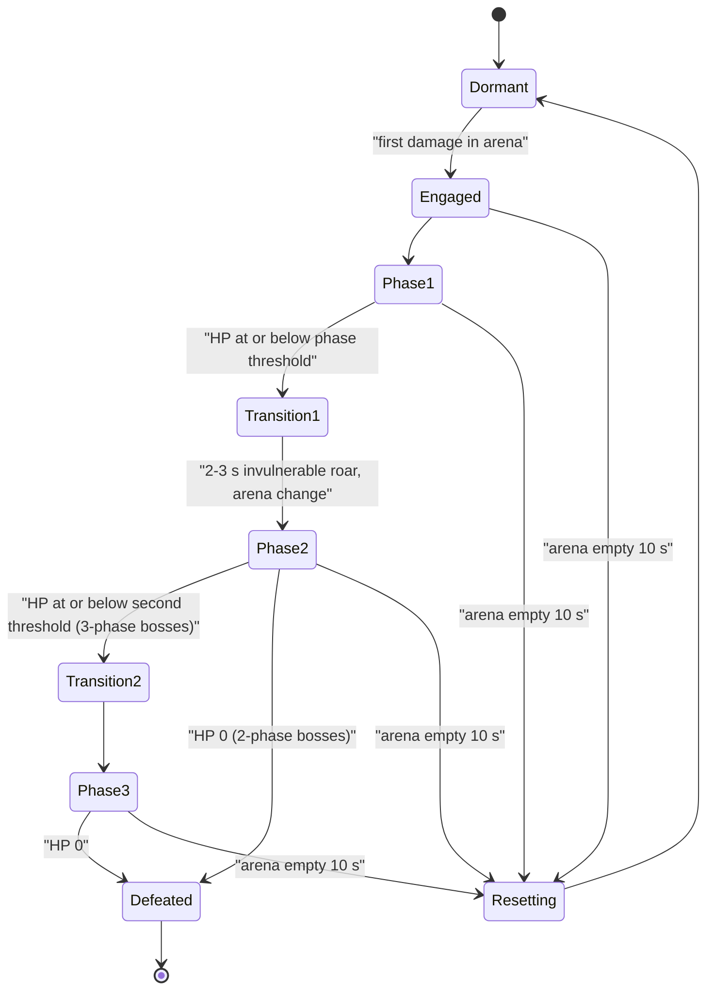

# Boss Design Overview

> [!success] CONFIRMED (D-012)
> Mini-bosses and world bosses exist. Defeat consequences vary by battle type (D-013); exact penalties are **UNDECIDED** ([[Open Questions#Q-014]]).

> [!warning] UNDECIDED (Q-015)
> **Boss rewards are not decided.** Every boss document lists reward *options* only. See [[Boss Rewards]].

> [!info] PROPOSED
> The boss roster, stat formula, scaling, credit thresholds, telegraph standard and encounter rules below are proposals. New values introduced here (boss stat coefficients, scaling coefficients, credit thresholds, enrage and despawn timers) are pending addition to [[Canonical Proposed Values]].

## 1. Roster

| ID | Boss | Type | Base animal | Region / arena | Rec. level | Phases |
|---|---|---|---|---|---:|---:|
| BOS-01 | [[Mini-Boss - Bramblehorn]] | Mini | Bramble-antlered giant stag | Whisperwood Forest / Thornheart Hollow | 8–10 | 2 |
| BOS-02 | [[Mini-Boss - Dustmane]] | Mini | Elder lion | Sunscorch Savanna / Sunstone Kopje | 16–20 | 2 |
| BOS-03 | [[Mini-Boss - Vinecoil]] | Mini | Vine-wrapped giant python | Emerald Canopy / Strangler's Cenote | 26–30 | 2 |
| BOS-04 | [[Mini-Boss - Hammertide]] | Mini | Giant hammerhead shark | Coral Coast / Breakwater Lagoon | 36–42 | 2 |
| BOS-05 | [[Mini-Boss - Rimeback]] | Mini | Ice-crusted giant polar bear | Frostfang Tundra / Glacier Maw | 48–54 | 2 |
| BOS-06 | [[Mini-Boss - Stormtalon]] | Mini | Storm-feathered giant eagle | Skyreach Peaks / Thunderspire | 60–66 | 2 |
| BOS-07 | [[Mini-Boss - Cinderjaw]] | Mini | Ember-scaled giant crocodile | Emberheart Caldera / Magma Basin | 74–80 | 2 |
| BOS-08 | [[Mini-Boss - Eclipse Panther]] | Mini (capstone) | Celestial black panther | Starfall Sanctuary / Umbral Observatory | 90–100 | 3 |
| BOS-09 | [[World Boss - Ironbark Colossus]] | World | Ancient tortoise with a forest on its shell | Rootfall Crossing (Whisperwood–Savanna) | 15 | 3 |
| BOS-10 | [[World Boss - Thunderhoof]] | World | Colossal storm elephant | Thunderflats (Savanna) | 30 | 3 |
| BOS-11 | [[World Boss - Abyssal Leviathan]] | World | Giant whale | Leviathan's Maw (Coral Coast) | 45 | 3 |
| BOS-12 | [[World Boss - Ashwing Condor]] | World | Ember-feathered giant condor | Ashen Rim (Skyreach–Emberheart) | 70 | 3 |

Boss base animals are **boss-only creatures** inspired by real animals. They are not hatchable, do not appear in hatch pools and do not have Animal Index species entries ([[Animal Index Feature Specification]]).

## 2. Mini-bosses versus world bosses

| Aspect | Mini-boss | World boss |
|---|---|---|
| Purpose | Region gate key; skill check for one region's lesson | Shared spectacle; group content; Starfall gate input |
| Spawn | Always present; respawns 10 min after defeat per server (canonical) | Timed: 45 / 50 / 55 / 60 min per boss per server, announced 2 min ahead (canonical) |
| Designed for | Solo at recommended level; faster in groups | Groups of 3–8; possible solo but long |
| Target solo time-to-kill | 60–120 s at recommended level (**PROPOSED**) | About 5 min at recommended level (**PROPOSED**) |
| Target group time-to-kill | 40–80 s (4 players) | 2–3 min (6 players) |
| Lifetime if undefeated | Persistent | Retreats after 900 s (**PROPOSED**) |
| Reward eligibility | Once per player per spawn (canonical) | Once per player per spawn (canonical) |
| Progression Score | +10 PS on first unique defeat (8 max) | +20 PS on first unique defeat (4 max) |

## 3. Stat model (PROPOSED)

Bosses do **not** use the wild multipliers (HP ×2.0, ATK ×0.75). Instead:

```
BossHP  = 200 × kHP  × E
BossATK = 20  × kATK × E
BossDEF = 10  × kDEF            (not scaled by region)
```

- 200, 20 and 10 are the Common reference stats ([[Canonical Proposed Values#3. Animal stat model (PROPOSED)]]).
- **E** is the encounter multiplier. For mini-bosses, E is the region multiplier. For world bosses, E is the multiplier of the region whose recommended band contains the boss's recommended level (the lower one where bands overlap), so world bosses outside their host region's band stay relevant: Ironbark (L15) uses ×1.5, Thunderhoof (L30) ×2.2, Abyssal Leviathan (L45) ×4.5, Ashwing Condor (L70) ×8.5.
- Damage uses the canonical formula `ATK × SkillMultiplier × (100 / (100 + DEF_target)) × Random(0.95, 1.05)` ([[Damage, Defence and Health Model]]).

| Boss | E | kHP | kATK | kDEF | HP (solo) | ATK | DEF | Basic hit vs rec.-level player |
|---|---:|---:|---:|---:|---:|---:|---:|---|
| Bramblehorn | 1.0 | 36 | 2.4 | 3.0 | 7,200 | 48 | 30 | ~22% of max HP (L9) |
| Dustmane | 1.5 | 34 | 2.6 | 3.0 | 10,200 | 78 | 30 | ~23% (L18) |
| Vinecoil | 2.2 | 35 | 2.3 | 2.8 | 15,400 | 101 | 28 | ~20% (L28) |
| Hammertide | 3.2 | 30 | 2.6 | 2.5 | 19,200 | 166 | 25 | ~24% (L40) |
| Rimeback | 4.5 | 40 | 2.3 | 3.8 | 36,000 | 207 | 38 | ~22% (L52) |
| Stormtalon | 6.2 | 30 | 2.4 | 2.4 | 37,200 | 298 | 24 | ~26% (L64) |
| Cinderjaw | 8.5 | 38 | 2.3 | 3.4 | 64,600 | 391 | 34 | ~27% (L78) |
| Eclipse Panther | 11.5 | 36 | 2.2 | 3.0 | 82,800 | 506 | 30 | ~27% (L95) |
| Ironbark Colossus | 1.5 | 120 | 2.6 | 4.5 | 36,000 | 78 | 45 | ~26% (L15) |
| Thunderhoof | 2.2 | 110 | 3.0 | 4.0 | 48,400 | 132 | 40 | ~25% (L30) |
| Abyssal Leviathan | 4.5 | 125 | 2.5 | 3.6 | 112,500 | 225 | 36 | ~28% (L45) |
| Ashwing Condor | 8.5 | 100 | 2.3 | 3.2 | 170,000 | 391 | 32 | ~30% (L70) |

Player HP and DEF at the recommended level come from `HP = 100 + 12 × (L − 1)` and `DEF = 5 + 0.5 × (L − 1)`.

### 3.1 Damage budget

| Attack tier | SkillMultiplier range | Max share of a rec.-level player's HP | Minimum telegraph |
|---|---|---|---|
| Light (basic) | 0.8–1.2 | ~30% | 0.5 s |
| Heavy | 1.8–2.0 | ~60% | 0.9 s |
| Signature | 2.2–2.4 | ~72% | 1.5 s |
| Ultimate (phase move) | ≤ 2.5 | **75% hard cap** | 2.5 s with roar or voice cue |

Rule: **no single boss attack can knock out a full-HP player at the recommended level.** Repeated failure to dodge should knock out; a single mistake should not.

### 3.2 Worked example: Bramblehorn solo at level 9

Player Strength 26; three-hit combo averages Strength × 1.0 per 0.45 s ≈ 58 raw DPS. Three Common companions add about 55 raw DPS. Total ≈ 113 × `100 / (100 + 30)` ≈ 87 effective DPS → 7,200 / 87 ≈ **83 s**, inside the 60–120 s target, before specials and downtime from dodging.

## 4. Multiplayer scaling (PROPOSED)

| Boss type | Max HP with N participants | N cap |
|---|---|---:|
| Mini-boss | `BaseHP × (1 + 0.40 × (N − 1))` | 8 |
| World boss | `BaseHP × (1 + 0.45 × (N − 1))` | 16 |

- **Participant:** a player inside the arena boundary who has dealt damage or healing to the fight in the last 20 s.
- N is recomputed every 5 s. On rescale the boss keeps its **current HP percentage**, so joining or leaving never grants a free chunk of HP or a free kill.
- ATK does not scale; groups face the same per-hit danger, split across more targets.
- Adds (where present) scale in count, not stats: +1 add per 3 participants beyond the first.

## 5. Credit and eligibility (PROPOSED)

| Rule | Mini-boss | World boss |
|---|---|---|
| Credit threshold | ≥ 5% of current scaled max HP contributed | ≥ 2.5% |
| Time alternative (for Supports and Controllers) | In the arena and in combat for ≥ 50% of the fight | In the arena and in combat for ≥ 60 s |
| Healing and shielding by the player's animals | Counts 1:1 towards the threshold | Same |
| Knocked out during the fight | Contribution kept if the boss falls before it resets | Same |
| Gate and PS credit | Recorded permanently on first credited defeat | Same |
| Reward eligibility | Once per player per spawn (canonical) | Same |

The wild-animal threshold is 10% (D-040 **PROPOSED**); bosses use lower thresholds so groups of up to 8 (mini) or 16 (world) can all earn credit.

## 6. Encounter rules (PROPOSED)

| Rule | Detail |
|---|---|
| Arena boundary | Each boss has a bounded arena (tagged `BossArena`). Bosses never leave it; they use the arena instead of the 60-stud wild leash. |
| Reset | If no participant is inside the arena for 10 s, the boss returns to its spawn point, regenerates to full HP and resets phases. A reset is not a defeat and does not start the 10-minute respawn. |
| Soft enrage (mini-bosses) | After 300 s in combat: +10% ATK every 30 s, maximum +100%. Prevents endless kiting. |
| Retreat (world bosses) | 900 s after spawning, an undefeated world boss retreats with an animation; no rewards. The next cadence timer starts at retreat. |
| Combat tag | Being in a boss arena with an engaged boss keeps the player combat-tagged, so Return Home and team edits are blocked ([[Team Equipping and Base Lock Rule]]). |
| Hazards | Ambient hazards are disabled inside arenas; bosses bring their own hazard attacks, which can knock out ([[Environmental Hazards]] H3). |
| PvP | Disabled inside boss arenas (**PROPOSED**) to prevent griefing. |
| Defeat | Knock-outs follow [[Player Defeat and Penalties]]; penalties are **UNDECIDED** ([[Open Questions#Q-014]]). Proposed respawn point: the region Waystone, with a run-back of under 30 s. |

## 7. Telegraph standard

| Colour (decal) | Meaning |
|---|---|
| Orange | Standard damage |
| Red with pulsing rim | Heavy or signature damage |
| Purple | Control (stun, root, pull, knock-up) |
| Gold ring | Safe zone (stand here) |
| Blue-white | Reserved for ambient hazards; never used by bosses |

Shapes are always one of: circle, cone, line, ring (donut), arena-wide. Every telegraph also has a distinct animation wind-up and audio cue ([[Animation - Boss Attacks]], [[Sound - Bosses]]), so colour is never the only signal ([[UI Accessibility Standards]]). Authored telegraph times include a 150 ms latency allowance ([[Latency Handling]]).

## 8. Phase framework



Two-phase bosses transition at 50% HP; three-phase bosses at 66% and 33%. Transitions are short, invulnerable, and always change something the player can see (arena, attack set or weak points). Behaviour logic is implemented by [[Boss AI]] and [[Service - BossService]].

## 9. Rewards (UNDECIDED, Q-015)

Option families for every boss (none chosen):

| Option | Description | Notes |
|---|---|---|
| R1. Cash | Lump sum scaled by E | Simple; feeds rolls and modules |
| R2. XP | Lump sum scaled by E | Eases level gates |
| R3. Egg | An egg of a fixed rarity per boss tier | The rarity is fixed (not random); the hatch is random from that pool with disclosed odds at hatch time |
| R4. Trophy | First-defeat trophy for the [[Module - Trophy Hall]] (+1% Cash per unique trophy, max 12%, canonical module effect) | Twelve bosses match the 12% maximum |
| R5. Cosmetic | Title, base decoration, emote | No power |
| R6. Combination | First defeat: trophy + cosmetic; repeat defeats: Cash/XP | **Recommendation (PROPOSED)** for discussion only |

Each boss document lists the same families with boss-specific notes. See [[Boss Rewards]] and [[Combat Rewards]].

## 10. Spawn and announcement (PROPOSED)

- World boss announcements: 2 minutes ahead, server-wide banner, World Boss Board countdown in [[Hub - Hatchling Haven]], and a compass marker ([[UI - Notifications]]).
- The four world bosses run independent timers from server start with random initial offsets, so overlaps are possible but rare.
- Boss models and arena dressing preload when the announcement fires.

## 11. Shared test hooks

| ID | Test | Expected |
|---|---|---|
| BS-01 | Solo at recommended level, scripted average play | TTK within target band |
| BS-02 | 4 players join one by one | Max HP rescales, current HP % preserved |
| BS-03 | Player deals 4.9% to a mini-boss | No credit |
| BS-04 | All players leave arena for 10 s | Reset to full HP, no respawn timer |
| BS-05 | Full-HP rec.-level player takes the strongest attack | Survives (≤ 75% max HP) |
| BS-06 | Mini-boss fight lasts 330 s | ATK +10% applied once |

Full cases: [[Test Cases - Bosses]].

## Related documents
- [[World Design Index]]
- [[Boss AI]]
- [[Boss Art Direction]]
- [[Animation - Boss Attacks]]
- [[Sound - Bosses]]
- [[UI - Boss Health Bar]]
- [[Boss Rewards]]
- [[M17 - Boss Encounters]]
