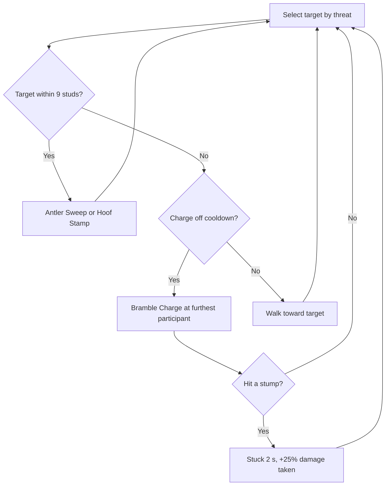

# Mini-Boss - Bramblehorn

| Field | Value |
|---|---|
| Asset ID | BOS-01 |
| Type | Mini-boss (2 phases) |
| Base animal | Giant stag with antlers of living bramble |
| Region / arena | [[Region - Whisperwood Forest]] / Thornheart Hollow |
| Recommended level | 8–10 |
| Gate role | Key for [[Region - Sunscorch Savanna]] (with level 8) |
| Respawn | 10 min after defeat, per server (canonical) |
| Status | **PROPOSED** (rewards **UNDECIDED**, [[Open Questions#Q-015]]) |

## 1. Concept

Bramblehorn is the old guardian of Whisperwood: a towering stag whose antlers have grown into a crown of thorny vines and blossoms. It is the player's **first boss** and its lesson is the most important in the game: **read the telegraph, dodge, punish**. Its charge can be baited into tree stumps, rewarding positioning over raw stats. The tone is majestic and grumpy, never frightening ([[Boss Art Direction]]).

## 2. Arena: Thornheart Hollow

- Circular grove, **70-stud radius**, bounded by a bramble wall (the `BossArena` boundary).
- Four **ancient stumps** (6 studs tall, 8 wide) placed at roughly 40 studs from the centre. A Bramble Charge that hits a stump stops and leaves Bramblehorn **stuck for 2.0 s** (takes +25% damage while stuck).
- A low mossy rise at the centre gives slight elevation; no other cover.
- In phase 2 the bramble wall closes inward to a 60-stud radius.
- Ambient hazards are disabled inside the arena ([[Environmental Hazards]] rules).

## 3. Stats (PROPOSED)

From [[Boss Design Overview]]: `HP = 200 × 36 × 1.0`, `ATK = 20 × 2.4 × 1.0`, `DEF = 10 × 3.0`.

| Stat | Value | Note |
|---|---:|---|
| Max HP (solo) | 7,200 | Scales `× (1 + 0.40 × (N − 1))`, N ≤ 8 |
| ATK | 48 | Not scaled by participants |
| DEF | 30 | Damage taken × 0.77 |
| Move speed | 14 studs/s (walk), 40 studs/s (charge) | |
| Soft enrage | After 300 s: +10% ATK per 30 s, max +100% | |

Target solo time-to-kill at level 9: about 80–90 s ([[Boss Design Overview]] worked example).

## 4. Phases

| Phase | HP range | Behaviour change | Transition |
|---|---|---|---|
| 1: Guardian | 100–50% | Melee sweeps, single charges, stamps | At 50%: 2.5 s invulnerable roar; antlers bloom with thorns; wall closes to 60 studs |
| 2: Thornbloom | 50–0% | Adds bramble patches, thorn volleys and double charges | — |

## 5. Attack list

Damage percentages are of a level 9 player's max HP (196 HP, DEF 9).

| Attack | Phase | Tier | Skill mult. | Shape | Telegraph (wind-up) | Active / recovery | Approx. damage | Counterplay |
|---|---|---|---:|---|---|---|---|---|
| Antler Sweep | 1, 2 | Light | 1.0 | Cone 120°, 9 studs | 0.5 s orange cone, head lowers | 0.3 s / 0.6 s | ~22% | Step behind or dodge |
| Hoof Stamp | 1, 2 | Light | 1.2 | Circle 10 studs on self | 0.7 s orange circle, front hooves rise | 0.2 s / 0.8 s | ~27% | Leave the circle |
| Bramble Charge | 1, 2 | Heavy | 1.9 | Line 40 × 6 studs to the furthest target within 40 studs | 0.9 s red line, scrapes ground twice | 1.0 s / 1.2 s (2.0 s stuck if it hits a stump) | ~42% | Dodge sideways; stand in front of a stump to bait it |
| Rooting Bellow | 2 | Control | 0.8 | Ring 4–15 studs around self | 1.2 s purple ring, chest swells | 0.3 s / 1.0 s | ~18% + root 1.0 s | Hug the boss or leave the ring |
| Thornbloom | 2 | Zone | — | 3 circles 6 studs at random players' positions | 1.5 s purple decals sprout | Patches persist 20 s | −30% move speed inside | Move out; avoid fighting in patches |
| Briar Crown Volley | 2 | Signature | 2.2 | 5 circles 6 studs (one on each player, rest random) | 1.5 s red circles, antlers glow | 0.4 s / 1.0 s | ~49% | Dodge out; spread out in groups |
| Double Charge | 2 | Heavy | 1.9 ×2 | Two lines, second re-aimed | 0.9 s each | 1.0 s each / 1.5 s | ~42% each | Bait both into stumps |

Ultimate: none (first boss teaches fundamentals only).

## 6. AI behaviour summary

General behaviour is defined in [[Boss AI]]. Bramblehorn-specific:
- **Target selection:** highest threat (damage + 0.5 × healing in the last 10 s). Tank companions add a threat bonus (role intent in [[Animal Roles]]).
- **Charge targeting:** every 10–12 s, picks the **furthest** participant within 40 studs, rewarding a player who deliberately baits from in front of a stump.
- **Ability rotation (P1):** Sweep / Stamp at melee range, Charge on cooldown; never two heavy attacks within 2 s of each other.
- **P2 rotation:** Thornbloom every 15 s, Volley every 18 s, Bellow when 3+ targets are within 10 studs.
- **Reset:** arena empty for 10 s → returns to centre, full HP.

## 7. Multiplayer scaling

- Max HP: 7,200 solo, 10,080 (2 players), 15,840 (4), 27,360 (8, cap).
- Thornbloom adds +1 patch per 3 participants beyond the first.
- Credit: ≥ 5% of current scaled max HP ([[Boss Design Overview]]).

## 8. Rewards (UNDECIDED, Q-015)

> [!warning] UNDECIDED
> No rewards are decided ([[Open Questions#Q-015]], [[Boss Rewards]]). Options:
> - R1 Cash or R2 XP scaled by E = 1.0.
> - R3 a fixed-rarity egg (for example Common or Uncommon) with the hatch drawn from that pool.
> - R4 first-defeat trophy for the [[Module - Trophy Hall]].
> - R5 cosmetic (for example a "Thornbreaker" title).
>
> Confirmed effects of a first credited defeat regardless of rewards: Savanna gate key, +10 PS ([[Progression Score Specification]]).

## 9. Defeat penalties

Knock-outs follow [[Player Defeat and Penalties]] (values **UNDECIDED**, [[Open Questions#Q-014]]). **PROPOSED:** respawn at the Elderglen Waystone (about 20 s run-back); contribution retained if the boss is defeated before it resets.

## 10. Visual, animation, VFX and sound notes

| Area | Notes |
|---|---|
| Model | Low-poly stag, chunky silhouette; antlers as bramble with pink blossoms; P2 swaps to a thorn-crown antler mesh ([[Boss Art Direction]]) |
| Animation | Head-lower for Sweep, two ground scrapes before Charge, rear-up for Stamp, chest swell for Bellow, stuck "antlers in stump" struggle loop ([[Animation - Boss Attacks]]) |
| VFX | Petal burst on hits, thorn decals, dust trail on charge, blossom-to-thorn transformation at 50% ([[VFX - Combat Effects]]) |
| Sound | Deep bugle call at engage and transition; distinct wind-up cues per attack; wood crack when hitting a stump ([[Sound - Bosses]]) |
| UI | Health bar with a 50% phase tick ([[UI - Boss Health Bar]]) |

## 11. Test hooks

- Charge into stump → 2.0 s stuck and +25% damage taken.
- Level 9 scripted solo → TTK 60–120 s.
- Volley on a full-HP level 9 player → survives (≤ 75%).
- Four players join → max HP 15,840, HP % preserved.

## Related documents
- [[Boss Design Overview]]
- [[Region - Whisperwood Forest]]
- [[Region Unlock Progression]]
- [[Boss AI]]
- [[Test Cases - Bosses]]
