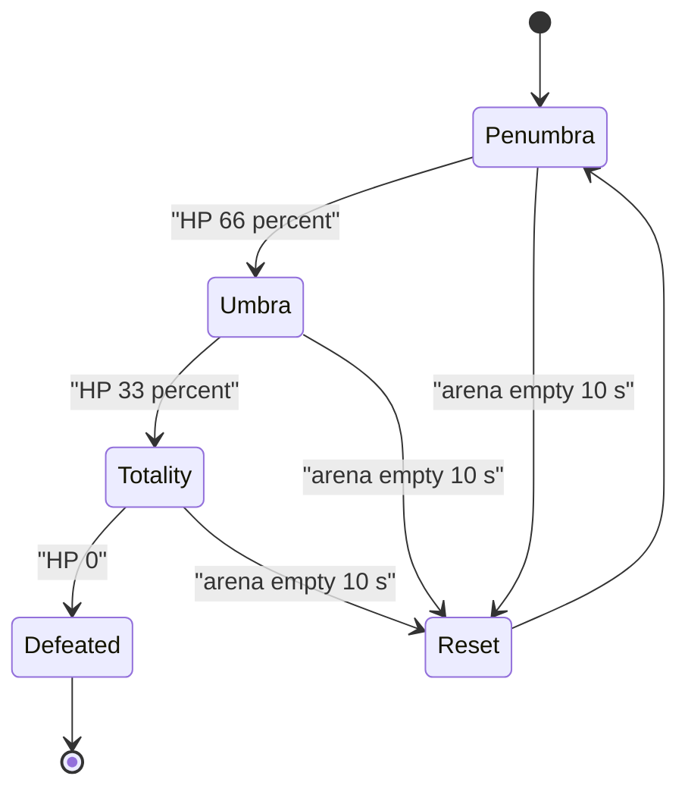

# Mini-Boss - Eclipse Panther

| Field | Value |
|---|---|
| Asset ID | BOS-08 |
| Type | Mini-boss, capstone (3 phases) |
| Base animal | Celestial black panther wreathed in an eclipse corona |
| Region / arena | [[Region - Starfall Sanctuary]] / Umbral Observatory |
| Recommended level | 90–100 |
| Gate role | None at launch (capstone) |
| Respawn | 10 min after defeat, per server |
| Status | **PROPOSED** (rewards **UNDECIDED**, [[Open Questions#Q-015]]) |

## 1. Concept

The guardian of the Sanctuary's observatory is a sleek black panther whose silhouette is outlined by a burning silver corona, like the sun behind the moon. It moves between light and shadow, splits into afterimages and finally darkens the dome into a total eclipse. It is the **hardest mini-boss** and the only one with three phases. Its lesson tests everything: dodging, **manual target commands** (finding the real panther among clones), positioning and team composition.

## 2. Arena: Umbral Observatory

- Domed observatory floor, **70-stud radius**, with a central telescope pillar (10 studs wide, blocks line of sight).
- The floor is a star chart; constellations light up under attack telegraphs, keeping them readable on the dark surface.
- The dome's oculus projects a **moving beam of moonlight** (12-stud circle) used as the safe zone for Total Eclipse.
- In phase 3 the environment lighting darkens; **telegraphs and characters keep full brightness** (darkness never hides threats, [[UI Accessibility Standards]]).

## 3. Stats (PROPOSED)

`HP = 200 × 36 × 11.5`, `ATK = 20 × 2.2 × 11.5`, `DEF = 10 × 3.0`.

| Stat | Value |
|---|---:|
| Max HP (solo) | 82,800 |
| ATK | 506 |
| DEF | 30 |
| Move speed | 22 studs/s; Umbral Dash 60 studs/s |
| Soft enrage | After 300 s: +10% ATK per 30 s, max +100% |

> [!warning] Balance risk
> At ×11.5 the solo time-to-kill may exceed the 60–120 s mini-boss target. Validate with [[Balance Simulation Plan]] before approval.

## 4. Phases

| Phase | HP range | Behaviour | Transition |
|---|---|---|---|
| 1: Penumbra | 100–66% | Pounces, claw flurries, Umbral Dash trails | At 66%: 2.5 s; the corona flares and the panther splits into afterimages |
| 2: Umbra | 66–33% | Eclipse Clones mimic attacks; Starfall Pounce | At 33%: 3.0 s; the dome darkens; the moonbeam begins to move |
| 3: Totality | 33–0% | Corona Rings, Total Eclipse every 45 s | — |

## 5. Attack list

Damage percentages are of a level 95 player's max HP (1,228 HP, DEF 52); one SkillMultiplier point ≈ 27.1%.

| Attack | Phase | Tier | Skill mult. | Shape | Telegraph | Active / recovery | Approx. damage | Counterplay |
|---|---|---|---:|---|---|---|---|---|
| Claw Flurry | 1–3 | Light | 0.6 ×3 | Cone 90°, 9 studs, three hits | 0.5 s orange cone | 0.9 s / 0.6 s | ~16% per hit | Dodge after the first hit |
| Shadow Pounce | 1–3 | Heavy | 1.9 | Circle 8 studs at the landing point | 0.9 s red circle, crouch with corona dimming | 0.5 s / 1.0 s | ~51% | Move out; punish on landing |
| Umbral Dash | 1–3 | Control | 0.8 | Line 40 × 4 studs; leaves a shadow trail for 6 s | 1.0 s purple line | 0.4 s / 0.8 s | ~22% + trail slow (−30% move speed) | Sidestep; do not fight in trails |
| Eclipse Clones | 2 | Mechanic | 0.5 × source | 2 afterimages (+1 per 3 extra participants) copy the real panther's attacks with a 0.4 s delay | 1.5 s split animation | Clones last until the next phase or until hit for 2% of boss max HP each | Clone attacks at half damage | The real panther has a **bright corona glint**; issue a target command on it ([[Targeting and Command System]]) |
| Starfall Pounce | 2, 3 | Signature | 2.2 | 3 sequential circles 8 studs on separate targets | 1.5 s red circles, star-trail preview | 1.2 s / 1.2 s | ~60% per hit | Dodge each circle as it lands |
| Corona Rings | 3 | Signature | 2.2 | Expanding ring (donut) from the panther, 3 waves | 1.5 s red ring with a visible gap | 2.0 s / 1.0 s | ~60% per ring | Dodge roll through each ring or stand in the gap |
| Total Eclipse | 3 | Ultimate | 2.4 | Arena-wide except the moonbeam (12-stud circle) | 2.5 s screen-edge silver glow, dome goes dark | 1.0 s / 3.0 s | ~65% | Stand in the moving moonbeam; the gold outline stays visible |

## 6. AI behaviour summary

General system: [[Boss AI]].
- **Target selection:** highest threat, but Shadow Pounce prefers a Ranged or Support companion's position (it hunts the backline), so Tank companions and the player must peel ([[Animal Roles]]).
- **Clone logic (P2):** clones choose different targets from the real panther; their attacks are always telegraphed with the same shapes but a silver (not red) rim, so players can tell danger levels apart at a glance.
- **Moonbeam (P3):** moves along a fixed constellation path at 4 studs/s; the next position is previewed by a faint trail 5 s ahead.
- **Rotation (P3):** Corona Rings every 15 s; Total Eclipse every 45 s.
- **Reset:** arena empty 10 s → full HP, phase 1, lights restored.

## 7. Multiplayer scaling

- Max HP: 82,800 solo; 115,920 (2); 182,160 (4); 314,640 (8, cap).
- Clones: +1 per 3 participants beyond the first (max 4).
- Starfall Pounce targets up to 3 different players or companions.
- Credit: ≥ 5% of current scaled max HP; damage to clones does **not** count (prevents padding).

## 8. Rewards (UNDECIDED, Q-015)

> [!warning] UNDECIDED
> Options only ([[Boss Rewards]]): R1 Cash / R2 XP scaled by E = 11.5; R3 a fixed-rarity egg (for example Legendary or Mythical); R4 first-defeat trophy (proposed Trophy Hall centrepiece, [[Module - Trophy Hall]]); R5 prestige cosmetic (for example a corona aura for the player avatar, never for stats). Confirmed regardless: +10 PS on first credited defeat.

## 9. Defeat penalties

[[Player Defeat and Penalties]] (**UNDECIDED**, [[Open Questions#Q-014]]). **PROPOSED:** respawn at the Moonwell Waystone; contribution kept until reset.

## 10. Visual, animation, VFX and sound notes

| Area | Notes |
|---|---|
| Model | Sleek black panther with a silver corona outline (rim light plus a Beam-based halo); clones are translucent with a silver rim ([[Boss Art Direction]]) |
| Animation | Low stalking idle, crouch with corona dimming for Pounce, split-into-three transition ([[Animation - Boss Attacks]]) |
| VFX | Shadow trails as dark decals with bright edges, star-trail previews, corona rings with an obvious gap ([[VFX - Combat Effects]], [[VFX - Rarity and Variant Effects]] for shared corona language) |
| Sound | Near-silent footfalls, chime-like corona hum, deep choral swell before Total Eclipse ([[Sound - Bosses]], [[Music Direction]]) |
| Accessibility | The real panther's glint uses shape (a four-point star) as well as brightness |

## 11. Test hooks

- Target command on a clone → companions attack the clone; on the real panther → full damage.
- Clone damage excluded from the credit threshold.
- Moonbeam safe zone fits 8 players and is previewed 5 s ahead.
- Phase 3 darkness: telegraph contrast ratio unchanged from phase 1 ([[UI Accessibility Standards]]).

## Related documents
- [[Boss Design Overview]]
- [[Region - Starfall Sanctuary]]
- [[Targeting and Command System]]
- [[Long-Term Goals and Endgame]]
- [[Test Cases - Bosses]]
