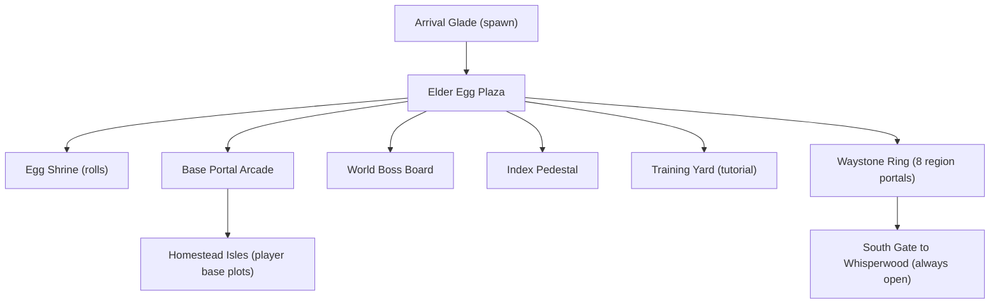

# Hub - Hatchling Haven

> [!warning] UNDECIDED (Q-001)
> The hub's position and role are part of the **PROPOSED** hybrid world. Final layout is **UNDECIDED** ([[Open Questions#Q-001]]).

| Field | Value |
|---|---|
| Role | Safe central hub: arrival, egg shrine, base portals, region Waystones, world boss board |
| Status | **PROPOSED** |
| Multiplier | — (no wild animals) |
| Unlock | Start |
| Footprint | 600 × 600 studs on a plateau at +40 altitude |
| Combat | Disabled (no wild spawns, no PvP, no hazards) |
| Asset range | ENV-001 – ENV-009 |

## 1. Purpose

Hatchling Haven is where every session begins and where the world's systems are physically represented: eggs (Egg Shrine), homes (base portals), travel (Waystones), shared events (world boss board) and the collection (index pedestal). It must be readable within ten seconds of arriving and never feel like a menu.

## 2. Theme and visual identity

A sunlit plateau garden built around a giant, softly glowing stone egg, the **Elder Egg**, cracked along faceted seams with light leaking through. Paths radiate from it like spokes towards the eight region Waystones, so the hub's layout literally maps the world ring ([[World Overview and Map]]).

| Element | Direction |
|---|---|
| Terrain | Low terraced lawns, white stone paths, shallow reflecting pools |
| Architecture | Rounded low-poly pavilions, nest-like roofs woven from stylised branches |
| Lighting | Warm, neutral midday; soft shadows; slightly brighter than any region so returning home feels welcoming ([[Lighting Direction]]) |
| Ambient effects | Drifting petals, shimmering motes around the Elder Egg, gentle fountain spray ([[VFX - Environment Ambient Effects]]) |
| Audio | Calm theme with light percussion; Egg Shrine chimes ([[Sound - Ambient World]], [[Music Direction]]) |

### 2.1 Colour palette (PROPOSED)

| Role | Hex | Use |
|---|---|---|
| Primary lawn | `#8FD16A` | Grass terraces |
| Stone | `#EDE6D6` | Paths, pavilions |
| Accent warm | `#FFC46B` | Banners, Egg Shrine trim |
| Accent cool | `#6FC3E8` | Pools, Waystone glow |
| Elder Egg glow | `#FFF1C1` | Central landmark emission |
| Shadow tint | `#5A6B7A` | Ambient shadow colour |

Rarity colours on the Egg Shrine use the rarity keys in [[Canonical Proposed Values#1. Rarity tiers]].

## 3. Layout

| Area | Function | Notes |
|---|---|---|
| **Arrival Glade** (ENV-001) | Spawn point on join and after hub respawns | Faces the Elder Egg so the player sees the Shrine first |
| **Elder Egg Plaza** (ENV-002) | Central landmark and meeting space | Emotes and hatch celebrations visible to everyone |
| **Egg Shrine** (ENV-003) | Egg rolls (200 Cash each, ×5 for 1,000; **PROPOSED**, [[Egg Pricing]]) with the odds panel | Seven rarity niches light up during roll presentations ([[UI - Egg Rolling]]) |
| **Base Portal Arcade** (ENV-004) | One personal portal that always leads to the player's own base | Shows shield status and active-raid warnings ([[Shield Mechanics]]) |
| **Homestead Isles** (ENV-005) | Ring of 16 floating plot islands around the plateau, linked to the hub by bridges and one portal arch per plot | Plot geometry and capacity are owned by [[Base Layout and Plot Expansion]]; this is a **PROPOSED** location only |
| **World Boss Board** (ENV-006) | Countdown timers and "announced" banners for the four world bosses | Mirrors [[UI - Notifications]] |
| **Index Pedestal** (ENV-007) | Opens the [[UI - Animal Index Screen]]; shows server-wide first-discovery feed (**PROPOSED**) | |
| **Training Yard** (ENV-008) | Combo and dodge drills used by [[New Player Onboarding]] | Training stumps and swinging logs; no rewards |
| **Waystone Ring** (ENV-009) | Eight portals, one per region, active once that region is unlocked | Locked Waystones show the gate requirement |

## 4. Rules in the hub

| Rule | Status |
|---|---|
| No combat, no PvP, no hazards, no wild spawns | **PROPOSED** |
| Team edits are **not** possible in the hub; the hub is not the player's base (D-010) | **CONFIRMED** rule, applied here |
| Backpack eggs can be hatched in the hub (outside combat) | **PROPOSED** ([[Canonical Proposed Values#7. Eggs, rolls and hatching]]) |
| Base-stored eggs can only be hatched at the base | **PROPOSED** |
| Each player's three companions follow them in a calm idle behaviour, with collision against other players and their companions disabled | **PROPOSED** ([[Animal Combat Behaviour]]) |
| Waystone travel is instant from the hub; travelling *to* the hub from a region uses that region's Waystone | **PROPOSED** |

## 5. Social features

- Hatch celebrations for Legendary and above play a visible beam over the Elder Egg for everyone in the hub (**PROPOSED**, [[VFX - Rarity and Variant Effects]]).
- Rare-spawn and world boss announcements show on the World Boss Board and in chat via `TextChatService` system messages (**PROPOSED**).
- No trading booths (D-045 **PROPOSED**).

## 6. Performance considerations

| Budget | Target (PROPOSED) |
|---|---|
| Static parts (excluding base plots) | ≤ 6,000 |
| Unique meshes | ≤ 60 |
| Active particle emitters | ≤ 25, rate ≤ 20 per emitter |
| Dynamic lights | ≤ 8 (Elder Egg, Shrine, Waystones share) |
| Companions visible | Up to 48 (16 players × 3); simplified idle animation beyond 80 studs |

Base plots on the Homestead Isles are streamed separately and budgeted in [[Base Layout and Plot Expansion]] and [[Animal Scalability and Performance Budgets]].

## 7. Asset list

| ID | Kit |
|---|---|
| ENV-001 | Arrival Glade kit |
| ENV-002 | Elder Egg landmark and plaza |
| ENV-003 | Egg Shrine with seven rarity niches |
| ENV-004 | Base Portal Arcade |
| ENV-005 | Homestead Isles bridge, island edge and plot border kit |
| ENV-006 | World Boss Board |
| ENV-007 | Index Pedestal |
| ENV-008 | Training Yard props |
| ENV-009 | Waystone Ring (8 Waystones, locked and active states) |

## 8. Test hooks

- Attempt to damage another player in the hub → no damage.
- Attempt a team edit in the hub → `NOT_AT_BASE`.
- Waystone to a locked region → prompt shows the gate requirement; no teleport.
- Join a full server → spawn in Arrival Glade within 3 s of character load.

## Related documents
- [[World Design Index]]
- [[World Overview and Map]]
- [[New Player Onboarding]]
- [[Egg Roll System]]
- [[Player Base System]]
- [[Region Unlock Progression]]
