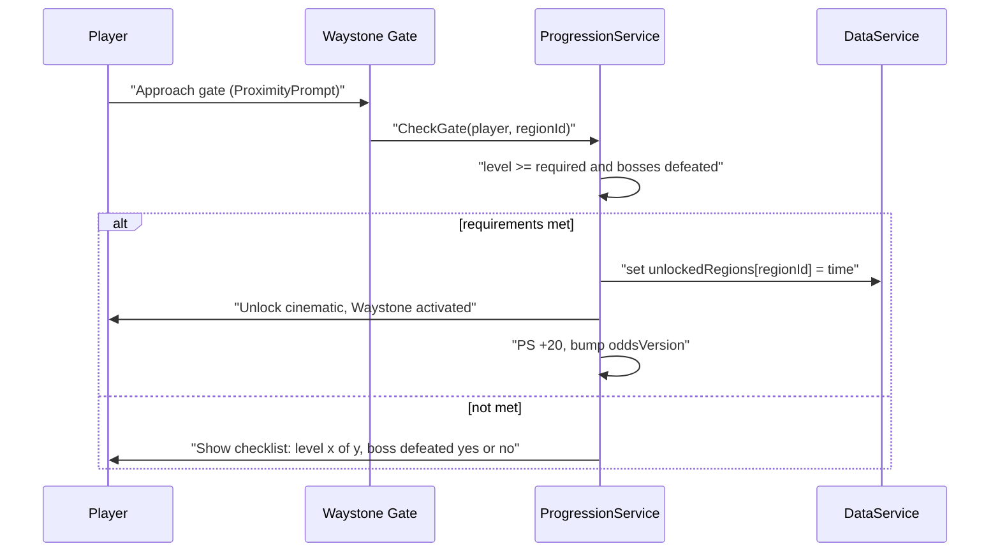

# Region Unlock Progression

> [!warning] UNDECIDED (Q-001)
> The region list and order belong to the **PROPOSED** world layout ([[Open Questions#Q-001]]). Gate requirements are **PROPOSED** values from [[Canonical Proposed Values#5. Regions (PROPOSED — world layout is UNDECIDED, Q-001)]].

## 1. Gate table

| # | Region | Requirement | Recommended level | Multiplier | Unlock grants |
|---:|---|---|---|---:|---|
| 1 | [[Region - Whisperwood Forest]] | Start | 1–10 | ×1.0 | — |
| 2 | [[Region - Sunscorch Savanna]] | Level 8 + defeat [[Mini-Boss - Bramblehorn]] | 8–20 | ×1.5 | Savanna Waystone; +20 PS |
| 3 | [[Region - Emerald Canopy]] | Level 18 + defeat [[Mini-Boss - Dustmane]] | 18–30 | ×2.2 | Canopy Waystone; +20 PS |
| 4 | [[Region - Coral Coast]] | Level 28 + defeat [[Mini-Boss - Vinecoil]] | 28–42 | ×3.2 | Coast Waystone; +20 PS; merge station level 3 gate ([[Egg Merging Station]]) |
| 5 | [[Region - Frostfang Tundra]] | Level 40 + defeat [[Mini-Boss - Hammertide]] | 40–54 | ×4.5 | Tundra Waystone; +20 PS |
| 6 | [[Region - Skyreach Peaks]] | Level 52 + defeat [[Mini-Boss - Rimeback]] | 52–66 | ×6.2 | Peaks Waystone; +20 PS; station level 4 gate (with 1 world boss) |
| 7 | [[Region - Emberheart Caldera]] | Level 65 + defeat [[Mini-Boss - Stormtalon]] | 65–80 | ×8.5 | Caldera Waystone; +20 PS |
| 8 | [[Region - Starfall Sanctuary]] | Level 80 + defeat [[Mini-Boss - Cinderjaw]] + defeat at least 2 **different** world bosses | 80–100 | ×11.5 | Star Waystone; +20 PS; station level 5 gate |

Regions unlocked beyond the first are worth 20 Progression Score points each, 140 in total ([[Progression Score Specification]]).

## 2. Design intent

1. **Two keys per gate:** a level (time and general power) and a boss (skill and team composition). Neither alone opens a gate.
2. **Gates overlap bands:** each gate level sits inside the previous region's recommended band (for example level 8 within 1–10), so the player can unlock slightly before outgrowing the old region and returns to it for discoveries without boredom.
3. **The Starfall gate is social:** two different world bosses require being present for timed spawns, encouraging group play at the endgame. World boss cadence is 45–60 minutes per boss per server ([[Boss Design Overview]]).
4. **Gates never regress:** once unlocked, a region stays unlocked for that player forever.

## 3. Unlock flow

- The check runs on the server; the client only shows the checklist it is sent.
- An unlock is recorded the first time the requirement is met **and** the player interacts with the gate or its hub Waystone (**PROPOSED**), so the unlock moment is a celebrated beat rather than a silent background event.
- Data: [[Schema - Unlocks and Boss Progress]].

## 4. Gate barrier behaviour (PROPOSED)

| Situation | Behaviour |
|---|---|
| Locked player walks into the gate | Soft barrier (a shimmering Waystone veil, ENV-170 range) pushes them back gently; no damage |
| Unlocked player walks through | Veil parts for them only (client-side visual; server allows passage) |
| Locked player is knocked or pushed through (physics, PvP) | Server detects presence in a locked region volume and returns them to the gate's safe side within 1 s |
| Locked player teleported by a raid | Raids target bases, which are on the Homestead Isles, so no region access is granted |
| Group with mixed unlocks | Unlocked members pass; locked members cannot follow |

> [!warning] UNDECIDED (Q-107)
> **Party access to locked regions.** Should a player be allowed to enter a region they have not unlocked when grouped with someone who has? **Recommendation (PROPOSED):** no at launch; gates are personal progress and a key Progression Score input. Possible later option: a "visitor" mode with no rewards.

## 5. Boss requirement rules

| Rule | Status |
|---|---|
| A mini-boss counts as defeated for a player who has kill credit on that defeat | **PROPOSED** |
| Boss kill credit threshold is defined in [[Boss Design Overview]] (lower than the 10% wild threshold so groups of up to 8 can all qualify) | **PROPOSED** |
| A world boss counts toward the Starfall gate once per **different** world boss | **PROPOSED**, follows the canonical "at least 2 different world bosses" |
| Defeats are permanent records, independent of whether rewards were eligible | **PROPOSED** |

Boss rewards themselves are **UNDECIDED** ([[Open Questions#Q-015]]).

## 6. Expected pacing (PROPOSED, planning only)

From the XP curve `XP(L) = round(100 × L^1.6)` and base XP per defeat scaled by the region multiplier ([[Canonical Proposed Values#6. Wild rewards and respawn (PROPOSED)]]). Assumes combat-only XP and roughly 6 s per defeat.

| Gate | Cumulative XP needed | XP from previous gate | Typical defeats in previous band | Active play in band |
|---|---:|---:|---:|---|
| L8 | 7,223 | 7,223 | ~600 at ~12 XP | ~1 h |
| L18 | 65,564 | 58,341 | ~2,600 at ~22 XP | ~4.5 h |
| L28 | 212,416 | 146,852 | ~2,200 at ~66 XP | ~3.5–4 h |
| L40 | 544,664 | 332,248 | ~2,600 at ~128 XP | ~4.5 h |
| L52 | 1,085,664 | 541,000 | ~2,700 at ~200 XP | ~4.5 h |
| L65 | 1,949,231 | 863,567 | ~2,800 at ~310 XP | ~4.5–5 h |
| L80 | 3,357,134 | 1,407,903 | ~2,900 at ~480 XP | ~5 h |

Average XP per defeat rises with the region's rarity mix as well as its multiplier. The near-constant defeats per band is intentional: each region lasts long enough to explore without stalling. Bottleneck analysis: [[Progression Bottleneck Analysis]].

## 7. Edge cases

- **Player levels past a gate without fighting its boss:** possible; the gate checklist highlights the boss. No level cap per region.
- **Mini-boss defeated before the level requirement:** recorded; the gate opens as soon as the level is reached.
- **Profile from a future version with more regions:** unknown region IDs are preserved but ignored ([[Data Validation and Migration]]).
- **Region added after launch:** inserted at the end of the chain or as a side branch; PS normalisation must be reviewed ([[Content Expansion Guidelines]]).

## 8. Test hooks

| ID | Test | Expected |
|---|---|---|
| RU-01 | L7 with Bramblehorn defeated approaches gate | Checklist shows level 7 / 8 |
| RU-02 | L8 with Bramblehorn defeated interacts | Unlock, PS +20, odds version bumped |
| RU-03 | Locked player physics-pushed into Savanna | Returned to safe side ≤ 1 s |
| RU-04 | One world boss defeated twice, L80, Cinderjaw defeated | Starfall still locked (needs 2 different) |

See [[Test Cases - Bosses]] and [[Test Cases - Persistence]].

## Related documents
- [[World Design Index]]
- [[World Overview and Map]]
- [[Boss Design Overview]]
- [[Player Progression and Levelling]]
- [[Progression Score Specification]]
- [[Service - ProgressionService]]
