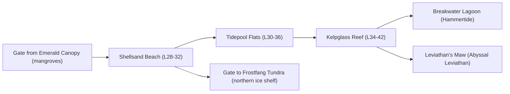

# Region - Coral Coast

> [!warning] UNDECIDED (Q-001)
> This region belongs to the **PROPOSED** hybrid world ([[Open Questions#Q-001]]). Aquatic movement on land is **UNDECIDED** ([[Open Questions#Q-028]]).

| Field | Value |
|---|---|
| Region index | 4 |
| Theme | Ocean shore, tide pools and reef shallows |
| Stat and cash multiplier | ×3.2 |
| Unlock | Level 28 + defeat [[Mini-Boss - Vinecoil]] |
| Recommended level | 28–42 |
| Mini-boss | [[Mini-Boss - Hammertide]] |
| World boss | [[World Boss - Abyssal Leviathan]] (Leviathan's Maw) |
| Footprint | 1,400 × 1,000 studs, altitude −20 to +30 |
| Region cap | 20 |
| Asset range | ENV-070 – ENV-089 |

## 1. Theme and fantasy

A bright tropical coastline where the land runs out and the sea begins. The fantasy is **the edge of the known world**: beaches, sea stacks and a reef so shallow you can wade across it, then a sudden blue drop-off where enormous shapes move. Coral Coast is the home of the aquatic family and the first region where the world itself moves on a timer (the tide).

## 2. Visual identity

| Element | Direction |
|---|---|
| Terrain | White sand beaches, tide flats, rock pools, coral shelves in knee-deep water, sea stacks, a lagoon and a deep circular bay |
| Vegetation | Palms, sea grape shrubs, kelp in the shallows, colourful low-poly coral |
| Lighting | Bright, high-key, cyan bounce light from the water; caustic patterns on the shallows; clear atmosphere ([[Lighting Direction]]) |
| Ambient effects | Gentle wave foam, caustics, drifting bubbles over the reef, sea spray at the stacks, gull flocks |
| Audio | Waves, gulls, wind; steel pan and ukulele lead |

### 2.1 Colour palette (PROPOSED)

| Role | Hex |
|---|---|
| Lagoon turquoise | `#2EC4C9` |
| Deep sea | `#1B5E8C` |
| Sand | `#F4E2B8` |
| Coral pink | `#FF7A8A` |
| Coral orange | `#FFAA5C` |
| Kelp | `#4E8B5A` |

## 3. Sub-zones and layout

| Sub-zone | Character | Main species | Hazards |
|---|---|---|---|
| **Shellsand Beach** | Long beach, palms, mangrove edge | Crab, Duck (secondary), Raccoon (secondary), Seal | HZ-09 Urchin Bed (rock edges) |
| **Tidepool Flats** | Wide flats that flood every 120 s | Octopus, Crab, Flamingo (secondary) | HZ-08 Tide Surge |
| **Kelpglass Reef** | Knee-deep coral shelves and kelp beds | Dolphin, Octopus, Great White Shark (apex at the drop-off) | HZ-09 Urchin Bed |
| **Breakwater Lagoon** | Rocky ring of breakwaters around a shallow lagoon | Hammertide arena | Boss hazards |
| **Leviathan's Maw** | Deep bay ringed by reef platforms | World boss arena | Boss hazards |

The Crocodile secondary spawn sits in the mangrove estuary between the Canopy gate and Shellsand Beach.

## 4. Animals

### 4.1 Home species

| Animal | Rarity | Role | Pool class | Sub-zone | Spawn type |
|---|---|---|---|---|---|
| [[Crab]] | Common | Tank | Elusive | Beach, Tidepool Flats | Fixed group (low weight) |
| [[Seal]] | Uncommon | Controller | Scarce | Shellsand Beach rocks | Fixed |
| [[Octopus]] | Rare | Controller | Standard | Tidepools, Reef | Fixed, fewer |
| [[Dolphin]] | Epic | Support | Standard | Kelpglass Reef | Dedicated |
| [[Great White Shark]] | Legendary | Assassin | Standard | Reef drop-off | Apex, 50% per 300 s window |

Aquatic wild animals fight from water up to 4 studs deep and the shoreline beside it; they do not chase players far inland. This keeps them readable while the companion movement question remains open ([[Open Questions#Q-028]], D-043 **PROPOSED** air-swimming).

### 4.2 Secondary appearances (PROPOSED)

| Animal | Home | Why here |
|---|---|---|
| [[Duck]] | Whisperwood Forest | Common filler; Crab is Elusive, so the beach needs a Standard Common |
| [[Raccoon]] | Whisperwood Forest | Common beach scavenger; Scarce weight |
| [[Flamingo]] | Sunscorch Savanna | Uncommon filler on the flats |
| [[Crocodile]] | Emerald Canopy | Epic in the mangrove estuary, linking the two regions |

## 5. Enemy difficulty

×3.2 region multiplier. Approximate values before species tweaks:

| Example | Wild HP | Wild ATK | Cash per defeat |
|---|---:|---:|---:|
| Crab (Common Tank) | 1,984 | 34 | 32 |
| Seal (Uncommon Controller) | 1,581 | 50 | 51 |
| Octopus (Rare Controller) | 2,067 | 65 | 90 |
| Dolphin (Epic Support) | 2,816 | 69 | 160 |
| Great White Shark (Legendary Assassin) | 2,736 | 198 | 304 |

From here a single 200-Cash roll costs only a handful of defeats; the economy's flat roll price makes this the region where egg volume noticeably accelerates ([[Egg Pricing]], [[Core Gameplay Loop]]).

## 6. Boss encounters

| Boss | Type | Location | Recommended level |
|---|---|---|---|
| [[Mini-Boss - Hammertide]] | Mini-boss | Breakwater Lagoon | 36–42 |
| [[World Boss - Abyssal Leviathan]] | World boss | Leviathan's Maw | 45 |

## 7. Exploration

### 7.1 Landmarks

| Landmark | Asset | Purpose |
|---|---|---|
| **Lantern Stack** | ENV-072 | Hero landmark; a lighthouse built on a tall sea stack, Waystone at its foot |
| **Coral Arch** | ENV-074 | Natural arch over the reef; scenic route to the drop-off |
| **Sunken Cog** | ENV-076 | A small wrecked sailing ship on the flats, exposed at low tide |
| **Leviathan's Maw** | ENV-078 | Deep circular bay; world boss arena |

### 7.2 Secrets (PROPOSED)

- **Low-tide passage:** between Tide Surges, the flats reveal a sandbar path to a hidden cove with a Seal spawn group.
- **Inside the Cog:** the wreck's hold holds a naturalist plaque and a view through the hull to the reef.
- **Naturalist plaques:** five plaques.

## 8. Progression requirements

- Entry: level 28 + Vinecoil.
- Exit to [[Region - Frostfang Tundra]]: level 40 + Hammertide.
- Merge station level 3 (Crystal Incubator, 60,000 Cash, Epic → Legendary) becomes available once this region is unlocked ([[Egg Merging Station]]).

## 9. Environmental hazards

| Hazard | Where | Effect summary |
|---|---|---|
| HZ-08 Tide Surge | Tidepool Flats | Every 120 s, 5 s warning; damage and knockback |
| HZ-09 Urchin Bed | Rocks and reef | Contact damage |

The tide is server-wide and synchronised, so groups learn the rhythm together. Full rules: [[Environmental Hazards]].

## 10. Performance considerations

| Budget | Target (PROPOSED) |
|---|---|
| Static parts | ≤ 10,000 |
| Water | Terrain water for the sea and lagoon; reef shelves as terrain under shallow water; tide surge as an animated foam mesh plus a server hazard volume, never a moving terrain water level |
| Caustics | One shared animated texture on the shallows; disabled on low quality |
| Particle emitters | ≤ 22 active; spray at stacks ≤ 4 emitters |
| Transparency | Coral uses opaque low-poly geometry; only foam and bubbles are transparent |
| Streaming | Leviathan's Maw streamed separately; its arena platforms load with the boss announcement |

## 11. Asset IDs (ENV-070 – ENV-089)

| ID | Kit |
|---|---|
| ENV-070 | Beach, dune and rock pool terrain kit |
| ENV-071 | Palm and coastal shrub set |
| ENV-072 | Lantern Stack landmark |
| ENV-073 | Coral and kelp set (low-poly) |
| ENV-074 | Coral Arch |
| ENV-075 | Mangrove estuary kit |
| ENV-076 | Sunken Cog wreck |
| ENV-077 | Breakwater Lagoon arena |
| ENV-078 | Leviathan's Maw bay and reef platforms |
| ENV-079 | Tide Surge foam meshes and warning conch props |
| ENV-080 – ENV-089 | Reserved |

## 12. Test hooks

- Tide Surge telegraph visible ≥ 4.85 s on a 150 ms latency client.
- Aquatic wild animals never path more than 12 studs inland from water.
- Great White Shark apex occupancy ≈ 50% of windows over a long simulation.

## Related documents
- [[World Design Index]]
- [[Region - Emerald Canopy]]
- [[Region - Frostfang Tundra]]
- [[Mini-Boss - Hammertide]]
- [[World Boss - Abyssal Leviathan]]
- [[Animal Families]]
