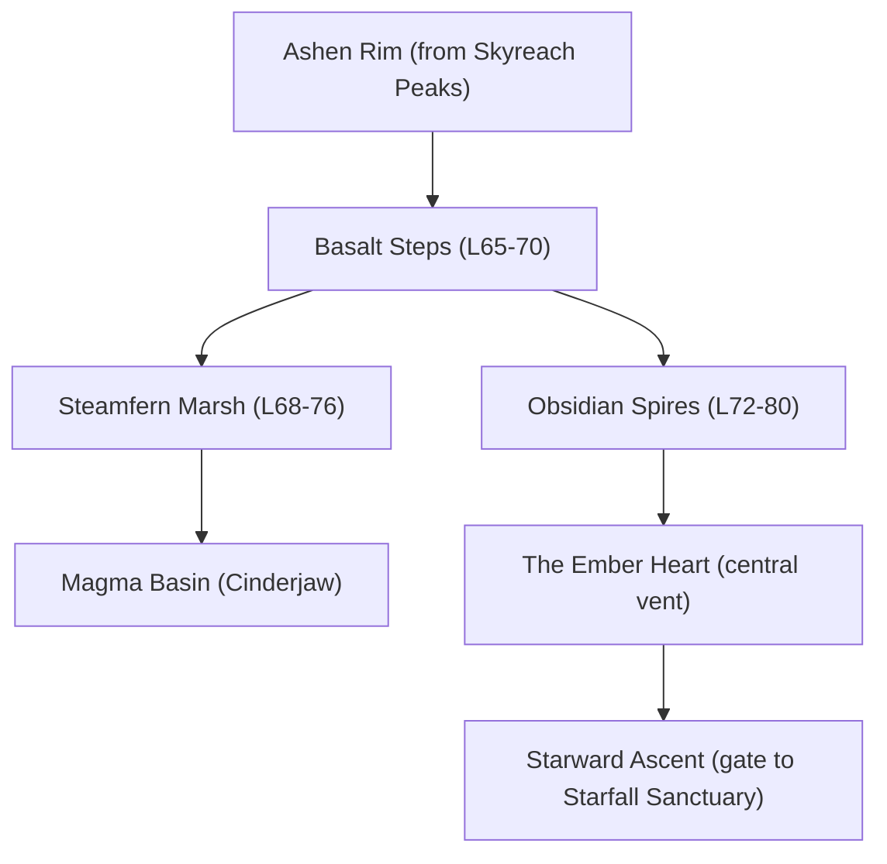

# Region - Emberheart Caldera

> [!warning] UNDECIDED (Q-001)
> This region belongs to the **PROPOSED** hybrid world ([[Open Questions#Q-001]]). The prehistoric "ancient lineage" theme it showcases is **UNDECIDED** ([[Open Questions#Q-027]], D-033 **PROPOSED**).

| Field | Value |
|---|---|
| Region index | 7 |
| Theme | Volcanic lost valley |
| Stat and cash multiplier | ×8.5 |
| Unlock | Level 65 + defeat [[Mini-Boss - Stormtalon]] |
| Recommended level | 65–80 |
| Mini-boss | [[Mini-Boss - Cinderjaw]] |
| World boss | [[World Boss - Ashwing Condor]] (Ashen Rim, shared with Skyreach Peaks) |
| Footprint | 1,100 × 1,100 studs, altitude +60 to +250 (a bowl) |
| Region cap | 16 |
| Rare-spawn species | [[Sabre-Tooth Tiger]] (Mythical), [[Titanoboa]] (Secret), [[Tyrannosaurus Rex]] (Secret) |
| Asset range | ENV-130 – ENV-149 |

## 1. Theme and fantasy

Inside a vast, ancient volcano lies a hidden valley where time stopped: steaming fern marshes, obsidian spires, glowing lava rivers, and animals the rest of the world thinks are long gone. The fantasy is **the lost world**. Emberheart is where the "ancient eggs" fiction becomes tangible: it hosts two of the four Secret species as rare spawns.

The tone stays **adventurous, not menacing** (D-026): warm orange light, lush green ferns against black rock, and no horror imagery. Prehistoric animals are majestic and stylised, never gruesome ([[Art Bible]]).

## 2. Visual identity

| Element | Direction |
|---|---|
| Terrain | Caldera rim walls, basalt column steps, black sand, lava channels, a central glowing vent, a steaming marsh basin |
| Vegetation | Giant tree ferns, cycads, horsetail reeds, glowing ember moss |
| Lighting | Warm orange under-light from lava, smoky amber sky, deep contrast; cooler green in the fern marsh ([[Lighting Direction]]) |
| Ambient effects | Rising embers, heat haze, steam vents, drifting ash flakes, lava glow pulses |
| Audio | Deep rumbles, bubbling lava, marsh insects, distant roars; taiko-style drums, low brass, choir swells |

### 2.1 Colour palette (PROPOSED)

| Role | Hex |
|---|---|
| Basalt black | `#2B2628` |
| Lava orange | `#FF6A1A` |
| Ember gold | `#FFB347` |
| Fern green | `#5E9E3F` |
| Ash grey | `#8A8580` |
| Obsidian violet | `#4B2E5C` |

## 3. Sub-zones and layout

| Sub-zone | Character | Main species | Hazards |
|---|---|---|---|
| **Basalt Steps** | Hexagonal column terraces descending from the rim | Boar and Hyena (secondary), Komodo Dragon (apex) | HZ-16 Geyser Vent |
| **Steamfern Marsh** | Lush fern swamp around hot springs | Frog, Cobra, Crocodile (secondary), Titanoboa (rare spawn) | HZ-17 Ash Fog (edges) |
| **Obsidian Spires** | Forest of glassy black spires and lava channels | Leopard, Tiger, Rhino (secondary), Sabre-Tooth Tiger and Tyrannosaurus Rex (rare spawns) | HZ-15 Lava, HZ-16 Geyser Vent |
| **Magma Basin** | Lava lake with basalt islands | Cinderjaw arena | Boss hazards |
| **The Ember Heart** | Central vent pillar; the Starward Ascent begins here | Waystone clearing; no spawns | — |

## 4. Animals

### 4.1 Home species

| Animal | Rarity | Role | Pool class | Sub-zone | Spawn type |
|---|---|---|---|---|---|
| [[Komodo Dragon]] | Legendary | Controller | Elusive | Basalt Steps | Apex, 50% per 300 s window |
| [[Sabre-Tooth Tiger]] | Mythical | Assassin | Standard | Obsidian Spires anchors (4) | Rare spawn: 25% per 900 s window |
| [[Titanoboa]] | Secret | Controller | Scarce | Steamfern Marsh anchors (3) | Rare spawn: 10% per 2,700 s window |
| [[Tyrannosaurus Rex]] | Secret | Bruiser | Elusive | Obsidian Spires anchors (3) | Rare spawn: 10% per 2,700 s window |

### 4.2 Secondary appearances (PROPOSED)

| Animal | Home | Why here |
|---|---|---|
| [[Boar]] | Whisperwood Forest | Common filler on the steps |
| [[Frog]] | Whisperwood Forest | Common filler in the marsh |
| [[Hyena]] | Sunscorch Savanna | Uncommon filler |
| [[Cobra]] | Sunscorch Savanna | Uncommon filler in the marsh |
| [[Leopard]] | Emerald Canopy | Rare filler among the spires |
| [[Rhino]] | Sunscorch Savanna | Epic dedicated point |
| [[Crocodile]] | Emerald Canopy | Epic dedicated point in the marsh |
| [[Tiger]] | Emerald Canopy | Epic dedicated point among the spires |

## 5. Enemy difficulty

×8.5 region multiplier. Approximate values before species tweaks:

| Example | Wild HP | Wild ATK | Cash per defeat |
|---|---:|---:|---:|
| Komodo Dragon (Legendary Controller) | 9,206 | 291 | 808 |
| Sabre-Tooth Tiger (Mythical Assassin) | 9,435 | 684 | 1,615 |
| Titanoboa (Secret Controller) | 15,504 | 490 | 3,400 |
| Tyrannosaurus Rex (Secret Bruiser) | 17,952 | 612 | 3,400 |

Secret rare spawns here are **group events**. A solo player can attempt one, but the encounter is tuned for 3–6 players arriving after the announcement. Wild Secret attacks follow wild-animal telegraph rules, not boss rules ([[Wild Animal AI]]).

## 6. Boss encounters

| Boss | Type | Location | Recommended level |
|---|---|---|---|
| [[Mini-Boss - Cinderjaw]] | Mini-boss | Magma Basin | 74–80 |
| [[World Boss - Ashwing Condor]] | World boss | Ashen Rim | 70 |

## 7. Exploration

### 7.1 Landmarks

| Landmark | Asset | Purpose |
|---|---|---|
| **The Ember Heart** | ENV-132 | Hero landmark; a glowing pillar of cooled lava with a pulsing core, visible from every point in the bowl |
| **Fossil Cliffs** | ENV-134 | Cliff face with huge stylised fossils; viewpoint over the marsh |
| **Obsidian Spires** | ENV-136 | Field of glassy spires reflecting lava light |
| **Starward Ascent** | ENV-139 | Spiral of floating basalt steps rising from the Ember Heart towards Starfall Sanctuary |

### 7.2 Secrets (PROPOSED)

- **Nest Hollow:** a hidden cave behind the Fossil Cliffs contains giant fossilised eggs, an "ancient egg" story beat (cosmetic, ties to [[Egg Art Direction]]).
- **Cooling Path:** a safe route across the lava channels that appears only between geyser cycles.
- **Naturalist plaques:** four plaques.

## 8. Progression requirements

- Entry: level 65 + Stormtalon.
- Exit to [[Region - Starfall Sanctuary]] via the Starward Ascent: level 80 + Cinderjaw + at least 2 different world bosses ([[Region Unlock Progression]]).

## 9. Environmental hazards

| Hazard | Where | Effect summary |
|---|---|---|
| HZ-15 Lava | Channels and basin edges | Heavy damage per second, bounce-out, floored at 1 HP |
| HZ-16 Geyser Vent | Steps and spires | Periodic eruption with telegraph; launch |
| HZ-17 Ash Fog | Marsh edges | Visibility; companion auto-target range reduced |

## 10. Performance considerations

| Budget | Target (PROPOSED) |
|---|---|
| Static parts | ≤ 9,000 |
| Lava | Neon-material channels with a scrolling texture; glow via a few PointLights per channel segment (≤ 12 dynamic lights on PC, ≤ 4 on mobile) |
| Embers | One camera-attached emitter plus ≤ 6 world emitters at vents; rate scaled by graphics quality |
| Heat haze | Disabled on mobile |
| Spires | Shared mesh set with 6 variants; reflections faked with a static glossy material, not real-time reflection |
| Rare-spawn models | Secret models (Titanoboa, T-Rex) are the largest wild models; preload with `ContentProvider` when the announcement fires (*unverified*: confirm preload behaviour under streaming) |

## 11. Asset IDs (ENV-130 – ENV-149)

| ID | Kit |
|---|---|
| ENV-130 | Caldera rim and basalt column kit |
| ENV-131 | Lava channel and lava lake kit |
| ENV-132 | The Ember Heart landmark |
| ENV-133 | Prehistoric fern and cycad set |
| ENV-134 | Fossil Cliffs |
| ENV-135 | Steamfern Marsh hot springs |
| ENV-136 | Obsidian Spires set |
| ENV-137 | Geyser vent props |
| ENV-138 | Magma Basin arena |
| ENV-139 | Starward Ascent floating steps |
| ENV-140 – ENV-149 | Reserved |

## 12. Test hooks

- Three simultaneous rare spawns (worst case) stay within the region cap of 16 by evicting lowest-rarity animals.
- Lava contact at 3% HP floors at 1 HP and bounces the player out.
- Starward Ascent blocks a player with only one world boss defeated.

## Related documents
- [[World Design Index]]
- [[Region - Skyreach Peaks]]
- [[Region - Starfall Sanctuary]]
- [[Mini-Boss - Cinderjaw]]
- [[World Boss - Ashwing Condor]]
- [[Animal Families]]
