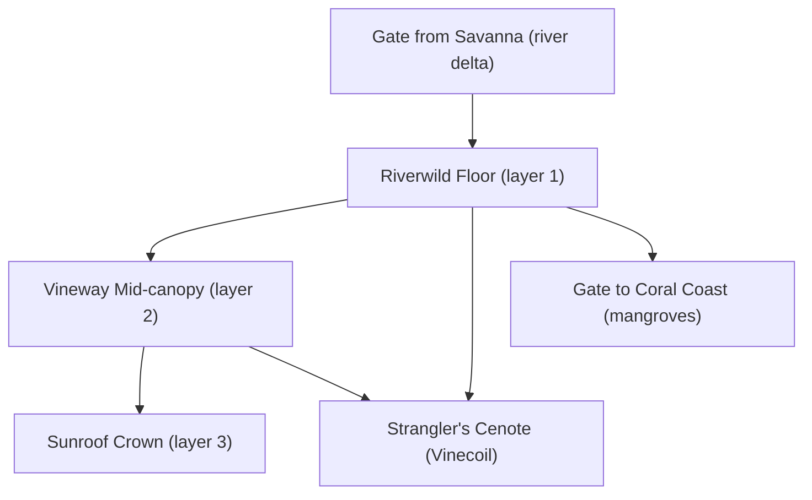

# Region - Emerald Canopy

> [!warning] UNDECIDED (Q-001)
> This region belongs to the **PROPOSED** hybrid world ([[Open Questions#Q-001]]).

| Field | Value |
|---|---|
| Region index | 3 |
| Theme | Tropical jungle, built in layers |
| Stat and cash multiplier | ×2.2 |
| Unlock | Level 18 + defeat [[Mini-Boss - Dustmane]] |
| Recommended level | 18–30 |
| Mini-boss | [[Mini-Boss - Vinecoil]] |
| World boss | — |
| Footprint | 1,200 × 1,200 studs, three layers from 0 to +120 |
| Region cap | 24 |
| Asset range | ENV-050 – ENV-069 |

## 1. Theme and fantasy

The Canopy is the first **vertical** region: a jungle floor of rivers and roots, a mid-layer of vine walkways and rope bridges, and a sunlit crown where birds nest. The fantasy is **discovery in three dimensions**: the same map square holds different animals at different heights. It is also where Epic animals stop being rare sightings and become regular targets, with four dedicated Epic points.

## 2. Visual identity

| Element | Direction |
|---|---|
| Terrain | River valleys, mud banks, giant buttress roots, a waterfall cliff, the Strangler's Cenote sinkhole |
| Vegetation | Huge kapok-style trunks, broad leaves, hanging vines, bromeliads and orchids as colour pops |
| Lighting | Green-filtered light on the floor, dappled beams in the mid-layer, bright open sun on the crown; humid haze ([[Lighting Direction]]) |
| Ambient effects | Mist, dripping water, drifting spores, butterflies and dragonflies, glowing fungi in shaded hollows |
| Audio | Layered bird calls by height, insect drone, rain bursts; pan flute, kalimba and soft percussion |

### 2.1 Colour palette (PROPOSED)

| Role | Hex |
|---|---|
| Emerald foliage | `#1FA36A` |
| Deep jungle shade | `#0F4D3A` |
| Vine and bark | `#6B4E2E` |
| River teal | `#2FB5A8` |
| Orchid accent | `#E55BB5` |
| Sunlit crown | `#C8F07A` |

## 3. Sub-zones and layout

| Sub-zone | Layer | Main species | Hazards |
|---|---|---|---|
| **Riverwild Floor** | 0 to +15 | Crocodile, Electric Eel, Frog and Duck (secondary), Gorilla | HZ-07 River Rapids |
| **Vineway** | +40 to +70 | Monkey, Leopard, Cobra (secondary), Tiger | HZ-06 Rotten Walkway |
| **Sunroof Crown** | +90 to +120 | Toucan, Peacock, Owl (secondary) | HZ-05 Spore Bloom (flower terraces) |
| **Strangler's Cenote** | Floor, open to sky | Vinecoil arena | Boss hazards only |

Movement between layers: giant roots (ramps), vine ladders (ProximityPrompt climb), and two lift platforms made of woven leaves. Falling from a higher layer drops the player onto the layer below without damage; only the cenote rim uses the H7 fall-return rule ([[Environmental Hazards]]).

## 4. Animals

### 4.1 Home species

| Animal | Rarity | Role | Pool class | Layer | Spawn type |
|---|---|---|---|---|---|
| [[Monkey]] | Uncommon | Skirmisher | Standard | Vineway | Fixed group |
| [[Leopard]] | Rare | Assassin | Scarce | Vineway | Fixed, fewer |
| [[Toucan]] | Rare | Ranged | Standard | Sunroof | Fixed, fewer |
| [[Peacock]] | Rare | Support | Scarce | Sunroof | Fixed, fewer |
| [[Tiger]] | Epic | Assassin | Standard | Vineway | Dedicated |
| [[Gorilla]] | Epic | Tank | Standard | Riverwild | Dedicated |
| [[Crocodile]] | Epic | Controller | Standard | Riverwild banks | Dedicated |
| [[Electric Eel]] | Epic | Ranged | Scarce | Eel Pools (Riverwild) | Dedicated |

Aquatic species here (Crocodile, Electric Eel) fight from shallow water and banks. How aquatic animals move on land is **UNDECIDED** ([[Open Questions#Q-028]]); D-043 **PROPOSED** air-swimming applies to them as companions.

### 4.2 Secondary appearances (PROPOSED)

| Animal | Home | Why here |
|---|---|---|
| [[Frog]] | Whisperwood Forest | Common filler on the floor; jungle frog colouring through region lighting only (not a variant) |
| [[Duck]] | Whisperwood Forest | Common filler on rivers |
| [[Cobra]] | Sunscorch Savanna | Uncommon filler in the Vineway |
| [[Owl]] | Whisperwood Forest | Uncommon filler in the crown |

Secondary appearances are the normal species model; they are never variants (variant acquisition is **UNDECIDED**, [[Open Questions#Q-006]]).

## 5. Enemy difficulty

×2.2 region multiplier. Approximate values before species tweaks:

| Example | Wild HP | Wild ATK | Cash per defeat |
|---|---:|---:|---:|
| Monkey (Uncommon Skirmisher) | 972 | 34 | 35 |
| Leopard (Rare Assassin) | 1,122 | 81 | 62 |
| Tiger (Epic Assassin) | 1,452 | 105 | 110 |
| Gorilla (Epic Tank) | 3,001 | 51 | 110 |

The Canopy's design lesson is **burst threat**: Leopards and Tigers hit hard from ambush positions in the Vineway. Players learn to use Tank companions and dodge rolls. See [[Animal Roles]].

## 6. Boss encounters

| Boss | Type | Location | Recommended level |
|---|---|---|---|
| [[Mini-Boss - Vinecoil]] | Mini-boss | Strangler's Cenote | 26–30 |

No world boss lives here. The nearest are [[World Boss - Thunderhoof]] (back in the Savanna, recommended level 30) and [[World Boss - Abyssal Leviathan]] (next region).

## 7. Exploration

### 7.1 Landmarks

| Landmark | Asset | Purpose |
|---|---|---|
| **Giant Kapok** | ENV-052 | Hero landmark; the tallest tree, with a spiral root ramp through all three layers and the Waystone at its base |
| **Veil Falls** | ENV-055 | Waterfall with a walkable cave behind it connecting floor to Vineway |
| **Eel Pools** | ENV-056 | Bioluminescent pools; Electric Eel dedicated point |
| **Strangler's Cenote** | ENV-058 | Sinkhole wrapped in giant vines; boss arena |

### 7.2 Secrets (PROPOSED)

- **Behind the Veil:** the waterfall cave holds a quiet glade with a Peacock spawn group and a view of the cenote.
- **Crown Nest:** a hidden platform at the very top of the Giant Kapok; reaching it by vine climbing grants a cosmetic index stamp.
- **Naturalist plaques:** four plaques.

## 8. Progression requirements

- Entry: level 18 + Dustmane.
- Exit to [[Region - Coral Coast]]: level 28 + Vinecoil.

## 9. Environmental hazards

| Hazard | Where | Effect summary |
|---|---|---|
| HZ-05 Spore Bloom | Sunroof flower terraces | Periodic poison cloud |
| HZ-06 Rotten Walkway | Vineway bridges | Collapsing planks drop players a layer |
| HZ-07 River Rapids | Riverwild | Current push |

## 10. Performance considerations

The Canopy is the **highest-risk region for performance**, because layered foliage multiplies overdraw and part counts.

| Budget | Target (PROPOSED) |
|---|---|
| Static parts | ≤ 15,000 across all layers |
| Foliage | Large leaves as MeshParts with shared textures; no transparent stacking deeper than 3 layers along any common camera line |
| Transparency | Mist via a few large, low-opacity volumes rather than many particles |
| Particle emitters | ≤ 25 active; spores and drips rate ≤ 6 |
| Lights | ≤ 10 dynamic (Eel Pools glow) on PC; 4 on mobile |
| Streaming | Each layer streamed as its own model, so a player on the floor does not hold the crown's detail at full resolution |
| AI | Pathfinding uses separate navigation per layer; ladders and lifts are explicit links (`PathfindingService` with custom costs, *unverified*: confirm link support against current documentation) |

## 11. Asset IDs (ENV-050 – ENV-069)

| ID | Kit |
|---|---|
| ENV-050 | Jungle floor terrain, roots and mud bank kit |
| ENV-051 | Jungle tree set (trunks, leaves, vines) |
| ENV-052 | Giant Kapok landmark |
| ENV-053 | Vineway bridges and platforms |
| ENV-054 | Sunroof flower terraces |
| ENV-055 | Veil Falls and cave |
| ENV-056 | Eel Pools (bioluminescent) |
| ENV-057 | Vine ladders and leaf lifts |
| ENV-058 | Strangler's Cenote arena |
| ENV-059 – ENV-069 | Reserved |

## 12. Test hooks

- Camera never clips into dense foliage on the Vineway with default and mobile cameras ([[Camera Behaviour Guidelines]]).
- Rotten Walkway collapse resets after 20 s and never strands a player.
- Mid-range mobile holds 30 FPS on the Vineway with 8 players.

## Related documents
- [[World Design Index]]
- [[Region - Sunscorch Savanna]]
- [[Region - Coral Coast]]
- [[Mini-Boss - Vinecoil]]
- [[Environment Art Direction]]
- [[Performance Guidelines]]
