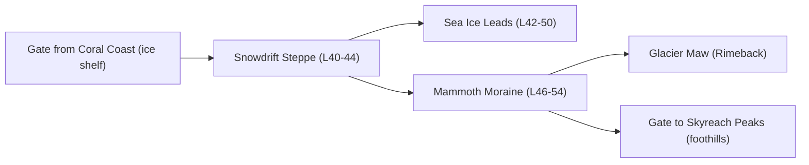

# Region - Frostfang Tundra

> [!warning] UNDECIDED (Q-001)
> This region belongs to the **PROPOSED** hybrid world ([[Open Questions#Q-001]]).

| Field | Value |
|---|---|
| Region index | 5 |
| Theme | Arctic tundra, sea ice and glaciers |
| Stat and cash multiplier | ×4.5 |
| Unlock | Level 40 + defeat [[Mini-Boss - Hammertide]] |
| Recommended level | 40–54 |
| Mini-boss | [[Mini-Boss - Rimeback]] |
| World boss | — |
| Footprint | 1,400 × 1,200 studs, altitude +20 to +80 |
| Region cap | 20 |
| Rare-spawn species | [[Woolly Mammoth]] (Mythical) |
| Asset range | ENV-090 – ENV-109 |

## 1. Theme and fantasy

A vast, quiet white land under an aurora sky. After the colour of the coast, the Tundra is **stark beauty and endurance**: blizzards roll in, the ice cracks underfoot, and somewhere on the moraine an Ice Age giant may appear. It is the first region with a **Mythical rare spawn**, so it introduces the server-wide announcement ritual ([[Wild Animal Spawning and Respawn]]).

## 2. Visual identity

| Element | Direction |
|---|---|
| Terrain | Snow steppe, pressure ridges, sea ice with open-water leads, a glacier tongue with an ice cave, a stony moraine |
| Vegetation | Sparse: lichen-coloured rocks, low shrubs, a few wind-bent conifers near the Skyreach border |
| Lighting | Low sun, long blue shadows, pastel sky; aurora at the region's "permanent dusk" sub-zones; higher fog during blizzards ([[Lighting Direction]]) |
| Ambient effects | Wind-blown snow, ice glints, aurora ribbons (Beam-based), breath puffs on characters |
| Audio | Wind, creaking ice, distant whale song from the leads; cello, glass harmonica and soft choir |

### 2.1 Colour palette (PROPOSED)

| Role | Hex |
|---|---|
| Snow white | `#F2F7FB` |
| Ice blue | `#A9D8F0` |
| Glacier deep | `#4C8FBF` |
| Shadow blue | `#5B6F9E` |
| Aurora green | `#5BF0B0` |
| Aurora violet | `#B58CFF` |

## 3. Sub-zones and layout

| Sub-zone | Character | Main species | Hazards |
|---|---|---|---|
| **Snowdrift Steppe** | Open snowfield with the Hearthstone Camp | Rabbit and Goat (secondary), Penguin, Arctic Fox | HZ-10 Blizzard |
| **Sea Ice Leads** | Ice floes with open-water channels | Penguin, Walrus, Seal (secondary), Orca and Narwhal (apex rotation) | HZ-11 Thin Ice |
| **Mammoth Moraine** | Rocky ridges, frozen bones, aurora sky | Wolf (secondary), Snow Leopard (secondary), Woolly Mammoth (rare spawn) | HZ-10 Blizzard |
| **Glacier Maw** | Ice cave in the glacier tongue | Rimeback arena | Boss hazards |

## 4. Animals

### 4.1 Home species

| Animal | Rarity | Role | Pool class | Sub-zone | Spawn type |
|---|---|---|---|---|---|
| [[Penguin]] | Uncommon | Tank | Elusive | Steppe, Leads | Fixed (low weight) |
| [[Walrus]] | Rare | Tank | Standard | Sea Ice Leads | Fixed, fewer |
| [[Arctic Fox]] | Rare | Controller | Elusive | Snowdrift Steppe | Fixed, fewer (low weight) |
| [[Orca]] | Legendary | Controller | Standard | Sea Ice Leads | Apex rotation |
| [[Narwhal]] | Legendary | Ranged | Scarce | Sea Ice Leads | Apex rotation |
| [[Woolly Mammoth]] | Mythical | Tank | Standard | Mammoth Moraine anchors (4) | Rare spawn: 25% per 900 s window |

### 4.2 Secondary appearances (PROPOSED)

| Animal | Home | Why here |
|---|---|---|
| [[Rabbit]] | Whisperwood Forest | Common filler (the Tundra has no home Commons) |
| [[Goat]] | Whisperwood Forest | Common filler on the moraine edges |
| [[Seal]] | Coral Coast | Uncommon filler on the floes |
| [[Wolf]] | Whisperwood Forest | Rare filler; pack hunter on the moraine |
| [[Snow Leopard]] | Skyreach Peaks | Epic dedicated point in the foothills; foreshadows the next region |
| [[Dolphin]] | Coral Coast | Epic dedicated point in a sheltered lead |

## 5. Enemy difficulty

×4.5 region multiplier. Approximate values before species tweaks:

| Example | Wild HP | Wild ATK | Cash per defeat |
|---|---:|---:|---:|
| Penguin (Uncommon Tank) | 3,627 | 61 | 72 |
| Walrus (Rare Tank) | 4,743 | 80 | 126 |
| Orca (Legendary Controller) | 4,874 | 154 | 428 |
| Woolly Mammoth (Mythical Tank) | 10,323 | 175 | 855 |

The Tundra's lesson is **attrition**: many Tanks with high HP and Chilled from thin ice reward sustained damage, Support companions and focus-fire commands.

## 6. Boss encounters

| Boss | Type | Location | Recommended level |
|---|---|---|---|
| [[Mini-Boss - Rimeback]] | Mini-boss | Glacier Maw | 48–54 |

The Woolly Mammoth rare spawn behaves as a "mini-event" without being a boss: it uses wild animal rules, the standard 60-stud leash and the 10% credit rule.

## 7. Exploration

### 7.1 Landmarks

| Landmark | Asset | Purpose |
|---|---|---|
| **Aurora Stones** | ENV-092 | Hero landmark; a ring of tall standing stones under a permanent aurora, Waystone at the centre |
| **Frozen Falls** | ENV-094 | Waterfall frozen mid-fall; climbable ice steps to a lookout |
| **Hearthstone Camp** | ENV-096 | Explorers' camp with warming braziers that negate Blizzard effects within 15 studs |
| **Glacier Maw** | ENV-098 | Ice cave entrance and boss arena |

### 7.2 Secrets (PROPOSED)

- **Mammoth Bones:** a frozen skeleton in the moraine; examining it unlocks index flavour text for the Woolly Mammoth even before discovery.
- **Under the Falls:** an ice tunnel behind Frozen Falls leads to an Arctic Fox den.
- **Naturalist plaques:** five plaques.

## 8. Progression requirements

- Entry: level 40 + Hammertide.
- Exit to [[Region - Skyreach Peaks]]: level 52 + Rimeback.

## 9. Environmental hazards

| Hazard | Where | Effect summary |
|---|---|---|
| HZ-10 Blizzard | Whole region except caves and camps | 60 s event every 6 min; slow and fog; braziers negate |
| HZ-11 Thin Ice | Sea Ice Leads | Cracks after 2.5 s; Chilled |

## 10. Performance considerations

| Budget | Target (PROPOSED) |
|---|---|
| Static parts | ≤ 9,000 |
| Snow | Terrain snow and glacier materials; avoid part-based snow drifts |
| Blizzard | Client-side particle volume attached to the camera (one emitter, rate scaled by quality) plus Atmosphere density change; no world-space particle walls |
| Aurora | 6–8 Beam ribbons with scrolling texture; disabled on low quality |
| Ice transparency | Thin-ice floes use opaque material with a cracked decal; no glass stacking |
| Streaming | Glacier Maw interior streamed as its own model |

## 11. Asset IDs (ENV-090 – ENV-109)

| ID | Kit |
|---|---|
| ENV-090 | Tundra terrain, pressure ridge and moraine kit |
| ENV-091 | Sea ice floes and thin-ice variants |
| ENV-092 | Aurora Stones landmark |
| ENV-093 | Aurora Beam ribbons |
| ENV-094 | Frozen Falls |
| ENV-095 | Mammoth bones and frozen fossils |
| ENV-096 | Hearthstone Camp and braziers |
| ENV-097 | Wind-bent conifer set |
| ENV-098 | Glacier Maw cave and arena |
| ENV-099 – ENV-109 | Reserved |

## 12. Test hooks

- Mammoth windows: over a long simulation, about 25% succeed; announcement reaches all clients in the same server tick.
- Standing near a brazier during Blizzard removes slow and fog within 0.5 s.
- Thin Ice never traps a companion below the floe.

## Related documents
- [[World Design Index]]
- [[Region - Coral Coast]]
- [[Region - Skyreach Peaks]]
- [[Mini-Boss - Rimeback]]
- [[Wild Animal Spawning and Respawn]]
- [[Environmental Hazards]]
