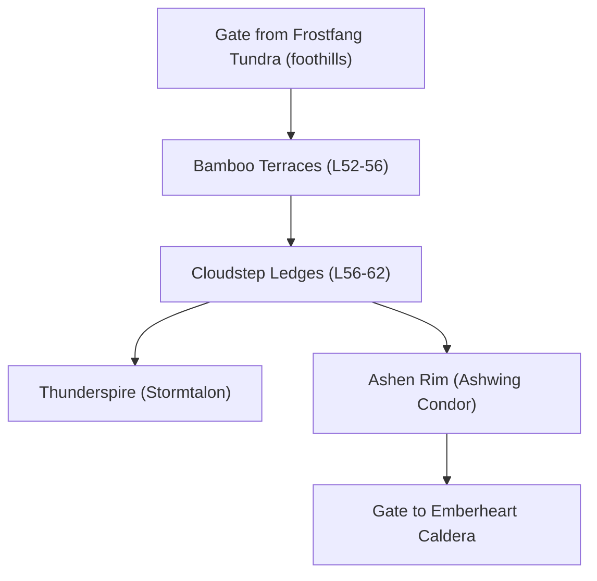

# Region - Skyreach Peaks

> [!warning] UNDECIDED (Q-001)
> This region belongs to the **PROPOSED** hybrid world ([[Open Questions#Q-001]]).

| Field | Value |
|---|---|
| Region index | 6 |
| Theme | High mountains, cloud ledges and bamboo terraces |
| Stat and cash multiplier | ×6.2 |
| Unlock | Level 52 + defeat [[Mini-Boss - Rimeback]] |
| Recommended level | 52–66 |
| Mini-boss | [[Mini-Boss - Stormtalon]] |
| World boss | [[World Boss - Ashwing Condor]] (Ashen Rim, shared with Emberheart Caldera) |
| Footprint | 1,000 × 1,000 studs, altitude +80 to +600 |
| Region cap | 18 |
| Rare-spawn species | [[Haast's Eagle]] (Mythical) |
| Asset range | ENV-110 – ENV-129 |

## 1. Theme and fantasy

The roof of the world. Skyreach is compact on the map but enormous vertically: the player climbs from misty bamboo terraces through cloud-wreathed ledges to a storm-crowned spire. The fantasy is **the climb**: every few minutes the view gets bigger and the whole ring of regions becomes visible below. It is the birds' region, with eagles, a falcon and the colossal Haast's Eagle.

## 2. Visual identity

| Element | Direction |
|---|---|
| Terrain | Stepped terraces, narrow ledges, rope-and-plank sky bridges, cliff faces with switchback paths, a lightning-scarred spire |
| Vegetation | Bamboo groves on lower terraces, alpine flowers, gnarled pines on ledges, bare rock at the summit |
| Lighting | Crisp, cool sunlight above the clouds; a sea of soft cloud below the ledges; storm-dark and lit by flashes around Thunderspire ([[Lighting Direction]]) |
| Ambient effects | Rolling cloud layer (large slow-moving meshes), drifting petals on the terraces, wind streaks, distant birds wheeling |
| Audio | Wind tones, wind chimes, eagle cries, thunder; bamboo flute, zither-like plucked strings and frame drums |

### 2.1 Colour palette (PROPOSED)

| Role | Hex |
|---|---|
| Granite | `#8E96A3` |
| Cloud white | `#F5F8FF` |
| Bamboo green | `#8CC152` |
| Alpine sky | `#6FA8FF` |
| Storm slate | `#3E4A61` |
| Blossom accent | `#FFB3C7` |

## 3. Sub-zones and layout

| Sub-zone | Altitude | Main species | Hazards |
|---|---|---|---|
| **Bamboo Terraces** | +80 to +200 | Giant Panda (apex rotation), Woodpecker and Goat (secondary) | — |
| **Cloudstep Ledges** | +200 to +420 | Golden Eagle, Snow Leopard, Owl and Wolf (secondary), Peregrine Falcon (apex rotation), Haast's Eagle (rare spawn) | HZ-12 Gale Gust, HZ-13 Rockfall |
| **Thunderspire** | +420 to +600 | Stormtalon arena on the summit eyrie | HZ-14 Summit Lightning |
| **Ashen Rim** | +250 to +350 | Ash-dusted ridge bordering the caldera; world boss arena; Arctic Fox (secondary) on the cold side | HZ-12 Gale Gust |

Falls below a ledge's kill plane return the player to the last safe point with 10% max HP damage, floored at 1 HP ([[Environmental Hazards]] H7). Two **updraft vents** let players ride upward between ledges (a Gravity-Well-like assist, server-validated).

## 4. Animals

### 4.1 Home species

| Animal | Rarity | Role | Pool class | Sub-zone | Spawn type |
|---|---|---|---|---|---|
| [[Golden Eagle]] | Epic | Skirmisher | Standard | Cloudstep Ledges | Dedicated (2 points) |
| [[Snow Leopard]] | Epic | Controller | Elusive | Cloudstep Ledges | Dedicated (1 point) |
| [[Peregrine Falcon]] | Legendary | Skirmisher | Standard | Ledges | Apex rotation |
| [[Giant Panda]] | Legendary | Support | Scarce | Bamboo Terraces | Apex rotation |
| [[Haast's Eagle]] | Mythical | Skirmisher | Scarce | Ledge anchors (4) | Rare spawn: 25% per 900 s window |

Flying animals (eagles, falcon) fight from low hover heights (≤ 12 studs) so that melee players and companions can reach them; their dives are telegraphed ([[Wild Animal AI]]).

### 4.2 Secondary appearances (PROPOSED)

| Animal | Home | Why here |
|---|---|---|
| [[Goat]] | Whisperwood Forest | Common filler; mountain goat behaviour on ledges |
| [[Woodpecker]] | Whisperwood Forest | Common filler in bamboo (Elusive weight retained) |
| [[Owl]] | Whisperwood Forest | Uncommon filler on shaded ledges |
| [[Wolf]] | Whisperwood Forest | Rare filler |
| [[Arctic Fox]] | Frostfang Tundra | Rare filler on the snowy side of Ashen Rim |

## 5. Enemy difficulty

×6.2 region multiplier. Approximate values before species tweaks:

| Example | Wild HP | Wild ATK | Cash per defeat |
|---|---:|---:|---:|
| Golden Eagle (Epic Skirmisher) | 4,638 | 164 | 310 |
| Snow Leopard (Epic Controller) | 5,183 | 164 | 310 |
| Peregrine Falcon (Legendary Skirmisher) | 6,008 | 212 | 589 |
| Haast's Eagle (Mythical Skirmisher) | 7,800 | 275 | 1,178 |

The Peaks' lesson is **positioning under pressure**: gusts and narrow ledges punish careless dodges; Ranged companions shine against hovering birds.

## 6. Boss encounters

| Boss | Type | Location | Recommended level |
|---|---|---|---|
| [[Mini-Boss - Stormtalon]] | Mini-boss | Thunderspire | 60–66 |
| [[World Boss - Ashwing Condor]] | World boss | Ashen Rim | 70 |

## 7. Exploration

### 7.1 Landmarks

| Landmark | Asset | Purpose |
|---|---|---|
| **Thunderspire** | ENV-112 | Hero landmark; storm-crowned summit visible from most of the world |
| **Sky Bridge** | ENV-114 | Long rope bridge across the main chasm between terraces and ledges |
| **Chime Pavilions** | ENV-116 | Wooden pavilions with wind chimes on the terraces; Waystone clearing |
| **Eagle Roost** | ENV-118 | Giant nest on a pinnacle; Haast's Eagle anchor and viewpoint |

### 7.2 Secrets (PROPOSED)

- **Cloud Walk:** a hidden updraft behind a waterfall carries players to a ledge above the cloud layer with a full-world view.
- **Panda Grove:** a bamboo maze whose centre holds a calm glade (no hazards) near the Giant Panda apex position.
- **Naturalist plaques:** four plaques.

## 8. Progression requirements

- Entry: level 52 + Rimeback.
- Exit to [[Region - Emberheart Caldera]]: level 65 + Stormtalon.
- Merge station level 4 (Aurora Crucible, 250,000 Cash, Legendary → Mythical) needs this region unlocked plus one world boss defeated ([[Egg Merging Station]]).

## 9. Environmental hazards

| Hazard | Where | Effect summary |
|---|---|---|
| HZ-12 Gale Gust | Ledges, Ashen Rim | Telegraphed push |
| HZ-13 Rockfall | Cliff paths | Telegraphed shadow; damage and stagger |
| HZ-14 Summit Lightning | Thunderspire during storms | Telegraphed strike |
| Ledge falls | Everywhere above the clouds | H7 fall return |

## 10. Performance considerations

| Budget | Target (PROPOSED) |
|---|---|
| Static parts | ≤ 9,000 |
| Vertical streaming | Streaming must account for altitude: ledges above and below the player are separate models; the cloud layer hides lower detail |
| Cloud layer | ≤ 12 large, slow-moving low-poly cloud meshes; no particle clouds |
| Distant world view | Impostor meshes for the other regions' hero landmarks, so the "whole world below" vista costs little |
| Particle emitters | ≤ 18 active; wind streaks attached to the camera |
| Lightning | Client-side flashes, rate-limited, reduced-flash option |

## 11. Asset IDs (ENV-110 – ENV-129)

| ID | Kit |
|---|---|
| ENV-110 | Mountain cliff, ledge and terrace kit |
| ENV-111 | Bamboo and alpine vegetation set |
| ENV-112 | Thunderspire landmark and eyrie arena |
| ENV-113 | Cloud layer meshes |
| ENV-114 | Sky Bridge |
| ENV-115 | Updraft vent props |
| ENV-116 | Chime Pavilions |
| ENV-117 | Ashen Rim ridge and world boss arena |
| ENV-118 | Eagle Roost |
| ENV-119 | Distant landmark impostor set |
| ENV-120 – ENV-129 | Reserved |

## 12. Test hooks

- Falling from Thunderspire returns the player to the last safe point with 10% max HP damage, never knocked out.
- Gale Gust cannot push a player off a ledge without a 1.5 s telegraph.
- Updraft vents reject client-side velocity spoofing ([[Exploit Prevention]]).

## Related documents
- [[World Design Index]]
- [[Region - Frostfang Tundra]]
- [[Region - Emberheart Caldera]]
- [[Mini-Boss - Stormtalon]]
- [[World Boss - Ashwing Condor]]
- [[Environment Art Direction]]
