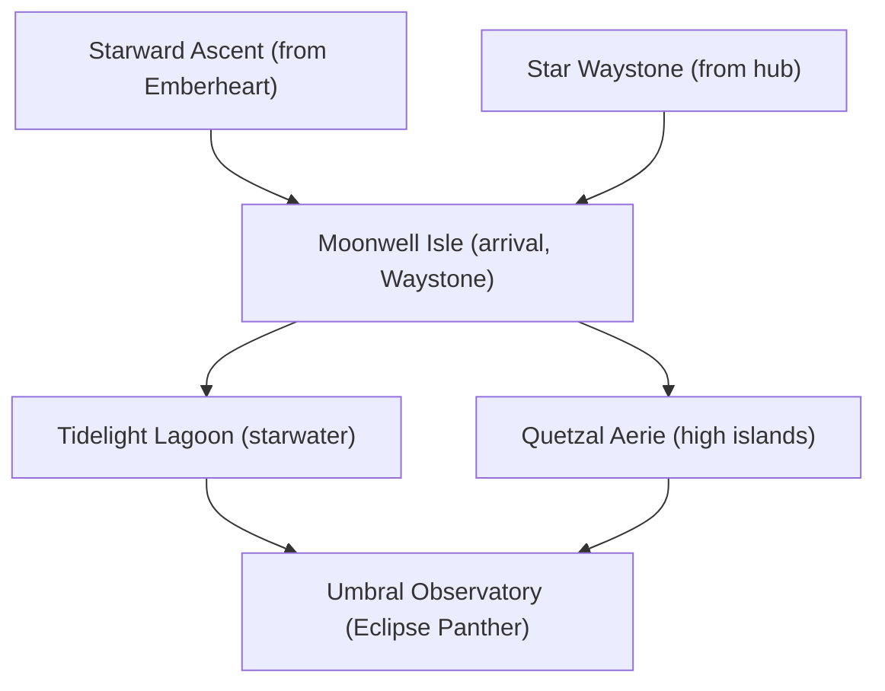

# Region - Starfall Sanctuary

> [!warning] UNDECIDED (Q-001)
> This region belongs to the **PROPOSED** hybrid world ([[Open Questions#Q-001]]).

| Field | Value |
|---|---|
| Region index | 8 (special endgame) |
| Theme | Celestial archipelago of floating islands |
| Stat and cash multiplier | ×11.5 |
| Unlock | Level 80 + defeat [[Mini-Boss - Cinderjaw]] + defeat at least 2 different world bosses |
| Recommended level | 80–100 |
| Mini-boss | [[Mini-Boss - Eclipse Panther]] |
| World boss | — (all four world bosses count toward its gate) |
| Footprint | 1,200 × 1,200 studs of islands at altitude +900 |
| Region cap | 14 |
| Rare-spawn species | [[Megalodon]], [[Blue Whale]], [[Giant Squid]] (Mythical); [[Mosasaurus]], [[Quetzalcoatlus]] (Secret) |
| Asset range | ENV-150 – ENV-169 |

## 1. Theme and fantasy

High above the world, islands of pale stone float in a sea of stars. Waterfalls pour off their edges into nothing, and a lagoon of glowing **starwater** holds the largest creatures in the game. The fantasy is **the sanctuary at the end of the journey**: calm, wondrous and a little mysterious, with the Eclipse Panther guarding its observatory. It is the only region whose home roster is entirely Mythical and Secret, so its everyday population is drawn from the best animals of every other region.

## 2. Visual identity

| Element | Direction |
|---|---|
| Terrain | Floating islands joined by light bridges, starwater pools and lagoon, crystal outcrops, island undersides with hanging roots |
| Vegetation | Silver-leaf trees, luminous flowers, moss with star-speck emission |
| Lighting | Permanent twilight: deep indigo sky, a large moon, soft cyan rim light from starwater; eclipse events darken and tint the sky violet ([[Lighting Direction]]) |
| Ambient effects | Drifting star motes, slow meteors in the skybox, aurora-like light ribbons, waterfalls dissolving into sparkles |
| Audio | Airy pads, soft chimes, whale song echoing; celesta, harp, choir and slow strings ([[Music Direction]]) |

### 2.1 Colour palette (PROPOSED)

| Role | Hex |
|---|---|
| Night indigo | `#1C1B4D` |
| Starwater cyan | `#5FF2F2` |
| Moon silver | `#DDE3F0` |
| Island stone | `#B9B3C9` |
| Nebula rose | `#FF79C6` |
| Secret prismatic base | `#1B1B2F` (matches the Secret rarity key in [[Canonical Proposed Values#1. Rarity tiers]]) |

## 3. Sub-zones and layout

| Sub-zone | Character | Main species | Hazards |
|---|---|---|---|
| **Moonwell Isle** | Arrival island around a glowing well | Rabbit and Duck (secondary), Owl (secondary) | HZ-18 Void Edge |
| **Tidelight Lagoon** | Large starwater lagoon with stepping-stone islets | Seal, Octopus, Dolphin, Electric Eel (secondary); apex rotation; Megalodon, Blue Whale, Giant Squid, Mosasaurus (rare spawns) | HZ-18 Void Edge |
| **Quetzal Aerie** | Tall thin islands linked by light bridges | Peacock, Golden Eagle (secondary); Quetzalcoatlus (rare spawn) | HZ-20 Gravity Well, HZ-19 Meteor Shower |
| **Umbral Observatory** | Domed observatory on the highest island | Eclipse Panther arena | Boss hazards |

Light bridges are solid and always on; there are no timed bridges, to avoid stranding players above the void.

## 4. Animals

### 4.1 Home species

| Animal | Rarity | Role | Pool class | Sub-zone | Spawn type |
|---|---|---|---|---|---|
| [[Megalodon]] | Mythical | Bruiser | Standard | Tidelight Lagoon anchors (4) | Rare spawn: 25% per 900 s window |
| [[Blue Whale]] | Mythical | Support | Scarce | Tidelight Lagoon anchors (3) | Rare spawn: 25% per 900 s window |
| [[Giant Squid]] | Mythical | Controller | Elusive | Lagoon deep pools (3) | Rare spawn: 25% per 900 s window |
| [[Mosasaurus]] | Secret | Assassin | Standard | Lagoon anchors (3) | Rare spawn: 10% per 2,700 s window |
| [[Quetzalcoatlus]] | Secret | Ranged | Standard | Quetzal Aerie anchors (3) | Rare spawn: 10% per 2,700 s window |

Starfall averages about **three Mythical events per hour** and one Secret event roughly every **3.75 hours** per server ([[Wild Animal Spawning and Respawn]]).

### 4.2 Secondary appearances (PROPOSED): "Starlit echoes"

Animals from other regions appear here under the region's starlight. They are the normal species models with region lighting, not variants ([[Open Questions#Q-006]]).

| Animal | Home | Point type |
|---|---|---|
| [[Rabbit]] | Whisperwood Forest | Common (moon-rabbit motif) |
| [[Duck]] | Whisperwood Forest | Common |
| [[Owl]] | Whisperwood Forest | Uncommon |
| [[Seal]] | Coral Coast | Uncommon |
| [[Peacock]] | Emerald Canopy | Rare |
| [[Octopus]] | Coral Coast | Rare |
| [[Dolphin]] | Coral Coast | Epic dedicated |
| [[Electric Eel]] | Emerald Canopy | Epic dedicated |
| [[Golden Eagle]] | Skyreach Peaks | Epic dedicated |
| [[Great White Shark]], [[Orca]], [[Narwhal]] | Coral Coast, Frostfang Tundra | Apex rotation (one Legendary point, equal weights) |

## 5. Enemy difficulty

×11.5 region multiplier. Approximate values before species tweaks:

| Example | Wild HP | Wild ATK | Cash per defeat |
|---|---:|---:|---:|
| Rabbit (Common Skirmisher, echo) | 3,910 | 138 | 115 |
| Megalodon (Mythical Bruiser) | 18,722 | 638 | 2,185 |
| Blue Whale (Mythical Support) | 17,020 | 415 | 2,185 |
| Mosasaurus (Secret Assassin) | 16,560 | 1,201 | 4,600 |
| Quetzalcoatlus (Secret Ranged) | 16,560 | 952 | 4,600 |

> [!warning] Balance risk
> At ×11.5, wild HP grows faster than the proposed player Strength curve. Time-to-kill for a level 80–90 player with an ascended Legendary team may reach 20–30 s per Mythical. This must be validated in [[Balance Simulation Plan]] and summarised in [[Progression Bottleneck Analysis]] before the multiplier is approved.

## 6. Boss encounters

| Boss | Type | Location | Recommended level |
|---|---|---|---|
| [[Mini-Boss - Eclipse Panther]] | Mini-boss (endgame, three phases) | Umbral Observatory | 90–100 |

Defeating the Eclipse Panther is not a gate to anything further at launch; it is the capstone mini-boss and a Trophy Hall centrepiece ([[Module - Trophy Hall]]). Rewards are **UNDECIDED** ([[Open Questions#Q-015]]).

## 7. Exploration

### 7.1 Landmarks

| Landmark | Asset | Purpose |
|---|---|---|
| **Moonwell** | ENV-152 | Hero landmark on the arrival island; a well of light reflecting the moon |
| **Star Orrery** | ENV-154 | Giant rotating model of the world ring above Moonwell Isle; each region's orb lights up when the player has discovered all its home species (**PROPOSED** cosmetic) |
| **Comet Arch** | ENV-156 | Arch of crystal over the lagoon's entrance |
| **Umbral Observatory** | ENV-158 | Domed observatory; boss arena |

### 7.2 Secrets (PROPOSED)

- **Underside Grotto:** reachable by a Gravity Well drop, a cave under Moonwell Isle holds a naturalist plaque and a view down to the whole world.
- **Orrery Alignment:** completing all eight regional orbs plays a short celestial animation (cosmetic only, no odds effect).
- **Naturalist plaques:** five plaques.

## 8. Progression requirements

- Entry: level 80 + Cinderjaw + at least 2 different world bosses ([[Region Unlock Progression]]).
- Merge station level 5 (Celestial Convergence Altar, 1,000,000 Cash, Mythical → Secret) requires this region unlocked ([[Egg Merging Station]]).

## 9. Environmental hazards

| Hazard | Where | Effect summary |
|---|---|---|
| HZ-18 Void Edge | All island edges | Fall return (H7) |
| HZ-19 Meteor Shower | Quetzal Aerie (event) | Telegraphed impacts |
| HZ-20 Gravity Well | Aerie and grotto | Beneficial: higher jumps, slow falls |

## 10. Performance considerations

| Budget | Target (PROPOSED) |
|---|---|
| Static parts | ≤ 8,000 |
| Skybox | Custom star skybox; slow meteors as skybox-layer meshes, not particles |
| Island undersides | Low-poly; detail only where visible from bridges |
| Starwater | Neon-material surface with a scrolling texture over opaque base; no terrain water at this altitude |
| Particle emitters | ≤ 16 active; star motes via one camera-attached emitter |
| Rare-spawn models | Up to two colossal models active at once; LOD meshes mandatory ([[Animal Modelling Principles]]) |
| Streaming | Each island is a separate streaming model; the observatory interior loads on approach |

## 11. Asset IDs (ENV-150 – ENV-169)

| ID | Kit |
|---|---|
| ENV-150 | Floating island kit (tops, undersides, hanging roots) |
| ENV-151 | Silver-leaf vegetation and luminous flowers |
| ENV-152 | Moonwell landmark |
| ENV-153 | Light bridge kit |
| ENV-154 | Star Orrery |
| ENV-155 | Starwater lagoon surface and islets |
| ENV-156 | Comet Arch |
| ENV-157 | Gravity Well props |
| ENV-158 | Umbral Observatory arena |
| ENV-159 | Star skybox and meteor layer |
| ENV-160 – ENV-169 | Reserved |

## 12. Test hooks

- Void Edge fall from every island returns the player to that island's last safe point.
- Two simultaneous colossal rare spawns plus 12 other animals on a mid-range mobile → ≥ 30 FPS.
- Star Waystone stays inactive until the full gate is met.

## Related documents
- [[World Design Index]]
- [[Region - Emberheart Caldera]]
- [[Mini-Boss - Eclipse Panther]]
- [[Long-Term Goals and Endgame]]
- [[Wild Animal Spawning and Respawn]]
- [[Progression Bottleneck Analysis]]
