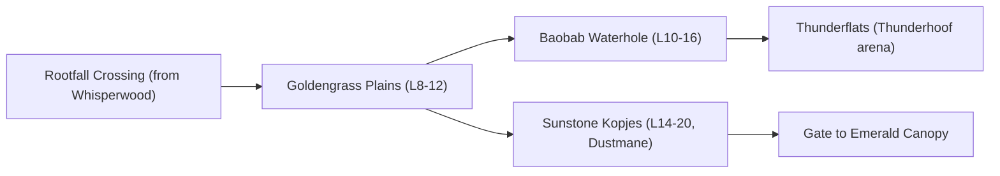

# Region - Sunscorch Savanna

> [!warning] UNDECIDED (Q-001)
> This region belongs to the **PROPOSED** hybrid world ([[Open Questions#Q-001]]).

| Field | Value |
|---|---|
| Region index | 2 |
| Theme | Safari grassland |
| Stat and cash multiplier | ×1.5 |
| Unlock | Level 8 + defeat [[Mini-Boss - Bramblehorn]] |
| Recommended level | 8–20 |
| Mini-boss | [[Mini-Boss - Dustmane]] |
| World bosses | [[World Boss - Thunderhoof]] (Thunderflats); [[World Boss - Ironbark Colossus]] (Rootfall Crossing, shared border) |
| Footprint | 1,600 × 1,400 studs, altitude 0 to +20 |
| Region cap | 26 |
| Asset range | ENV-030 – ENV-049 |

## 1. Theme and fantasy

Wide golden grassland under a huge sky. After the enclosed forest, the Savanna's fantasy is **space and scale**: you can see herds, storms and the silhouette of a colossal elephant on the horizon. It introduces the first Epic and Legendary wild animals, the first apex spawn, and the first region where the world boss lives inside the region.

## 2. Visual identity

| Element | Direction |
|---|---|
| Terrain | Flat-to-rolling plains, rocky kopjes (granite outcrops), dry riverbeds, one large waterhole |
| Vegetation | Flat-topped acacias, a giant baobab, tall grass clumps that sway in waves |
| Lighting | Strong warm sun, crisp shadows, high exposure; late-afternoon golden tint; heat-haze shimmer near the ground |
| Ambient effects | Grass waves (wind-driven texture scrolling), dust motes, distant storm flashes over Thunderflats |
| Audio | Cicadas, wind through grass, distant rumbles; marimba and hand-drum lead |

### 2.1 Colour palette (PROPOSED)

| Role | Hex |
|---|---|
| Golden grass | `#E3B95A` |
| Dry earth | `#C98A4B` |
| Acacia green | `#7E9B45` |
| Sky | `#8FD0F5` |
| Sunset accent | `#FF8C42` |
| Kopje granite | `#A89A8A` |

## 3. Sub-zones and layout

| Sub-zone | Character | Main species | Hazards |
|---|---|---|---|
| **Goldengrass Plains** | Open grass with meerkat mounds and zebra herds | Meerkat, Zebra, Hyena, Boar (secondary) | HZ-03 Dust Devil |
| **Baobab Waterhole** | Shared watering spot around the Great Baobab | Flamingo, Hippo, Zebra, Cobra, Elephant (apex rotation) | — |
| **Sunstone Kopjes** | Granite outcrops, ledges, the Dustmane arena | Cheetah, Kangaroo, Cobra, Rhino, Lion (apex rotation), Goat (secondary) | HZ-04 Sinksand (dry riverbed) |
| **Thunderflats** | Cracked salt pan under a permanent storm cloud | World boss arena; sparse wild spawns | HZ-03 during boss downtime |

## 4. Animals

### 4.1 Home species

| Animal | Rarity | Role | Pool class | Sub-zone | Spawn type |
|---|---|---|---|---|---|
| [[Meerkat]] | Common | Support | Scarce | Goldengrass Plains | Fixed group |
| [[Zebra]] | Common | Controller | Standard | Plains, Waterhole | Fixed group |
| [[Hyena]] | Uncommon | Skirmisher | Standard | Goldengrass Plains | Fixed |
| [[Flamingo]] | Uncommon | Support | Scarce | Baobab Waterhole | Fixed |
| [[Cobra]] | Uncommon | Ranged | Standard | Kopjes, Waterhole | Fixed |
| [[Cheetah]] | Rare | Skirmisher | Standard | Sunstone Kopjes | Fixed, fewer |
| [[Kangaroo]] | Rare | Bruiser | Standard | Sunstone Kopjes | Fixed, fewer |
| [[Rhino]] | Epic | Bruiser | Standard | Sunstone Kopjes | Dedicated point |
| [[Hippo]] | Epic | Tank | Scarce | Baobab Waterhole | Dedicated point |
| [[Lion]] | Legendary | Bruiser | Standard | Apex point (rotation) | 50% per 300 s window |
| [[Elephant]] | Legendary | Tank | Standard | Apex point (rotation) | 50% per 300 s window |

The single apex point alternates between Lion (Kopjes rock) and Elephant (Waterhole) with equal weight each window. The apex point physically moves between two authored positions, so the region still has exactly one apex point active at a time ([[Wild Animal Spawning and Respawn]]).

### 4.2 Secondary appearances (PROPOSED)

| Animal | Home | Why here |
|---|---|---|
| [[Boar]] | Whisperwood Forest | Warthog-like role filler on the plains; keeps Common density high |
| [[Goat]] | Whisperwood Forest | Kopje climbers; Common filler on rocky ground |

## 5. Enemy difficulty

×1.5 region multiplier. Approximate values before species tweaks:

| Example | Wild HP | Wild ATK | Cash per defeat |
|---|---:|---:|---:|
| Zebra (Common Controller) | 570 | 18 | 15 |
| Hyena (Uncommon Skirmisher) | 663 | 23 | 24 |
| Cheetah (Rare Skirmisher) | 867 | 31 | 42 |
| Rhino (Epic Bruiser) | 1,452 | 50 | 75 |
| Lion (Legendary Bruiser) | 1,881 | 64 | 142 |

Wild Legendaries here are tuned as **group or late-band targets**: a solo player at level 10 should be able to defeat one with good dodging, but comfortably only around level 16+.

## 6. Boss encounters

| Boss | Type | Location | Recommended level |
|---|---|---|---|
| [[Mini-Boss - Dustmane]] | Mini-boss | Sunstone Kopjes | 16–20 |
| [[World Boss - Thunderhoof]] | World boss | Thunderflats | 30 |
| [[World Boss - Ironbark Colossus]] | World boss | Rootfall Crossing | 15 |

Thunderhoof's recommended level (30) is above the region's band on purpose: it lives here as a returning-player challenge and a reason to come back after unlocking Emerald Canopy.

## 7. Exploration

### 7.1 Landmarks

| Landmark | Asset | Purpose |
|---|---|---|
| **Great Baobab** | ENV-032 | Hero landmark; Waystone at its roots; shade and calm area |
| **Sunstone Kopje** | ENV-034 | Tallest outcrop; Dustmane's arena on its summit plateau |
| **Cracked Vein** | ENV-035 | Dry riverbed canyon cutting across the region; sinksand pockets |
| **Thunderflats Salt Pan** | ENV-037 | Storm-lit flats; Thunderhoof arena |

### 7.2 Secrets (PROPOSED)

- **Kopje Climb:** a hidden ledge route to the top of a lesser kopje with a panoramic view of the whole ring of regions.
- **Old Hide:** a wooden wildlife hide overlooking the Waterhole; standing inside reveals a spawn group of Flamingos (no odds change).
- **Naturalist plaques:** five plaques for Savanna species.

## 8. Progression requirements

- Entry: level 8 + Bramblehorn ([[Region Unlock Progression]]).
- Exit to [[Region - Emerald Canopy]]: level 18 + Dustmane.
- Merge station level 2 (Stonebound Hatchery Forge, 15,000 Cash) becomes available once this region is unlocked ([[Egg Merging Station]]).

## 9. Environmental hazards

| Hazard | Where | Effect summary |
|---|---|---|
| HZ-03 Dust Devil | Goldengrass Plains, Thunderflats | Moving whirlwind; knockback and small damage |
| HZ-04 Sinksand | Cracked Vein | Heavy slow; no dodge roll |

Dust Devils teach the first moving hazard. Full rules: [[Environmental Hazards]].

## 10. Performance considerations

| Budget | Target (PROPOSED) |
|---|---|
| Static parts | ≤ 11,000 (open terrain uses Terrain, not parts) |
| Grass | Terrain grass decoration plus ≤ 400 tall-grass clump meshes near paths; density reduced on mobile |
| Draw distance | Long sight lines are the identity; use low-detail impostor meshes for distant acacias and kopjes |
| Particle emitters | ≤ 20 active; Dust Devils ≤ 3 alive at once |
| Storm effects | Thunderflats lightning flashes are client-side, rate-limited, reduced-flash option |
| Streaming | Thunderflats streamed as its own model; boss arena dressing loads with the world boss announcement |

## 11. Asset IDs (ENV-030 – ENV-049)

| ID | Kit |
|---|---|
| ENV-030 | Savanna terrain and kopje rock kit |
| ENV-031 | Acacia and shrub set |
| ENV-032 | Great Baobab landmark |
| ENV-033 | Waterhole shoreline kit |
| ENV-034 | Sunstone Kopje and Dustmane arena |
| ENV-035 | Cracked Vein canyon kit |
| ENV-036 | Meerkat mound and termite mound props |
| ENV-037 | Thunderflats salt pan and arena |
| ENV-038 | Wildlife hide and plaques |
| ENV-039 – ENV-049 | Reserved |

## 12. Test hooks

- Apex simulation over 2,000 windows → about 1,000 occupied (50%), split roughly evenly between Lion and Elephant.
- Dust Devil knockback never pushes a player through the Canopy gate while locked ([[Region Unlock Progression]]).
- Long-distance impostors swap without visible popping at 60 FPS on PC.

## Related documents
- [[World Design Index]]
- [[Region - Whisperwood Forest]]
- [[Region - Emerald Canopy]]
- [[Mini-Boss - Dustmane]]
- [[World Boss - Thunderhoof]]
- [[Environmental Hazards]]
