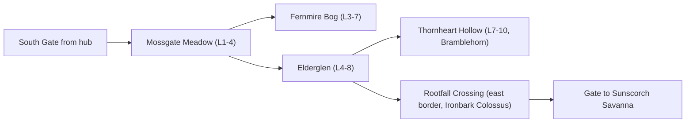

# Region - Whisperwood Forest

> [!warning] UNDECIDED (Q-001)
> This region belongs to the **PROPOSED** hybrid world. Layout, size and adjacency are **UNDECIDED** ([[Open Questions#Q-001]]).

| Field | Value |
|---|---|
| Region index | 1 (starter) |
| Theme | Temperate woodland |
| Stat and cash multiplier | ×1.0 |
| Unlock | Start |
| Recommended level | 1–10 |
| Mini-boss | [[Mini-Boss - Bramblehorn]] |
| World boss | [[World Boss - Ironbark Colossus]] at Rootfall Crossing (eastern border) |
| Footprint | 1,400 × 1,200 studs, altitude 0 |
| Region cap | 30 wild animals per server ([[Wild Animal Spawning and Respawn]]) |
| Asset range | ENV-010 – ENV-029 |

## 1. Theme and fantasy

Whisperwood is the forest every adventure starts in: friendly, bright and full of life, but with older, darker groves deeper in. The fantasy is **"the woods behind your house, if they were enchanted"**. Leaves whisper as players pass (literal rustle audio), and the oldest trees glow faintly at their roots, foreshadowing the "ancient lineage" fiction of the rarest eggs.

## 2. Visual identity

| Element | Direction |
|---|---|
| Terrain | Gentle rolling hills, mossy rocks, clear shallow streams, a bog in the west |
| Vegetation | Faceted oaks and birches with chunky leaf clusters, fern beds, mushroom rings |
| Lighting | Morning light with long, soft god-rays through the canopy; light fog density in Elderglen ([[Lighting Direction]]) |
| Ambient effects | Floating pollen motes, falling leaves, fireflies at dusk-lit glades, stream sparkles ([[VFX - Environment Ambient Effects]]) |
| Audio | Birdsong, rustling leaves, babbling streams; acoustic guitar and flute lead ([[Sound - Ambient World]], [[Music Direction]]) |

### 2.1 Colour palette (PROPOSED)

| Role | Hex |
|---|---|
| Canopy green | `#5DAA4B` |
| Moss | `#7CC26A` |
| Bark | `#7A5236` |
| Stream blue | `#6EC6E6` |
| Sunlight accent | `#FFE08A` |
| Deep grove shadow | `#2F4A3A` |

## 3. Sub-zones and layout

| Sub-zone | Character | Main species | Hazards |
|---|---|---|---|
| **Mossgate Meadow** | Open clearings near the hub gate; tutorial fights | Rabbit, Squirrel, Hedgehog, Duck, Goat | None |
| **Fernmire Bog** | Misty wetland with boardwalks and the Lantern Mill | Frog, Duck, Beaver, Raccoon | HZ-02 Fernmire Bog |
| **Elderglen** | Ancient oaks, the Grandfather Oak landmark | Owl, Deer, Squirrel, Woodpecker, Fox, Badger, Boar | HZ-01 Bramble Thicket (edges) |
| **Thornheart Hollow** | Darker grove ringed by brambles, boss arena at its centre | Wolf, Brown Bear, Badger | HZ-01 Bramble Thicket |

## 4. Animals

### 4.1 Home species (from [[Canonical Proposed Values#2. Launch roster (PROPOSED)]])

| Animal | Rarity | Role | Pool class | Sub-zone | Spawn type |
|---|---|---|---|---|---|
| [[Rabbit]] | Common | Skirmisher | Standard | Mossgate Meadow | Fixed group |
| [[Squirrel]] | Common | Ranged | Standard | Mossgate, Elderglen | Fixed group |
| [[Hedgehog]] | Common | Tank | Standard | Mossgate Meadow | Fixed group |
| [[Raccoon]] | Common | Assassin | Scarce | Fernmire Bog | Fixed group |
| [[Frog]] | Common | Controller | Standard | Fernmire Bog | Fixed group |
| [[Duck]] | Common | Support | Standard | Mossgate, Fernmire | Fixed group |
| [[Woodpecker]] | Common | Skirmisher | Elusive | Elderglen | Fixed group (low weight) |
| [[Boar]] | Common | Bruiser | Standard | Elderglen | Fixed group |
| [[Goat]] | Common | Bruiser | Standard | Mossgate rocky edge | Fixed group |
| [[Fox]] | Uncommon | Assassin | Standard | Elderglen | Fixed |
| [[Owl]] | Uncommon | Controller | Scarce | Elderglen | Fixed |
| [[Deer]] | Uncommon | Support | Standard | Elderglen | Fixed |
| [[Badger]] | Uncommon | Bruiser | Standard | Elderglen, Thornheart | Fixed |
| [[Beaver]] | Uncommon | Tank | Standard | Fernmire Bog | Fixed |
| [[Wolf]] | Rare | Bruiser | Standard | Thornheart Hollow | Fixed, fewer points |
| [[Brown Bear]] | Rare | Tank | Standard | Thornheart Hollow | Fixed, fewer points |

Whisperwood has 16 home species, the largest share, so new players can discover many species quickly (+3 PS each, [[Animal Index Feature Specification]]).

### 4.2 Secondary appearances (PROPOSED)

None. Whisperwood is fully covered by its home roster. Its Rare points (4) give an early taste of Wolf and Brown Bear.

## 5. Enemy difficulty

Region multiplier ×1.0 on wild HP and ATK, on top of the wild multipliers (HP ×2.0, ATK ×0.75; [[Canonical Proposed Values#4. Combat values (PROPOSED)]]). Approximate values before species tweaks (exact values: [[Animal Statistics Database]]):

| Example | Wild HP | Wild ATK | Cash per defeat |
|---|---:|---:|---:|
| Rabbit (Common Skirmisher) | 340 | 12 | 10 |
| Hedgehog (Common Tank) | 620 | 10 | 10 |
| Fox (Uncommon Assassin) | 390 | 28 | 16 |
| Wolf (Rare Bruiser) | 748 | 26 | 28 |
| Brown Bear (Rare Tank) | 1,054 | 18 | 28 |

Average Cash per defeat across the region's spawn mix is about 12, so a 200-Cash roll takes roughly 17 defeats ([[Core Gameplay Loop]]).

## 6. Boss encounters

| Boss | Type | Location | Recommended level |
|---|---|---|---|
| [[Mini-Boss - Bramblehorn]] | Mini-boss | Thornheart Hollow | 8–10 |
| [[World Boss - Ironbark Colossus]] | World boss | Rootfall Crossing (shared border with Savanna) | 15 |

Bramblehorn is a required key for the Savanna gate ([[Region Unlock Progression]]). Ironbark Colossus is visible from Elderglen when it spawns, giving new players an aspirational sight long before they can fight it.

## 7. Exploration

### 7.1 Landmarks

| Landmark | Asset | Purpose |
|---|---|---|
| **Grandfather Oak** | ENV-012 | Hero landmark; vast hollow oak in Elderglen with glowing roots; Waystone clearing at its base |
| **Lantern Mill** | ENV-015 | Beaver dam and waterwheel with hanging lanterns in Fernmire Bog |
| **Mossgate Ruins** | ENV-013 | Mossy stone arch marking the start of the region |
| **Rootfall Crossing** | ENV-018 | Giant fallen roots bridging the stream into the Savanna; world boss arena |

### 7.2 Secrets (PROPOSED)

- **Hollow Log Run:** a fallen log tunnel west of Elderglen leads to a hidden glade with a Woodpecker spawn group (still Elusive weighted; secrets change access, not odds).
- **Lantern Path:** lighting five lanterns around the Lantern Mill (ProximityPrompt interactions) opens a shortcut boardwalk across Fernmire Bog.
- **Naturalist plaques:** six carved plaques that unlock flavour text in the Animal Index for Whisperwood species (cosmetic only).

## 8. Progression requirements

- Available from the start through the hub's South Gate.
- Exit to [[Region - Sunscorch Savanna]]: level 8 + Bramblehorn defeated.
- XP to level 8: 7,223 (about 600 defeats at roughly 12 XP each, about one hour of play; [[Region Unlock Progression]]).

## 9. Environmental hazards

| Hazard | Where | Effect summary |
|---|---|---|
| HZ-01 Bramble Thicket | Elderglen edges, Thornheart ring | Slow; small damage after 3 s |
| HZ-02 Fernmire Bog | Fernmire Bog | Slow; shorter dodge roll |

Hazards here are mild and teaching-oriented. Full rules: [[Environmental Hazards]].

## 10. Performance considerations

| Budget | Target (PROPOSED) |
|---|---|
| Static parts | ≤ 14,000 (trees built from ≤ 12 parts or one MeshPart each) |
| Unique meshes | ≤ 90 |
| Foliage | Instanced tree variants (8 oak, 6 birch, 4 shrub); leaf clusters as single MeshParts |
| Particle emitters | ≤ 30 active near the player; pollen and leaves at rate ≤ 8 |
| Water | Terrain water for streams; bog uses a flat transparent part with animated texture |
| Streaming | Elderglen and Thornheart as separate streaming models; Grandfather Oak flagged as persistent landmark (*unverified*: confirm the best model streaming mode for landmarks against current documentation) |
| Mobile | Fog hides draw distance beyond 350 studs; fireflies disabled on low graphics quality |

The region carries the highest player density early on, so its cap of 30 wild animals and a dense spawn layout must be profiled with 16 players in Mossgate Meadow ([[Test Cases - Mobile Performance]]).

## 11. Asset IDs (ENV-010 – ENV-029)

| ID | Kit |
|---|---|
| ENV-010 | Woodland terrain kit (hills, rocks, stream banks) |
| ENV-011 | Oak and birch tree set |
| ENV-012 | Grandfather Oak landmark |
| ENV-013 | Mossgate Ruins arch |
| ENV-014 | Fern, mushroom and flower set |
| ENV-015 | Lantern Mill and dam |
| ENV-016 | Fernmire boardwalk kit |
| ENV-017 | Bramble Thicket hazard props |
| ENV-018 | Rootfall Crossing roots and arena dressing |
| ENV-019 | Thornheart Hollow arena kit |
| ENV-020 | Naturalist plaques |
| ENV-021 – ENV-029 | Reserved |

## 12. Test hooks

- 16 players and 30 wild animals in Mossgate Meadow on a mid-range mobile device → ≥ 30 FPS.
- New player reaches level 8 in 45–90 minutes in playtests (pacing check).
- Bramble Thicket damage never knocks out (H2).

## Related documents
- [[World Design Index]]
- [[World Overview and Map]]
- [[New Player Onboarding]]
- [[Mini-Boss - Bramblehorn]]
- [[World Boss - Ironbark Colossus]]
- [[Environment Art Direction]]
- [[Region - Sunscorch Savanna]]
