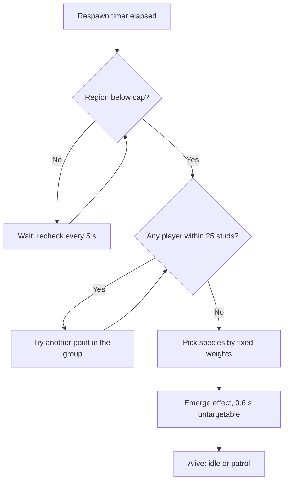

# Wild Animal Spawning and Respawn

> [!success] CONFIRMED
> Wild animals respawn; rarer animals respawn more slowly (D-011). Progression luck does **not** affect wild encounter rarity (D-017).

> [!info] PROPOSED
> Respawn times and rare-spawn chances come from [[Canonical Proposed Values#6. Wild rewards and respawn (PROPOSED)]]. Spawn point layout, caps, selection rules, announcements, despawn and LOD rules on this page are **PROPOSED** for [[Service - SpawnService]].

> [!important] Luck never touches the wild
> No player's Progression Score, luck, purchases, history or index state influences **which** wild animals spawn, **where**, **when** or at **what rarity**. Spawning is server-wide and identical for every player on the server. Rare-spawn rolls use a server-side `Random.new()` stream with no player inputs. Any change that introduces a player input into spawning violates D-017 and must be rejected in review.

## 1. Spawn architecture

| Concept | Definition |
|---|---|
| **Spawn point** | A part tagged `WildSpawn` (CollectionService) with attributes `RegionId`, `Tier` (rarity band), `SpeciesList` (comma-separated IDs), `GroupSize` (1–3) |
| **Spawn group** | A cluster of 3–6 spawn points sharing a theme (for example "Mossgate rabbit warren") so animals appear in natural groups |
| **Dedicated point** | An Epic point that holds one specific species |
| **Apex point** | The single Legendary point per region |
| **Rare-spawn anchor** | 3–5 candidate locations per Mythical or Secret species; one is chosen at random per event |
| **Region cap** | Maximum simultaneously alive wild animals in a region, per server |

### 1.1 Respawn and placement by rarity

| Rarity | Respawn time | Placement | Behaviour after defeat |
|---|---|---|---|
| Common | 20 s | Fixed spawn points in groups | Same point, species re-rolled from `SpeciesList` |
| Uncommon | 35 s | Fixed spawn points | As Common |
| Rare | 60 s | Fixed spawn points, fewer of them | As Common |
| Epic | 120 s | Dedicated points | Same species returns |
| Legendary | 300 s | Single apex point per region | 50% chance per 300 s window that the apex is occupied; if a region has two Legendary species, the species is chosen with equal weight per window |
| Mythical | 900 s window | Rare-spawn event | 25% chance per window, announced to the server |
| Secret | 2,700 s window | Rare-spawn event | 10% chance per window, announced to the server |

Respawn timers start **at defeat**, not at despawn, and keep running while the region is dormant (§5).

### 1.2 Species re-roll weights at shared points (PROPOSED)

When a point lists several species, the species is chosen by the roster's pool class, reused as a wild-frequency hint: Standard 10, Scarce 6, Elusive 3 ([[Canonical Proposed Values#2. Launch roster (PROPOSED)]]). This keeps Elusive animals such as [[Woodpecker]] genuinely uncommon to meet. These weights are fixed and identical for every player; they are **not** the hatch-pool weights and are not affected by H or P.

## 2. Population caps per server (PROPOSED)

Canonical budget: ≤ 180 simulated wild animals, ≤ 60 with full AI near players ([[Canonical Proposed Values#15. Server and performance targets (PROPOSED)]]).

| Region | Region cap | Spawn points | Of which Rare | Epic points | Apex | Rare-spawn species |
|---|---:|---:|---:|---:|---:|---|
| [[Region - Whisperwood Forest]] | 30 | 34 | 4 | 0 | 0 | — |
| [[Region - Sunscorch Savanna]] | 26 | 30 | 5 | 2 | 1 | — |
| [[Region - Emerald Canopy]] | 24 | 28 | 5 | 4 | 0 | — |
| [[Region - Coral Coast]] | 20 | 24 | 4 | 2 | 1 | — |
| [[Region - Frostfang Tundra]] | 20 | 24 | 4 | 2 | 1 | Woolly Mammoth |
| [[Region - Skyreach Peaks]] | 18 | 22 | 3 | 3 | 1 | Haast's Eagle |
| [[Region - Emberheart Caldera]] | 16 | 20 | 3 | 3 | 1 | Sabre-Tooth Tiger, Titanoboa, Tyrannosaurus Rex |
| [[Region - Starfall Sanctuary]] | 14 | 18 | 2 | 3 | 1 | Megalodon, Blue Whale, Giant Squid, Mosasaurus, Quetzalcoatlus |
| **Wild total** | **168** | 200 | | | | |
| Bosses (8 mini + 4 world, worst case) | 12 | | | | | |
| **Grand total** | **180** | | | | | |

Spawn points outnumber the cap so that the server can skip points near players (§3) and still fill the region. Rare-spawn animals count toward their region cap; if the cap is full, the lowest-rarity animal furthest from any player is despawned to make room.

Regions whose home roster lacks low-rarity species fill Common, Uncommon and Rare points with **PROPOSED secondary appearances** of earlier species, listed in each region document. Secondary appearances use the **host** region's multiplier.

## 3. Spawn selection rules

1. **Player proximity:** a point does not spawn if any player is within 25 studs (avoids pop-in).
2. **Line of sight:** **PROPOSED** optional check: prefer points not in the camera view of the nearest player, approximated server-side by a 70° cone from the character's facing.
3. **Spawn presentation:** a 0.6 s "emerge" effect (leaves, sand, bubbles, snow; [[VFX - Environment Ambient Effects]]) and the animal's idle animation; the animal is not targetable for 0.6 s.
4. **Spacing:** points within a group are at least 12 studs apart; groups are at least 20 studs from main paths ([[World Overview and Map]]).
5. **Hazards:** no point within 10 studs of an ambient hazard edge ([[Environmental Hazards]]).

## 4. Rare-spawn events (Mythical and Secret)

| Step | Rule (PROPOSED unless canonical) |
|---|---|
| Window | Each Mythical species has a 900 s window and each Secret species a 2,700 s window, per server, running from server start with a random offset of 0–100% of a window so species do not align |
| Roll | At window start: Mythical 25% (canonical), Secret 10% (canonical) |
| Location | One of 3–5 anchors in its home region, chosen uniformly |
| Announcement | Server-wide system message and banner on spawn: species silhouette (name hidden if the player has not discovered it), region, and a compass marker to the anchor's sub-zone; World Boss Board entry ([[UI - Notifications]]) |
| Lifetime | Remains until defeated or 600 s (Mythical) / 480 s (Secret) pass **without being engaged**; once engaged, it remains until defeated or reset by leash |
| Leash | Standard 60-stud leash (§6) |
| Credit | Every player with ≥10% of max HP contributed gets full Cash, XP and discovery (D-040 **PROPOSED**) |
| Repeat | A defeated rare spawn does not respawn until a later window succeeds |

Expected frequency per server: each Mythical species about **1 per hour**; each Secret species about **1 per 7.5 hours**. Starfall Sanctuary, with five rare-spawn species, sees about three Mythical events per hour and one Secret event roughly every 3.75 hours.

Players who miss announcements can move servers; that is acceptable because spawns are server-wide and luck-free. No "pity" for wild spawns exists or is planned, consistent with D-017.

> [!info] PROPOSED: announcement fairness
> All players receive the announcement in the same server tick. The compass marker points to a sub-zone, not the exact anchor, so players nearby do not have an overwhelming advantage, while the 10% credit threshold lets late arrivals still contribute.

## 5. Per-server instancing and simulation LOD

Wild animals are **shared server entities**: one instance exists per spawn for everyone on the server. There is no per-player instancing of wild animals.

| LOD tier | Condition | Simulation |
|---|---|---|
| Full AI | Within 150 studs of any player | Perception, pathfinding, combat ([[Wild Animal AI]]) ≤ 60 per server |
| Reduced | 150–400 studs | Idle or patrol along a precomputed path; no perception; animation streamed out on clients |
| Dormant | Region has had no players for 300 s | Animals despawned; spawn and respawn timers continue; region refilled to cap when a player enters, over 10 s, not instantly |

If more than 60 animals qualify for full AI, the server promotes those nearest to engaged players first ([[Implementation - Animal AI State Machine]]). Movement uses server network ownership for wild animals (`BasePart:SetNetworkOwner(nil)`) so clients cannot manipulate them ([[Network Ownership]]).

## 6. Leash behaviour

| Rule | Value |
|---|---|
| Leash range | 60 studs from the animal's spawn point (canonical) |
| Trigger | The animal's position exceeds 60 studs, or all its attackers are more than 60 studs from the spawn point |
| Return | Moves back at 1.5× its movement speed, ignores damage and aggro while returning |
| Reset | Arrives at full HP; combat tags and damage contributions clear |
| Anti-exploit | An animal that leashes 3 times within 60 s becomes "wary" for 30 s: it stays within 30 studs of its point (**PROPOSED**) |
| Bosses | Use arena boundaries instead of the 60-stud leash ([[Boss Design Overview]]) |

## 7. Edge cases

- **Animal defeated during despawn:** defeat wins if it resolves on the server first; despawn is cancelled.
- **Region at cap when a rare spawn succeeds:** evict as in §2; rare spawns are never skipped because of the cap.
- **Server shutting down:** no persistence of wild state; timers restart on new servers.
- **Many players camping a point:** proximity rule shifts spawns within the group; respawn timers are unchanged, so camping does not speed up spawns.
- **Hazard pushes an animal:** wild animals are immune to ambient hazards and path around them ([[Environmental Hazards]]).

## 8. Telemetry (PROPOSED)

`wild_spawn` (species, region, point), `wild_defeat` (species, region, credited players, TTK), `rare_spawn_roll` (species, success), `rare_spawn_outcome` (defeated, expired, engaged count). Used to verify spawn rates statistically ([[Statistical Testing of Probabilities]]).

## 9. Test hooks

| ID | Test | Expected |
|---|---|---|
| SP-01 | Force 10,000 Secret window rolls | Success rate 10% ± 0.6% (99% CI) |
| SP-02 | Two players with PS 0 and PS 1000 on one server | Identical spawns (spawn RNG has no player input) |
| SP-03 | Kite an animal 61 studs from spawn | Leash return and full HP reset |
| SP-04 | Empty region for 300 s | Dormant; animals despawned; refill over 10 s on entry |
| SP-05 | 80 animals within 150 studs of players | ≤ 60 in Full AI |

See [[Test Cases - Animal AI]] and [[Test Cases - Multiplayer]].

## Related documents
- [[World Design Index]]
- [[Service - SpawnService]]
- [[Wild Animal AI]]
- [[Combat Rewards]]
- [[Dynamic Progression Luck]]
- [[Animal Scalability and Performance Budgets]]
- [[Animal Index Feature Specification]]
