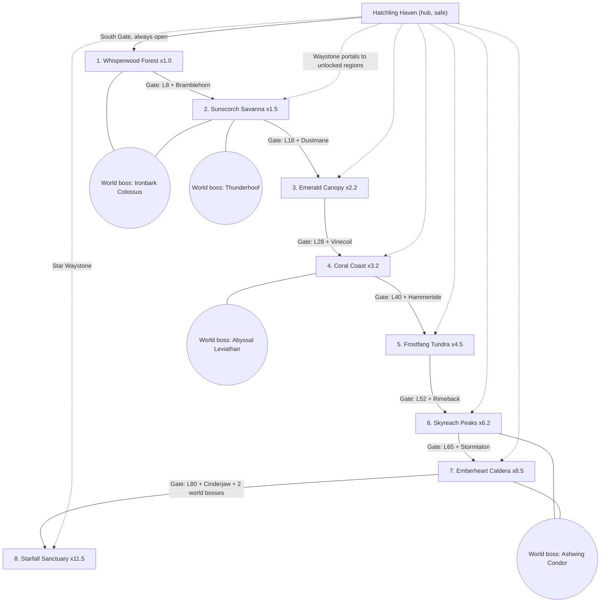

# World Overview and Map

> [!warning] UNDECIDED (Q-001): this layout is NOT approved
> The exact world layout, region list, adjacency and size are **UNDECIDED** ([[Open Questions#Q-001]]). Everything on this page is a **PROPOSED** hybrid world (D-035 **PROPOSED**) for prototyping and art pre-production. Do not build final terrain against it until the owner decides.

> [!success] CONFIRMED (D-025)
> One large **shared world** that supports both single-player and multiplayer play. Wild animals respawn, rarer ones more slowly (D-011). Mini-bosses and world bosses exist (D-012).

## 1. The proposed hybrid world

The proposal is a **hybrid**: one contiguous, walkable world in a single Roblox place, combined with **hub portals** for fast travel to regions the player has already unlocked.

- **Contiguous:** regions physically touch. A player can walk from [[Region - Whisperwood Forest]] to [[Region - Emberheart Caldera]] without a loading screen. This honours D-025 and makes the world feel large and real.
- **Hub-centred:** [[Hub - Hatchling Haven]] sits in the middle of a ring of regions. Its Waystone portals connect to each unlocked region's Waystone, so returning home and heading out is quick ([[Team Equipping and Base Lock Rule]]).
- **Gated:** each region boundary has a **Waystone Gate** that opens per player when the gate requirement is met ([[Region Unlock Progression]]).
- **Vertical finale:** [[Region - Starfall Sanctuary]] floats above the world, reached by a sky path from Emberheart Caldera or by the hub's Star Waystone once unlocked.

### 1.1 Alternatives considered (for Q-001)

| Option | Description | Fit with D-025 | Recommendation |
|---|---|---|---|
| **A. Hybrid ring + hub portals** | This page | Strong: one world, one server, shared spaces | **PROPOSED** recommendation |
| B. Hub and spoke islands | Hub with separate islands connected only by portals | Medium: one place, but regions feel disconnected | Fallback if memory budgets fail |
| C. Separate places per region | TeleportService between places | Weak: splits the shared world and its players | Not recommended |

## 2. Region adjacency map

Solid arrows are walkable gated borders; dotted arrows are hub portals that activate once the region is unlocked. Emberheart Caldera and Whisperwood Forest share a visual border (the Cinder Wall cliffs) that is **not** passable, closing the ring visually without creating a shortcut.

## 3. Spatial layout (PROPOSED)

The ring runs clockwise from the south, so the player's journey visibly circles the hub and climbs in altitude and drama.

| Position | Region | Footprint (studs) | Base altitude | Terrain character |
|---|---|---|---|---|
| Centre | [[Hub - Hatchling Haven]] | 600 × 600 | +40 | Plateau garden, egg shrine, base terraces |
| South | [[Region - Whisperwood Forest]] | 1,400 × 1,200 | 0 | Rolling woodland, streams |
| South-east | [[Region - Sunscorch Savanna]] | 1,600 × 1,400 | 0 to +20 | Open grassland, kopjes, dry riverbeds |
| East | [[Region - Emerald Canopy]] | 1,200 × 1,200 | 0 to +120 (layered) | Dense jungle with canopy walkways |
| North-east | [[Region - Coral Coast]] | 1,400 × 1,000 | −20 to +30 | Beaches, reef shallows, sea stacks |
| North | [[Region - Frostfang Tundra]] | 1,400 × 1,200 | +20 to +80 | Snowfields, sea ice, glaciers |
| North-west | [[Region - Skyreach Peaks]] | 1,000 × 1,000 | +80 to +600 | Steep peaks, ledges, bamboo terraces |
| West | [[Region - Emberheart Caldera]] | 1,100 × 1,100 | +60 to +250 | Volcanic bowl, basalt, lava rivers |
| Above centre | [[Region - Starfall Sanctuary]] | 1,200 × 1,200 (archipelago) | +900 | Floating islands, starlit water |

The whole world fits in about **5,000 × 5,000 studs**. At the default walk speed of 16 studs per second, crossing a typical region takes 75–100 seconds, and walking from the hub to Frostfang Tundra takes about 6 minutes; hub portals reduce return trips to seconds.

### 3.1 World layout rules

1. **Every region has one hero landmark** visible from its gate (for example Ironbark's Rootfall Crossing, Thunderspire). Landmarks orient players without a minimap ([[Environment Art Direction]]).
2. **Gates are funnels, not walls:** each border has one gated pass of 40–60 studs width so streaming and spawn culling can treat regions as separate zones.
3. **Safe pockets:** each region has one Waystone clearing with no spawns or hazards within 60 studs, used for portals, regrouping and the Return Home action.
4. **Boss arenas are bounded** spaces at region edges or hero landmarks, so their effects and AI do not spill into farming zones ([[Boss Design Overview]]).
5. **Spawns stay off main paths** by at least 20 studs, so travel is not constant combat ([[Wild Animal Spawning and Respawn]]).

## 4. Region summary

All values from [[Canonical Proposed Values#5. Regions (PROPOSED — world layout is UNDECIDED, Q-001)]].

| # | Region | Multiplier | Unlock | Levels | Mini-boss | Home species |
|---:|---|---:|---|---|---|---:|
| 0 | [[Hub - Hatchling Haven]] | — | Start | — | — | 0 |
| 1 | [[Region - Whisperwood Forest]] | ×1.0 | Start | 1–10 | [[Mini-Boss - Bramblehorn]] | 16 |
| 2 | [[Region - Sunscorch Savanna]] | ×1.5 | L8 + Bramblehorn | 8–20 | [[Mini-Boss - Dustmane]] | 11 |
| 3 | [[Region - Emerald Canopy]] | ×2.2 | L18 + Dustmane | 18–30 | [[Mini-Boss - Vinecoil]] | 8 |
| 4 | [[Region - Coral Coast]] | ×3.2 | L28 + Vinecoil | 28–42 | [[Mini-Boss - Hammertide]] | 5 |
| 5 | [[Region - Frostfang Tundra]] | ×4.5 | L40 + Hammertide | 40–54 | [[Mini-Boss - Rimeback]] | 6 |
| 6 | [[Region - Skyreach Peaks]] | ×6.2 | L52 + Rimeback | 52–66 | [[Mini-Boss - Stormtalon]] | 5 |
| 7 | [[Region - Emberheart Caldera]] | ×8.5 | L65 + Stormtalon | 65–80 | [[Mini-Boss - Cinderjaw]] | 4 |
| 8 | [[Region - Starfall Sanctuary]] | ×11.5 | L80 + Cinderjaw + 2 different world bosses | 80–100 | [[Mini-Boss - Eclipse Panther]] | 5 |

World bosses: [[World Boss - Ironbark Colossus]] (Whisperwood–Savanna border), [[World Boss - Thunderhoof]] (Savanna), [[World Boss - Abyssal Leviathan]] (Coral Coast), [[World Boss - Ashwing Condor]] (Skyreach–Emberheart rim).

## 5. Shared-world rules

| Rule | Status |
|---|---|
| All players on a server share one world instance, including wild animals and bosses | **CONFIRMED** (D-025) |
| Region gates are per player: an unlocked player walks through, a locked player meets a barrier | **PROPOSED** ([[Region Unlock Progression]]) |
| Wild animals are shared; credit goes to every contributor with ≥10% damage | **PROPOSED** (D-040) |
| Rare spawns are announced to the whole server at once | **PROPOSED** ([[Wild Animal Spawning and Respawn]]) |
| The hub and all bases are combat-free unless a raid is active at that base | **PROPOSED** ([[Hub - Hatchling Haven]], [[Base Raiding System]]) |
| PvP happens only between opted-in players | **CONFIRMED** optional (D-023); activation **UNDECIDED** ([[Open Questions#Q-011]]) |
| Server capacity | 16 players (**UNDECIDED**, [[Open Questions#Q-031]]) |

## 6. Technical approach (summary)

- **StreamingEnabled** on, with regions built as separate models so distant regions stream out ([[Performance Guidelines]]).
- Each region has a `RegionVolume` part tagged through **CollectionService** (`Region`, attribute `RegionId`), used by [[Service - SpawnService]] for population control, by audio for ambience and by the server for region presence.
- Wild population budget: ≤ 180 simulated per server, ≤ 60 with full AI near players, split per region in [[Wild Animal Spawning and Respawn]].
- Lighting changes per region are client-side blends driven by region presence ([[Lighting Direction]]).
- Per-region part, effect and audio budgets are listed in each region document and consolidated in [[Animal Scalability and Performance Budgets]].

## 7. Asset ID allocation (PROPOSED)

| Range | Area |
|---|---|
| ENV-001 – ENV-009 | [[Hub - Hatchling Haven]] |
| ENV-010 – ENV-029 | [[Region - Whisperwood Forest]] |
| ENV-030 – ENV-049 | [[Region - Sunscorch Savanna]] |
| ENV-050 – ENV-069 | [[Region - Emerald Canopy]] |
| ENV-070 – ENV-089 | [[Region - Coral Coast]] |
| ENV-090 – ENV-109 | [[Region - Frostfang Tundra]] |
| ENV-110 – ENV-129 | [[Region - Skyreach Peaks]] |
| ENV-130 – ENV-149 | [[Region - Emberheart Caldera]] |
| ENV-150 – ENV-169 | [[Region - Starfall Sanctuary]] |
| ENV-170 – ENV-189 | Shared: Waystones, gates, boss arena dressing, hazard props |
| ENV-190 – ENV-199 | Reserved for expansion |

Boss models use BOS-01 to BOS-12 ([[Boss Design Overview]]). The master list is the [[Asset Register]].

## Related documents
- [[World Design Index]]
- [[Region Unlock Progression]]
- [[Wild Animal Spawning and Respawn]]
- [[Environmental Hazards]]
- [[Boss Design Overview]]
- [[Environment Art Direction]]
- [[Shared World and Player Sessions]]
- [[M16 - World Design]]
