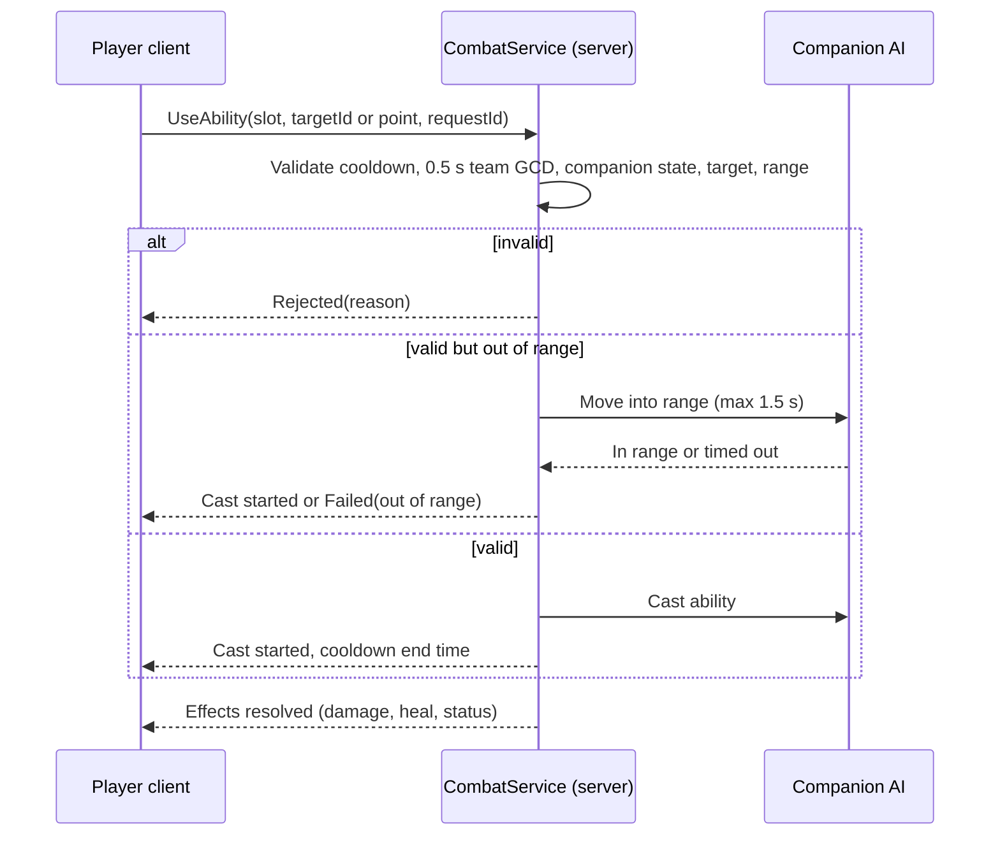

# Abilities and Cooldowns

The rules every ability follows: animal abilities (manual and automatic), player specials, cooldowns, triggers and the manual-ability user experience. Species-specific abilities are listed in the [[Animal Abilities Catalogue]]; this page does not name them.

> [!success] CONFIRMED
> - Animal abilities can be **manually** or **automatically** activated. **Both types exist** (D-008).
> - The player has special moves, which may have cooldowns (D-005).

> [!info] PROPOSED
> Kit structure, bands, triggers and UX rules below are proposals. Values not in [[Canonical Proposed Values]] are marked *(new)*.

## Ability types

| Type | Who activates | Typical use | Shown on |
|---|---|---|---|
| **Automatic** | The companion's AI, when its trigger rule is met | Reliable baseline value: heals, periodic strikes, self-buffs | Team bar pip that flashes on use |
| **Manual** | The player, by input | High-impact timing decisions: burst, interrupts, emergency heals, crowd control | Team bar button with cooldown sweep |
| **Passive** (optional) | Always on | Role flavour: bonus vs a target type, aura | Tooltip only |
| **Player special** | The player | Power Strike, Ground Slam, Rally Cry ([[Player Combat]]) | Special buttons |

## Kit structure

The system supports any species having 0–1 passive and 1–2 active abilities, each flagged `Manual` or `Automatic`. The [[Animal Abilities Catalogue]] is authoritative for each species.

| Option | Kit | Pros | Cons |
|---|---|---|---|
| A | Every animal: 1 automatic + 1 manual | Uniform; every animal has a button | Up to 3 manual buttons from the first minute; heavy on mobile |
| **B (recommended)** | Common and Uncommon: 1 automatic. Rare and Epic: 1 automatic + 1 manual. Legendary and above: 1 automatic + 1 manual + 1 passive. | Gentle onboarding; rarity visibly adds depth | Early teams have no manual animal buttons |
| C | Each species has one ability, either manual or automatic | Simplest | Teams with three automatic animals feel passive |

**Recommendation (PROPOSED, unapproved):** option B, because a new player's first team (Commons) then needs no extra buttons, and the first manual ability arrives with the first Rare, a natural teaching moment ([[New Player Onboarding]]).

## Archetypes and tuning bands *(new)*

Ability damage is a percentage of the animal's ATK; heals and shields are a percentage of the target's max HP (canonical §3). Ascension adds +5% ability effectiveness per level (A5 = +25%, canonical §9).

| Archetype | Typical roles | Magnitude band | Cooldown band (auto / manual) |
|---|---|---|---|
| Strike (single target) | Assassin, Bruiser, Skirmisher | 250–400% ATK | 8–12 s / 10–18 s |
| Cleave or area | Bruiser, Ranged, Controller | 120–200% ATK per target, radius 8–12 studs | 10–15 s / 14–22 s |
| Damage over time | Ranged, Controller | 40–60% ATK per second for 4–6 s | 10–14 s / 14–20 s |
| Heal | Support | 15–30% max HP, single; 8–15% area | 10–16 s / 18–30 s |
| Shield (absorb) | Support, Tank | 15–25% max HP for 5 s | 12–18 s / 18–28 s |
| Buff | Support | +10–20% damage or −10–20% damage taken for 5–8 s | 15–20 s / 20–30 s |
| Stun or root | Controller | 1.0–2.0 s (halved on bosses) | 12–16 s / 16–24 s |
| Slow or pull | Controller | 30–50% slow for 3–4 s, or pull 8–12 studs | 10–14 s / 14–20 s |
| Taunt | Tank | 2–3 s | 10–14 s / 14–20 s |
| Dash or reposition | Skirmisher, Assassin | 10–20 studs | 6–10 s / 8–14 s |

Manual abilities sit at the top of each magnitude band because they cost attention; automatic abilities sit in the lower half.

## Automatic trigger rules

Each automatic ability has exactly one trigger rule, evaluated at the companion AI tick (10 Hz):

| Trigger | Fires when |
|---|---|
| `OnReady` | Off cooldown and the companion has a valid target in range |
| `AllyBelow(x)` | Any team member (player included) is below x% HP and in range; default x = 50 |
| `SelfBelow(x)` | The companion is below x% HP; default x = 40 |
| `EnemiesInRadius(n, r)` | At least n enemies are within r studs; default n = 2 |
| `EnemyCasting` | An enemy within range is winding up a telegraphed attack (interrupt) |
| `CombatStart` | Once, on entering combat (opening buffs) |

Automatic abilities ignore the manual global cooldown but have a 1 s per-companion internal lock *(new)* so a companion never fires two automatic abilities in the same instant.

## Manual ability flow



Targeting modes:
- **Unit-targeted:** fires at the focus target; if there is none, at the soft target ([[Targeting and Command System]]).
- **Ground-targeted:** PC fires at the cursor; mobile and gamepad fire at the soft target's position, or 10 studs ahead of the player if there is none.
- **Self or team:** no target needed.

## Cooldown rules

| Rule | Value |
|---|---|
| Global cooldown between manual **animal** abilities | 0.5 s, team-wide (canonical §4; team-wide scope is an interpretation) |
| Player specials | Own cooldowns (6 / 12 / 25 s) plus a 0.25 s anti-mash lock *(new)* |
| When the cooldown starts | When the effect resolves, not on button press |
| Failed or cancelled cast | Cooldown not consumed; a 0.5 s retry lock applies *(new)* |
| Knock-out | Cooldowns keep ticking while the companion is knocked out |
| Base or hub visit | All cooldowns reset |
| Cooldown reduction | No sources at launch. Attack speed does not affect ability cooldowns. |
| Authority | Server stores the end time of every cooldown; the client only displays it |

## Manual-ability UX summary

The team bar in [[UI - Animal Team Display]] owns every animal ability control.

| State | Visual | Audio |
|---|---|---|
| Ready | Icon at full colour with rarity-coloured ring glow | Soft chime when it becomes ready (optional in [[UI - Settings]]) |
| Cooling down | Radial sweep with whole seconds remaining | — |
| Global cooldown | Brief 0.5 s dim on all three manual buttons | — |
| Out of range | Icon tinted red; pressing still sends the companion towards the target | Short "denied" click |
| Companion stunned | Stun icon overlay | — |
| Companion knocked out | Portrait greyed with recovery timer ([[Animal Combat Behaviour#Knock-out and recovery]]) | — |
| Automatic ability fired | Small pip under the portrait flashes; ability name toast is optional | Ability sound ([[Sound - Abilities]]) |

Further UX rules:
- Button order always matches team order and formation slots 1–3.
- On mobile, a manual button is never smaller than the minimum touch target in [[UI Accessibility Standards]].
- First use of a manual ability shows a one-time tooltip.

> [!warning] UNDECIDED (Q-201)
> **May players switch manual abilities to auto-cast?** An "auto-cast manual abilities" setting would help mobile players and players with motor impairments, but blurs the manual and automatic distinction that D-008 confirms. Options: (1) no auto-cast; (2) auto-cast as an accessibility setting with the AI using the `OnReady` trigger; (3) auto-cast with a 20% cooldown penalty. **Recommendation (PROPOSED, unapproved):** option 2. Accessibility should not cost power, and manual timing still beats `OnReady` in practice.

## Ability definition (illustrative)

```lua
-- Illustrative Luau, not tested in Roblox Studio. Shape only; values per species live in the catalogue.
return {
	Id = "ABL_EXAMPLE_STRIKE",
	Activation = "Manual",            -- "Manual" | "Automatic" | "Passive"
	Trigger = nil,                    -- e.g. { Kind = "AllyBelow", Threshold = 0.5 } for Automatic
	Targeting = "Unit",               -- "Unit" | "Ground" | "Self" | "Team"
	Range = 12,
	Cooldown = 14,
	Effects = {
		{ Kind = "Damage", AtkPercent = 3.0 },
		{ Kind = "Stun", Duration = 1.0 },
	},
	TelegraphSeconds = 0,             -- player-side abilities are not telegraphed to enemies
}
```

## Test hooks
- Two manual abilities from different companions pressed 0.3 s apart: the second is rejected with reason `GlobalCooldown`.
- A cancelled cast leaves the cooldown at 0.
- An `AllyBelow(50)` heal fires within 0.1 s of the player reaching 49% HP when off cooldown.
- Forged `UseAbility` for an ability the species does not have is rejected ([[Test Cases - Exploit Prevention]]).

## Related documents
- [[Animal Abilities Catalogue]]
- [[Animal Roles]]
- [[Player Combat]]
- [[Targeting and Command System]]
- [[UI - Animal Team Display]]
- [[Animation - Animal Abilities]]
- [[Sound - Abilities]]
- [[Ascension System]]
