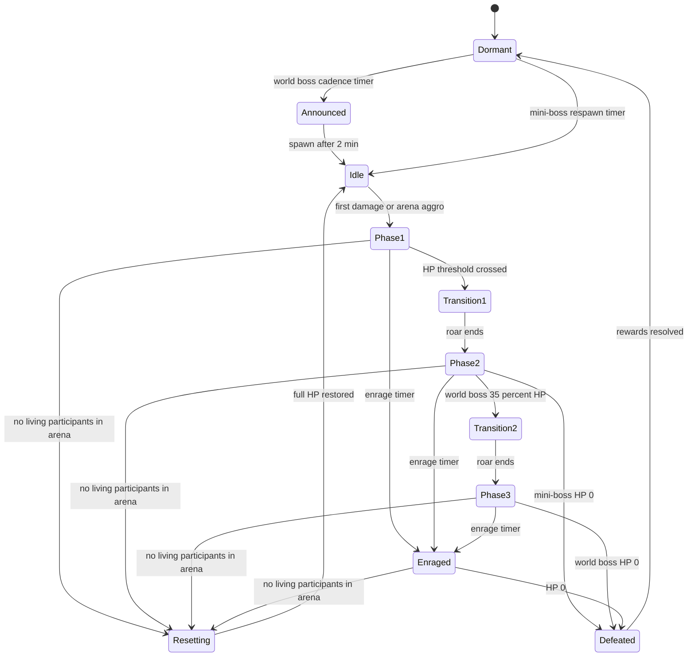

# Boss AI

The shared AI framework for mini-bosses and world bosses: phases, telegraphs, threat, adds, participant scaling, resets and anti-cheese rules. Each boss's attacks, lore and arena are in its own document (listed in [[Boss Design Overview]]); this page defines the rules they all follow.

> [!success] CONFIRMED
> Mini-bosses and world bosses exist (D-012).

> [!warning] UNDECIDED
> Boss rewards are **UNDECIDED** ([[Open Questions#Q-015]]); see [[Boss Rewards]].

> [!info] PROPOSED
> Canonical: eight mini-bosses (one per region), four world bosses with spawn cadences of 45–60 min announced 2 min ahead, mini-boss respawn 10 min per server instance, reward eligibility once per player per spawn ([[Canonical Proposed Values]] §5). Everything else is a proposal; new values are marked *(new)*.

## Boss types

| | Mini-boss | World boss |
|---|---|---|
| Purpose | Region gate (defeat unlocks the next region) | Server-wide social event |
| Where | Fixed arena inside its region | Large open arena at its home location |
| Intended group | Solo on-level, up to 6 players | 6–16 players |
| Respawn | 10 min per server instance (canonical) | Fixed cadence, 2 min announcement (canonical) |
| Phases | 2 (split at 50% HP) *(new)* | 3 (splits at 70% and 35% HP) *(new)* |
| Soft enrage | 240 s after engagement *(new)* | 600 s after engagement *(new)* |
| TTK target | 60–120 s solo on-level | 180–300 s with 8 players ([[Damage, Defence and Health Model#Time-to-kill targets]]) |

## Phase machine

| State | Rules |
|---|---|
| `Transition` | 1.5 s roar; the boss is **not** invulnerable but ignores CC *(new)*. Clears all active telegraphs to give players a breather. |
| `Enraged` | +10% damage every 30 s after the enrage timer, uncapped *(new)*. Soft, so a weak group can still finish if close. |
| `Resetting` | Triggered when no living participant has been inside the arena for 10 s *(new)*. Full HP, threat cleared, adds despawn. |
| `Defeated` | Rewards resolved once per eligible player per spawn (canonical). |

## Telegraph rules

Every boss attack that deals more than a basic hit's damage is telegraphed. These are hard rules for every boss document *(new)*:

1. **Minimum wind-up:** mini-boss 0.9 s; world boss 1.2 s.
2. **Heavy attacks** (more than 50% of an on-level player's max HP) need at least **1.5 s** and a visible ground shape.
3. **Always escapable:** from any point inside a telegraph, walking at 16 studs/s for the wind-up time, or a 12-stud dodge roll with 0.3 s invulnerability started at the moment the telegraph appears, must reach safety.
4. **Never unwinnable overlap:** simultaneous telegraphs must always leave a safe area of at least 8 studs radius.
5. **Shapes:** circle, cone, line, donut, and "marked target" (a ring on one player). Shapes and colours are standardised in [[Combat Feedback and Readability]].
6. **Audio cue** on every heavy attack ([[Sound - Bosses]]).
7. **Companions dodge too:** companions in a telegraph move out if they can within the wind-up; Tanks taunted by the boss are exempt. This prevents players losing animals to attacks they cannot control.

## Threat and targeting

- Bosses use the wild threat table ([[Wild Animal AI]]) with Tank damage threat × 2.0.
- **Spread pressure:** every 15 s *(new)*, a "marked target" attack picks a random participant who is not top threat, so the whole group must stay alert.
- Taunts work at half duration (CC rule in [[Damage, Defence and Health Model]]) and never redirect marked-target attacks.
- Bosses may target companions and players. A boss never targets the same player with two marked-target attacks in a row.

## Adds

- Phase 2 (and phase 3 for world bosses) may summon adds: wild animals from the boss's region with normal wild stats *(new)*.
- **Adds grant no Cash or XP** *(new)*, so boss fights cannot be stalled to farm adds. They do count for index registration if the species is not yet discovered (D-029).
- Add count scales with participants: `ceil(N / 3)` per wave, maximum 6 *(new)*.

## Participant scaling

| Value | Mini-boss *(new)* | World boss *(new)* |
|---|---|---|
| HP | `BaseHP × (1 + 0.5 × (N − 1))`, N capped at 6 | `BaseHP × (1 + 0.75 × (N − 1))`, N capped at 16 |
| ATK | Not scaled | Not scaled |
| N | Players who have dealt damage or been hit in the first 30 s | Players in the arena when Phase 1 starts, plus late joiners |
| Late joiners | Increase max HP; current HP rises by the same proportion | Same, until the boss is below 50% HP; after that no further scaling |
| Players leaving | HP is **never** scaled down | Never scaled down |

`BaseHP` for each boss is set in its own document; this page only defines the scaling. Example: a world boss with `BaseHP` of B and 8 participants has `B × 6.25` HP.

## Participation and credit

| Boss type | Eligible if *(new unless stated)* |
|---|---|
| Mini-boss | Contribution ≥ 5% of current scaled max HP **or** was in the arena and in combat for 50% of the fight (thresholds owned by [[Boss Design Overview]]) |
| World boss | Contribution ≥ 2.5% of current scaled max HP **or** in the arena and in combat for at least 60 s |
| Contribution | Damage dealt by the player and their animals, plus healing and shielding by the player's animals, counted 1:1 ([[Boss Design Overview]]). The 10% wild-animal threshold (D-040) does not apply to bosses |
| Both | Once per player per spawn (canonical). Defeated players who return before the boss dies keep their contribution. |

What eligible players receive is **UNDECIDED** ([[Open Questions#Q-015]]); see [[Combat Rewards]] and [[Boss Rewards]].

## Anti-cheese rules *(new)*

| Exploit | Response |
|---|---|
| Damage from outside the arena | Ignored; no contribution. |
| Standing where the boss cannot path | Boss uses a ranged "dislodge" attack on that target; after 5 s unreachable, the boss leaps to the nearest reachable point. Never resets while a reachable participant is fighting. |
| Kiting the boss out of the arena | Arena leash: the boss cannot leave the arena; it returns to centre without healing. |
| Repeated wipe-and-retry with reduced N | HP is never scaled down within a spawn. |
| Hatching or base-teleport mid-fight to dodge defeat | Teleports out of combat are blocked while combat-tagged ([[Combat States and State Machine]]). |

## Downed and defeat inside boss fights
In **world boss** encounters players are **Downed** before being defeated: 15 s bleed-out, revivable by an ally (3 s channel, 30% HP) *(new)*. Mini-boss defeats skip the downed state. Both are unapproved options under [[Open Questions#Q-014]]; full rules in [[Player Defeat and Penalties]].

## Test hooks
- With telegraph rule 3, an automated bot that walks straight out from the centre of every telegraph takes no heavy-attack damage.
- World boss with 8 participants spawns with `6.25 × BaseHP`; a 9th player joining at 60% HP raises max HP by 12% (from 6.25B to 7.0B) and current HP proportionally.
- All players leave the arena: reset after 10 s, full HP.
- Adds grant zero Cash and XP.
- Cases in [[Test Cases - Bosses]].

## Related documents
- [[Boss Design Overview]]
- [[World Boss - Ironbark Colossus]] · [[World Boss - Thunderhoof]] · [[World Boss - Abyssal Leviathan]] · [[World Boss - Ashwing Condor]]
- [[Mini-Boss - Bramblehorn]] · [[Mini-Boss - Eclipse Panther]]
- [[UI - Boss Health Bar]]
- [[Animation - Boss Attacks]]
- [[Sound - Bosses]]
- [[Service - BossService]]
- [[M17 - Boss Encounters]]
