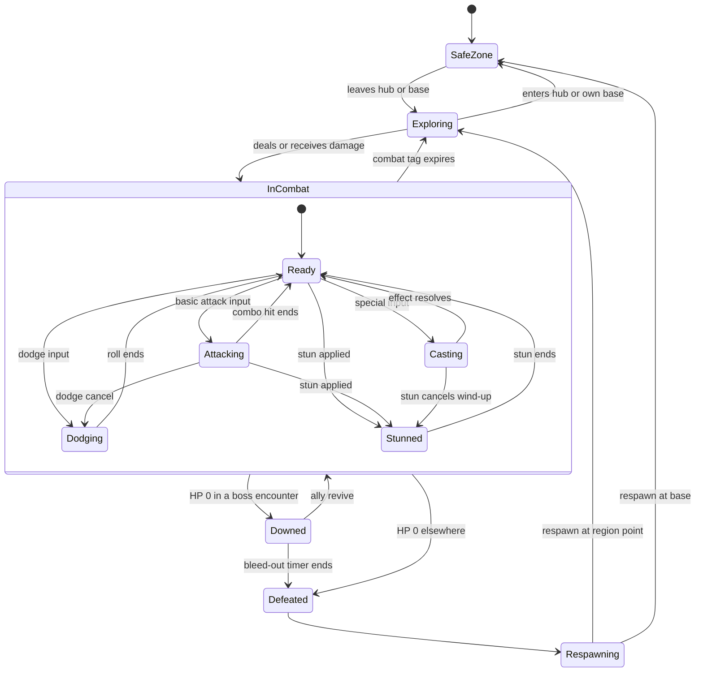
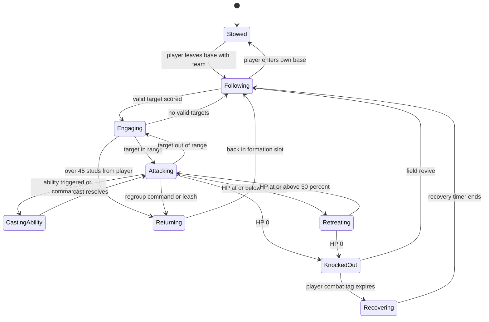
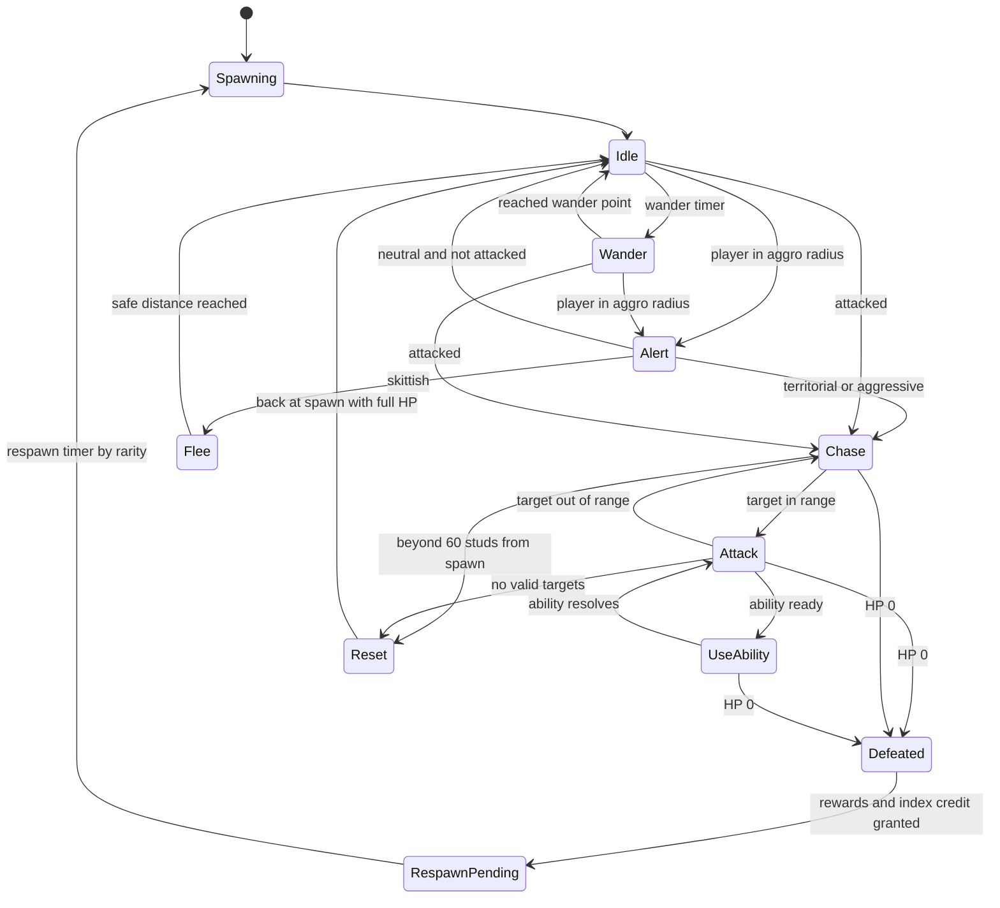

# Combat States and State Machine

Formal state machines for the three main combat actors: the player, a companion animal and a wild animal. Bosses extend the wild machine with phases ([[Boss AI]]); raid guards extend the companion machine ([[Animal Guards and Base Defence AI]]). Implementation guidance is in [[Implementation - Animal AI State Machine]].

> [!info] PROPOSED
> All states, transitions and timings are proposals. Timings come from [[Canonical Proposed Values]] §4 or from the owning combat documents, where new values are marked.

## Shared concepts

| Concept | Definition |
|---|---|
| **Combat tag** | Applied to an actor whenever it deals or receives damage, or is targeted by a hostile ability. Expires after **8 s** without either (canonical §4). Determines "in combat" for regeneration, recovery, hatching restrictions ([[Hatch System]]) and safe-zone entry. |
| **Safe zone** | The hub ([[Hub - Hatchling Haven]]) and the player's own base outside a raid. No damage can be dealt or received. |
| **Authority** | Every state lives on the server. Clients receive state changes for animation and UI and may predict only their own player's `Attacking` and `Dodging` animations. |
| **Tick rate** | Player state is event-driven. Companion and wild AI evaluate at 10 Hz *(new)*; distant wild animals at a lower tier ([[Wild Animal AI#Performance and simulation tiers]]). |

## Player state machine



| State | Rules |
|---|---|
| `SafeZone` | Attacks disabled; team changes allowed only at the player's own base (D-010). |
| `Exploring` | Out-of-combat regeneration 10% max HP/s *(new)*; hatching backpack eggs allowed (canonical §7). |
| `Attacking` | 0.45 s per combo hit; walk speed 60% *(new)*. |
| `Casting` | Special wind-up (0.35 s Power Strike, 0.5 s Ground Slam *(new)*); interrupted by stun without consuming the cooldown. |
| `Dodging` | 0.3 s invulnerability, 12 studs, 4 s cooldown. |
| `Downed` | Boss encounters only. 15 s bleed-out, ally revive channel 3 s restores 30% HP *(new)*. See [[Player Defeat and Penalties]]. |
| `Defeated` / `Respawning` | 5 s respawn delay, 3 s spawn protection broken by attacking *(new)*. Destination depends on battle type ([[Player Defeat and Penalties]]). |

## Companion state machine



| State | Rules (see [[Animal Combat Behaviour]]) |
|---|---|
| `Stowed` | At base; part of the base, not the field. Team edits allowed. |
| `Following` | Formation slot; catch-up speed 125% beyond 20 studs. |
| `Engaging` | Moving to role stance position against the chosen target. |
| `Attacking` | Basic attacks at AS; automatic abilities checked every tick. |
| `Returning` | Ignores targets until back in slot; teleports if over 90 studs or stuck for 4 s. |
| `Retreating` | Triggered at 25% HP (Tanks 15%); no basic attacks. |
| `KnockedOut` | Untargetable, non-colliding. Recovery rule **UNDECIDED** (Q-204); proposal in [[Animal Combat Behaviour#Knock-out and recovery]]. In a raid, a knocked-out defender stays down and is capturable ([[Animal Theft Rules]]). |
| `Recovering` | 30 s timer *(new, proposal)*; returns at 50% HP. Instant at base or hub. |

## Wild animal state machine



| State | Rules (see [[Wild Animal AI]]) |
|---|---|
| `Spawning` | Fade-in 1 s, untargetable *(new)*. |
| `Alert` | 0.75 s look-at with an alert icon before chasing *(new)*, so the player can back off. |
| `Chase` | Moves at species MS. Leash: 60 studs from spawn point (canonical §4). |
| `Reset` | Invulnerable, clears threat table, returns to spawn and restores full HP (canonical §4). Damage dealt before the reset grants no reward. |
| `Defeated` | Kill credit to every player with ≥ 10% contribution (D-040, PROPOSED). Index registration (D-029). |
| `RespawnPending` | Respawn time by rarity: 20 s, 35 s, 60 s, 120 s, 300 s; Mythical and Secret use event windows (canonical §6, [[Wild Animal Spawning and Respawn]]). |

## Transition guards and invariants

1. No actor can be in `Attacking` or `CastingAbility` while inside a safe zone.
2. `Defeated` and `KnockedOut` are terminal for the encounter: only the listed transitions leave them.
3. A wild animal in `Reset` cannot be damaged, so it cannot be "farmed" for damage contribution.
4. A companion never enters `Engaging` against a player unless a PvP or raid context is active on the server ([[Multiplayer Combat Rules]]).
5. Every transition is logged at debug level with actor ID, from, to and cause ([[Logging and Error Handling]]).

## Illustrative transition table

```lua
-- Illustrative Luau, not tested in Roblox Studio.
local Transitions = {
	Attacking = {
		TargetOutOfRange = "Engaging",
		AbilityTriggered = "CastingAbility",
		Leash = "Returning",
		LowHealth = "Retreating",
		HealthZero = "KnockedOut",
	},
	KnockedOut = {
		FieldRevive = "Following",
		CombatTagExpired = "Recovering",
	},
}

local function transition(actor, event: string)
	local nextState = Transitions[actor.state] and Transitions[actor.state][event]
	if not nextState then
		return false -- illegal transition: ignore and log
	end
	actor.state = nextState
	return true
end
```

## Test hooks
- Illegal transitions (for example `KnockedOut` → `Attacking`) are rejected and logged.
- A wild animal pulled 61 studs from spawn enters `Reset` and returns with full HP.
- Combat tag: 7.9 s after the last damage, regeneration has not started; at 8.1 s it has.
- Cases in [[Test Cases - Animal AI]] and [[Test Cases - Combat]].

## Related documents
- [[Animal Combat Behaviour]]
- [[Wild Animal AI]]
- [[Boss AI]]
- [[Player Combat]]
- [[Implementation - Animal AI State Machine]]
- [[Service - AnimalAIService]]
- [[Service - CombatService]]
