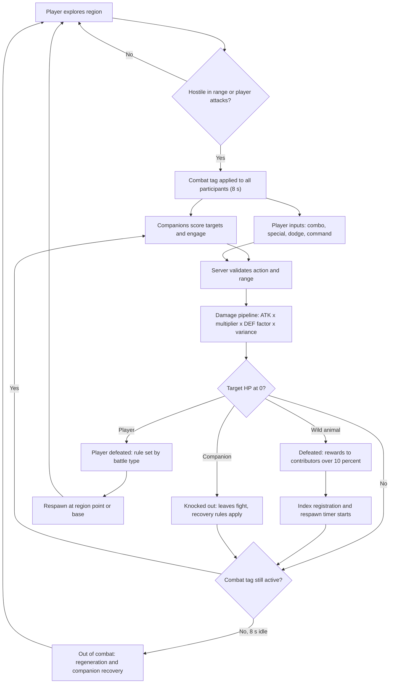

# Combat System Overview

Combat is the engine of the core loop ([[Core Gameplay Loop]]): fighting wild animals earns Cash, Cash buys egg rolls, eggs hatch animals, and stronger animals let the player fight in harder regions. This page explains how the pieces fit together. Each mechanic is specified once in its owning document, linked below.

> [!success] CONFIRMED
> - Real-time hybrid combat: the player and their animals fight **together** (D-005).
> - The player has basic attacks and special moves; special moves may have cooldowns (D-005).
> - Exactly **three** equipped animals (D-006), changeable only at the player's own base (D-010).
> - Player strength is a separate statistic from animal strength (D-007).
> - Animal abilities are manual or automatic; both exist (D-008).
> - Animals auto-target nearby enemies; the player can issue manual target commands (D-009).
> - Wild animals respawn, rarer ones more slowly (D-011). Mini-bosses and world bosses exist (D-012).
> - Defeat consequences vary by battle type (D-013); exact penalties are **UNDECIDED** ([[Open Questions#Q-014]]).

## 1. Combat pillars (PROPOSED)

| Pillar | What it means in practice | Test |
|---|---|---|
| **The team is the hero** | Collecting and ascending animals must visibly change fights. Rarity, role and ascension should matter more than raw player level. | A Rare team should beat a fight that a Common team loses at the same player level. |
| **Hands on, never hands full** | The player always has something to do (move, combo, dodge, special, command) but is never required to micro-manage three animals at once. Automatic behaviour is competent by default. | A new player who only uses basic attacks and never issues commands can clear Whisperwood Forest. |
| **Readable at a glance** | Every dangerous attack is telegraphed; every hit is legible on a phone screen. | QA can name the source of every death in a replay. |
| **Fair in a shared world** | Nobody loses rewards to kill-stealing; nobody is forced into PvP. | See [[Multiplayer Combat Rules]] and [[PvP System]]. |
| **Server authoritative** | The client requests; the server decides all damage, KO and rewards. | See [[Server-Client Responsibilities]]. |

## 2. Participants

| Participant | Controlled by | Defined in |
|---|---|---|
| Player character | The player (direct input) | [[Player Combat]], [[Player Strength]] |
| Three equipped companions | AI, steered by player commands and manual abilities | [[Animal Combat Behaviour]], [[Targeting and Command System]], [[Abilities and Cooldowns]] |
| Wild animals | Server AI | [[Wild Animal AI]], [[Wild Animal Spawning and Respawn]] |
| Mini-bosses and world bosses | Server AI with scripted phases | [[Boss AI]], [[Boss Design Overview]] |
| Other players and their teams | Other players | [[Multiplayer Combat Rules]]; hostile only in PvP or raids ([[PvP System]], [[Base Raiding System]]) |
| Base defences and guard animals | Server AI | [[Base Defence Overview]], [[Animal Guards and Base Defence AI]] |

## 3. The combat loop at one encounter's scale

1. **Approach.** The player explores; wild animals idle, wander or patrol according to temperament ([[Wild Animal AI]]).
2. **Engage.** Combat starts when the player or a companion damages an enemy, or a hostile enemy aggroes on the player or team. Every participant receives a **combat tag** (8 s timeout, canonical §4).
3. **Fight.** Companions auto-target using the scoring algorithm ([[Targeting and Command System]]), use automatic abilities on their own, and use manual abilities when the player triggers them. The player combos, uses specials and dodges.
4. **Resolve.** At 0 HP, an enemy is **defeated**: rewards are granted to every eligible contributor ([[Combat Rewards]]) and the species is registered in the index (D-029). A companion at 0 HP is **knocked out** ([[Animal Combat Behaviour#Knock-out and recovery]]). A player at 0 HP is **defeated** ([[Player Defeat and Penalties]]).
5. **Recover.** When the combat tag expires, out-of-combat regeneration begins and knocked-out companions start recovering.

## 4. Combat flow diagram

## 5. Key numbers at a glance (PROPOSED, from [[Canonical Proposed Values]])

| Item | Value |
|---|---|
| Damage formula | `ATK × SkillMultiplier × (100 / (100 + DEF_target)) × Random(0.95, 1.05)` |
| Critical hits | None at launch |
| Player HP / DEF / base Strength | `100 + 12(L−1)` / `5 + 0.5(L−1)` / `10 + 2(L−1)` |
| Player combo | 3 hits at Strength × 0.8 / 0.8 / 1.4, 0.45 s per hit, resets after 1.2 s idle |
| Player specials | Power Strike (×3.0, 6 s), Ground Slam (×2.0 AoE 10 studs, 12 s, L10), Rally Cry (+15% team damage 6 s, 25 s, L25) |
| Dodge roll | 0.3 s invulnerability, 12 studs, 4 s cooldown |
| Wild animal multipliers | HP ×2.0, ATK ×0.75 versus companion stats, then × region multiplier |
| Wild leash | 60 studs from spawn, then reset to full HP |
| Combat tag | 8 s without dealing or receiving damage |
| Global cooldown between manual animal abilities | 0.5 s |
| Kill credit | Full reward to every player who contributed ≥ 10% of max HP (D-040, PROPOSED) |

Balancing targets, time-to-kill bands and worked examples are in [[Damage, Defence and Health Model]].

## 6. What combat does not do

- **No team swapping in the field.** The three-animal team is locked until the player returns to their base (D-010). Knocked-out companions are not replaced mid-trip. See [[Team Equipping and Base Lock Rule]].
- **No critical hits at launch** (canonical §4). Variance is limited to ±5%.
- **No friendly fire** in PvE ([[Multiplayer Combat Rules]]).
- **No egg or animal loss from PvE defeat.** Theft exists only in raids ([[Egg Theft Rules]], [[Animal Theft Rules]]).
- **No per-animal XP** (D-042, PROPOSED; [[Open Questions#Q-021]]).
- **Luck never affects combat or wild encounter rarity** (D-017).

## 7. Known balance risks (summary)

The worked examples in [[Damage, Defence and Health Model#Balance findings]] show two risks for the lead to review:
1. The player's own damage share rises from about 48% of team damage in Whisperwood Forest to about 66% in Starfall Sanctuary, which works against the "team is the hero" pillar. **UNDECIDED** (Q-211).
2. Wild animals of the region's native high rarity (for example a wild Mythical in Starfall Sanctuary) can knock out an endgame tank in about 6 s. These rare spawns are announced server events, so they should be treated as group encounters. **UNDECIDED** (Q-212).

## Related documents
- [[Combat Index]]
- [[Core Gameplay Loop]]
- [[Damage, Defence and Health Model]]
- [[Combat States and State Machine]]
- [[Targeting and Command System]]
- [[Multiplayer Combat Rules]]
- [[Service - CombatService]]
- [[Implementation - Combat Damage Pipeline]]
- [[Design Principles and Fairness Charter]]
