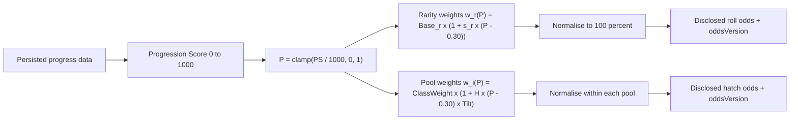

# Dynamic Progression Luck

Dynamic Progression Luck rewards genuine progress with better egg odds. As a player levels up, discovers species, defeats bosses, unlocks regions and builds their base, their **Progression Score (PS)** rises and their egg-rarity and hatch odds tilt towards rarer outcomes.

> [!success] CONFIRMED (D-017)
> - Progression improves **egg-rarity odds** and **hatch odds**.
> - It does **not** affect wild encounter rarity.
> - The formula may be hidden, but the **actual odds must be disclosed before the player commits** and must **never be altered silently after purchase**.

> [!info] PROPOSED (D-036)
> The PS model, pivot, slopes, hatch tilt and all numbers below come from [[Canonical Proposed Values]] §8. The final formula and its inputs are **UNDECIDED** ([[Open Questions#Q-017]]). The input specification is [[Progression Score Specification]].

## 1. "Hidden formula, disclosed odds"

The design separates two things that are often confused:

| | Hidden | Disclosed |
|---|---|---|
| What | The formula: which inputs count, their weights, the slopes, the pivot | The **result**: the exact seven rarity percentages and the exact in-pool percentages this player receives right now |
| Why | Prevents players from optimising a spreadsheet instead of playing; lets the team retune without a lore problem | Required by D-017; required in principle by platform rules for random rewards ([[Randomised Reward Compliance]]); builds trust |
| How | Server-only code in [[Service - LuckService]]. Nothing about weights is replicated to the client | Every roll or hatch confirmation shows server-computed odds bound to an `oddsVersion` token (D-041) |

Players are told, in plain words, that **luck exists and grows with progress** (copy in [[Randomised Reward Compliance]]). "Hidden" never means "secret that luck exists"; it means the inner arithmetic is not published. The [[UI - Progression Interface]] may show a qualitative luck meter (PROPOSED), but never PS weights.

## 2. The mechanism

**Stage 1, egg rarity.** Each rarity has a base weight `Base_r` (the owner-supplied baseline) and a slope `s_r`: Common 0.0, Uncommon 0.6, Rare 1.2, Epic 1.8, Legendary 2.4, Mythical 2.8, Secret 3.2. Weights are linear in P around the **pivot P₀ = 0.30**, then normalised. Because Common has slope 0, its *weight* never changes; its *share* falls only because the rarer weights grow.

**Stage 2, hatch pool.** Inside a pool, Standard animals have tilt 0, Scarce 0.5, Elusive 1.0, and `H = 1.0`. At P = 1.0, a Scarce weight is multiplied by 1.35 and an Elusive weight by 1.70; at P = 0 they are multiplied by 0.85 and 0.70.

**Pivot meaning.** At P = 0.30 (PS 300) every multiplier is exactly 1, so the owner-supplied 65 / 22 / 9 / 3 / 0.8 / 0.18 / 0.02 % are received exactly.

> [!danger] Players below the pivot receive worse-than-baseline odds
> A brand-new player (P ≈ 0) has Secret odds of **0.0009 %** (×0.04 of baseline) and Legendary **0.2477 %**. This is mathematically intended by the canonical slopes, but the published "baseline" is not what a new player sees. Marketing, store copy and support must never describe 0.02 % as "the" Secret chance. See [[Probability Balancing]] for whether the pivot should move to 0 (PROPOSED option).

## 3. Worked examples at four progression stages

The four profiles are defined input-by-input in [[Progression Score Specification#Worked player profiles]]. Rarity odds use the canonical formula; the raw weight sum before normalisation is shown so that anyone can reproduce the numbers.

| Rarity | Beginner P = 0.05 | Intermediate P = 0.30 | Advanced P = 0.60 | Endgame P = 0.95 |
|---|---:|---:|---:|---:|
| Common | 70.6307 % | 65.0000 % | 59.3248 % | 53.8404 % |
| Uncommon | 20.3199 % | 22.0000 % | 23.6934 % | 25.3298 % |
| Rare | 6.8457 % | 9.0000 % | 11.1713 % | 13.2696 % |
| Epic | 1.7929 % | 3.0000 % | 4.2166 % | 5.3923 % |
| Legendary | 0.3477 % | 0.8000 % | 1.2559 % | 1.6964 % |
| Mythical | 0.0587 % | 0.1800 % | 0.3023 % | 0.4205 % |
| Secret | 0.0043 % | 0.0200 % | 0.0358 % | 0.0510 % |
| **Sum** | **100.0000 %** | **100.0000 %** | **100.0000 %** | **100.0000 %** |
| Raw weight sum | 92.0280 | 100.0000 | 109.5664 | 120.7272 |
| Secret vs baseline | ×0.22 | ×1.00 | ×1.79 | ×2.55 |

**Calculation shown for the Secret column at P = 0.60:** raw weight = 0.02 × (1 + 3.2 × 0.30) = 0.02 × 1.96 = 0.0392. Raw sum = 65 + 22 × 1.18 + 9 × 1.36 + 3 × 1.54 + 0.8 × 1.72 + 0.18 × 1.84 + 0.0392 = 65 + 25.96 + 12.24 + 4.62 + 1.376 + 0.3312 + 0.0392 = **109.5664**. Normalised: 0.0392 / 109.5664 = **0.0358 %**.

**Hatch effect, Secret pool** (2 Standard, 1 Scarce, 1 Elusive):

| Class | P = 0.05 | P = 0.30 | P = 0.60 | P = 0.95 |
|---|---:|---:|---:|---:|
| Standard each ([[Mosasaurus]], [[Quetzalcoatlus]]) | 36.36 % | 34.48 % | 32.47 % | 30.40 % |
| Scarce ([[Titanoboa]]) | 19.09 % | 20.69 % | 22.40 % | 24.16 % |
| Elusive ([[Tyrannosaurus Rex]]) | 8.18 % | 10.34 % | 12.66 % | 15.05 % |
| Sum | 100.00 % | 100.00 % | 100.00 % | 100.00 % |
| Chance per roll of a Tyrannosaurus Rex | 1 in 281,197 | 1 in 48,333 | 1 in 22,074 | 1 in 13,026 |

Combined, luck makes the rarest single outcome about **21.6 times** more likely for an endgame player than for a beginner. The narrative stages:

- **Beginner (P ≈ 0.05).** Mostly Commons and Uncommons; an Epic roughly every 56 rolls. Luck is below baseline, which is invisible in play because early rolls are about filling the Common and Uncommon pages.
- **Intermediate (P ≈ 0.30).** Exactly the baseline. First Legendary expected around 125 rolls.
- **Advanced (P ≈ 0.60).** Epic+ share rises from 4.00 % to 5.81 %. Merging and luck together make Legendary teams realistic.
- **Endgame (P ≈ 0.95).** Epic+ is 7.56 % of rolls; a Secret egg is expected every 1,960 direct rolls.

Full sample tables for P = 0, 0.1 … 1.0: [[Dynamic Luck Probability Tables]]. Per-animal pool tables: [[Hatch Pool Tables]].

## 4. Luck does NOT affect wild encounters

> [!success] CONFIRMED (D-017)
> Wild animal spawn rarity, rare-spawn event chances (Legendary 50 %, Mythical 25 %, Secret 10 % per window), boss spawns and loot are **independent of PS**. [[Service - SpawnService]] must not import or call [[Service - LuckService]]. A static code check (no `require` of LuckService from SpawnService) and a test that spawns are identical for PS 0 and PS 1000 are mandatory ([[Test Cases - Egg Rolls and Hatching]]).

Luck also does **not** affect: merge outcomes (deterministic), ascension, combat damage, Cash or XP rewards, raid outcomes or theft.

## 5. Server-side calculation requirements

| # | Requirement | Status |
|---|---|---|
| 1 | PS is computed **only on the server** from persisted profile data ([[Progression Score Specification#Inputs and data sources]]). No client value is ever read | **PROPOSED** |
| 2 | Odds are computed in [[Service - LuckService]] with double-precision floats, normalised, and checked to sum to 1 within 1e-9 | **PROPOSED** |
| 3 | PS and odds are cached per player and invalidated on every recalculation trigger (level, discovery, boss, region, module level, config change) | **PROPOSED** |
| 4 | Every odds response carries an `oddsVersion` token; commits recompute and compare; mismatches are rejected as stale (D-041) | **PROPOSED** |
| 5 | Luck config (bases, slopes, pivot, H, tilt) has a `configVersion`. Changing it invalidates all tokens server-wide via MessagingService | **PROPOSED** |
| 6 | No odds are applied that were not disclosed: the server samples from the snapshot it disclosed, after confirming it is still current | **PROPOSED** |
| 7 | Audit log per roll or hatch: PS, P, configVersion, odds, random value, outcome | **PROPOSED** |
| 8 | PS is non-decreasing. No input can be lost (index entries, bosses, regions and module levels are never removed, including by raids) | **PROPOSED** |

Implementation detail: [[Implementation - Dynamic Luck Calculation]].

## 6. Anti-manipulation measures

| Threat | Mitigation | Status |
|---|---|---|
| Client spoofs PS or odds | PS never accepted from the client; remotes carry only tokens and IDs ([[Implementation - Remote Validation Layer]]) | **PROPOSED** |
| Player delays a level-up to "lock" old odds | Not exploitable: odds only improve with PS (all slopes ≥ 0 for rare tiers), and tokens expire after 120 s | **PROPOSED** |
| Player wants lower PS to farm Commons | No way to lower PS; it is non-decreasing | **PROPOSED** |
| Buying luck | PS inputs are earned through play. Base modules cost Cash only. If any Robux product could grant Cash or module levels, luck would become purchasable; this must be reviewed under [[Open Questions#Q-032]] | **PROPOSED** guard |
| Alt accounts or trading | Trading is out of scope at launch (D-045), so a high-PS account cannot roll for a low-PS one | **PROPOSED** |
| Discovery farming via kill credit | Discovery requires dealing at least 10 % of max HP within the combat-tag window (shared kill credit rule, D-040) | **PROPOSED** |
| Race between luck change and commit | Token comparison at commit; stale tokens rejected | **PROPOSED** (D-041) |
| Insider tuning without disclosure | Config changes are versioned, logged in the [[Changelog]] and follow [[Balance Update Process]] | **PROPOSED** |

## 7. Balancing and testing methodology

1. **Analytical checks** on every config change: all rarity tables at P = 0, 0.05, 0.1 … 1.0 sum to 100 %; every rare-tier share is non-decreasing in P; every pool sums to 100 % at every P; no weight is negative (the smallest multiplier is Secret at P = 0: 1 + 3.2 × (−0.30) = 0.04 > 0).
2. **Monte Carlo** with 10 million draws per sampled P; chi-squared goodness-of-fit at α = 0.001 against disclosed odds ([[Statistical Testing of Probabilities]]).
3. **Journey simulation**: synthetic players progressing through regions with the PS profiles in [[Progression Score Specification]], measuring time to first Epic, Legendary, Mythical and Secret ([[Balance Simulation Plan]]).
4. **Telemetry in beta**: observed rarity frequency per PS band versus disclosed odds; any band deviating beyond its 99.9 % confidence interval is a P0 bug.
5. **Tuning levers** are listed in [[Probability Balancing]]; any change bumps `configVersion` and is logged.

## Related documents
- [[Progression Score Specification]] · [[Dynamic Luck Probability Tables]] · [[Hatch Pool Tables]]
- [[Egg Roll System]] · [[Hatch System]] · [[Independent Random Outcomes]]
- [[Probability Balancing]] · [[Randomised Reward Compliance]]
- [[Service - LuckService]] · [[Implementation - Dynamic Luck Calculation]]
- [[Wild Animal Spawning and Respawn]]
- [[Canonical Proposed Values]] · [[Decision Register]]
