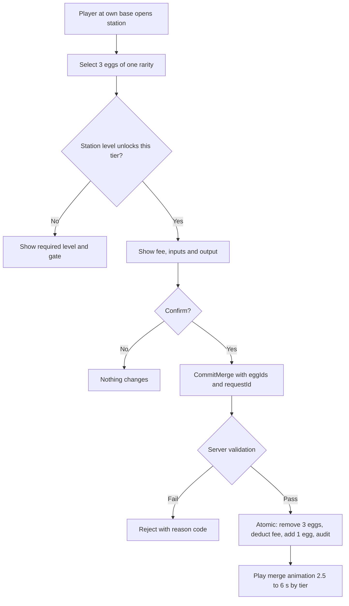

# Egg Merging

Merging converts **three eggs of one rarity into one egg of the next rarity**. It is the deterministic counterweight to independent rolls: players can always see exactly how far they are from their next higher-rarity egg. Merging takes place at the [[Egg Merging Station]], a base structure that must be bought and upgraded.

> [!success] CONFIRMED (D-020)
> - **3** eggs of the same rarity → **1** egg of the next rarity.
> - Requires a purchased **Egg Merging Station**.
> - The station must be **upgraded** before it can merge higher rarities.
> - The station **physically changes appearance** with each upgrade.
> - Secret eggs cannot be merged (there is no higher rarity).

> [!info] PROPOSED (D-038, [[Canonical Proposed Values]] §10)
> Station levels, costs, gates and merge fees below. Final costs are **UNDECIDED** ([[Open Questions#Q-019]]). Merge timing (instant with animation versus timed) is **UNDECIDED** ([[Open Questions#Q-034]]).

## 1. Rules

| # | Rule | Status |
|---|---|---|
| 1 | Exactly 3 input eggs, all of the same rarity | **CONFIRMED** |
| 2 | Output is exactly 1 egg of rarity + 1 | **CONFIRMED** |
| 3 | Output rarity is deterministic; merging involves no randomness and no luck | **PROPOSED** (follows from D-020 wording) |
| 4 | The output egg is a normal egg: it is hatched through the [[Hatch System]] with that rarity's pool | **PROPOSED** |
| 5 | Merging happens at the player's own base, at the station | **PROPOSED** |
| 6 | Inputs may come from the backpack, base storage or both | **PROPOSED** |
| 7 | Output goes to base storage; if base storage is full, into a freed backpack slot. Net capacity always frees by 2 | **PROPOSED** |
| 8 | A merge fee in Cash is charged per merge, by tier | **PROPOSED** |
| 9 | The station level must unlock the input tier | **CONFIRMED** principle, **PROPOSED** levels |
| 10 | Not allowed while combat-tagged or while the player's own base is under an active raid | **PROPOSED** |
| 11 | One merge per request; a "Merge all possible" button queues sequential merges client-side, each a separate server transaction | **PROPOSED** |

### Consumption rules

- The three input eggs are **destroyed** in the same atomic transaction that creates the output egg and deducts the fee. If any part fails, nothing changes ([[Implementation - Egg Merge Transaction]]).
- Inputs must be **unlocked**: not reserved by another pending action (hatch confirmation, transfer, raid pickup).
- There is no refund, undo or partial merge. The confirmation shows the three eggs, the fee and the output.
- Merged eggs carry `source = "merge"` and the IDs of their inputs, for audit and support.

## 2. Upgrade table (canonical §10)

| Station level | Name | Cost (Cash) | Extra gate | Merges unlocked | Merge fee (Cash) |
|---:|---|---:|---|---|---|
| 1 | Twig Nest Press | 2,500 | — | Common → Uncommon; Uncommon → Rare | 100; 300 |
| 2 | Stonebound Hatchery Forge | 15,000 | Region 2 unlocked | Rare → Epic | 900 |
| 3 | Crystal Incubator | 60,000 | Region 4 unlocked | Epic → Legendary | 2,700 |
| 4 | Aurora Crucible | 250,000 | Region 6 unlocked + 1 world boss defeated | Legendary → Mythical | 8,000 |
| 5 | Celestial Convergence Altar | 1,000,000 | Region 8 unlocked | Mythical → Secret | 25,000 |
| | **Total** | **1,327,500** | | | |

All values **PROPOSED**. The station's physical form at each level is in [[Egg Merging Station]].

## 3. Flow

Server validation, error codes and UI are specified in [[Egg Merging Station#Server validation]] and [[UI - Egg Merging]].

## Merge shortcut analysis

### Common-equivalents

Since 3 eggs of rarity *r* make 1 of rarity *r + 1*, an egg of rarity *r* is worth **3^r Common-equivalents (CE)**. The expected CE produced by one roll at baseline (P = 0.30) is

Σ p_r × 3^r = 0.65 × 1 + 0.22 × 3 + 0.09 × 9 + 0.03 × 27 + 0.008 × 81 + 0.0018 × 243 + 0.0002 × 729
= 0.65 + 0.66 + 0.81 + 0.81 + 0.648 + 0.4374 + 0.1458 = **4.1612 CE per roll**.

A Secret egg is 3^6 = **729 CE**, so through full merging it costs 729 / 4.1612 ≈ **175 rolls**, versus **5,000 rolls** (1 / 0.0002) by direct rolling: a **28.5×** shortcut in rolls alone. At P = 0.95 the CE per roll rises to 6.7162, giving 108.5 rolls per Secret egg versus 1,960 direct.

Each Common egg contributes only 1 CE, but the rarer eggs contribute disproportionately: at baseline the Legendary, Mythical and Secret eggs together supply 1.23 of the 4.16 CE per roll (30 %), despite being only 1 % of rolls.

### Including merge fees

The roll-count comparison ignores fees. The expected Cash per target egg via merging is

`(200 + FeesPerRoll) / TargetEggsPerRoll`, where TargetEggsPerRoll = p_target + Σ_{j<target} p_j × 3^(j − target),

and each rarity-*j* input pays its share of every merge it passes through: a share of 3^(j − k − 1) of the fee at each tier *k* from *j* to target − 1. Producing one Secret egg purely from Commons needs 243 + 81 + 27 + 9 + 3 + 1 = 364 merges and costs **146,200 Cash** in fees; because fees grow ×3 per tier while merge counts shrink ×3, each tier contributes about 24,300 Cash.

| Target rarity | Direct Cash per egg, P = 0.30 | Merge Cash per egg incl. fees, P = 0.30 | Shortcut | Direct, P = 0.95 | Merge, P = 0.95 | Shortcut |
|---|---:|---:|---:|---:|---:|---:|
| Uncommon | 909 | 508 | ×1.79 | 790 | 504 | ×1.57 |
| Rare | 2,222 | 1,126 | ×1.97 | 1,507 | 943 | ×1.60 |
| Epic | 6,667 | 3,096 | ×2.15 | 3,709 | 2,354 | ×1.58 |
| Legendary | 25,000 | 9,817 | ×2.55 | 11,790 | 7,243 | ×1.63 |
| Mythical | 111,111 | 33,373 | ×3.33 | 47,568 | 24,941 | ×1.91 |
| Secret | 1,000,000 | 120,734 | ×8.28 | 391,971 | 94,294 | ×4.16 |

At baseline the Secret merge cost breaks down as 35,038 Cash of rolls plus **85,696 Cash of fees (71 %)**. Fees are therefore already the main cost of high-tier merging, but they cut the shortcut only from ×28.5 to ×8.3.

**Station payback.** Level 5 is gated behind Region 8 (Starfall Sanctuary), so its realistic owner is at P ≈ 0.95. There, each merged Secret egg saves 391,971 − 94,294 = **297,677 Cash**. The 1,000,000 Cash level-5 upgrade pays for itself after **3.4 Secret eggs**, and the whole station (1,327,500) after **4.5**. Level 4 (250,000) pays back after about **11 Mythical eggs**.

> [!warning] Opportunity cost
> Full merging consumes every lower-rarity egg, so a player chasing a Secret hatches almost nothing else. The comparison above is "Cash per target egg", not total value. Players who also want index completion and ascension of lower tiers will merge only their surplus.

### Are the fees and gates adequate balance levers? (PROPOSED assessment)

| Lever | Current effect | Assessment |
|---|---|---|
| Station gates (regions, world boss) | Prevent Secret merging before Region 8 | **Effective for timing.** Nobody can short-cut to Secret early. Gates do nothing once reached |
| Station cost (1.33 M total) | Paid back after 4–5 Secret eggs | **Weak as a long-term brake**; it is a one-off |
| Merge fees (×3 per tier) | 71 % of merged Secret cost | **Moderate.** Keeps the shortcut at ×4 at endgame, ×8 at baseline |
| Fees growing ×3 per tier | Each tier costs the same per final egg | Neutral design: no tier is a "tax" step |

Mid-tier shortcuts (×1.6 at endgame for Uncommon to Legendary) are healthy: merging is clearly worth doing without making rolls pointless. The Secret shortcut is the outlier.

**Tuning options (all PROPOSED, for owner review under [[Open Questions#Q-019]]):**

| Option | Fees (C→U … M→S) | Secret shortcut at P = 0.30 | At P = 0.95 | Mythical at P = 0.95 | Notes |
|---|---|---:|---:|---:|---|
| A. Keep canonical | 100 / 300 / 900 / 2,700 / 8,000 / 25,000 | ×8.28 | ×4.16 | ×1.91 | Accept a strong endgame shortcut as the intended sink |
| B. Raise top two tiers | 100 / 300 / 900 / 2,700 / 24,000 / 125,000 | ×3.87 | ×1.73 | ×1.24 | Targets only the outlier; mid-game untouched (recommended starting point) |
| C. Fees ×4 per tier | 100 / 400 / 1,600 / 6,400 / 25,600 / 102,400 | ×3.62 | ×1.65 | ×0.96 | Makes Mythical merging slightly *worse* than rolling at endgame; not recommended |
| D. No fees (reference) | 0 | ×28.5 | ×18.1 | ×6.21 | Shows why fees are required |
| E. Timed top-tier merges | Canonical fees + a timer on M→S | ×8.28 Cash | ×4.16 Cash | ×1.91 | Throttles throughput instead of Cash; depends on [[Open Questions#Q-034]] |
| F. Daily cap on M→S merges | Canonical fees | ×8.28 Cash | ×4.16 Cash | ×1.91 | Hard throughput limit; adds a daily-login pressure that may conflict with [[Design Principles and Fairness Charter]] |

All options keep the **CONFIRMED** 3 → 1 ratio. Changing the ratio is not an option without an owner decision. The effect on ascension time is quantified in [[Ascension Expected Value Analysis]].

## 4. Edge cases

| Case | Behaviour | Status |
|---|---|---|
| Fewer than 3 eggs of a rarity | Merge button disabled with "Need 3" | **PROPOSED** |
| Mixed rarities selected | Rejected `MixedRarity` | **CONFIRMED** rule |
| Secret eggs selected | Rejected `MaxRarity` | **CONFIRMED** |
| Insufficient Cash for fee | Rejected `InsufficientCash`, nothing consumed | **PROPOSED** |
| Station level too low | Rejected `StationLevel` with the level and gate required | **PROPOSED** |
| Disconnect mid-merge | Atomic; on rejoin the output egg exists or the inputs remain | **PROPOSED** |
| Egg in a pending hatch confirmation | Rejected `EggLocked` | **PROPOSED** |

Tests: [[Test Cases - Egg Merging]].

## Related documents
- [[Egg Merging Station]] · [[UI - Egg Merging]] · [[Animation - Egg Merge]]
- [[Egg Storage]] · [[Hatch System]] · [[Egg Rarity System]]
- [[Ascension Expected Value Analysis]] · [[Probability Balancing]] · [[Cash Sources and Sinks]]
- [[Service - MergeService]] · [[Implementation - Egg Merge Transaction]] · [[Test Cases - Egg Merging]]
