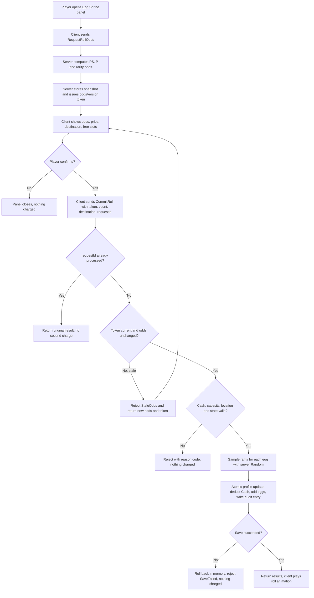
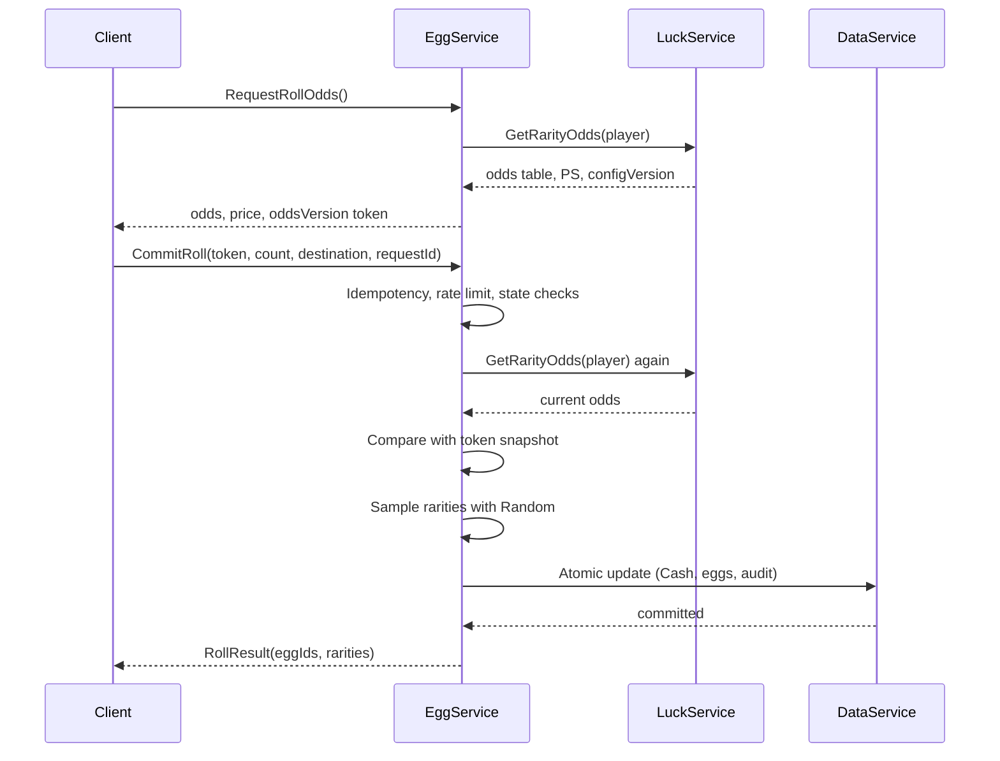

# Egg Roll System

An egg roll exchanges Cash for one egg whose **rarity** is drawn from the player's current, disclosed rarity odds. It is stage 1 of the two-stage randomness (D-015). Stage 2 is the [[Hatch System]].

> [!success] CONFIRMED
> - Cash from defeating wild animals buys egg rolls (D-014).
> - The roll decides egg rarity (D-015).
> - Progression luck may change the odds; the actual odds are shown before the player commits, and are never altered silently after purchase (D-017).
> - Each roll is independent of every earlier roll (D-018).

> [!info] PROPOSED values (from [[Canonical Proposed Values]] §7–§8)
> - Price: **200 Cash** per roll, flat (D-039). Pricing model **UNDECIDED** ([[Open Questions#Q-020]]).
> - Bulk: **×5 for 1,000 Cash**, no discount, convenience only.
> - Baseline odds at P = 0.30: **65 / 22 / 9 / 3 / 0.8 / 0.18 / 0.02 %** (D-031). Final odds **UNDECIDED** ([[Open Questions#Q-016]]).
> - Odds are bound to an `oddsVersion` token (D-041).

## 1. Where and how a player rolls

| Item | Proposal | Status |
|---|---|---|
| Roll location | The Egg Shrine in [[Hub - Hatchling Haven]]. A second roll point at the player's own base is an option | **UNDECIDED** (Q-301); shrine-only is the working assumption |
| Destination | Backpack by default while it has space; the player may choose "Send to base storage" in the roll panel | **PROPOSED** (part of Q-301) |
| Combat | Rolling is blocked while combat-tagged (8 s after last damage dealt or taken) | **PROPOSED** |
| Raid | Rolling with destination "base storage" is blocked while the player's own base is under an active raid | **PROPOSED** |
| UI | [[UI - Egg Rolling]] | |

## 2. Odds disclosure

The roll panel always shows, **before** the confirm button becomes active:

1. All seven rarity percentages, computed on the server for this player now.
2. The price and the player's current Cash.
3. The destination and the free slots there.
4. A short line: *"Your odds improve as you progress. These are your exact odds for this roll."* (copy **PROPOSED**; see [[Randomised Reward Compliance]]).

**Display format (PROPOSED).** Show each value to at least two significant figures and never round a non-zero value to 0 (for example a beginner's Secret odds show as **0.0043 %**, not 0.00 %). Percentages are shown to 4 decimal places where needed, and displayed values are rounded with a largest-remainder method so that the numbers the player sees also sum to exactly 100 % (rule shared with [[Dynamic Luck Probability Tables]]).

### Worked odds at four progression levels

Computed with `w_r(P) = Base_r × (1 + s_r × (P − 0.30))`, normalised. Full table: [[Dynamic Luck Probability Tables]].

| Rarity | P = 0.05 (beginner) | P = 0.30 (baseline) | P = 0.60 (advanced) | P = 0.95 (endgame) |
|---|---:|---:|---:|---:|
| Common | 70.6307 % | 65.0000 % | 59.3248 % | 53.8404 % |
| Uncommon | 20.3199 % | 22.0000 % | 23.6934 % | 25.3298 % |
| Rare | 6.8457 % | 9.0000 % | 11.1713 % | 13.2696 % |
| Epic | 1.7929 % | 3.0000 % | 4.2166 % | 5.3923 % |
| Legendary | 0.3477 % | 0.8000 % | 1.2559 % | 1.6964 % |
| Mythical | 0.0587 % | 0.1800 % | 0.3023 % | 0.4205 % |
| Secret | 0.0043 % | 0.0200 % | 0.0358 % | 0.0510 % |
| **Sum** | **100.0000 %** | **100.0000 %** | **100.0000 %** | **100.0000 %** |

## 3. Roll flow



## 4. Server-authoritative sequence



Key principles:

- **The client never sends odds, rarity or price.** It sends only the token, the count (1 or 5), the destination and a client-generated `requestId`.
- **The server recomputes odds at commit** and compares them with the snapshot bound to the token. Any difference (level-up, new discovery, config hot-fix) means the token is stale.
- **The result is final before any animation plays.** Animation is presentation only ([[Egg Animations]]).
- **The audit entry records** `oddsVersion`, the odds table, the random draw, the rarity and the Cash before and after ([[Service - AnalyticsAndLoggingService]]).

Illustrative commit handler (not executed; validation helpers are defined in [[Implementation - Remote Validation Layer]]):

```lua
-- Illustrative Luau (not executed in Roblox Studio).
local rng = Random.new() -- one server-side generator; seeding behaviour: unverified

local function sampleRarity(odds: { number }): number
	local u = rng:NextNumber() -- [0, 1)
	local acc = 0
	for rarity = 0, 6 do
		acc += odds[rarity + 1]
		if u < acc then
			return rarity
		end
	end
	return 0 -- guard against floating-point shortfall: fall back to Common
end

function EggService.CommitRoll(player, token, count, destination, requestId)
	local cached = EggService.processedRequests[player.UserId][requestId]
	if cached then return cached end

	if count ~= 1 and count ~= 5 then return { ok = false, code = "BadCount" } end
	local snapshot = EggService.issuedOdds[player.UserId]
	local current = LuckService.GetRarityOdds(player)
	if not snapshot or snapshot.token ~= token or not LuckService.SameOdds(snapshot.odds, current) then
		return { ok = false, code = "StaleOdds", odds = EggService.IssueOdds(player, current) }
	end
	-- cash, capacity, combat, raid and location checks happen here
	local rarities = table.create(count)
	for i = 1, count do rarities[i] = sampleRarity(current.normalised) end
	return EggService.CommitAtomically(player, rarities, destination, snapshot, requestId)
end
```

The fallback to Common in `sampleRarity` is only reached if floating-point accumulation falls short of 1.0; the server should normalise odds so this is practically unreachable, and the test suite must assert it is never hit in a 10-million-draw run ([[Statistical Testing of Probabilities]]).

## 5. Bulk roll ×5

| Rule | Proposal | Status |
|---|---|---|
| Price | 1,000 Cash (5 × 200, no discount) | **PROPOSED** |
| Odds | Each of the five eggs uses the same disclosed odds and is sampled independently | **PROPOSED**; independence **CONFIRMED** |
| Capacity | Requires 5 free slots in the chosen destination. If fewer are free, the button shows "Roll ×N" where N is the free count | **PROPOSED** |
| Partial failure | Not possible: the five eggs are one atomic transaction | **PROPOSED** |

Chance of at least one Legendary-or-better egg in a ×5 at baseline: 1 − (1 − 0.01)^5 = **4.90 %**.

## 6. Edge cases

| Case | Server behaviour | Client behaviour | Status |
|---|---|---|---|
| **No capacity** in the chosen destination | Reject `NoCapacity` before any charge | Offer the other destination if it has space; link to [[UI - Egg Storage]] | **PROPOSED** |
| **Insufficient Cash** | Reject `InsufficientCash`; nothing charged | Confirm button disabled locally when Cash < price, but the server check is authoritative | **PROPOSED** |
| **Double-click / repeated send** | Same `requestId` returns the cached result; a per-player in-flight lock rejects a second commit while one is processing (`Busy`); rate limit of 4 commits per second (PROPOSED, [[Implementation - Rate Limiting]]) | Button disables on first press until a response arrives | **PROPOSED** |
| **Disconnect mid-roll** | If the atomic save committed, the eggs exist and are flagged `unseen`; if it did not, nothing was charged. There is no half state | On rejoin, an "Eggs you rolled" card replays the reveal for `unseen` eggs ([[Disconnect Handling]]) | **PROPOSED** |
| **Stale odds** (level-up, new discovery, region unlock, base upgrade, config change, token older than 120 s) | Reject `StaleOdds` and return the new odds and token | Show "Your odds have changed" with old and new values side by side; player must confirm again | **PROPOSED** (D-041); 120 s expiry **PROPOSED** |
| **Server shutdown during commit** | `game:BindToClose` waits for in-flight commits to finish their save; if the save fails, nothing is charged | Rejoin flow as for disconnect | **PROPOSED** |
| **Player is combat-tagged** | Reject `InCombat` | Button disabled with a countdown | **PROPOSED** |
| **Own base under raid and destination is base** | Reject `BaseUnderRaid` | Suggest backpack | **PROPOSED** |
| **Tampered count** (e.g. 6, 0, −1, 1e9) | Reject `BadCount`; log as a suspicious request | — | **PROPOSED** |
| **DataStore budget exhausted** | Queue is not used for purchases: reject `TryAgain` rather than risk an unsaved charge | Retry prompt | **PROPOSED** |

Test coverage: [[Test Cases - Egg Rolls and Hatching]] and [[Test Cases - Exploit Prevention]].

## 7. Open items

> [!warning] UNDECIDED
> - Final odds ([[Open Questions#Q-016]]) and luck formula ([[Open Questions#Q-017]]).
> - Pricing model ([[Open Questions#Q-020]]).
> - Roll locations and default destination (Q-301).
> - Whether any Robux product grants Cash, which would make rolls paid random items ([[Open Questions#Q-032]]; see [[Randomised Reward Compliance]]).

## Related documents
- [[Egg System Overview]] · [[Hatch System]] · [[Egg Rarity System]]
- [[Dynamic Progression Luck]] · [[Dynamic Luck Probability Tables]] · [[Independent Random Outcomes]]
- [[Randomised Reward Compliance]] · [[Egg Pricing]]
- [[UI - Egg Rolling]] · [[Animation - Egg Roll]] · [[Sound - Eggs]]
- [[Service - EggService]] · [[Service - LuckService]] · [[Implementation - Egg Roll and Hatch Flow]] · [[Implementation - Weighted Random Selection]]
- [[Test Cases - Egg Rolls and Hatching]]
