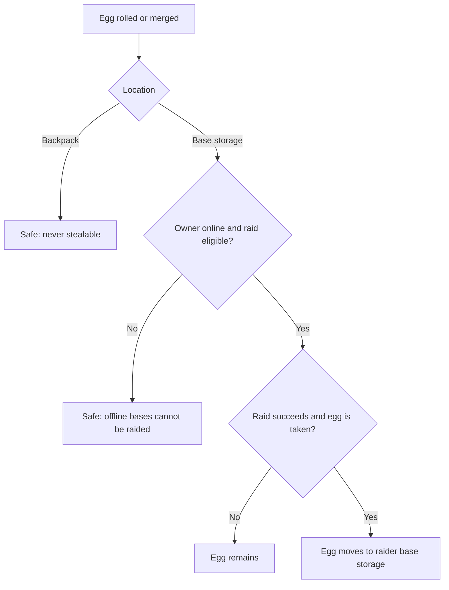

# Egg Storage

Unhatched eggs live in one of two places: the **Backpack**, which travels with the player and is never stealable, and **Base storage** (the Egg Vault), which is larger but exposed to eligible raids. This page owns storage rules: capacities, behaviour when full, transfers and the raid interaction summary.

> [!success] CONFIRMED (D-021)
> - Backpack **10** + Base storage **50** = **60** eggs at the start.
> - Backpack eggs can **never** be stolen.
> - Eggs stored in the base can be stolen in an eligible raid (D-024).
> - Extra space can be purchased. The **currency and pricing are UNDECIDED** ([[Open Questions#Q-009]], [[Open Questions#Q-010]]).

## 1. Capacities

| Location | Start capacity | Stealable | Expansion step | Steps | Maximum | Currency and price |
|---|---:|---|---|---:|---:|---|
| Backpack | **10** (**CONFIRMED**) | Never (**CONFIRMED**) | +5 (**PROPOSED**) | 3 | 25 (**PROPOSED**) | **UNDECIDED** (Q-009, Q-010) |
| Base storage (Egg Vault) | **50** (**CONFIRMED**) | During an eligible raid (**CONFIRMED**) | +25 (**PROPOSED**) | 6 | 200 (**PROPOSED**) | **UNDECIDED** (Q-009, Q-010) |
| **Total** | **60** (**CONFIRMED**) | | | | 225 (**PROPOSED**) | |

> [!warning] UNDECIDED
> Do not quote a price or currency for expansion anywhere in the vault. Options and their trade-offs (Cash only, Robux only, both) are analysed in [[Storage Expansion Economics]]. The fairness requirement (D-027) means storage must never become a pay-to-win bottleneck: the game must be fully playable at 60 slots.

Egg Vault **module levels** (security and visuals, [[Module - Egg Vault]]) are separate from **capacity expansion**; upgrading the module does not add slots (**PROPOSED**, per [[Canonical Proposed Values]] §12).

## 2. Is 60 slots enough? (PROPOSED analysis)

| Player stage | Rolls per hour (model in [[Ascension Expected Value Analysis#Cash-per-hour model]]) | Time to fill 60 empty slots without hatching |
|---|---:|---|
| Beginner | 18 | 3.3 h |
| Intermediate | 49 | 1.2 h |
| Advanced | 165 | 22 min |
| Endgame | 335 | 11 min |

Storage is a **holding area, not a bank**. Late-game players cycle eggs through merge and hatch constantly; the capacity question for them is about merge staging (keeping 3 of each rarity) and owned-animal capacity ([[Open Questions#Q-022]]), not egg slots. Early players rarely fill storage. Expansion is therefore a comfort purchase, which suits D-027.

## 3. Behaviour when full

| Action | When destination is full | Status |
|---|---|---|
| Egg roll | Rejected before any charge (`NoCapacity`). The panel offers the other location if it has space | **PROPOSED** |
| Bulk ×5 | Offered as "Roll ×N" where N = free slots (1–4); if 0, rejected | **PROPOSED** |
| Merge | Never blocked by capacity: inputs free 3 slots, the output takes 1 (net −2). Output goes to base storage; if base storage is still full (all three inputs were in the backpack), the output goes into a freed backpack slot | **PROPOSED** |
| Raid loot (attacker) | Stolen eggs go to the attacker's base storage. If full, the attacker cannot pick up more eggs (pickup prompt disabled with "Vault full") | **PROPOSED**; theft limits **UNDECIDED** ([[Open Questions#Q-013]]) |
| Any other source (events, boss rewards) | Rewards are held in a "pending rewards" queue (PROPOSED: up to 20 entries) until space exists | **PROPOSED**; boss rewards **UNDECIDED** ([[Open Questions#Q-015]]) |

No egg is ever silently destroyed because storage is full.

## 4. Transfer between backpack and base (PROPOSED rules)

| Rule | Proposal | Rationale |
|---|---|---|
| Where | Only at the player's own base, within the base plot | Keeps the "carry vs secure" decision physical and simple |
| When | Not while combat-tagged; not while the player's own base is under an active raid | Prevents "rescuing" eggs into the unstealable backpack mid-raid |
| Direction | Both ways, any rarity | |
| Batch | Up to 10 eggs per request; drag-and-drop or "Move all of rarity X" | Usability |
| Cost | Free, instant | Storage friction should come from capacity, not fees |
| Rate limit | 5 transfer requests per second per player (PROPOSED, [[Implementation - Rate Limiting]]) | Exploit hygiene |
| Atomicity | A transfer moves eggs between lists in one profile update; an egg is never in both or neither | Data safety ([[Data Consistency and Transactions]]) |

**Strategic choice for players.** The backpack is the safe pocket for the eggs a player cares about most (for example a Mythical waiting for a merge partner). The vault holds bulk. Because offline bases cannot be raided (D-024), the risk exists only while the player is online, which the UI should explain ([[UI - Egg Storage]]).

## 5. Raid interaction summary

The full rules are owned by [[Egg Theft Rules]] and [[Base Raiding System]]; this is a summary.

| Rule | Status |
|---|---|
| Only base-stored eggs can be stolen | **CONFIRMED** |
| Backpack eggs are never stealable | **CONFIRMED** |
| Offline bases cannot be raided | **CONFIRMED** |
| Egg theft limit per raid | **UNDECIDED** ([[Open Questions#Q-013]]) |
| Raid duration | **UNDECIDED** ([[Open Questions#Q-012]]) |
| During an active raid on their base, the owner cannot transfer, hatch or merge base-stored eggs | **PROPOSED** |
| A stolen egg keeps its rarity; hatch odds follow the new owner's P at hatch time (if Q-302 Option A is chosen) | **PROPOSED** |
| Stolen eggs do not change either player's PS | **PROPOSED** |

## 6. Server validation

- Capacity is computed from the persisted lists, never from client counts.
- Every egg ID in a request must belong to the player and be in the claimed location.
- Moves, hatches and merges re-check the raid lock at commit time, not only at request time.
- Expansion purchases (whatever the currency) are applied idempotently; Robux purchases follow `MarketplaceService.ProcessReceipt` rules ([[Roblox Monetisation Policy Requirements]]).

Schema: [[Schema - Egg Inventory]]. Tests: [[Test Cases - Inventory and Storage]].

## Related documents
- [[Egg System Overview]] · [[Egg Roll System]] · [[Hatch System]] · [[Egg Merging]]
- [[Module - Egg Vault]] · [[Storage Expansion Economics]]
- [[Egg Theft Rules]] · [[Base Raiding System]] · [[Raid Lifecycle and States]]
- [[UI - Egg Storage]] · [[Schema - Egg Inventory]] · [[Test Cases - Inventory and Storage]]
