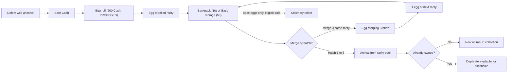
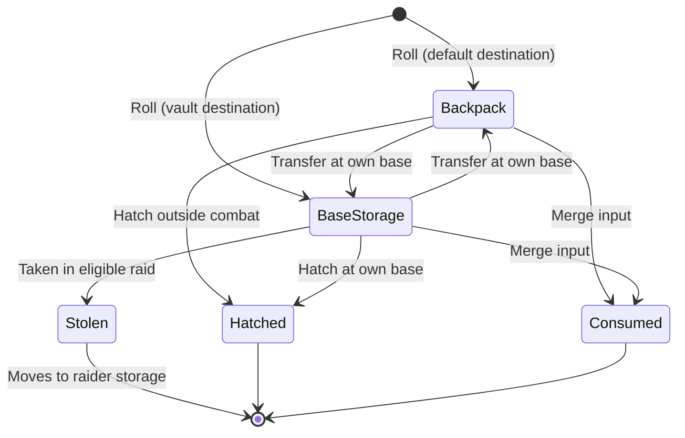

# Egg System Overview

Eggs are the bridge between combat and collection. Cash earned from wild animals buys **egg rolls**; a roll produces an egg of one of seven rarities; the egg is stored, optionally merged, and finally **hatched** into an animal. Duplicate animals then feed [[Ascension System|ascension]]. This page is the map of the whole egg pipeline. Each stage has an owning document, and this page does not repeat their detail.

> [!success] CONFIRMED pillars of the egg system
> - Cash from defeating wild animals buys egg rolls (D-014).
> - Two-stage randomness: the roll decides egg rarity; the hatch picks an animal from that rarity's pool (D-015).
> - Up to **5** eggs can be hatched at once (D-016).
> - Hidden progression luck improves egg-rarity and hatch odds, never wild encounter rarity. Actual odds are shown before committing and are never changed silently after purchase (D-017).
> - Every hatch is independent: no duplicate protection, no bias towards unowned animals, no memory (D-018).
> - 3 eggs of one rarity merge into 1 egg of the next rarity at a purchased, upgradeable [[Egg Merging Station]] (D-020).
> - Storage starts at Backpack **10** + Base **50** = **60**. Backpack eggs can never be stolen (D-021).

## 1. The pipeline at a glance

| Stage | What is random | Owning document | Server service |
|---|---|---|---|
| Earning cash | Nothing in the egg system (combat rewards) | [[Wild Animal Cash Rewards]] | [[Service - EconomyService]] |
| Roll | Egg rarity, from the player's current disclosed rarity odds | [[Egg Roll System]] | [[Service - EggService]] |
| Luck | Not random: a deterministic odds modifier from the Progression Score | [[Dynamic Progression Luck]], [[Progression Score Specification]] | [[Service - LuckService]] |
| Storage | Nothing | [[Egg Storage]] | [[Service - EggService]] |
| Merge | Nothing: merging is deterministic (3 → 1 of next rarity) | [[Egg Merging]], [[Egg Merging Station]] | [[Service - MergeService]] |
| Hatch | Which animal, from the egg's rarity pool | [[Hatch System]] | [[Service - HatchService]] |
| Ascension | Nothing: deterministic consumption of duplicates | [[Ascension System]] | [[Service - AscensionService]] |

## 2. Egg lifecycle

Every egg is a persistent item with a unique ID from the moment it is rolled until it is hatched, merged or stolen.

| Egg field | Example | Notes |
|---|---|---|
| `eggId` | GUID | Unique, generated by the server |
| `rarity` | `3` (Epic) | 0–6, see [[Egg Rarity System]] |
| `source` | `roll`, `merge`, `raid` | Analytics and support |
| `createdAt` | Unix time | Server time |
| `oddsVersion` | token used at roll | Audit only; proves which odds were disclosed ([[Randomised Reward Compliance]]) |
| `location` | `backpack` / `base` | See [[Egg Storage]] |

The full persisted schema is in [[Schema - Egg Inventory]].

## 3. Key rules and their status

| Rule | Status | Detail in |
|---|---|---|
| Seven rarities, Common → Secret | **CONFIRMED** (D-003) | [[Egg Rarity System]] |
| Roll price 200 Cash flat; ×5 bulk for 1,000 Cash | **PROPOSED** (D-039); model **UNDECIDED** ([[Open Questions#Q-020]]) | [[Egg Pricing]] |
| Baseline odds 65 / 22 / 9 / 3 / 0.8 / 0.18 / 0.02 % at P = 0.30 | **PROPOSED** (D-031); final **UNDECIDED** ([[Open Questions#Q-016]]) | [[Egg Roll System]], [[Dynamic Luck Probability Tables]] |
| Luck formula and inputs | **PROPOSED** (D-036); final **UNDECIDED** ([[Open Questions#Q-017]]) | [[Dynamic Progression Luck]] |
| Pool weight classes Standard 10 / Scarce 6 / Elusive 3 | **PROPOSED**; final pools **UNDECIDED** ([[Open Questions#Q-018]]) | [[Hatch Pool Tables]] |
| Odds bound to an `oddsVersion` token | **PROPOSED** (D-041) | [[Randomised Reward Compliance]] |
| Hatch presentation: instant result, 3.5 s single, 5.0 s multi | **PROPOSED**; timing **UNDECIDED** ([[Open Questions#Q-023]]) | [[Hatch System]], [[Egg Animations]] |
| Where rolls can be made and where the egg goes | **PROPOSED**; **UNDECIDED** (Q-301) | [[Egg Roll System]] |
| Whether hatch odds are fixed at roll time or at hatch time | **UNDECIDED** (Q-302) | [[Hatch System]] |
| Station levels, costs, fees, gates | **PROPOSED**; final **UNDECIDED** ([[Open Questions#Q-019]]) | [[Egg Merging Station]] |
| Expansion currency and price | **UNDECIDED** ([[Open Questions#Q-009]], [[Open Questions#Q-010]]) | [[Egg Storage]] |

## 4. Design intent

1. **Readable fairness.** The formula may be hidden, but players always see the exact odds they are about to receive. Odds are a server fact, never a client guess.
2. **Every roll is a fresh chance.** Independence (D-018) is a promise and a constraint: no pity timers, no "bad luck protection", no duplicate shields. The maths and the copywriting rules are in [[Independent Random Outcomes]].
3. **Duplicates are progress.** Because duplicates are expected, every hatch is useful: a new species fills the index, a duplicate advances ascension.
4. **Merging is the deterministic counterweight.** It converts surplus low-rarity eggs into a guaranteed higher-rarity egg. It is powerful; the balance analysis is in [[Egg Merging#Merge shortcut analysis]].
5. **Risk is opt-in and bounded.** Base-stored eggs can be stolen in eligible raids; the backpack is a permanent safe pocket.

## 5. Throughput reality check (PROPOSED model)

Using the cash model in [[Ascension Expected Value Analysis#Cash-per-hour model]], a player's roll rate grows from about **18 rolls per hour** (beginner, Whisperwood Forest) to about **335 rolls per hour** (endgame, Starfall Sanctuary). Three consequences shape the egg UI and storage design:

- **Endgame players produce far more eggs than 60 slots hold.** Bulk roll, multi-hatch (5) and merge must be fast and keyboard, controller and touch friendly ([[UI - Egg Rolling]], [[UI - Egg Hatching]]).
- **Owned-animal capacity** (working assumption 100, **UNDECIDED** [[Open Questions#Q-022]]) will fill quickly. A way to dispose of surplus animals (release or sell) is not yet designed: **UNDECIDED** (Q-305).
- **Animation time must stay a small share of play time.** At 335 rolls per hour, 67 multi-hatches × 5.0 s ≈ 5.6 minutes per hour, which is acceptable only because animations are skippable after first viewing.

## 6. Services and implementation

| Concern | Document |
|---|---|
| Roll and hatch transaction | [[Implementation - Egg Roll and Hatch Flow]] |
| Weighted selection | [[Implementation - Weighted Random Selection]] |
| Luck calculation | [[Implementation - Dynamic Luck Calculation]] |
| Merge transaction | [[Implementation - Egg Merge Transaction]] |
| Remote validation and rate limits | [[Implementation - Remote Validation Layer]], [[Implementation - Rate Limiting]] |
| Atomic saves | [[Data Consistency and Transactions]] |

## Related documents
- [[Eggs and Hatching Index]]
- [[Core Gameplay Loop]]
- [[Egg Rarity System]] · [[Egg Roll System]] · [[Hatch System]] · [[Egg Storage]] · [[Egg Merging]]
- [[Dynamic Progression Luck]] · [[Independent Random Outcomes]] · [[Probability Balancing]] · [[Randomised Reward Compliance]]
- [[Egg Art Direction]] · [[Egg Animations]]
- [[Canonical Proposed Values]] · [[Decision Register]]
