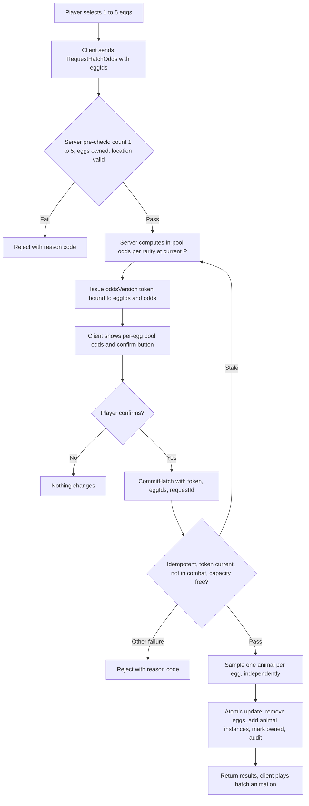
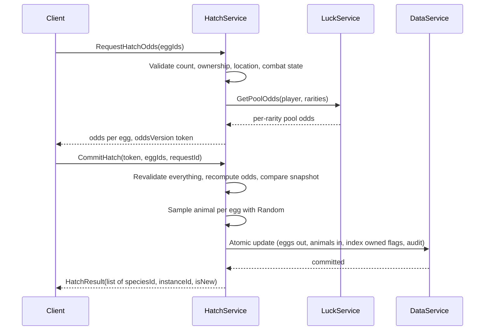

# Hatch System

Hatching turns an egg into an animal. It is stage 2 of the two-stage randomness (D-015): the egg's rarity is already fixed, and the hatch picks **one animal from that rarity's pool** using weighted, independent sampling.

> [!success] CONFIRMED
> - The hatch picks an animal from the egg rarity's pool (D-015).
> - Up to **five** eggs can be hatched at once (D-016).
> - Progression luck may change hatch odds; actual odds are shown before committing (D-017).
> - Every hatch is independent: no duplicate protection, no bias towards unowned animals, no influence from earlier hatches (D-018).

## 1. Hatch rules

| Rule | Proposal | Status |
|---|---|---|
| Eggs per hatch action | 1 to 5, any mix of rarities | **CONFIRMED** maximum; mixing **PROPOSED** |
| Result timing | Instant on the server; 3.5 s single-egg animation, 5.0 s multi-hatch, skippable after first viewing of that rarity | **PROPOSED**; timed incubation is an alternative (**UNDECIDED**, [[Open Questions#Q-023]]) |
| Backpack eggs | Hatchable anywhere outside combat | **PROPOSED** |
| Base-stored eggs | Hatchable only at the player's own base | **PROPOSED** |
| Cost | Free (the roll was the purchase) | **PROPOSED** |
| Animal capacity | Needs one free owned-animal slot per egg. Working assumption: 100 owned animals | **UNDECIDED** ([[Open Questions#Q-022]]) |
| Pool weights | Class weights Standard 10, Scarce 6, Elusive 3, tilted by luck (`H = 1.0`) | **PROPOSED**; final pools **UNDECIDED** ([[Open Questions#Q-018]]) |
| Index | A hatched species is marked **owned** in the index; discovery comes only from defeating the animal in the wild (D-029) | **CONFIRMED** distinction |

## 2. Hatch odds

For an egg of rarity *r*, each animal *i* in that pool has weight

`w_i(P) = ClassWeight_i × (1 + H × (P − 0.30) × Tilt_i)` with `H = 1.0` and Tilt Standard 0, Scarce 0.5, Elusive 1.0,

normalised within the pool. At P = 0.30 the tilt term is zero, so baseline in-pool odds are simply **class weight / pool total**. Per-animal tables for every pool at several P values are in [[Hatch Pool Tables]]; each egg type document lists its baseline pool.

**Worked example: Epic pool** (6 Standard, 2 Scarce, 1 Elusive; total 60 + 12 + 3 = 75 at baseline).

| Class | Animals | P = 0.05 | P = 0.30 | P = 0.60 | P = 0.95 |
|---|---|---:|---:|---:|---:|
| Standard (each) | [[Tiger]], [[Gorilla]], [[Crocodile]], [[Rhino]], [[Golden Eagle]], [[Dolphin]] | 13.75 % | 13.33 % | 12.87 % | 12.37 % |
| Scarce (each) | [[Hippo]], [[Electric Eel]] | 7.22 % | 8.00 % | 8.88 % | 9.83 % |
| Elusive | [[Snow Leopard]] | 3.09 % | 4.00 % | 5.02 % | 6.12 % |
| **Pool total weight** | | 72.75 | 75.00 | 77.70 | 80.85 |
| **Sum check** (6 S + 2 Sc + 1 E) | | 100.00 % | 100.00 % | 100.00 % | 100.00 % |

Luck shifts probability **within** a pool from Standard towards Scarce and Elusive animals. It never adds animals from another rarity.

> [!warning] UNDECIDED (Q-302): when are hatch odds fixed?
> The egg's rarity is fixed at roll time. The in-pool odds depend on P, which may rise between roll and hatch.
> - **Option A (working assumption):** hatch odds are computed at **hatch time** from the player's current P and disclosed on the hatch confirmation, with their own `oddsVersion` token. The roll purchase only ever promised a rarity, and the hatch is a separate, free commit point. Simple; works for stolen and merged eggs (the holder's P applies).
> - **Option B:** snapshot the in-pool odds onto the egg at roll time. Strongest reading of "never altered after purchase", but every egg then carries an odds record, and pool changes in content updates (new animals) become hard to honour.
> - Recommendation (**PROPOSED**): Option A, with roll-panel copy stating *"Hatch odds are shown when you hatch."* Needs owner sign-off because it interprets D-017.

## 3. Hatch flow

## 4. Server-authoritative sequence

The `isNew` flag is computed **after** sampling, purely for presentation. It has no influence on the draw (D-018). Code that reads ownership before sampling is a defect; [[Test Cases - Egg Rolls and Hatching]] must include a test that the sampling function receives no collection data at all.

## 5. Edge cases

| Case | Server behaviour | Client behaviour | Status |
|---|---|---|---|
| **Hatching six eggs** (or 0, or duplicates in the list) | Reject `BadCount` / `DuplicateEggId` before computing odds; log if the client UI cannot produce the request | Selection UI caps at 5 and greys out further eggs | Cap **CONFIRMED**; handling **PROPOSED** |
| **Hatching in combat** | Reject `InCombat` while combat-tagged (8 s timeout) | Hatch button shows the remaining tag time | **PROPOSED** |
| **Base eggs away from base** | Reject `NotAtBase` for any base-stored egg in the list; the whole request fails (no partial hatch) | Base eggs are shown with a lock icon and "Hatch at your base" | **PROPOSED** |
| **Mixed backpack and base eggs at base** | Allowed | — | **PROPOSED** |
| **Insufficient animal capacity** | Reject `AnimalStorageFull` listing the free slots | Offer "Hatch N" where N is free slots | **PROPOSED**; capacity **UNDECIDED** ([[Open Questions#Q-022]]) |
| **Double-click** | `requestId` idempotency; in-flight lock; eggs already removed cannot be hatched twice | Button disabled after first press | **PROPOSED** |
| **Disconnect mid-hatch** | Atomic: either eggs are gone and animals exist (flagged `unseen`), or nothing changed | Replay reveal on rejoin | **PROPOSED** |
| **Stale odds** (P changed, config changed, token older than 120 s) | Reject `StaleOdds`, return new odds | Show changed odds; reconfirm | **PROPOSED** (D-041) |
| **Egg stolen between odds request and commit** | Ownership fails at commit: reject `EggNotOwned` | Refresh storage view | **PROPOSED** |
| **Own base under active raid** | Base-stored eggs cannot be hatched (prevents "saving" eggs from theft by hatching them) | Lock icon with "Raid in progress" | **PROPOSED**; see [[Egg Theft Rules]] |

## 6. Multi-hatch presentation

A five-egg hatch resolves all five draws in one transaction, then plays one 5.0 s sequence: all eggs wobble together, crack in rarity order (lowest first), and the highest rarity reveals last. The order is presentation only. Details are in [[Egg Animations]] and [[Animation - Egg Hatch]]; the screen is [[UI - Egg Hatching]].

## 7. Duplicates

A duplicate is a second or later instance of a species the player already owns. It is stored as a full animal instance (it can be equipped like any other) until the player consumes it in [[Ascension System|ascension]]. Hatch results show "Duplicate: x of y for next ascension" to make the duplicate's value visible.

> [!warning] UNDECIDED (Q-305)
> There is no designed way to dispose of surplus animals (release or sell for Cash) once ascension is complete or capacity is full. At endgame roll rates (about 335 rolls per hour, see [[Ascension Expected Value Analysis]]) this becomes a hard blocker. Options: release for a small Cash refund, release for nothing, or automatic conversion of fully-ascended duplicates. Any Cash refund must be tuned so release + re-roll cannot be farmed.

## Related documents
- [[Egg Roll System]] · [[Egg System Overview]] · [[Egg Rarity System]]
- [[Hatch Pool Tables]] · [[Dynamic Progression Luck]] · [[Independent Random Outcomes]]
- [[Egg Storage]] · [[Ascension System]] · [[Animal Collection System]] · [[Animal Index Feature Specification]]
- [[UI - Egg Hatching]] · [[Animation - Egg Hatch]] · [[Egg Animations]] · [[Sound - Eggs]]
- [[Service - HatchService]] · [[Implementation - Egg Roll and Hatch Flow]]
- [[Test Cases - Egg Rolls and Hatching]]
