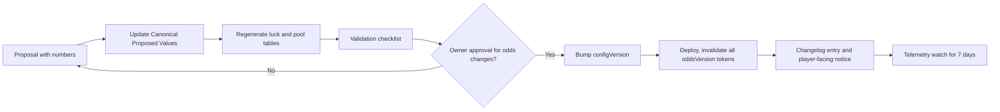

# Probability Balancing

How the egg odds are tuned, checked and changed. This page owns the **targets**, the **levers** and the **process**; the formulas are owned by [[Dynamic Progression Luck]], the numbers by [[Canonical Proposed Values]], and the generated tables by [[Dynamic Luck Probability Tables]] and [[Hatch Pool Tables]].

> [!info] PROPOSED
> Every target, lever setting and recommendation here is **PROPOSED**. Final egg probabilities, luck formula and pools are **UNDECIDED** ([[Open Questions#Q-016]], [[Open Questions#Q-017]], [[Open Questions#Q-018]]).

## 1. Balance targets (PROPOSED)

The odds exist to pace the collection. Targets are expressed as **expected hours of play to the first egg of a rarity**, using the cash model in [[Ascension Expected Value Analysis#Cash-per-hour model]] (direct rolling only, no merging).

| Profile (P) | Rolls per hour | Epic | Legendary | Mythical | Secret | Target band |
|---|---:|---:|---:|---:|---:|---|
| Beginner (0.05) | 18.0 | 3.1 h | 16.0 h | 94.7 h | 1,278 h | First Epic within the first two or three sessions |
| Intermediate (0.30) | 49.1 | 0.7 h | 2.5 h | 11.3 h | 102 h | First Legendary within a weekend |
| Advanced (0.60) | 165.2 | 0.1 h | 0.5 h | 2.0 h | 16.9 h | First Mythical within one long session |
| Endgame (0.95) | 335.3 | 0.1 h | 0.2 h | 0.7 h | 5.8 h | Secret egg roughly once per long session |

Expected eggs per hour by rarity:

| Profile | Common | Uncommon | Rare | Epic | Legendary | Mythical | Secret |
|---|---:|---:|---:|---:|---:|---:|---:|
| Beginner | 12.71 | 3.66 | 1.23 | 0.32 | 0.063 | 0.011 | 0.0008 |
| Intermediate | 31.92 | 10.80 | 4.42 | 1.47 | 0.393 | 0.088 | 0.0098 |
| Advanced | 97.99 | 39.13 | 18.45 | 6.97 | 2.074 | 0.499 | 0.059 |
| Endgame | 180.55 | 84.94 | 44.50 | 18.08 | 5.689 | 1.410 | 0.171 |

Most acceleration comes from **income** (×18.6 from beginner to endgame), not from luck (Secret odds ×11.7). This is healthy: the hidden part of the system is the smaller part.

## 2. Findings that need owner attention

| # | Finding | Evidence | Recommendation (PROPOSED) |
|---|---|---|---|
| F1 | Players below P = 0.30 receive **worse** than the published baseline | Beginner Secret 0.0043 % vs 0.02 %; new player 0.0009 % | Option 1: keep (pivot is a design choice; early rolls are about Commons). Option 2: move the pivot to P₀ = 0, so the baseline is the floor; at P = 1 this gives 49.28 / 26.69 / 15.01 / 6.37 / 2.06 / 0.52 / 0.064 %, a much steeper late game. Option 3: pivot 0 with halved slopes, giving 56.06 / 24.67 / 12.42 / 4.92 / 1.52 / 0.37 / 0.045 % at P = 1. Decision belongs to [[Open Questions#Q-017]] |
| F2 | In-pool luck **lowers** Standard animals' odds at high P | Standard Common share 10.20 % at P = 0.30 → 9.40 % at P = 1.0 | Acceptable; disclose per-animal odds so players chasing a Standard animal understand. Fully ascending [[Rabbit]] takes 320 rolls at P = 1.0 vs 241 at P = 0.30 |
| F3 | Merging dwarfs luck at the top tier | Secret merge shortcut ×8.3 (baseline) and ×4.2 (endgame) | See tuning options in [[Egg Merging#Merge shortcut analysis]] |
| F4 | Endgame roll throughput exceeds storage and owned-animal capacity | 335 rolls/h vs 60 egg slots and 100 animals | Surplus-animal disposal needed (**UNDECIDED**, Q-305) |
| F5 | Elusive Secret A5 chase is extreme without merging | Tyrannosaurus Rex A5: 290,000 direct rolls at baseline | See [[Ascension Expected Value Analysis]] |

## 3. Tuning levers

| Lever | Where | Effect | Side effects |
|---|---|---|---|
| `Base_r` (baseline odds) | §7 | Overall rarity of each tier at the pivot | Changes the published baseline; needs owner sign-off ([[Open Questions#Q-016]]) |
| Slopes `s_r` | §8 | How strongly progress improves each tier | Steeper slopes widen the beginner-endgame gap |
| Pivot `P₀` | §8 | Which P receives the baseline | See F1 |
| `H` (hatch luck strength) | §8 | How much luck tilts pools towards Scarce and Elusive | At H = 1, Elusive ×1.70 at P = 1 |
| `Tilt` per class | §8 | Which classes benefit | Standard tilt must stay 0 or pools lose their anchor |
| Class weights (10 / 6 / 3) | §7 | Relative rarity inside a pool | Per-pool totals change; regenerate [[Hatch Pool Tables]] |
| Pool composition | §2 | Which animals are Standard, Scarce or Elusive | Art and marketing implications ([[Open Questions#Q-018]]) |
| Roll price | §7 | Rolls per hour | Economy-wide; [[Egg Pricing]] ([[Open Questions#Q-020]]) |
| Merge fees and gates | §10 | Merge shortcut size | [[Egg Merging]] |
| PS input weights | §8 | How fast P grows | [[Progression Score Specification]] |

Never tune by changing behaviour that is not visible in the disclosed odds (no hidden multipliers, no history-based adjustments; D-017, D-018).

## 4. Validation checklist (run on every change)

1. **Sum check.** Every rarity table at P = 0, 0.05, 0.1 … 1.0 sums to 100 % within 1e-9. Every pool sums to 100 % at the same P values.
2. **Monotonicity.** For each of Uncommon to Secret, share is non-decreasing in P; Common share is non-increasing.
3. **Positivity.** Every weight > 0 for P in [0, 1]. Currently the minimum multiplier is 0.04 (Secret at P = 0).
4. **Ordering.** At every P, each rarity is less likely than the one below it (currently true: at P = 1, Uncommon 25.54 % < Common 53.14 %).
5. **Simulation.** 10 million draws per configuration; chi-squared test at α = 0.001; serial runs test ([[Statistical Testing of Probabilities]]).
6. **Journey.** Re-run the four profile targets in §1 and the ascension tables ([[Balance Simulation Plan]]).
7. **Disclosure.** Confirm that UI shows the new values and that all outstanding `oddsVersion` tokens are invalidated.

## 5. Change process

Odds changes follow [[Balance Update Process]] and [[Versioning and Changelog Policy]]. A change is never applied to a roll or hatch whose odds were already disclosed and confirmed (D-017).

## Related documents
- [[Dynamic Progression Luck]] · [[Dynamic Luck Probability Tables]] · [[Hatch Pool Tables]]
- [[Egg Roll System]] · [[Hatch System]] · [[Egg Merging]] · [[Independent Random Outcomes]]
- [[Ascension Expected Value Analysis]] · [[Progression Score Specification]]
- [[Balancing Methodology]] · [[Balance Simulation Plan]] · [[Statistical Testing of Probabilities]]
- [[Expected Value Calculations]] · [[Progression Bottleneck Analysis]]
