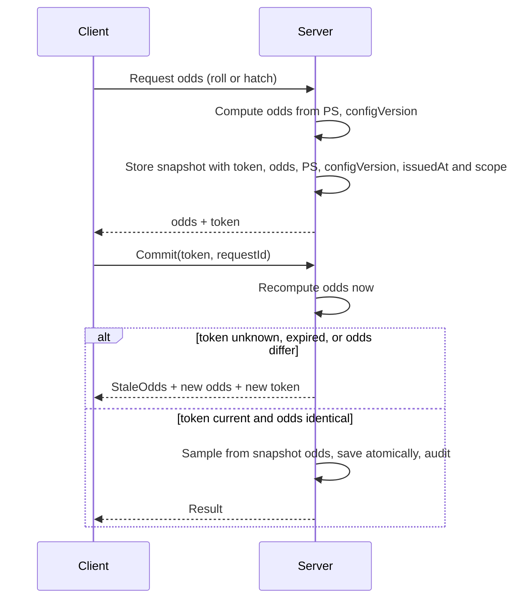

# Randomised Reward Compliance

Egg rolls and hatches are randomised rewards. This page defines how the game discloses odds, binds them technically to what the player confirmed, and stays inside platform policy and our own fairness charter. Monetisation policy as a whole is owned by [[Roblox Monetisation Policy Requirements]] and [[Monetisation Principles]].

> [!success] CONFIRMED (D-017, D-018, D-027)
> - The luck formula may be hidden, but the **actual odds must be shown before the player commits** and must **never be altered silently after purchase**.
> - Outcomes are independent; no duplicate protection or history influence.
> - The game is fully playable without Robux; paid random rewards are not the main revenue source.

> [!info] PROPOSED (D-041, D-044)
> - Displayed odds are bound to a server-issued `oddsVersion` token; stale tokens are rejected.
> - Cash is never sold for Robux, so Cash-bought egg rolls are not paid random items. Whether any Robux product grants Cash directly or indirectly is **UNDECIDED** ([[Open Questions#Q-032]]).

## 1. Classification of egg rewards

| Reward | Paid with | Random? | Classification (PROPOSED) |
|---|---|---|---|
| Egg roll | Cash (earned in play only) | Yes | Free-currency random reward, provided D-044 holds |
| Hatch | Free (egg already owned) | Yes | Free random reward |
| Merge | Cash fee | No (deterministic) | Not a random reward |
| Any Robux product that yields eggs, rolls or Cash | Robux | Yes, directly or indirectly | **Paid random item.** Not planned. If ever introduced, all rules in §4 apply in full |

> [!danger] Indirect conversion risk
> If any Robux product (pass, booster, bundle) grants Cash, a Cash multiplier, Progression Score inputs or storage that materially increases roll volume, rolls may be treated as paid random items (*unverified* interpretation of platform policy). Every new product must be reviewed against this table before release; see [[Monetisation Product Concepts]].

## 2. Disclosure requirements

| # | Requirement | Status |
|---|---|---|
| 1 | Show all seven rarity percentages before every roll confirmation | **CONFIRMED** principle (D-017); layout **PROPOSED** |
| 2 | Show per-animal in-pool percentages before every hatch confirmation (expandable per egg) | **CONFIRMED** principle; layout **PROPOSED** |
| 3 | Odds shown are the player's actual current odds, computed by the server, not a generic table | **CONFIRMED** principle |
| 4 | State plainly that odds improve with progression: *"Your odds improve as you progress. These are your exact odds right now."* | **PROPOSED** copy |
| 5 | Never round a non-zero value to 0 %; show at least two significant figures; round with a largest-remainder method so displayed values sum to exactly 100 % | **PROPOSED** |
| 6 | If the odds change before confirmation, show old and new values and require a new confirmation | **PROPOSED** (D-041) |
| 7 | A "View odds" link is available from the shop, shrine and hatch screens at all times | **PROPOSED** |
| 8 | Marketing, store descriptions and social posts may quote only "odds from X % to Y % depending on progress", never the baseline alone | **PROPOSED** |

## 3. The `oddsVersion` token (D-041)

**Purpose.** Prove, technically, that every outcome was drawn from exactly the odds the player saw.

**Lifecycle.**

| Property | Proposal |
|---|---|
| Format | Opaque GUID from `HttpService:GenerateGUID(false)`; carries no information itself |
| Storage | Server memory, keyed by player; one live token per scope (`roll`, `hatch`) |
| Scope binding | A hatch token is bound to the exact list of egg IDs it was issued for |
| Expiry | 120 s (**PROPOSED**) |
| Invalidation | Any PS change, any config change (`configVersion` bump broadcast via MessagingService), server restart |
| Replay | A token is consumed by its first successful commit; a repeat with the same `requestId` returns the stored result, a repeat with a new `requestId` is stale |

The token is not a security secret: the server never trusts its content, only its identity in the server's own table. Implementation: [[Implementation - Egg Roll and Hatch Flow]].

## 4. If paid random items are ever introduced

Not planned (D-044 **PROPOSED**). If the owner ever approves one, these rules become mandatory:

1. Call `PolicyService:GetPolicyInfoForPlayerAsync(player)` and, where `ArePaidRandomItemsRestricted` is true, hide and block the product for that player. Cache per session; fail closed (treat as restricted) if the call errors.
2. Show the full odds before the Robux prompt (`MarketplaceService:PromptProductPurchase`).
3. Grant the outcome only inside `MarketplaceService.ProcessReceipt`, idempotently by `PurchaseId`, and return `PurchaseGranted` only after the profile save succeeds.
4. Keep paid odds identical to or better than Cash-roll odds at the same PS; never worse.
5. Record the product as a paid random item in the [[Roblox Monetisation Policy Requirements]] register.

Exact platform obligations must be re-verified against current official policy at the time; the points above are this team's standard, not a statement of the platform's full policy (*unverified*).

## 5. Ethical design rules

| Rule | Status |
|---|---|
| No near-miss presentation (no teasing a higher rarity before revealing a lower one) | **PROPOSED** |
| No countdown or "limited time" pressure on egg rolls | **PROPOSED** |
| No pity timers or hidden streak adjustments (would also break D-018) | **CONFIRMED** (D-018) |
| No celebration of spending; celebration is for the animal | **PROPOSED** |
| No gambler's-fallacy copy ("You're due!") | **PROPOSED**, see [[Independent Random Outcomes]] |
| The game is completable without Robux | **CONFIRMED** (D-027) |
| Secret server-wide announcements are opt-out | **PROPOSED** |

## 6. Audit and logging

Every roll and hatch writes an audit record via [[Service - AnalyticsAndLoggingService]]:

| Field | Purpose |
|---|---|
| `userId`, `requestId`, `timestamp` | Identity and idempotency |
| `scope` (`roll` / `hatch`), egg IDs | What was committed |
| `ps`, `p`, `configVersion`, `oddsVersion` | Proves which odds applied |
| `odds` (7 values or pool table) | The disclosed table |
| `u` (random number drawn) | Reproducibility of the selection step |
| `outcome` | Rarity or species |
| Cash before and after | Ledger reconciliation |

Retention follows [[Logging and Error Handling]]. Support can answer "what were my odds?" for any outcome. Aggregate audits run weekly: observed versus disclosed frequency per PS band ([[Statistical Testing of Probabilities]]).

## 7. Test hooks

- Commit with a token from before a level-up → `StaleOdds`.
- Config hot-swap during an open roll panel → `StaleOdds` on commit.
- Hatch token reused with a different egg list → `StaleOdds`.
- Displayed odds equal audit-log odds for 1,000 random commits.
- SpawnService outcome distribution identical at PS 0 and PS 1000 (luck isolation).

See [[Test Cases - Egg Rolls and Hatching]] and [[Test Cases - Exploit Prevention]].

## Related documents
- [[Roblox Monetisation Policy Requirements]] · [[Monetisation Principles]] · [[Free-to-Play Experience]]
- [[Dynamic Progression Luck]] · [[Egg Roll System]] · [[Hatch System]] · [[Independent Random Outcomes]]
- [[Design Principles and Fairness Charter]] · [[Security Architecture]]
- [[Service - AnalyticsAndLoggingService]] · [[Implementation - Egg Roll and Hatch Flow]]
- [[Decision Register]]
