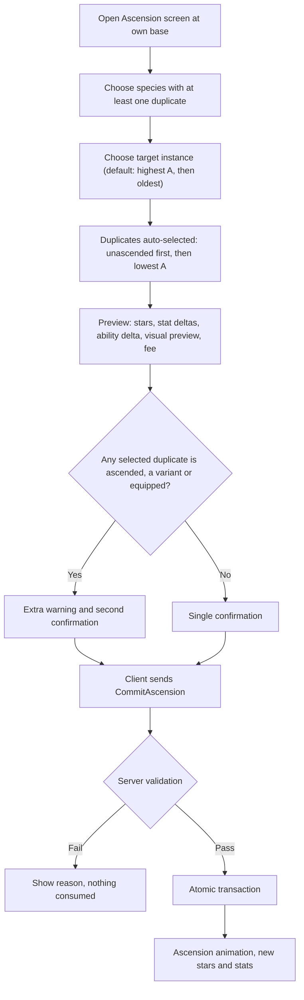

# Ascension System

Ascension is how duplicates become power. When a player owns more than one copy of the same species, they can consume the extra copies to raise one chosen animal's **ascension level**, improving its stats, its abilities and its look. The chosen animal is kept; the duplicates are consumed.

> [!success] CONFIRMED (D-019, D-018)
> - Ascension consumes the required duplicates of the same animal. **The original is retained.**
> - Duplicates arise naturally because hatches are independent with no duplicate protection.

> [!info] PROPOSED (D-037, [[Canonical Proposed Values]] §9)
> Five ascension levels A1–A5, shown as stars; duplicate requirements and Cash fees by rarity; +8 % HP / ATK / DEF and +5 % ability effectiveness per level. Exact levels are **UNDECIDED** ([[Open Questions#Q-004]]); exact duplicate requirements are **UNDECIDED** ([[Open Questions#Q-005]]). Numbers per step are tabulated in [[Ascension Progression Table]].

## 1. Terms

| Term | Meaning |
|---|---|
| **Target** | The animal instance being ascended. It is kept |
| **Duplicate** | Another instance of the **same species** (same `speciesId`) owned by the same player |
| **Ascension level (A)** | 0 (unascended) to 5 |
| **Step** | One level increase, A(n−1) → A(n); consumes the duplicates for step n and charges the step fee |

## 2. Levels, requirements and effects

| Rarity | Duplicates A1 / A2 / A3 / A4 / A5 | Total duplicates | Copies needed incl. target | Cash fee per step n | Total fees |
|---|---|---:|---:|---|---:|
| Common | 1 / 2 / 3 / 4 / 5 | 15 | 16 | 100 × n | 1,500 |
| Uncommon | 1 / 2 / 3 / 3 / 4 | 13 | 14 | 200 × n | 3,000 |
| Rare | 1 / 1 / 2 / 3 / 3 | 10 | 11 | 400 × n | 6,000 |
| Epic | 1 / 1 / 2 / 2 / 3 | 9 | 10 | 800 × n | 12,000 |
| Legendary | 1 / 1 / 1 / 2 / 2 | 7 | 8 | 1,600 × n | 24,000 |
| Mythical | 1 / 1 / 1 / 1 / 2 | 6 | 7 | 3,200 × n | 48,000 |
| Secret | 1 / 1 / 1 / 1 / 1 | 5 | 6 | 6,400 × n | 96,000 |

All values **PROPOSED**. How long these take to collect is analysed in [[Ascension Expected Value Analysis]].

### Stat scaling

`StatAtA = BaseStat × (1 + 0.08 × A)` for HP, ATK and DEF, where BaseStat is the animal's A0 stat from [[Animal Statistics Database]]. Attack speed and movement speed do not scale. The +8 % is of **base**, so it is linear, not compounding (A5 = ×1.40).

Worked example with role-neutral reference values for an Epic Assassin such as [[Tiger]] (before its species tweak; real values in [[Tiger]]): HP 200 × 2.20 × 0.75 = 330, ATK 20 × 2.20 × 1.45 = 63.8, DEF 10 × 2.20 × 0.70 = 15.4.

| Level | HP | ATK | DEF | Power Index vs A0 |
|---|---:|---:|---:|---:|
| A0 | 330.0 | 63.80 | 15.40 | ×1.000 |
| A1 | 356.4 | 68.90 | 16.63 | ×1.086 |
| A3 | 409.2 | 79.11 | 19.10 | ×1.260 |
| A5 | 462.0 | 89.32 | 21.56 | ×1.437 |

Because DEF also rises, the Power Index (`sqrt((ATK × AS) × (HP × (1 + DEF/100)))`) grows slightly faster than 40 %: about **+43.7 %** at A5 for this animal.

**Stacking with base bonuses (PROPOSED).** Ascension multiplies with other bonuses: `Final = BaseStat × (1 + 0.08 × A) × (1 + TrainingGroundsBonus)`, where [[Module - Training Grounds]] gives +4 % equipped animal stats per level. The authoritative stacking order belongs to [[Animal Stat Budget Model]]; if it defines otherwise, that document wins.

**Tier overlap.** An A4 animal slightly out-stats an A0 animal of the next rarity at every tier (for example Epic A4 = 2.20 × 1.32 = 2.904 versus Legendary A0 = 2.85). This is intentional: a well-ascended favourite remains viable after the next rarity is hatched. See [[Ascension Progression Table#Effective tier multipliers]].

### Ability progression

Ability effectiveness (damage, heal amount, buff or debuff duration) rises **+5 % per level** (A5 = +25 %). Cooldowns, ranges and targeting are unchanged. Ability definitions are in [[Animal Abilities Catalogue]]; the scaling is applied by [[Abilities and Cooldowns]].

> [!warning] Control duration in PvP
> +25 % on stun or slow duration for Controllers may be strong in [[PvP System|PvP]]. PROPOSED safeguard: crowd-control *durations* scale at half rate (+2.5 % per level) in PvP and raids only. Needs combat review.

### Visual tiers

| Level | Visual change ([[Canonical Proposed Values]] §9) | Implementation note (PROPOSED) |
|---|---|---|
| A1 | Coloured trim in the rarity colour | Material colour swap on trim parts |
| A2 | Rarity-coloured eye glint | Small Neon eye highlight |
| A3 | Soft aura | Low-rate ParticleEmitter or a translucent shell |
| A4 | Particle accents | Rarity particles on paws, wings or fins |
| A5 | Crest and full aura | Crest attachment above the head, full aura, star badge |

Effects follow [[VFX - Rarity and Variant Effects]] and must stay inside [[Animal Scalability and Performance Budgets]]: other players' animals show A3+ auras at reduced particle rates.

## 3. UI flow

Screen specification: [[UI - Ascension]].



### Duplicate detection

- The server groups owned instances by `speciesId`. A species shows as "ready" when `count − 1 ≥ duplicates required for the target's next step`.
- Ownership counts are always computed on the server from [[Schema - Animal Collection]]; the client display is a cache.
- Variants: whether a variant copy (for example a Golden variant) counts as a duplicate of its base species, and whether a variant can be the kept target, is **UNDECIDED** (Q-303). Working assumption: variants count as duplicates of their species, and consuming a variant always triggers the extra warning.

### Animal selection rules (PROPOSED)

| Rule | Proposal |
|---|---|
| Target choice | Player chooses; default is the highest-ascension instance |
| Duplicate auto-select | Unascended, non-variant, unequipped, unassigned instances first |
| Ascended duplicates | May be consumed after a second confirmation that names the ascension lost; no refund |
| Equipped duplicates | Cannot be consumed. Unequip first (only possible at base, D-010) |
| Base guard duplicates | Cannot be consumed while assigned to guard duty ([[Animal Guards and Base Defence AI]]) |
| Multi-step | "Ascend to max affordable" queues sequential steps; each step is its own transaction |

### Confirmation process

The confirmation panel shows: target card with current and next stars; each duplicate to be consumed (portrait, ascension, variant flag); the fee and Cash after payment; stat and ability deltas; and the line *"Consumed animals are gone permanently."* The confirm button arms after 0.5 s to prevent accidental double taps (PROPOSED).

## 4. Server validation and transaction

All checks run in [[Service - AscensionService]] inside one atomic profile update ([[Implementation - Ascension Transaction]], [[Data Consistency and Transactions]]).

| # | Check | Error code |
|---|---|---|
| 1 | Player is at own base (location rule **UNDECIDED**, Q-304; working assumption: base only) | `NotAtBase` |
| 2 | Not combat-tagged | `InCombat` |
| 3 | Not in an active raid as attacker, and own base not under an active raid | `InRaid` |
| 4 | Target instance owned by the player and A < 5 | `NotOwned`, `MaxAscension` |
| 5 | Exactly the required number of duplicate IDs, all distinct, all owned, all same `speciesId` as target, none equal to target | `BadDuplicates` |
| 6 | No duplicate is equipped, guard-assigned, or locked by another pending action | `DuplicateLocked` |
| 7 | Cash ≥ step fee | `InsufficientCash` |
| 8 | `requestId` not processed; per-player in-flight lock | Cached result / `Busy` |
| 9 | Rate limit 2 ascension commits per second (PROPOSED) | `RateLimited` |

The raid check (3) matters: without it, a defender could consume a knocked-out defending animal as a duplicate mid-raid to deny the raider (see [[Animal Theft Rules]]).

**Atomic transaction (illustrative Luau, not executed):**

```lua
-- Illustrative Luau. Runs inside the profile's UpdateAsync transform via DataService.
local function applyAscension(profile, targetId, duplicateIds, fee, requestId)
	local target = profile.animals[targetId]
	for _, id in duplicateIds do
		profile.animals[id] = nil -- consume
	end
	profile.cash -= fee
	target.ascension += 1
	table.insert(profile.ledger, {
		kind = "ascension", requestId = requestId, target = targetId,
		consumed = duplicateIds, fee = fee, newLevel = target.ascension,
	})
	return profile
end
```

All validation happens before the transform is applied; if `UpdateAsync` fails, the in-memory profile is not mutated and the client receives `SaveFailed`.

## 5. Failure handling

| Failure | Result | Player sees |
|---|---|---|
| Validation fails | Nothing changes | Specific reason ([[UI - Ascension]]) |
| Save fails (DataStore error or budget) | Nothing changes; retry allowed | "Something went wrong. Your animals and Cash are unchanged." |
| Disconnect after commit | Ascension saved; animation replays on rejoin | Reveal card |
| Server shutdown mid-commit | `game:BindToClose` waits for the save; otherwise nothing changes | As above |
| Duplicate stolen between preview and commit | `BadDuplicates` | Refreshed selection |

## 6. Save data

Per animal instance ([[Schema - Animal Collection]]):

| Field | Type | Example |
|---|---|---|
| `instanceId` | string (GUID) | `"8f3c…"` |
| `speciesId` | string | `"tiger"` |
| `ascension` | integer 0–5 | `3` |
| `variant` | string or nil | `nil` |
| `obtainedAt` | Unix time | `1794700000` |
| `source` | `hatch` / `raid` | `"hatch"` |

Ledger entries record every ascension for support and rollback. What a stolen animal keeps (including its ascension) is **UNDECIDED** ([[Open Questions#Q-025]]).

## 7. Animations and audio

The ascension sequence (3.0 s PROPOSED; 4.5 s for A5) shows the duplicates dissolving into rarity-coloured light that flows into the target, the new star igniting, and the new visual tier appearing. Specification: [[Animation - Ascension]]; audio: [[Sound - Ascension]].

## Related documents
- [[Ascension Progression Table]] · [[Ascension Expected Value Analysis]] · [[Ascension and Progression Index]]
- [[Hatch System]] · [[Independent Random Outcomes]] · [[Animal Collection System]]
- [[UI - Ascension]] · [[Animation - Ascension]] · [[Sound - Ascension]]
- [[Service - AscensionService]] · [[Implementation - Ascension Transaction]] · [[Test Cases - Ascension]]
- [[Animal Stat Budget Model]] · [[Animal Abilities Catalogue]] · [[Team Equipping and Base Lock Rule]]
