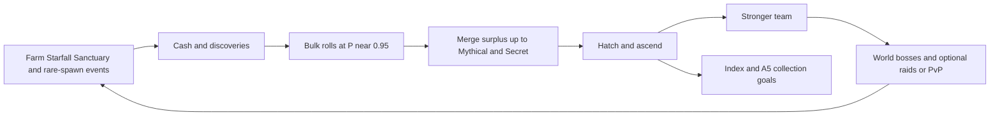

# Long-Term Goals and Endgame

What keeps a player coming back after the first week, and what the game looks like at the top. This page lists the long-term goals, estimates how long each takes under the vault's proposed numbers, describes the endgame loop, and flags where content runs thin.

> [!info] PROPOSED
> Goal list, time estimates and endgame loop are **PROPOSED**. Estimates use the cash and XP models in [[Ascension Expected Value Analysis#Cash-per-hour model]] and [[Player Progression and Levelling]] (240 defeats per hour; these are assumptions to be replaced by playtest data). Variant acquisition (**UNDECIDED**, [[Open Questions#Q-006]]) and boss rewards (**UNDECIDED**, [[Open Questions#Q-015]]) are not costed.

## 1. Goal ladder

| Horizon | Goal | Estimated time (model) | Systems | Notes |
|---|---|---|---|---|
| Session 1 | First team of three, first Epic egg | Epic expected every 56 rolls at P = 0.05 (≈ 3 h) | [[Egg Roll System]], [[Team Equipping and Base Lock Rule]] | Onboarding should guarantee nothing random; see [[New Player Onboarding]] |
| Week 1 | Unlock Coral Coast (Region 4) | ≈ 36 h to level 28 | [[Region Unlock Progression]] | Station L3 (Epic → Legendary merges) becomes available |
| Week 1–2 | Reach the luck pivot (PS 300) | ≈ 33 h | [[Progression Score Specification]] | Baseline odds from here on |
| Month 1 | First Legendary team at A3+ | Lion A5 ≈ 54 h with merging at baseline | [[Ascension System]] | |
| Month 1–2 | Skyreach Peaks, Station L4 | ≈ 108 h to level 52, plus a world boss | [[Egg Merging Station]] | First Mythical merges |
| Month 2–3 | Starfall Sanctuary, Station L5 | ≈ 206 h to level 80, plus 2 world bosses | [[Region - Starfall Sanctuary]] | Secret merging unlocked |
| Long | First copy of every animal (owned 60 / 60) | Hardest: [[Tyrannosaurus Rex]], about 6.5 Secret eggs ≈ 9 h of endgame income with merging (36.6 h direct) | [[Animal Collection System]] | |
| Long | Discover all 60 species in the wild | Bounded by Secret rare-spawn events (10 % per 45-min window ⇒ one spawn per 7.5 h per spawn point on average) | [[Wild Animal Spawning and Respawn]], [[Animal Index Feature Specification]] | Also the last 18 % of PS |
| Long | Level 100 | ≈ 280 h | [[Player Progression and Levelling]] | Recommended curve change would cut this to ≈ 189 h |
| Long | Max base (44 module levels) | 2.34 M Cash (modules 0.81 M, plot 0.20 M, station 1.33 M) ≈ 35 h of endgame income | [[Base Upgrade System]] | |
| Apex | All four Secrets at A5 | ≈ 42 Secret eggs ≈ 64 h of endgame income with merging (242 h direct) | [[Ascension Expected Value Analysis]] | |
| Apex | Entire roster at A5 | ≈ 8.6 M Cash ≈ 129 h of endgame income with merging (≈ 345 h direct) | All egg systems | Requires surplus-animal disposal (**UNDECIDED**, Q-305) |
| Ongoing | Variants, seasonal content, PvP and raid mastery | — | [[Animal Variants]], [[Seasonal and Limited-Time Events]], [[PvP System]] | Optional by design (D-023, D-024) |

**Completion horizon.** Cash earned while levelling overlaps with collection: by level 100 the income model has produced roughly 7 M Cash before bonuses, so the full A5 roster lands around **300–350 hours** of total play for an efficient player. This is long enough to be a real goal and short enough that live content must arrive before the most engaged players finish ([[Live Operations Framework]]).

## 2. The endgame loop

Endgame activities and their purpose:

| Activity | Purpose | Status |
|---|---|---|
| Secret and Mythical rare-spawn events | Discovery completion; the most exciting shared-world moments (server-wide announcements) | **PROPOSED** (§6 values) |
| World boss rotation (45–60 min cadence) | Team test, social play; rewards **UNDECIDED** ([[Open Questions#Q-015]]) | **PROPOSED** cadence |
| Secret merging at the Celestial Convergence Altar | The visible apex of base progression; status symbol (sky beam) | **PROPOSED** |
| A5 collection | Visual prestige (crest and full aura) and power | **PROPOSED** |
| Raids and PvP | Optional competition (D-023, D-024) | **CONFIRMED** optional; activation **UNDECIDED** ([[Open Questions#Q-011]]) |
| Base defence optimisation | Protecting base eggs while online | **PROPOSED** |

## 3. Risks and recommendations

> [!warning] Risks (PROPOSED assessment)
> 1. **Merging compresses the apex.** The whole Secret set at A5 takes about 64 hours at endgame. If fees are raised as recommended in [[Egg Merging#Merge shortcut analysis]], this rises to roughly 130–150 hours under option B.
> 2. **Discovery depends on presence.** Secret wild spawns appear about once per 7.5 hours per spawn point. Players who cannot be online at the right moment miss the last 3 PS points per Secret species (12 for all four) and the index entries. Recommendation: rare-spawn windows aligned to server time with in-game forecasts (no Robux shortcuts).
> 3. **Nothing to spend Cash on after completion.** Once the base is maxed and the roster is ascended, Cash loses purpose. Live operations must add sinks that do not break fairness: cosmetic base themes for Cash, new animals and regions ([[Content Expansion Guidelines]]).
> 4. **PS is near-maxed long before completion.** Most players hit P ≥ 0.9 around level 85–95; late-game luck growth is therefore flat. That is fine; the odds plateau should be communicated as "maximum luck reached" in [[UI - Progression Interface]].
> 5. **Optional systems must stay optional.** No long-term goal may require PvP or raiding (D-023, D-024). Raid-related goals remain side goals.

**Recommended additions for post-launch (PROPOSED, for [[Product Backlog]]):** a prestige-free "Collection Mastery" track that rewards cosmetic titles for full A5 per family ([[Animal Families]]); seasonal limited-time eggs that reuse the existing merge and hatch rules with disclosed pools ([[Seasonal and Limited-Time Events]]); new regions extending PS with the share-preserving rescale in [[Progression Score Specification]].

## Related documents
- [[Ascension and Progression Index]] · [[Player Progression and Levelling]] · [[Progression Score Specification]]
- [[Ascension System]] · [[Ascension Expected Value Analysis]]
- [[Egg Merging]] · [[Egg Merging Station]] · [[Dynamic Progression Luck]]
- [[Core Gameplay Loop]] · [[Session Flow and Player Journey]]
- [[Live Operations Framework]] · [[Content Expansion Guidelines]] · [[Seasonal and Limited-Time Events]]
