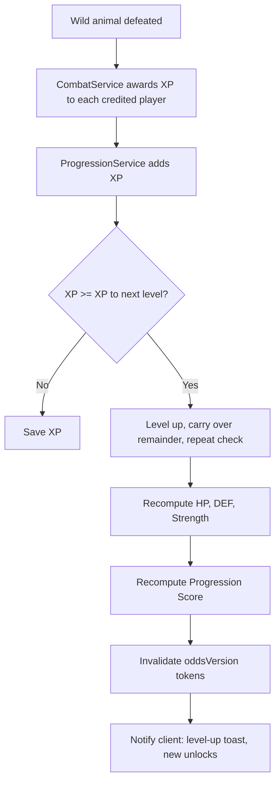

# Player Progression and Levelling

The player character has a level from 1 to 100. Levels raise the player's own combat statistics, unlock special moves, gate regions, and feed the Progression Score that drives egg luck. Animals do **not** level individually (D-042, **PROPOSED**; [[Open Questions#Q-021]]): their power comes from rarity, [[Ascension System|ascension]] and base bonuses.

> [!success] CONFIRMED context
> - Player strength is a statistic separate from animal strength (D-007).
> - Cash and progression come from defeating wild animals (D-014, D-002).

> [!info] PROPOSED ([[Canonical Proposed Values]] §4, §6, §13)
> Level cap 100; `XP(L) = round(100 × L^1.6)` to go from level L to L + 1; player HP, DEF and Strength formulas; special-move unlocks at levels 1, 10 and 25.

## 1. XP sources

| Source | XP | Status |
|---|---|---|
| Defeating a wild animal | `BaseXP(rarity) × RegionMultiplier`; BaseXP 10 / 15 / 25 / 45 / 80 / 150 / 300 for Common to Secret | **PROPOSED** (§6) |
| Shared kill credit | Every contributor with ≥ 10 % of max HP damage in the combat-tag window receives the **full** XP | **PROPOSED** (D-040) |
| Mini-bosses and world bosses | Rewards are **UNDECIDED** ([[Open Questions#Q-015]]) | **UNDECIDED** |
| Egg rolls, hatches, merges, ascension, Cash spending | **No XP** | **PROPOSED**: prevents converting Cash into levels and therefore into luck ([[Dynamic Progression Luck]]) |
| PvP and raids | No XP at launch | **PROPOSED**; keeps optional PvP optional (D-023) |

Average XP per defeat in the time model below assumes a spawn mix giving **13 base XP** per defeat (70 % Common, 20 % Uncommon, 8 % Rare, 2 % Epic: 7 + 3 + 2 + 0.9 = 12.9), a **new PROPOSED assumption** that mirrors the Cash model in [[Ascension Expected Value Analysis#Cash-per-hour model]].

## 2. XP curve

| Level L | XP from L to L + 1 | Cumulative XP to reach L | Region normally played |
|---:|---:|---:|---|
| 1 | 100 | 0 | [[Region - Whisperwood Forest]] |
| 5 | 1,313 | 1,902 | Whisperwood Forest |
| 8 | 2,786 | 7,223 | [[Region - Sunscorch Savanna]] unlock |
| 10 | 3,981 | 13,372 | Savanna |
| 18 | 10,196 | 65,564 | [[Region - Emerald Canopy]] unlock |
| 25 | 17,247 | 157,298 | Canopy |
| 28 | 20,675 | 212,416 | [[Region - Coral Coast]] unlock |
| 40 | 36,584 | 544,664 | [[Region - Frostfang Tundra]] unlock |
| 52 | 55,668 | 1,085,664 | [[Region - Skyreach Peaks]] unlock |
| 65 | 79,554 | 1,949,231 | [[Region - Emberheart Caldera]] unlock |
| 80 | 110,903 | 3,357,134 | [[Region - Starfall Sanctuary]] unlock |
| 90 | 133,902 | 4,568,323 | Starfall Sanctuary |
| 99 | 155,961 | 5,860,745 | Starfall Sanctuary |
| 100 | — (cap) | **6,016,706** | — |

Check: XP(10) = round(100 × 10^1.6) = round(100 × 39.81) = **3,981**.

## 3. Player statistics by level

| Level | HP `100 + 12(L − 1)` | DEF `5 + 0.5(L − 1)` | Base Strength `10 + 2(L − 1)` | Specials unlocked |
|---:|---:|---:|---:|---|
| 1 | 100 | 5.0 | 10 | Power Strike |
| 10 | 208 | 9.5 | 28 | + Ground Slam |
| 25 | 388 | 17.0 | 58 | + Rally Cry |
| 52 | 712 | 30.5 | 112 | — |
| 80 | 1,048 | 44.5 | 168 | — |
| 100 | 1,288 | 54.5 | 208 | — |

Effective Strength adds [[Module - Training Grounds]] bonuses: `BaseStrength × (1 + TrainingGroundsBonus + OtherStrengthBonuses)` ([[Player Strength]]). Combat use of these stats is in [[Player Combat]].

## 4. Levels as gates

| Gate | Requirement | Owner |
|---|---|---|
| Region 2 to Region 8 | Level 8 / 18 / 28 / 40 / 52 / 65 / 80 plus the previous mini-boss (Starfall also needs 2 world bosses) | [[Region Unlock Progression]] |
| Special moves | Level 1 / 10 / 25 | [[Player Combat]] |
| Egg Merging Station levels | Region gates, so indirectly level gates | [[Egg Merging Station]] |
| Progression Score | +4 PS per level (40 % of the maximum PS) | [[Progression Score Specification]] |

## 5. Time-to-level model (PROPOSED estimate)

Assumptions: 240 defeats per hour, 13 average base XP, playing in the newest region from its unlock level. Boss XP is excluded because it is undecided.

| Region (XP multiplier) | Levels | XP needed | XP per hour | Hours in region | Cumulative hours |
|---|---|---:|---:|---:|---:|
| 1 Whisperwood (×1.0) | 1 → 8 | 7,223 | 3,120 | 2.3 | 2.3 |
| 2 Savanna (×1.5) | 8 → 18 | 58,341 | 4,680 | 12.5 | 14.8 |
| 3 Canopy (×2.2) | 18 → 28 | 146,852 | 6,864 | 21.4 | 36.2 |
| 4 Coral Coast (×3.2) | 28 → 40 | 332,248 | 9,984 | 33.3 | 69.5 |
| 5 Frostfang (×4.5) | 40 → 52 | 541,000 | 14,040 | 38.5 | 108.0 |
| 6 Skyreach (×6.2) | 52 → 65 | 863,567 | 19,344 | 44.6 | 152.6 |
| 7 Emberheart (×8.5) | 65 → 80 | 1,407,903 | 26,520 | 53.1 | 205.7 |
| 8 Starfall (×11.5) | 80 → 100 | 2,659,572 | 35,880 | 74.1 | **279.8** |

Per-level time: about 2 minutes for level 1, 36 minutes at level 8, 1.5 hours at level 18, 2.1 hours at level 28, 2.9 hours at level 52, 3.1 hours at level 80, and 4.3 hours for the final level.

> [!warning] Assessment (PROPOSED)
> - **Total time to level 100 is about 280 hours** of combat. That is a reasonable long-term goal for a dedicated player, but per-level time exceeds 1.5 hours from level 18, which is slow for the target audience ([[Target Audience and Player Motivations]]). Level-ups are a key dopamine beat and a PS trigger.
> - **Options:** (a) keep 1.6 and add boss and first-discovery XP once [[Open Questions#Q-015]] is decided; (b) lower the exponent to 1.5 (total 3.95 M XP, about 189 hours, region 3 takes 15.6 hours instead of 21.4); (c) exponent 1.4 (2.60 M XP, about 128 hours). Option (b) is the recommended starting point for playtests. Any change shifts when players reach the PS pivot and the region gates, so it must be re-run through [[Progression Bottleneck Analysis]].

## 6. Level-up handling

Rules (**PROPOSED**): multiple level-ups from one award resolve in a loop; XP above level 100 is discarded (or shown as "max level"); level never decreases; the defeat penalty never removes XP or levels unless [[Open Questions#Q-014]] decides otherwise. Persistence: [[Schema - Player Progression]]; service: [[Service - ProgressionService]]; UI: [[UI - Progression Interface]].

## Related documents
- [[Ascension and Progression Index]] · [[Progression Score Specification]] · [[Long-Term Goals and Endgame]]
- [[Player Strength]] · [[Player Combat]] · [[Combat Rewards]] · [[Wild Animal Cash Rewards]]
- [[Region Unlock Progression]] · [[World Overview and Map]]
- [[Schema - Player Progression]] · [[Service - ProgressionService]] · [[UI - Progression Interface]]
- [[Progression Bottleneck Analysis]] · [[Canonical Proposed Values]]
