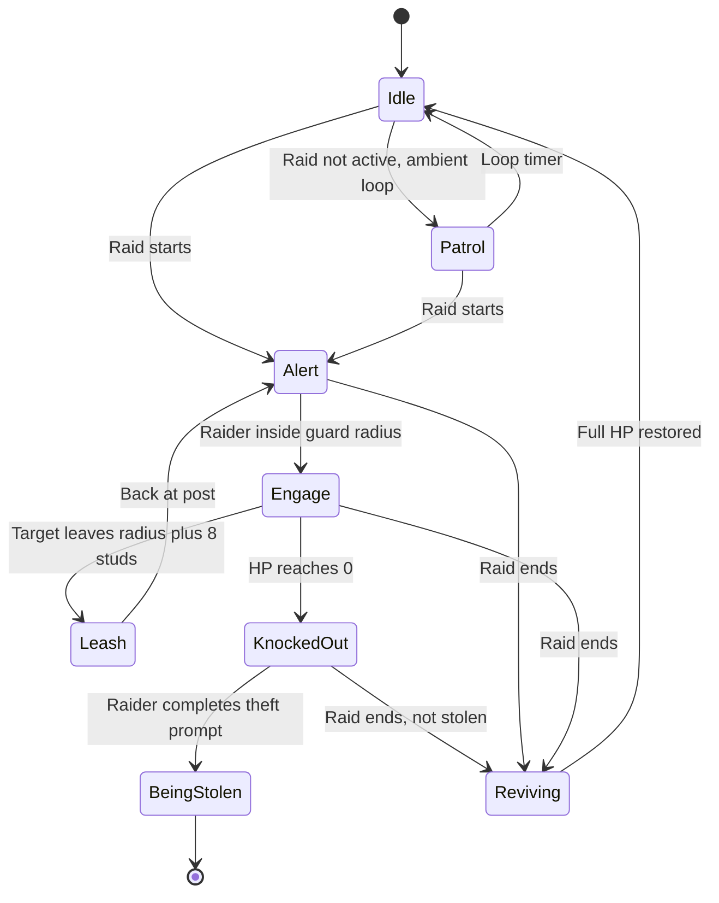

# Animal Guards and Base Defence AI

Which animals defend a base during a raid, how they behave, and the **knocked-out** state that makes a defender theft-eligible. The theft interaction itself (prompt, channel time, transfer) is owned by [[Animal Theft Rules]]; generic combat AI is in [[Animal Combat Behaviour]] and [[Implementation - Animal AI State Machine]].

> [!success] CONFIRMED
> A defending animal can be stolen **only after it has been knocked out**. Undefeated defenders cannot be stolen. At most **3** animals can be stolen per successful raid (D-024). Animals auto-target nearby enemies (D-009).

> [!warning] UNDECIDED
> - **Which animals defend**: **UNDECIDED** ([[Open Questions#Q-033]]).
> - Whether the defender's own equipped team joins: **UNDECIDED** ([[Open Questions#Q-035]]).
> - What a stolen animal keeps (ascension, variant) and what happens to the victim's team: **UNDECIDED** ([[Open Questions#Q-025]]).
> - Whether [[Module - Training Grounds]] bonuses apply to guards: **UNDECIDED** (Q-402).

## 1. Who defends: options for Q-033

The owner is always online when raided, and their equipped team travels with them. So "who defends" is really "which animals stand at the base while the owner may be elsewhere".

| Option | Description | Risk to the owner | Strengths | Weaknesses |
|---|---|---|---|---|
| A. Equipped team only | The three equipped animals defend, but only if the owner is at the base | The owner's best animals are exposed | No extra system; simple | Bases with an absent owner have no guards; contradicts "physical defences" feel; punishes owners who are out fighting |
| B. Dedicated pen guards | The owner assigns animals from their collection to guard posts in [[Module - Animal Pens]] (1–5 posts by pen level) | Only assigned animals are at risk, and the owner chose them | Owner controls risk; base is defended while away; gives the large non-equipped collection a purpose | New assignment UI; more AI agents per server |
| C. Both | Pen guards always; equipped team joins when the owner is present (Q-035) | Highest exposure while the owner defends | Most dramatic raids | Two risk pools to explain; the most AI agents |
| D. Construct guards | Non-animal defenders (e.g. carved totems) with no theft risk | None for animals | Zero theft anxiety | Undercuts the confirmed rule that knocked-out defenders can be stolen; less thematic |

> [!info] PROPOSED recommendation: Option B, with Option C as an opt-in
> Dedicated pen guards (B) let the owner decide exactly which animals are at stake, keep the base defended while the owner is away, and give duplicates and older animals a role. If Q-035 is resolved in favour of the owner's team joining, make it an explicit **"Defend with my team"** choice at the moment the owner returns, with a warning that knocked-out team members can be stolen. Final choice: **UNDECIDED** (Q-033).

### Guard post count (PROPOSED, applies to Options B and C)

| Animal Pens level | Guard posts | Guard post radius (studs) |
|---:|---:|---:|
| L1 | 1 | 20 |
| L2 | 2 | 22 |
| L3 | 3 | 24 |
| L4 | 4 | 26 |
| L5 | 5 | 28 |

Five posts at L5 means a raid can knock out more guards than it can steal (limit **3**). This is deliberate: the raider must choose which three to take.

## 2. Guard stats

Guards use their normal companion stats ([[Canonical Proposed Values]] §3), including ascension bonuses, so stronger animals make stronger guards. No extra guard multiplier is proposed. Whether Training Grounds bonuses apply is Q-402; the working assumption for prototyping is **no** (the canonical bonus is defined for the equipped team).

## 3. Guard AI behaviour

Guards run on the server through [[Service - AnimalAIService]] using the shared state machine, with a base-defence profile.



| State | Behaviour (PROPOSED) |
|---|---|
| Idle / Patrol | Low-cost ambient animation at the post; no pathfinding. Client-side cosmetic movement only |
| Alert | Faces the gate; plays an alert emote; scans every 0.25 s for raiders and raider animals in radius |
| Engage | Uses the animal's normal attacks and abilities. Automatic abilities fire as usual; manual abilities fire on an AI cooldown timer ([[Abilities and Cooldowns]]) |
| Leash | Returns to the post at full movement speed; does **not** heal (unlike wild leash), so kiting is not a free reset for the defender |
| KnockedOut | See §4 |
| Reviving | After the raid: 1.5 s revive animation, full HP |

### Target priority

Evaluated every 0.25 s; the highest-scoring valid target wins.

| Priority | Target | Score |
|---:|---|---:|
| 1 | Raider player channelling an egg or animal theft | 100 |
| 2 | Raider player carrying stolen eggs (if carrying is used by [[Egg Theft Rules]]) | 80 |
| 3 | Raider animal attacking this guard | 60 |
| 4 | Nearest raider player | 40 − distance / 2 |
| 5 | Nearest raider animal | 30 − distance / 2 |

Guards never target the owner, the owner's animals or visiting friends. Friendly fire is impossible.

### Coordination

- **Focus spread**: at most two guards may focus the same raider animal, so a lone guard is not left idle.
- **Call for help**: a guard entering Engage pings guards within 30 studs; they enter Alert immediately.
- **No chasing out of the plot**: the plot boundary is a hard leash.

## 4. Knocked-out state (theft enabler)

> [!success] CONFIRMED rule this implements
> Only a knocked-out defender can be stolen.

| Property | Proposal |
|---|---|
| Entry | HP reaches 0 from raider damage (traps and turrets cannot damage guards) |
| Pose | Lying down with a soft swirl VFX over the head (no injury imagery; [[Art Bible]] tone) |
| Duration | Remains knocked out until the raid ends (**PROPOSED**); an alternative is revival after a fraction of `T_raid`, configurable because duration is **UNDECIDED** ([[Open Questions#Q-012]]) |
| Theft eligibility | Flag `TheftEligible = true` on the server only while knocked out and the raid is active |
| Interaction | A server-created ProximityPrompt for raiders only; channel time and the 3-animal cap per [[Animal Theft Rules]] |
| Protection | A knocked-out guard cannot be damaged further; it cannot be revived by the owner mid-raid (**PROPOSED**, keeps outcomes predictable) |
| After raid | Not stolen → revives. Stolen → transfer per [[Animal Theft Rules]] and Q-025 |

```lua
-- Illustrative Luau (not executed)
local function onGuardHealthZero(guard, raidSession)
	guard.state = "KnockedOut"
	guard.model:SetAttribute("KnockedOut", true)
	if raidSession and raidSession:IsActive() then
		raidSession:RegisterTheftEligibleAnimal(guard.ownerUserId, guard.animalUid)
	end
end

local function canStealAnimal(raidSession, raider: Player, animalUid: string): boolean
	if not raidSession:IsActive() then return false end
	if raidSession:GetAnimalsStolenCount(raider) >= 3 then return false end -- CONFIRMED cap
	return raidSession:IsTheftEligible(animalUid) -- only knocked-out defenders
end
```

## 5. Performance

| Budget item | Proposal |
|---|---|
| Max guards per base | 5 (L5 pens) |
| Max simultaneous raids per server | 2 (**PROPOSED**; see [[Raid Lifecycle and States]]) |
| Active guard agents per server | ≤ 10 during raids, 0 full-AI guards outside raids |
| AI tick | 4 Hz for target selection; movement via Humanoid:MoveTo inside the plot, PathfindingService only if a path is blocked |
| Network ownership | Server-owned (SetNetworkOwner(nil)) so raiders cannot manipulate guards ([[Network Ownership]]) |

Outside raids, guards are cosmetic: client-side animation only, which keeps idle bases cheap. Budgets: [[Animal Scalability and Performance Budgets]].

## 6. Edge cases

| Case | Handling |
|---|---|
| Owner unassigns a guard during a raid | Blocked: guard assignment locks while a raid is active |
| Owner equips a guard animal into their team | Not allowed while it is assigned; must unassign at the base first (D-010 still applies) |
| Raider disconnects with guards knocked out | Raid resolution per [[Raid Disconnection Handling]]; guards revive |
| Guard is the owner's last animal of that species | No special protection (D-018 style independence); warning in the assignment UI |
| All guards knocked out | Raid continues; vault remains the last layer |

## Related documents
- [[Base Defence Overview]]
- [[Module - Animal Pens]]
- [[Animal Theft Rules]]
- [[Raid Lifecycle and States]]
- [[Animal Combat Behaviour]]
- [[Implementation - Animal AI State Machine]]
- [[Service - AnimalAIService]]
- [[Combat States and State Machine]]
- [[Test Cases - Animal AI]]
- [[Test Cases - Raiding]]
