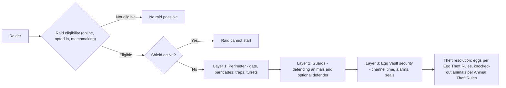

# Base Defence Overview

How a base protects its stored eggs and its defending animals. This page explains the **layers** of defence and how they combine; each layer's numbers live in its module page. Raid flow itself is owned by [[Base Raiding System]] and [[Raid Lifecycle and States]].

> [!success] CONFIRMED
> - Raids are optional (D-024). Offline bases cannot be raided.
> - Base-stored eggs can be stolen; backpack eggs never can (D-021).
> - A defending animal can be stolen only after it has been knocked out. Undefeated defenders cannot be stolen. At most **3** animals can be stolen per successful raid.
> - Bases are protected by **shields and physical defences**.

> [!warning] UNDECIDED
> - Raid duration: **UNDECIDED** ([[Open Questions#Q-012]]). Defence timings below are expressed as fractions of a configurable raid length `T_raid`.
> - Egg theft limit: **UNDECIDED** ([[Open Questions#Q-013]]).
> - Which animals defend: **UNDECIDED** ([[Open Questions#Q-033]]).
> - Whether the defender's own equipped team joins: **UNDECIDED** ([[Open Questions#Q-035]]).
> - How shields are acquired: **UNDECIDED** ([[Open Questions#Q-030]]).
> - Whether optional raiding also lets a player opt out of being raided: part of **UNDECIDED** [[Open Questions#Q-011]] ([[PvP Activation Options]]).

## 1. Defence layers

| Layer | Module | What it does | What it never does |
|---|---|---|---|
| 0. Eligibility | None (rules) | Offline and ineligible bases are untouchable | — |
| 0. Shield | [[Module - Shield Generator]] | Prevents a raid from starting while active | Does not end a raid already in progress (**PROPOSED**) |
| 1. Perimeter | [[Module - Defence Station]] | Costs the raider time and HP before they reach the vault | Cannot kill a raider outright in one hit; cannot be permanent (respawns after each raid) |
| 2. Guards | [[Module - Animal Pens]] and [[Animal Guards and Base Defence AI]] | Fight raiders; can be knocked out and then become theft-eligible | Undefeated guards are never stealable |
| 3. Vault | [[Module - Egg Vault]] | Increases time to take each egg, alerts the owner | Does not change the theft limit (Q-013) |
| Bonus | [[Module - Training Grounds]] | Strengthens the defender's equipped team and player if they defend | Does not buff guards unless Q-402 decides so |

## 2. Design goals (PROPOSED)

1. **Every layer buys time, none makes a base invulnerable.** A fully upgraded base should still be raidable by a well-prepared raider at the same progression band. Otherwise raiding dies and the defensive modules become pointless.
2. **Defence is earned with Cash, never with Robux.** No defence, shield time or vault security is sold. Paying to protect eggs from other players is a pay-to-win pattern that D-027 rules out (see [[Monetisation Principles]]).
3. **Readability.** Each defensive module's level is visible from the gate. The raid UI shows the defensive summary before the raider commits ([[UI - Raid Interface]]).
4. **Raids are bounded.** All defensive values scale with `T_raid` so that, whatever duration is chosen for Q-012, the layers keep their relative weight.
5. **No permanent damage.** Modules are restored after every raid. Whether modules can be temporarily disabled mid-raid is **UNDECIDED** (Q-403).

## 3. Time budget model

Because the raid duration is **UNDECIDED**, defences are tuned by the share of `T_raid` they cost an at-level raider. The targets below are **PROPOSED** tuning targets, not durations.

| Base state | Perimeter share | Guards share | Vault share per egg | Intended outcome |
|---|---:|---:|---:|---|
| No defences (L0 Egg Crate only) | ~5% | 0% | ~2% | Easy target; good for first raids |
| All defensive modules L3 | ~20% | ~25% | ~4% | Even contest; raider takes some eggs |
| All defensive modules L5 | ~30% | ~35% | ~6% | Hard; only well-prepared raiders succeed |

Example: if a tester sets `T_raid = 300 s`, an all-L5 base costs ~90 s at the perimeter and ~105 s with guards, leaving ~105 s, which at ~18 s per egg allows roughly five vault interactions before time runs out (before any egg theft limit from Q-013). This is a **worked example only**.

## 4. Defender presence

The owner is always online during a raid (offline bases cannot be raided), but may be anywhere in the world. When a raid starts:

| Event | Proposal |
|---|---|
| Alert | Banner and sound for the owner wherever they are ([[UI - Notifications]], [[Sound - Base and Raid Alerts]]) |
| Return home | One-tap "Return home" teleports the owner to their Base Core after a 3 s channel that is cancelled by taking damage (**PROPOSED**) |
| Owner's equipped team | Whether it fights alongside the guards is **UNDECIDED** (Q-035). If it does, it is subject to the knock-out and theft rules exactly like any other defending animal; this risk must be made explicit to the owner |
| Owner's own combat | The owner may fight raiders inside their plot; PvP damage rules are in [[PvP System]] |

## 5. Post-raid restoration

After any raid ends, regardless of outcome:
1. Gates, barricades and traps reset to full.
2. Knocked-out guards that were not stolen revive at full HP.
3. A post-raid protection period may apply. Its length and source are **UNDECIDED** ([[Open Questions#Q-030]]); see [[Shield Mechanics]].
4. A summary is shown to both parties ([[Raid Rewards and Defender Compensation]]).

## 6. Anti-abuse notes

- Defensive values are server-side; clients only render. Raider position checks and interaction validation are in [[Raid Anti-Exploit Validation]].
- Raid collusion (a friend "raiding" an alt to move eggs) is analysed in [[Inflation and Farming Exploit Risks]].
- Defences must not be cheesable by standing outside turret range indefinitely: turrets have line of sight to the full gate approach.

## Related documents
- [[Player Bases Index]]
- [[Animal Guards and Base Defence AI]]
- [[Module - Defence Station]]
- [[Module - Shield Generator]]
- [[Module - Egg Vault]]
- [[Module - Animal Pens]]
- [[Base Raiding System]]
- [[Shield Mechanics]]
- [[Egg Theft Rules]]
- [[Animal Theft Rules]]
- [[M14 - Base Defence]]
- [[Test Cases - Raiding]]
