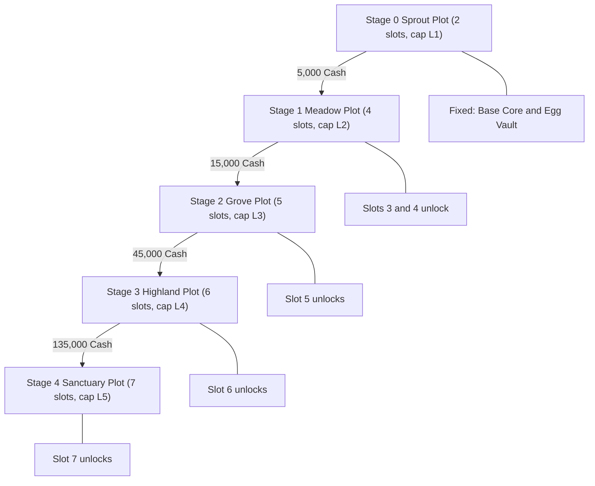
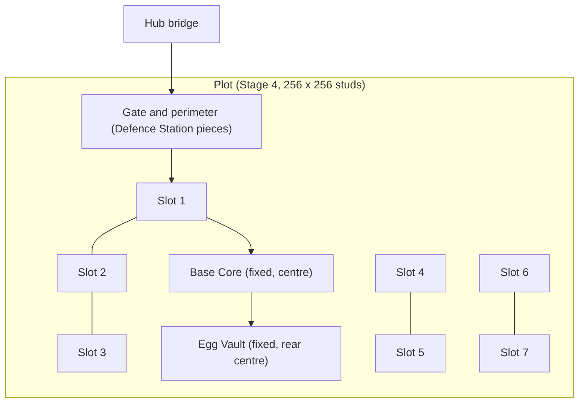

# Base Layout and Plot Expansion

How a base plot is laid out, how it grows through four purchased **Plot Expansion** stages, and how module slots unlock. Everything here is **PROPOSED** unless marked otherwise. Module availability is **UNDECIDED** ([[Open Questions#Q-007]]); plot placement in the world is **UNDECIDED** (Q-404, see [[Player Base System]]).

> [!success] CONFIRMED context
> Bases are modular and each section is upgraded separately (D-022). The team can only be changed at the player's own base (D-010).

## 1. Plot stages

Plot Expansion uses the canonical cost `5,000 × 3^(n − 1)` for stages n = 1–4 ([[Canonical Proposed Values]] §12). Stage 0 is the free starter plot.

| Stage | Name (PROPOSED) | Cost (Cash) | Plot size (studs, PROPOSED) | Module slots (PROPOSED) | Max module level (PROPOSED) | Suggested timing |
|---:|---|---:|---|---:|---:|---|
| 0 | Sprout Plot | 0 | 128 × 128 | 2 | 1 | Start |
| 1 | Meadow Plot | 5,000 | 160 × 160 | 4 | 2 | Late Whisperwood / early Sunscorch |
| 2 | Grove Plot | 15,000 | 192 × 192 | 5 | 3 | Sunscorch |
| 3 | Highland Plot | 45,000 | 224 × 224 | 6 | 4 | Emerald Canopy / Coral Coast |
| 4 | Sanctuary Plot | 135,000 | 256 × 256 | 7 | 5 | Coral Coast onward |

Total Plot Expansion cost: **200,000 Cash**.

> [!info] PROPOSED rule: module level cap = Plot Stage + 1
> A module cannot be upgraded beyond `PlotStage + 1`. This gives Plot Expansion a clear purpose (each stage raises the ceiling and adds slots), smooths spending, and stops a player pouring all early Cash into one L5 Multiplier Shrine. The [[Egg Merging Station]] is exempt; its own region gates apply.

### Slots

The **Base Core** and the **Egg Vault** occupy fixed positions and never use a slot. The 7 flexible slots hold the remaining seven buildings: [[Module - Animal Pens]], [[Module - Defence Station]] (its hub building; perimeter pieces attach to the plot edge), [[Module - Shield Generator]], [[Module - Training Grounds]], [[Module - Multiplier Shrine]], [[Module - Trophy Hall]] and [[Egg Merging Station]]. At Stage 4 every building fits, so slot choice is about **order**, not permanent exclusion.

All slots are standard **32 × 32 stud** pads. Each module's footprint fits inside one pad with clearance for paths.



## 2. Layout template

The plot is a square island. The gate always faces the hub bridge so raiders approach from one predictable side, which keeps raids readable and makes defensive layout meaningful.



| Zone | Position | Rule |
|---|---|---|
| Gate | Front edge, centred | Always on the hub-facing edge; 16 studs wide |
| Base Core | Plot centre | Spawn point when arriving by portal; team-change fallback point |
| Egg Vault | Rear centre | Furthest point from the gate. Raiders must cross the plot to reach it |
| Slots 1–3 | Front row | Recommended for Defence Station and Animal Pens (guard posts near the entry) |
| Slots 4–7 | Mid and rear | Economy buildings; unlock as the plot grows outward |
| Decor ring | Outer 8 studs | Cosmetic props only; non-collidable for raiders above knee height to avoid cosmetic walls |

> [!info] PROPOSED: free slot assignment, fixed slot positions
> The player chooses which module goes in which slot, but slot positions are fixed per stage. Free-form placement was rejected for launch: it complicates collision validation, makes raid AI pathing unpredictable and allows unfair maze-building. Free decoration placement inside the decor ring is allowed.

### Relocation

Swapping two modules between slots is free and instant outside raids (**PROPOSED**). Demolishing a module for a refund is **UNDECIDED** (Q-408); the working assumption is no demolition at launch.

## 3. Visual growth

Each stage adds terrain detail as well as area: Stage 0 is bare grass with a picket fence; Stage 1 adds paths and flower beds; Stage 2 adds a stream and small trees; Stage 3 adds rocky terraces and lanterns; Stage 4 adds a waterfall edge and floating lantern lights. Direction is owned by [[Base Art Direction]]; the expansion animation (ground unfolding outward over 3 s) is in [[Animation - Base Upgrades]].

## 4. Technical implementation

| Concern | Proposal |
|---|---|
| Plot pads | 16 fixed `Model` anchors in `Workspace.Homesteads` named `Pad_01`..`Pad_16`, each sized for Stage 4 so neighbours never overlap |
| Stage geometry | Five terrain/ground templates (ENV kit) swapped on stage change; the larger stage is a superset of the smaller |
| Slot transforms | `CFrame` offsets per stage in a configuration module ([[Configuration Modules]]) |
| Ownership | `OwnerUserId` attribute on the plot model; tagged `BasePlot` with CollectionService |
| Streaming | StreamingEnabled is on for the place. Each plot model is a streaming unit; module models use atomic model streaming so a module never appears half-loaded (exact `ModelStreamingMode` behaviour is *unverified* and must be checked in Studio) |
| Friend visits | Friends and party members may walk in when no raid is active; others see the boundary and a "Visit" prompt that asks the owner (**PROPOSED**) |
| Validation | Every slot request is validated server-side: slot unlocked, slot empty or swap target valid, owner inside own plot, no raid active |

```lua
-- Illustrative Luau (not executed)
local STAGES = {
	[0] = { size = 128, slots = 2, levelCap = 1, cost = 0 },
	[1] = { size = 160, slots = 4, levelCap = 2, cost = 5000 },
	[2] = { size = 192, slots = 5, levelCap = 3, cost = 15000 },
	[3] = { size = 224, slots = 6, levelCap = 4, cost = 45000 },
	[4] = { size = 256, slots = 7, levelCap = 5, cost = 135000 },
}

local function canUpgradeModule(base, moduleId: string, targetLevel: number): (boolean, string?)
	if moduleId ~= "EggMergingStation" and targetLevel > STAGES[base.plotStage].levelCap then
		return false, "PlotStageTooLow"
	end
	return true
end
```

## 5. Edge cases and test hooks

| Case | Expected behaviour |
|---|---|
| Player at Stage 0 tries to build a third module | Rejected with `NoFreeSlot`; UI suggests Plot Expansion |
| Player buys Stage 1 during a raid on their base | Rejected with `RaidActive` |
| Stage purchase succeeds but the rebuild fails | Data is the source of truth; rebuild retried next frame; QA hook logs `PlotRebuildFailed` |
| Module at L2 on a Stage 1 plot | Valid; L3 blocked until Stage 2 |
| Decor placed on a raider path | Decor ring is outside paths; decor inside the plot is rejected |

Test cases: [[Test Cases - Bases and Upgrades]].

## Related documents
- [[Player Base System]]
- [[Base Upgrade System]]
- [[Player Bases Index]]
- [[Cost Tables]]
- [[Progression Bottleneck Analysis]]
- [[Base Art Direction]]
- [[Animation - Base Upgrades]]
- [[UI - Base Management]]
- [[Schema - Base Data]]
- [[Hub - Hatchling Haven]]
