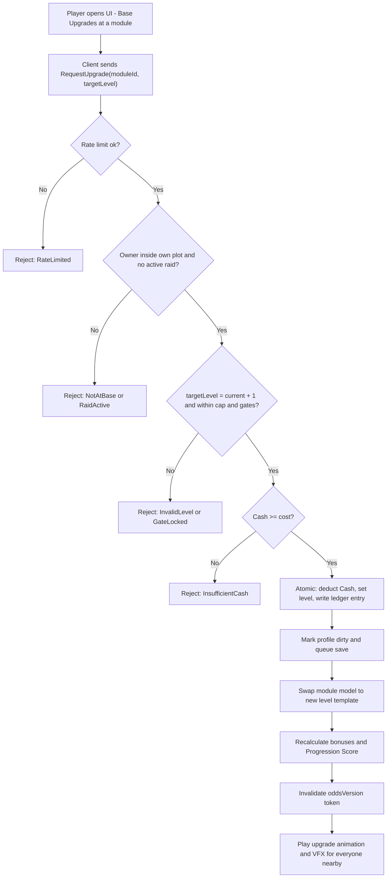

# Base Upgrade System

The shared rules for building and upgrading every base module, the Plot Expansion and (by reference) the [[Egg Merging Station]]. Module-specific effects are documented in each module page; prices are summarised in [[Cost Tables]].

> [!success] CONFIRMED
> Each section of the base is upgraded separately (D-022). The Egg Merging Station must be upgraded before it can merge higher rarities and physically changes appearance with each upgrade (D-020).

> [!info] PROPOSED
> Five levels per module (L1 = construction). `Cost(L) = BaseCost × 2.5^(L − 1)`. All upgrades are paid in **Cash** only. No module level is sold for Robux (see [[Monetisation Principles]]).

## 1. Upgrade cost curve

| Level | Multiplier on base cost | Cumulative multiplier |
|---:|---:|---:|
| L1 | 1.00 | 1.00 |
| L2 | 2.50 | 3.50 |
| L3 | 6.25 | 9.75 |
| L4 | 15.625 | 25.375 |
| L5 | 39.0625 | 64.4375 |

The 2.5× step means L5 alone is about 61% of a module's total cost. Combined with the level cap from [[Base Layout and Plot Expansion]] (`PlotStage + 1`), the L4 and L5 steps fall naturally in the Coral Coast to Starfall Sanctuary range, where hourly income is 19,000–62,000 Cash before bonuses (see [[Progression Bottleneck Analysis]]).

| Total across all seven modules | L1 | L2 | L3 | L4 | L5 | All levels |
|---|---:|---:|---:|---:|---:|---:|
| Cash | 12,500 | 31,250 | 78,125 | 195,314 | 488,283 | **805,472** |

With Plot Expansion (200,000) and the Egg Merging Station (1,327,500) the full base costs **2,332,972 Cash** (canonical rounded values).

## 2. Prerequisites (PROPOSED)

| Prerequisite | Applies to | Reason |
|---|---|---|
| Owner is inside their own plot | All upgrades | Base is the place of change, like team changes |
| No raid active on this base | All upgrades, stage purchases, slot swaps | Prevents mid-raid defence changes |
| Free slot (construction only) | L1 of slotted modules | See slots table |
| `TargetLevel ≤ PlotStage + 1` | All modules except the station | Paces spending |
| Region and boss gates | [[Egg Merging Station]] only | Canonical §10 |
| Previous level owned | All | No skipping levels |
| Enough Cash | All | Cash is deducted atomically |

No other gates are proposed. In particular, module levels are **not** gated by player level, so a player who prefers base building can progress it at their own pace.

## 3. Upgrade flow



Step K matters: base levels feed the Progression Score (`round(120 × TotalModuleLevels / 44)`), which changes egg odds. Any open roll or hatch confirmation must be re-displayed with the new odds, as required by D-017 and enforced by D-041 ([[Randomised Reward Compliance]]).

### Instant versus timed

| Option | Behaviour | Pros | Cons |
|---|---|---|---|
| Instant (working assumption) | Upgrade completes on purchase; a 2–4 s celebratory animation plays | Simple, no waiting, no pressure to pay for speed-ups | Fewer "come back later" hooks |
| Timed construction | Upgrade takes minutes to hours; module may be offline while building | Retention hook | Invites Robux speed-ups that contradict D-027; complicates raids |

Timed construction is **UNDECIDED** (Q-401). Recommendation: **instant**, labelled **PROPOSED**.

## 4. Server implementation

All upgrades go through [[Service - BaseService]], which calls [[Service - EconomyService]] for the Cash deduction. The economy ledger and profile write happen in one guarded transaction ([[Data Consistency and Transactions]]).

```lua
-- Illustrative Luau (not executed). Names follow Service - BaseService conventions.
local BaseService = {}

function BaseService.RequestUpgrade(player: Player, moduleId: string, targetLevel: number)
	local profile = DataService.GetProfile(player)
	if not profile then return false, "NoProfile" end
	local base = profile.base

	if not BaseService.IsInsideOwnPlot(player) then return false, "NotAtBase" end
	if RaidService.IsBaseUnderRaid(player.UserId) then return false, "RaidActive" end

	local def = ModuleConfig[moduleId]
	if not def then return false, "UnknownModule" end
	local current = (base.modules[moduleId] and base.modules[moduleId].level) or 0
	if targetLevel ~= current + 1 or targetLevel > def.maxLevel then return false, "InvalidLevel" end

	local ok, reason = BaseService.CheckGates(base, moduleId, targetLevel)
	if not ok then return false, reason end

	local cost = def.costs[targetLevel]
	local paid = EconomyService.TrySpend(player, cost, "BaseUpgrade", { moduleId = moduleId, level = targetLevel })
	if not paid then return false, "InsufficientCash" end

	base.modules[moduleId] = base.modules[moduleId] or { level = 0 }
	base.modules[moduleId].level = targetLevel
	DataService.MarkDirty(player)

	BaseService.RebuildModule(player, moduleId)
	ProgressionService.Recalculate(player) -- updates Progression Score and invalidates oddsVersion
	return true
end
```

Remote validation and rate limits: [[Implementation - Remote Validation Layer]], [[Implementation - Rate Limiting]]. Proposed limit: 4 upgrade requests per 10 s per player.

### Model swapping

| Step | Detail |
|---|---|
| Templates | `ServerStorage.ModuleTemplates.<ModuleId>.L1`..`L5` (and `L0` for the Egg Crate). Asset IDs `MOD-01`..`MOD-09` with level suffix, e.g. `MOD-06-L3` (**PROPOSED**, to be added to the [[Asset Register]]) |
| Swap | Clone new level, parent at the slot `CFrame`, then destroy the old model after the animation's "reveal" frame so there is never an empty slot |
| Attributes | `ModuleId`, `Level`, `OwnerUserId`, tag `BaseModule` |
| Client effects | The server fires one `ModuleUpgraded` event to nearby clients; VFX are client-side only ([[VFX Bible]]) |

## 5. Visual and audio language

Every module follows the same five-step visual ladder so players read level at a glance ([[Base Art Direction]], [[Rarity Visual Language]]):

| Level | Material language (PROPOSED) | Accent colour |
|---:|---|---|
| L1 | Rough timber and rope | Natural wood |
| L2 | Planed timber with stone footings | Leaf green trim |
| L3 | Dressed stone with brass fittings | Sky blue trim |
| L4 | Polished stone with crystal inlays | Violet glow |
| L5 | Gold-leaf and crystal with a soft aura | Gold and prismatic |

Upgrade animation: scaffolding pops up, a dust puff, a 0.6 s squash-and-stretch on the new model, and a coin-burst confirmation ([[Animation - Base Upgrades]], [[Sound - UI Feedback]]).

## 6. Edge cases

| Case | Handling |
|---|---|
| Double-click sends two requests | Second request fails `InvalidLevel` because the level already changed |
| Player leaves mid-transaction | Transaction is server-side and completes; save on PlayerRemoving |
| Save fails after purchase | Ledger entry and level are in the same profile write; retry queue ([[Save, Load and Recovery]]) |
| Raid starts during the upgrade animation | Upgrade already committed; animation finishes; raid locks apply to further requests |
| Config change lowers a cost after purchase | No refund; ledger records the price paid (documented in [[Balance Update Process]]) |

## Related documents
- [[Player Base System]]
- [[Base Layout and Plot Expansion]]
- [[Cost Tables]]
- [[Egg Merging Station]]
- [[Service - BaseService]]
- [[Service - EconomyService]]
- [[UI - Base Upgrades]]
- [[Animation - Base Upgrades]]
- [[Progression Score Specification]]
- [[Test Cases - Bases and Upgrades]]
- [[M13 - Base Upgrades]]
