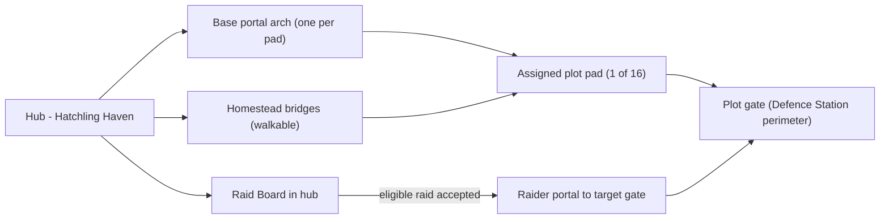
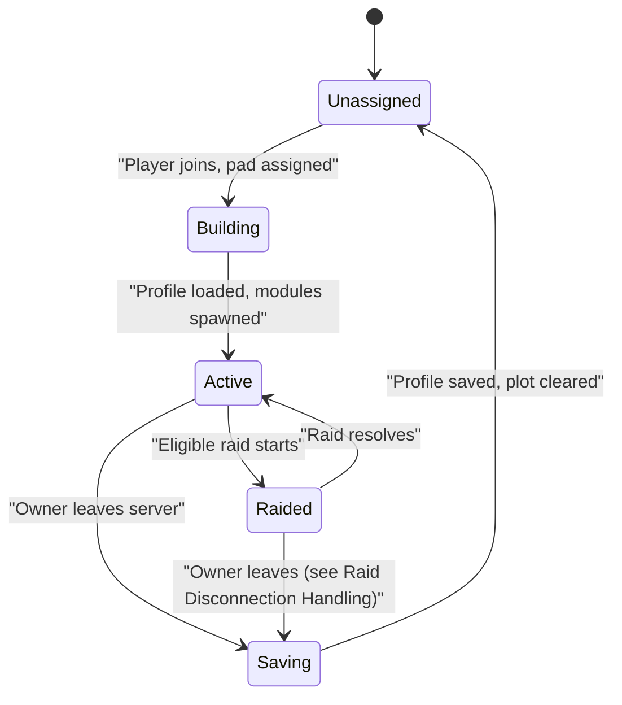

# Player Base System

The player base is the player's personal, modular home in the shared world. It is where the team is changed, where base-stored eggs live, where eggs are merged and hatched from base storage, and where long-term power multipliers are built. This document owns the **concept, placement and lifecycle** of a base. Layout and slots live in [[Base Layout and Plot Expansion]], the upgrade transaction in [[Base Upgrade System]], and protection in [[Base Defence Overview]].

> [!success] CONFIRMED
> - Every player owns a personal **modular** base, and **each section is upgraded separately** (D-022).
> - Base progression can contribute to multipliers, strength and progression (D-022).
> - The equipped team (exactly **3** animals) can be changed **only at the player's own base** and is locked from leaving until returning (D-006, D-010).
> - Base storage starts at **50** eggs (backpack 10, total 60). Base-stored eggs can be stolen in an eligible raid; backpack eggs never can (D-021, D-024).
> - Egg merging needs a purchased [[Egg Merging Station]] (D-020).
> - Raids are optional, offline bases cannot be raided, at most **3** animals can be stolen per successful raid, and bases are protected by shields and physical defences (D-024).

> [!warning] UNDECIDED
> - Which modules ship at launch: **UNDECIDED** ([[Open Questions#Q-007]]). The list below is **PROPOSED**.
> - Whether owned animals are physically displayed in pens: **UNDECIDED** ([[Open Questions#Q-008]]); options in [[Module - Animal Pens]].
> - Which animals defend: **UNDECIDED** ([[Open Questions#Q-033]]); options in [[Animal Guards and Base Defence AI]].
> - How base plots are placed in the shared world: **UNDECIDED** (Q-404). This document gives options and a recommendation.

## 1. Purpose in the core loop

The base is the "return point" of every session loop: fight in the world, return to bank eggs, hatch, ascend, re-equip and upgrade, then head out again. Because the team can only be changed at the base (D-010), returning home is mandatory for any team change. The base therefore has to be **fast to reach** and **safe by default**.

| Function | Where it happens | Status |
|---|---|---|
| Change the equipped team | Inside the player's own plot ([[Team Equipping and Base Lock Rule]]) | **CONFIRMED** rule, **PROPOSED** interaction point |
| Store eggs (50 at start) | [[Module - Egg Vault]] | **CONFIRMED** capacity, **PROPOSED** module |
| Hatch base-stored eggs | Anywhere inside the plot | **PROPOSED** ([[Canonical Proposed Values]] §7) |
| Merge eggs | [[Egg Merging Station]] | **CONFIRMED** requirement, **PROPOSED** levels |
| Permanent multipliers | [[Module - Training Grounds]], [[Module - Multiplier Shrine]], [[Module - Trophy Hall]] | **PROPOSED** |
| Protection | [[Module - Defence Station]], [[Module - Shield Generator]], [[Module - Egg Vault]], guards | **CONFIRMED** principle, **PROPOSED** modules |
| Progression Score contribution | All modules, station and plot stages (max 44 levels → 120 PS) | **PROPOSED** ([[Progression Score Specification]]) |

## 2. Module roster (PROPOSED, Q-007)

| Module | Asset ID (PROPOSED) | Role | Base cost (Cash) | Effect summary |
|---|---|---|---:|---|
| Base Core (fixed infrastructure, free) | MOD-09 | Spawn point, team-change fallback, plot boundary anchor | 0 | Not upgradeable, not a module slot |
| [[Module - Egg Vault]] | MOD-02 | Base egg storage security | 1,500 | Holds base storage; starts at a free L0 "Egg Crate" |
| [[Module - Animal Pens]] | MOD-01 | Housing, showcase and guard posts | 1,000 | Q-008 / Q-033 dependent |
| [[Module - Defence Station]] | MOD-03 | Gates, traps, turrets | 2,000 | Slows and damages raiders |
| [[Module - Shield Generator]] | MOD-04 | Raid shield | 2,500 | Shield duration and recharge (Q-030) |
| [[Module - Training Grounds]] | MOD-05 | Strength and team stats | 1,500 | +5% player Strength, +4% equipped animal stats per level |
| [[Module - Multiplier Shrine]] | MOD-06 | Cash income | 3,000 | +10% Cash per level |
| [[Module - Trophy Hall]] | MOD-07 | Boss trophies | 1,000 | +1% Cash per unique boss trophy displayed (max 12%) |
| [[Egg Merging Station]] | MOD-08 | Merging | 2,500 (L1) | Owned by its own document |

All costs follow `Cost(L) = BaseCost × 2.5^(L − 1)` ([[Canonical Proposed Values]] §12). Full tables: [[Cost Tables]].

> [!info] PROPOSED: Base Core and the L0 Egg Crate
> Base storage of 50 is **CONFIRMED** from the very start, but the Egg Vault has a construction cost of 1,500 Cash. To reconcile the two, every new base spawns with a free, fixed **Base Core** and a free **L0 Egg Crate** that already provides the 50 confirmed slots. Building the Egg Vault (L1, 1,500 Cash) improves security and visuals; it never changes capacity. Whether this interpretation is right is **UNDECIDED** (Q-409).

## 3. Where bases live in the shared world

D-025 confirms one large shared world. Bases are reached through [[Hub - Hatchling Haven]], which already hosts "base portals" in the proposed region table. Three placement models were evaluated.

| Option | Description | Pros | Cons |
|---|---|---|---|
| A. Homestead Isles ring (in-place) | Each server has a fixed ring of 16 plot pads on floating islands around the hub. A joining player is assigned a free pad; their saved base is built on it. Hub portals move the character to their pad. | One place file, raiders walk or portal in, offline protection is automatic (no owner → no base) | World space for 16 × 256-stud plots; server builds bases on join |
| B. Reserved-server base instances | Each base is a separate reserved server reached with TeleportService | Unlimited plot size, isolates base load | Breaks the single shared world, makes raids a cross-server matchmaking problem, teleport latency on every team change |
| C. Pocket dimension in the same place | Plots are built far below or above the map, each behind its own portal | Simple streaming isolation | Raiders must be teleported in; feels disconnected; harder to show the base to friends |

> [!info] PROPOSED recommendation: Option A
> Use a **Homestead Isles** ring of **16** plot pads (matching the working server cap of 16, [[Open Questions#Q-031]]) connected to [[Hub - Hatchling Haven]] by short bridges and by a portal arch per pad. A base exists in the server **only while its owner is in that server**. When the owner leaves, the plot is saved and cleared. This makes "offline bases cannot be raided" (D-024) true by construction rather than by a flag. Final decision: **UNDECIDED** (Q-404).



### How raiders reach a base

1. The raider must meet raid eligibility ([[Raid Eligibility and Offline Protection]]); activation is **UNDECIDED** ([[Open Questions#Q-011]]).
2. A raid is started either from the **Raid Board** in the hub or by interacting with the target's plot gate (a ProximityPrompt). Both call the same server request; the board is only a convenience.
3. The raider spawns or walks to the **outside of the plot gate**, never inside. Physical defences ([[Module - Defence Station]]) are therefore always met first.
4. Plots of players who are not raid-eligible are surrounded by a non-collidable visual boundary that blocks entry to non-friends while no raid is active (**PROPOSED**; friend visits are covered in [[Base Layout and Plot Expansion]]).

Lifecycle and timing of the raid belong to [[Raid Lifecycle and States]]; duration is **UNDECIDED** ([[Open Questions#Q-012]]).

## 4. Base lifecycle



| Step | Server work | Notes |
|---|---|---|
| Pad assignment | Pick the lowest free pad index; reserve it in a server table | Pads never change during a session |
| Build | Read base data from the profile ([[Schema - Base Data]]); clone module templates for each module at its level; set attributes | Build over several frames to avoid a spike; target < 250 ms total server time per base (**PROPOSED**) |
| Active | Upgrades, merges, team changes, cosmetic edits | All mutations go through [[Service - BaseService]] |
| Raided | Upgrades and cosmetic edits are locked; merges into base storage are locked | Prevents mid-raid state changes (see [[Base Upgrade System]]) |
| Leave | Save, destroy instances, free pad | Disconnect during raids: [[Raid Disconnection Handling]] |

## 5. Data ownership

The server is authoritative for everything. The client receives read-only replicated instances and attribute values. The schema lives in [[Schema - Base Data]]; a summary:

```lua
-- Illustrative Luau (not executed): shape of base data held by BaseService
type ModuleState = {
	level: number,        -- 0 = not built, 1..5
	slot: number?,        -- slot index on the plot, nil for fixed modules
	cosmeticId: string?,  -- purely visual skin
}

type BaseData = {
	version: number,
	plotStage: number,                 -- 0..4
	modules: { [string]: ModuleState },-- keyed by module id, e.g. "MultiplierShrine"
	trophies: { [string]: boolean },   -- boss id -> earned
	displayedTrophies: { string },     -- ordered, capped by Trophy Hall level
	guardAssignments: { string }?,     -- animal UIDs, only if Q-033 resolves to pen guards
	decor: { [string]: any },
}
```

## 6. Design rules (PROPOSED)

1. **No permanent loss from raids to modules.** Raids can steal base eggs and knocked-out defenders only, as confirmed. Modules are never destroyed or downgraded by a raid (raid-time disabling is a separate open item, Q-403).
2. **Every module is optional to build**, but the multiplier modules are clearly signposted as high-value early.
3. **One upgrade at a time per module**, instant with an animation (timed construction is **UNDECIDED**, Q-401).
4. **Readable from outside.** A raider standing at the gate can see the level of every defensive module from its appearance. This supports fair, informed raid decisions.
5. **Performance first.** A full server of 16 maxed bases must fit the budgets in [[Animal Scalability and Performance Budgets]].

## 7. Edge cases

| Case | Handling (PROPOSED) |
|---|---|
| Server is full of plots but has fewer than 16 players | Impossible by design: pads = max players |
| Player rejoins the same server quickly | New pad assignment; the previous pad was cleared on leave |
| Owner is inside another player's base during a raid on their own base | Owner receives an alert and a "Return home" prompt ([[Sound - Base and Raid Alerts]]) |
| Profile fails to load | Plot shows a locked placeholder; no raid eligibility until loaded ([[Save, Load and Recovery]]) |
| Owner is mid-merge when a raid starts | The merge transaction completes atomically before the raid locks begin ([[Data Consistency and Transactions]]) |

## Related documents
- [[Player Bases Index]]
- [[Base Layout and Plot Expansion]]
- [[Base Upgrade System]]
- [[Base Defence Overview]]
- [[Animal Guards and Base Defence AI]]
- [[Hub - Hatchling Haven]]
- [[Egg Merging Station]]
- [[Base Raiding System]]
- [[Service - BaseService]]
- [[Schema - Base Data]]
- [[Base Art Direction]]
- [[UI - Base Management]]
- [[Cost Tables]]
