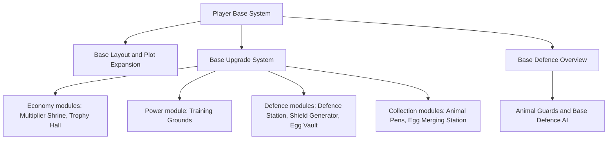

# Player Bases Index

Every player owns a personal, modular base with individually upgradeable sections (**CONFIRMED**, D-022). The base is where the team is changed (D-010), where base-stored eggs live, where eggs are merged, and where permanent multipliers are built. The module list, layout and all numbers are **PROPOSED**; which modules ship is **UNDECIDED** ([[Open Questions#Q-007]]).

## Orientation

- Start with [[Player Base System]] for the concept, world placement and lifecycle.
- Read [[Base Layout and Plot Expansion]] and [[Base Upgrade System]] before building any module.
- Read [[Base Defence Overview]] and [[Animal Guards and Base Defence AI]] together with [[Base Raiding System]].
- Prices for everything are collected in [[Cost Tables]].

## System documents

| Document | One-line description |
|---|---|
| [[Player Base System]] | Concept, module roster, world placement via the Homestead Isles ring, lifecycle and data shape |
| [[Base Layout and Plot Expansion]] | Plot stages 0–4, slot unlocks, level cap rule, layout template and streaming |
| [[Base Upgrade System]] | Upgrade prerequisites, server flow, model swapping and the shared visual ladder |
| [[Base Defence Overview]] | The defence layers (eligibility, shield, perimeter, guards, vault) and the raid time-budget model |
| [[Animal Guards and Base Defence AI]] | Guard options for Q-033, guard AI states, target priority and the knocked-out state that enables theft |

## Modules

| Module | Base cost (Cash) | Effect | Document |
|---|---:|---|---|
| Animal Pens | 1,000 | Team-change totem, showcase (Q-008), guard posts (Q-033) | [[Module - Animal Pens]] |
| Egg Vault | 1,500 | Base egg storage security; capacity is separate | [[Module - Egg Vault]] |
| Defence Station | 2,000 | Gate, barricades, traps, turrets | [[Module - Defence Station]] |
| Shield Generator | 2,500 | Stored, activatable raid shield (Q-030) | [[Module - Shield Generator]] |
| Training Grounds | 1,500 | +5% player Strength, +4% equipped animal stats per level | [[Module - Training Grounds]] |
| Multiplier Shrine | 3,000 | +10% Cash per level | [[Module - Multiplier Shrine]] |
| Trophy Hall | 1,000 | +1% Cash per unique boss trophy displayed (max 12%) | [[Module - Trophy Hall]] |
| Egg Merging Station | 2,500 (L1) | Merging 3 → 1 next rarity; documented separately | [[Egg Merging Station]] |

## Open items owned or raised here

| ID | Topic | Status |
|---|---|---|
| [[Open Questions#Q-007]] | Module availability at launch | **UNDECIDED** |
| [[Open Questions#Q-008]] | Physical display of owned animals | **UNDECIDED** |
| [[Open Questions#Q-033]] | Which animals defend | **UNDECIDED** |
| [[Open Questions#Q-035]] | Defender's own team joining | **UNDECIDED** |
| Q-401 | Instant versus timed upgrades | **UNDECIDED** |
| Q-402 | Training Grounds bonus on guards | **UNDECIDED** |
| Q-403 | Temporary disabling of modules in raids | **UNDECIDED** |
| Q-404 | Base plot placement model | **UNDECIDED** |
| Q-407 | Trophy bonus: displayed or earned | **UNDECIDED** |
| Q-408 | Module demolition and refunds | **UNDECIDED** |
| Q-409 | L0 Egg Crate interpretation of starting storage | **UNDECIDED** |

## Related documents
- [[Base Raiding System]]
- [[Egg Storage]]
- [[Cost Tables]]
- [[Base Art Direction]]
- [[Service - BaseService]]
- [[Schema - Base Data]]
- [[UI - Base Management]]
- [[UI - Base Upgrades]]
- [[M12 - Player Bases]]
- [[M13 - Base Upgrades]]
- [[M14 - Base Defence]]
- [[Test Cases - Bases and Upgrades]]
