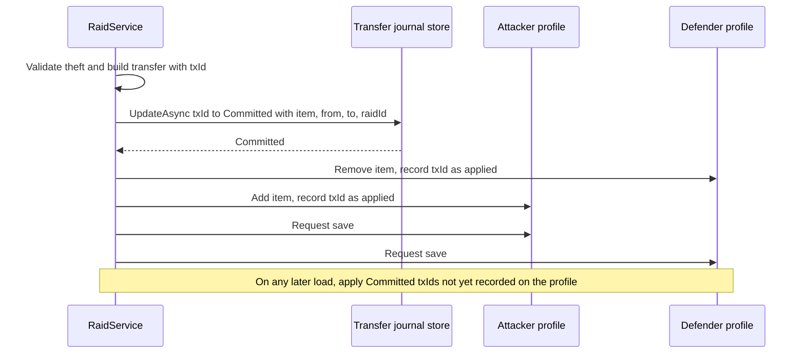

# Raid Disconnection Handling

What happens when the attacker, the defender, both, or the server drop during a raid, and how the server guarantees that no egg or animal is duplicated or lost. General session and save handling is owned by [[Disconnect Handling]] and [[Save, Load and Recovery]].

> [!success] CONFIRMED
> Offline bases cannot be raided (D-024). This document must never allow a theft from a defender who is offline.

> [!info] PROPOSED
> All rules here are proposals. "Offline" uses the precise definition in [[Raid Eligibility and Offline Protection#Definition of "online"]].

## Principles
1. **Secured is final; provisional is reversible.** An egg is final only once secured at the extraction point. A captured animal is final only when a successful raid resolves. Everything else rolls back.
2. **Nothing happens while the defender is offline.** No pickup, secure, capture or resolution transfer is accepted after the moment the defender is detected offline, except committing animals held from a raid already breached before that moment.
3. **Disconnecting never helps the person who disconnects.** The attacker loses unsecured progress; the defender stops further theft but does not undo secured theft.
4. **Every transfer is idempotent and journalled**, so a crash at any point can be reconciled.

## Case table

| Who drops | When | Outcome |
|---|---|---|
| Defender | `Warning` | `Cancelled`. Nothing transferred. No shield. No attacker cooldown. |
| Defender | `Active` (no breach) | `Resolving` → `Failed` (`DefenderOffline`). Held animals return. No attacker cooldown. Post-raid shield applied. |
| Defender | `Breached` | `Resolving` → `Succeeded` (`DefenderOffline`). Secured eggs stay with the attacker. Carried egg returns. Held animals (≤ 3) transfer, because they were captured while the defender was online and the vault had been breached. Capture channels in progress are cancelled. |
| Attacker | `Warning` | `Cancelled`. Attacker cooldown applies. |
| Attacker | `Active` (no breach) | `Resolving` → `Failed` (`AttackerOffline`). Held animals return. Attacker cooldown applies. |
| Attacker | `Breached` | `Resolving` → `Succeeded` (`AttackerOffline`). Secured eggs were already committed to the attacker. Carried egg returns. **Held animals return** to the defender *(choice: the attacker must be present at resolution to receive animals, so disconnecting never completes a capture)*. Attacker cooldown applies. |
| Both | Any | Handled in the order detected; if simultaneous in one frame, defender rules apply first (the more protective outcome). |
| Server | Graceful shutdown (`game:BindToClose`) | Every active raid moves to `Resolving` with `ServerShutdown`: carried eggs return, held animals return, secured eggs stay. Outcome recorded as `Voided` for statistics. Profiles saved inside the shutdown window (*unverified* time budget; see [[Roblox API Reference Notes]]). |
| Server | Crash (no shutdown callback) | No new commits. On each player's next load, the journal reconciliation below restores a consistent state. |

Reconnection: raids are bound to one server. A player who reconnects lands in a fresh session; the raid is not resumed *(PROPOSED)*. Their raid summary is shown on next login from the journal.

## Transfer protocol

Each secured egg and each resolved animal transfer is one transaction with a unique ID. Both profiles are session-locked by the same server (same-server raids, [[Base Raiding System#Cross-server raids]]).



Rules (PROPOSED):
- The journal entry is written **first**, with `DataStoreService` `UpdateAsync` so the write is conditional (*the specific store layout is owned by [[Data Consistency and Transactions]]*).
- Each profile keeps a bounded list of applied `txId`s. Applying the same `txId` twice is a no-op, so replay is safe.
- On load, a profile with pending journal entries (looked up by player ID index) applies them before gameplay starts.
- If the journal write fails, the theft is **refused** and the item stays where it was; the attacker sees "Could not secure, try again". No in-memory change happens before the journal write succeeds.
- Saves after a transfer are prioritised but respect DataStore budget limits; if a save is throttled, the journal still guarantees consistency.

### Illustrative Luau

```lua
-- Illustrative Luau, not tested in Roblox Studio.
local function commitTransfer(raid, item, fromProfile, toProfile): boolean
	local txId = HttpServiceLikeGuid() -- placeholder for a GUID generator; choose a real API in implementation
	local ok = Journal.writeCommitted(txId, {
		raidId = raid.id, item = item.id, from = fromProfile.userId, to = toProfile.userId,
	})
	if not ok then
		return false -- refuse the theft; nothing has changed in memory
	end
	fromProfile:applyOutgoing(txId, item)
	toProfile:applyIncoming(txId, item)
	DataService.requestSave(fromProfile)
	DataService.requestSave(toProfile)
	return true
end
```

## Detection timing

| Signal | Latency to detection |
|---|---|
| `Players.PlayerRemoving` | Immediate on the server |
| Heartbeat timeout | `OnlineHeartbeatTimeoutSeconds` = 10 *(new)* |
| Outbound teleport started | Immediate (raid participants are blocked from teleporting; any forced teleport ends the raid) |
| `game:BindToClose` | Immediate |

During the up-to-10-second heartbeat window the raid continues, but every theft action re-checks the defender's online state at commit time ([[Raid Anti-Exploit Validation]]), so a theft cannot commit after the defender's last heartbeat has expired.

## Resolution timeout
`Resolving` must complete within `RaidResolutionTimeoutSeconds` = 15 *(new)*. If journal writes for held animals have not succeeded by then, the held animals return to the defender and the raid is recorded as `Voided` for those items. Secured eggs are unaffected because they were committed earlier.

## Communication to players
- Attacker who disconnected: on next login, "Your raid on [base] ended because you left. Eggs you secured are in your base storage."
- Defender who left: on next login, a raid summary listing exactly what was secured before they left, plus any compensation ([[Raid Rewards and Defender Compensation]]).
- Shown through [[UI - Notifications]].

## Test hooks
- Kill the attacker's client while carrying an egg: egg back in the vault; attacker's base storage unchanged.
- Force a server crash after the journal write but before the profile save: on next load both profiles reflect the transfer exactly once.
- Replay the same `txId` on load twice: one item, not two.
- Journal write failure: theft refused, both inventories unchanged.
- Defender heartbeat expires during a capture channel: channel cancelled; no transfer.
- Cases in [[Test Cases - Raiding]] and [[Test Cases - Persistence]].

## Related documents
- [[Raid Lifecycle and States]]
- [[Raid Eligibility and Offline Protection]]
- [[Raid Anti-Exploit Validation]]
- [[Disconnect Handling]]
- [[Data Consistency and Transactions]]
- [[Save, Load and Recovery]]
- [[Service - DataService]]
- [[Implementation - Raid Session Controller]]
