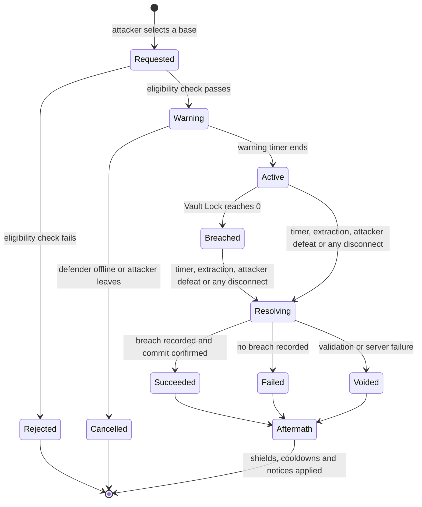
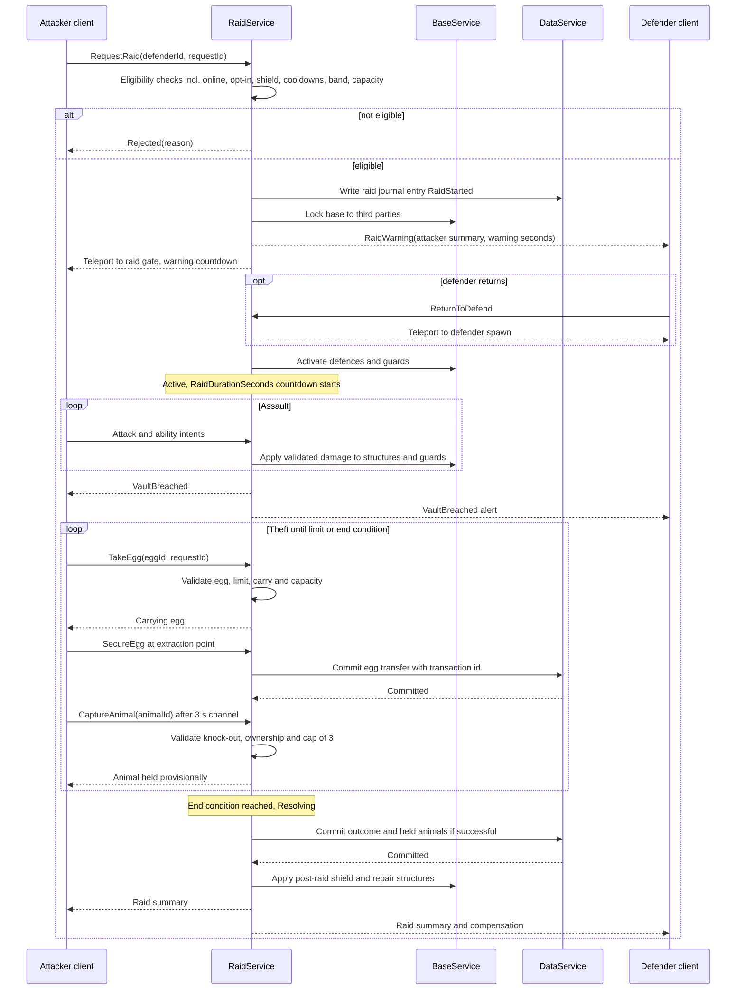

# Raid Lifecycle and States

The authoritative state machine for a raid session, the end-to-end sequence between clients and services, and the timing rules. Overview and parameters: [[Base Raiding System]].

> [!success] CONFIRMED
> Offline bases cannot be raided; at most three animals are stolen per successful raid; backpack eggs are never stealable (D-021, D-024).

> [!warning] UNDECIDED (Q-012)
> **Raid duration is undecided** ([[Open Questions#Q-012]]). The lifecycle uses the configurable parameter `RaidDurationSeconds`, which has **no approved value**. Test builds must set it explicitly; the server refuses to start raids if it is missing.

> [!info] PROPOSED
> States, transitions and every other timer are proposals. Parameters are listed in [[Base Raiding System#Raid parameters]].

## Raid state machine

## State reference

| State | Entered when | What happens | Leaves when |
|---|---|---|---|
| `Requested` | Attacker selects a base on the Raid Board or at the raid gate | Server runs every eligibility check ([[Raid Eligibility and Offline Protection]]) | Pass or fail, within one server frame |
| `Rejected` | Any check fails | Attacker sees the reason (shielded, offline, cooldown, band, capacity) | Immediately |
| `Warning` | Checks pass | Raid record created; both players locked into the raid (no hatching, merging or team changes for the defender; attacker cannot start other activities). Defender alerted with a "Return to defend" option. Attacker teleported to the raid gate and frozen. Third parties are moved out of the base. | `RaidWarningSeconds` (20 s, PROPOSED) elapses |
| `Cancelled` | Defender goes offline or attacker leaves during `Warning` | Nothing transferred. No shield. Attacker cooldown not applied if the defender left; applied if the attacker left. | Immediately |
| `Active` | Warning ends | `RaidDurationSeconds` countdown starts. Defences and guards activate. Attacker can damage structures, guards and the defender. Animal captures possible (held provisionally). | Vault Lock reaches 0, or any end condition |
| `Breached` | Vault Lock at 0 | The vault opens. Egg pickup and securing enabled ([[Egg Theft Rules]]). Timer continues; breach does **not** extend it. | Any end condition |
| `Resolving` | Any end condition | All input frozen. Carried eggs return. Held animals transfer (if successful) or return. Outcome committed ([[Raid Disconnection Handling]]). | Commit confirmed, or `RaidResolutionTimeoutSeconds` (15 s) |
| `Succeeded` | Breach recorded and commit confirmed | Result is final | — |
| `Failed` | No breach | Nothing transferred | — |
| `Voided` | Anti-exploit failure or server failure | All **uncommitted** changes discarded; secured items already committed stay unless the validator flags them ([[Raid Anti-Exploit Validation]]) | — |
| `Aftermath` | Any final state | Post-raid shield, cooldowns, structure repair, rewards and compensation, raid summary to both players | Done |

### End conditions (from `Active` or `Breached`)

| Condition | Recorded reason |
|---|---|
| `RaidDurationSeconds` elapses | `Timeout` |
| Attacker walks into the extraction point and confirms "Leave raid" | `Extracted` |
| Attacker is defeated (recommended rule RA-A, unapproved, [[Player Defeat and Penalties]]) | `AttackerDefeated` |
| Defender goes offline | `DefenderOffline` ([[Raid Eligibility and Offline Protection#Defender leaves mid-raid]]) |
| Attacker disconnects | `AttackerOffline` |
| Server shutting down | `ServerShutdown` |

## Lifecycle sequence

## Timing rules (PROPOSED)

| Rule | Value |
|---|---|
| Warning | `RaidWarningSeconds` = 20 *(new)*. Attacker cannot act; defender can return. |
| Raid timer | `RaidDurationSeconds`, **UNDECIDED** (Q-012). Shown to both sides. Never paused or extended. |
| Return to defend | 3 s channel then teleport to the defender spawn *(new)*. Available in `Warning`, `Active` and `Breached`. Blocked while combat-tagged; available as soon as the tag expires. |
| Resolution | Must finish within `RaidResolutionTimeoutSeconds` = 15 *(new)*, otherwise the raid is `Voided` for uncommitted items. |
| Structure repair | Destroyed barricades, traps and turrets are restored free of charge in `Aftermath` *(new)*, so raids do not become a hidden Cash drain on defenders. |
| Guard recovery | Knocked-out guards that were not captured recover in `Aftermath`. |

### Considerations for the duration decision (Q-012)
These do not choose a value; they list what the value affects so the owner can decide:
- **Vault Lock pacing:** the lock is tuned as a share of the duration ([[Base Raiding System#Physical defences (PROPOSED)]]).
- **Return-to-defend window:** the defender should be able to reach the base and fight for most of the raid.
- **Theft pacing:** with one egg carried at a time, the duration and the distance from vault to extraction set the practical theft count, which interacts with `MaxEggsStolenPerRaid` (Q-013).
- **Mobile sessions and attention:** longer raids increase disconnect risk ([[Raid Disconnection Handling]]).
- **Server load:** one raid holds two players, six companions, guards and structures in full simulation.

The prototype should test several owner-chosen values with identical bases and record breach time, eggs secured and defender return rate ([[Balance Simulation Plan]]).

## Concurrency rules (PROPOSED)
- A base can be in at most one raid at a time.
- A player can be in at most one raid at a time, as attacker or defender.
- A player being raided cannot start a raid until `Aftermath` completes.
- Raid records are in-server objects with a journal in persistent storage; cross-server raids are out of scope (Q-209, [[Base Raiding System#Cross-server raids]]).

## Test hooks
- Starting a raid with `RaidDurationSeconds` unset fails with an explicit configuration error.
- Every transition in the diagram is reachable in an automated test; transitions not in the diagram are rejected.
- Breach at the last second followed by `Timeout`: outcome `Succeeded`, no egg secured, held animals transferred.
- Defender offline during `Warning`: `Cancelled`, no shield, no attacker cooldown.
- Cases in [[Test Cases - Raiding]].

## Related documents
- [[Base Raiding System]]
- [[Raid Eligibility and Offline Protection]]
- [[Raid Disconnection Handling]]
- [[Raid Anti-Exploit Validation]]
- [[Implementation - Raid Session Controller]]
- [[Service - RaidService]]
- [[UI - Raid Interface]]
- [[Animation - Raid Interactions]]
- [[Sound - Base and Raid Alerts]]
