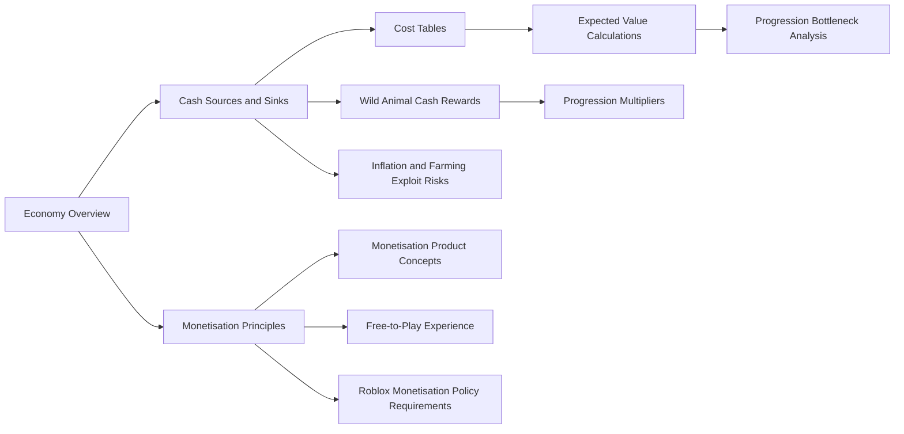

# Economy and Monetisation Index

The game runs on a single earned currency, **Cash**, from defeating wild animals (**CONFIRMED**, D-014). Monetisation is balanced and the game is fully playable without Robux (**CONFIRMED**, D-027). Cash is never sold for Robux (**PROPOSED**, D-044). Every number in this folder comes from [[Canonical Proposed Values]].

## Orientation

- New to the economy: read [[Economy Overview]], then [[Cash Sources and Sinks]].
- Balancing a price: [[Cost Tables]], then [[Expected Value Calculations]] and [[Progression Bottleneck Analysis]].
- Designing a Robux product: [[Monetisation Principles]] first, then [[Roblox Monetisation Policy Requirements]].

## Economy

| Document | One-line description |
|---|---|
| [[Economy Overview]] | Economy flow diagram, pillars, headline numbers and ownership map |
| [[Cash Sources and Sinks]] | Register of every source and sink with scale, lifetime totals and health metrics |
| [[Wild Animal Cash Rewards]] | Reward formula, stated modelling assumptions and cash-per-hour per region |
| [[Egg Pricing]] | The flat 200-Cash roll (D-039), Q-020 options and throughput limits |
| [[Cost Tables]] | Every Cash price: modules, plot, station, merge fees, ascension fees, rolls |
| [[Storage Expansion Economics]] | Slot value analysis and currency options for Q-009 and Q-010 (no decision) |
| [[Boss Rewards]] | Option sets, guardrails and a labelled recommendation for Q-015 |
| [[Progression Multipliers]] | Register and stacking rules for all Cash, combat and odds multipliers |
| [[Expected Value Calculations]] | Cash per egg by rarity, direct roll versus merge chain, ascension targets, time to max base |
| [[Inflation and Farming Exploit Risks]] | Inflation risks and farming exploits (alts, AFK, camping, shared credit, raid feeding) |
| [[Progression Bottleneck Analysis]] | Progression curve, stall points, build order and long-term goals |

## Monetisation

| Document | One-line description |
|---|---|
| [[Monetisation Principles]] | The ten principles, product classification flow, ethics and revenue targets |
| [[Monetisation Product Concepts]] | Candidate cosmetics, base cosmetics, passes, boosts and convenience with PROPOSED Robux prices |
| [[Free-to-Play Experience]] | The free player's journey, parity checklist and design responses |
| [[Roblox Monetisation Policy Requirements]] | Paid random items, PolicyService, receipts, the D-044 / Q-032 risk and a verification checklist |

## Open items in this area

| ID | Topic | Status |
|---|---|---|
| [[Open Questions#Q-009]] | Storage expansion currency | **UNDECIDED** |
| [[Open Questions#Q-010]] | Storage expansion price | **UNDECIDED** |
| [[Open Questions#Q-015]] | Boss rewards | **UNDECIDED** |
| [[Open Questions#Q-020]] | Egg roll pricing model | **UNDECIDED** |
| [[Open Questions#Q-032]] | Any Robux product granting Cash | **UNDECIDED** |
| Q-405 | Relative cost of merge path versus direct roll | **UNDECIDED** |
| Q-406 | Animal release and any Cash return | **UNDECIDED** |
| Q-410 | XP boosts for Robux | **UNDECIDED** |
| Q-411 | AFK farming policy | **UNDECIDED** |
| Q-412 | Daily or login rewards | **UNDECIDED** |
| Q-413 | Private servers | **UNDECIDED** |
| Q-414 | Roblox Premium member benefits | **UNDECIDED** |
| Q-415 | Kill credit scaling with group size | **UNDECIDED** |

## Related documents
- [[Canonical Proposed Values]]
- [[Player Bases Index]]
- [[Eggs and Hatching Index]]
- [[Ascension and Progression Index]]
- [[Service - EconomyService]]
- [[Schema - Economy]]
- [[UI - Shop]]
- [[Decision Register]]
