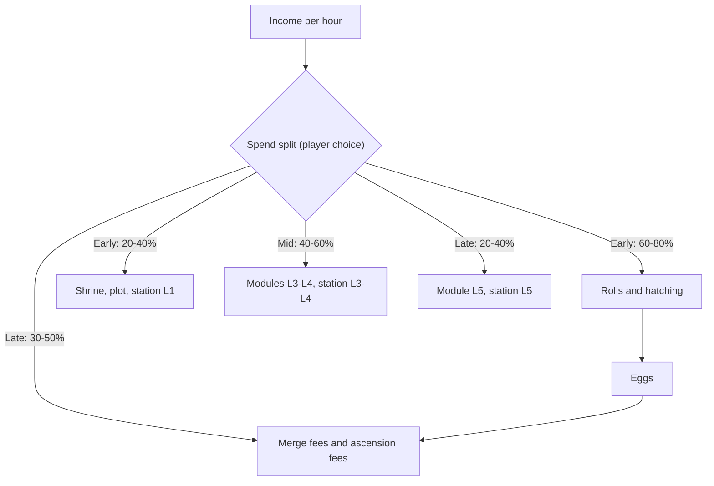

# Cash Sources and Sinks

A complete register of where Cash enters and leaves the economy, with scale and status. Prices are listed in full in [[Cost Tables]]; this page is about **flow and balance**.

> [!success] CONFIRMED
> Wild animal defeats earn Cash. Cash buys egg rolls (D-014).

## 1. Sources

| Source | Status | Scale (PROPOSED model) | Repeatable | Notes |
|---|---|---|---|---|
| Wild animal defeats | **CONFIRMED** source, **PROPOSED** values | 5,100–62,400 Cash per hour raw by region | Yes | ≥ 95% of all Cash in the model ([[Wild Animal Cash Rewards]]) |
| Mini-boss defeats | **UNDECIDED** ([[Open Questions#Q-015]]) | Options in [[Boss Rewards]] | Once per player per spawn (10 min) | Must not out-earn farming by more than ~30% per hour (**PROPOSED** guardrail) |
| World boss defeats | **UNDECIDED** (Q-015) | Options in [[Boss Rewards]] | Every 45–60 min per server | Event reward, social moment |
| Raid rewards | **UNDECIDED** (owned by [[Raid Rewards and Defender Compensation]]) | Recommended: no Cash transfer from the victim | Per raid | Any Cash from raids is a new mint and a collusion vector |
| Defender compensation | **UNDECIDED** (same owner) | Small, capped if any | Per raid | Must not reward "being raided on purpose" |
| Daily or login rewards | Not in scope; **UNDECIDED** (Q-412) | — | — | Not part of the owner brief |
| Robux | **Not a source** (D-044, PROPOSED; [[Open Questions#Q-032]]) | 0 | — | See [[Roblox Monetisation Policy Requirements]] |
| Selling or releasing animals | Not proposed; **UNDECIDED** (Q-406, below) | — | — | Would create a farm-and-sell loop |

> [!warning] UNDECIDED (Q-406)
> Whether players can release surplus animals, and whether release returns any Cash. With hatching at up to ~312 rolls per hour late game and an owned-animal cap of 100 (working assumption, [[Open Questions#Q-022]]), a release action is almost certainly needed. Recommendation (**PROPOSED**): release returns **no Cash** (or a token amount ≤ 5% of the roll price), so hatching never becomes a Cash source.

## 2. Sinks

| Sink | Status | Total per player | Scaling | Character |
|---|---|---:|---|---|
| Egg rolls | **CONFIRMED** sink, **PROPOSED** price 200 | Unbounded | Flat | Main early sink; relatively cheaper late game |
| Base modules (7 × L1–L5) | **PROPOSED** | 805,472 | ×2.5 per level | Mid-game wall, permanent value |
| Plot Expansion (4 stages) | **PROPOSED** | 200,000 | ×3 per stage | Gate on module level caps |
| Egg Merging Station (5 levels) | **CONFIRMED** to exist, **PROPOSED** costs | 1,327,500 | ×4–6 per level | Largest one-off sink; region-gated |
| Merge fees | **PROPOSED** | Unbounded | ×3 per tier (≈ 24,000 Cash per full tier of a 729-egg chain) | Main late-game sink |
| Ascension fees | **PROPOSED** | 1,500 (Common A5) to 96,000 (Secret A5) per animal | Doubles per rarity | Ongoing, collection-wide |
| Storage expansion | Currency **UNDECIDED** ([[Open Questions#Q-009]]) | Option-dependent | — | See [[Storage Expansion Economics]] |
| Defeat penalties | **UNDECIDED** ([[Open Questions#Q-014]]) | — | — | Any Cash loss on defeat is a sink; owned by [[Player Defeat and Penalties]] |

### Sink totals for one fully progressed account (PROPOSED)

| Category | Cash |
|---|---:|
| All modules L5 | 805,472 |
| Plot Stage 4 | 200,000 |
| Station L5 | 1,327,500 |
| **Base subtotal** | **2,332,972** |
| A5 on one animal of each species (60 animals): 12 × 1,500 + 11 × 3,000 + 10 × 6,000 + 9 × 12,000 + 8 × 24,000 + 6 × 48,000 + 4 × 96,000 | 1,083,000 |
| One Secret egg via the full merge chain (fees only, P = 0.30) | ~85,700 each |

## 3. Balance over a player lifetime

Cumulative raw Cash earned while progressing to each region gate (solo, no bonuses; from [[Progression Bottleneck Analysis]]):

| Milestone | Hours (cumulative) | Cash earned (cumulative, raw) | Base share at 50% spend |
|---|---:|---:|---:|
| Unlock Region 2 (level 8) | 1.5 | 7,600 | 3,800 |
| Unlock Region 4 (level 28) | 20.9 | 228,700 | 114,300 |
| Unlock Region 6 (level 52) | 61.1 | 1,176,900 | 588,500 |
| Unlock Region 8 (level 80) | 118.1 | 3,658,900 | 1,829,400 |
| Level 100 | 164.9 | 6,582,600 | 3,291,300 |

With a 50% base-spend share and the Shrine bought first, the simulation completes all 44 base levels exactly when Region 8 unlocks (~118 h): the final station level is region-gated, not Cash-gated. With a 30% share it takes ~140 h. See [[Progression Bottleneck Analysis]].

## 4. Health metrics (PROPOSED telemetry)

| Metric | Healthy range | Action if outside |
|---|---|---|
| Median Cash balance ÷ hourly income | 0.5–3 hours | Above 3: add or surface sinks; below 0.5: players feel poor |
| Share of income spent on rolls (median, Regions 1–3) | 50–80% | Below 50%: rolls feel irrelevant |
| Share of income spent on merge fees (Regions 6–8) | 25–50% | Above 60%: merging feels like a tax |
| Cash from bosses ÷ total | 3–10% | Above 15%: boss camping dominates |

Events are logged by [[Service - AnalyticsAndLoggingService]]; review cadence in [[Balance Update Process]].

## Related documents
- [[Economy Overview]]
- [[Cost Tables]]
- [[Wild Animal Cash Rewards]]
- [[Boss Rewards]]
- [[Expected Value Calculations]]
- [[Inflation and Farming Exploit Risks]]
- [[Service - EconomyService]]
