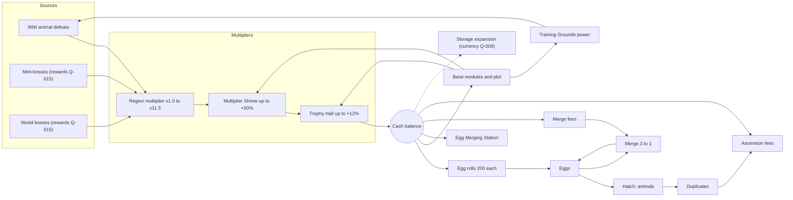

# Economy Overview

The game has **one currency, Cash**, earned by defeating wild animals and spent on egg rolls, base modules, the Egg Merging Station, merge fees and ascension fees. This page describes the shape of the economy and links to the detailed pages. All numbers come from [[Canonical Proposed Values]].

> [!success] CONFIRMED
> - Defeating wild animals earns Cash; Cash buys egg rolls (D-014).
> - Egg rarity is decided by the roll; the animal by the hatch (D-015).
> - Extra egg storage is purchasable; currency and price are **UNDECIDED** ([[Open Questions#Q-009]], [[Open Questions#Q-010]]).
> - The game is fully playable without Robux, with no essential progression behind purchases, and paid random rewards are not the main revenue mechanism (D-027).

> [!info] PROPOSED structural decisions
> - Cash is **never sold for Robux**, directly or indirectly (D-044, PROPOSED). Whether any Robux product may grant Cash is **UNDECIDED** ([[Open Questions#Q-032]]).
> - No player-to-player trading at launch (D-045, PROPOSED; [[Open Questions#Q-026]]).
> - Shared kill credit: every contributor with ≥ 10% damage gets the full reward (D-040, PROPOSED).

## 1. Economy flow

## 2. Pillars of the economy (PROPOSED)

1. **Single soft currency.** One number to understand. No premium currency at launch, which keeps the Cash economy free of Robux and keeps egg rolls out of paid-random territory ([[Roblox Monetisation Policy Requirements]]).
2. **Multiplicative income, mixed-scaling sinks.** Income grows about 12× across regions (×1.0 → ×11.5) and up to 1.62× from base bonuses. The roll price is flat (D-039), so rolls get relatively cheaper; the **scaling sinks** (station levels, merge fees, module L4–L5, ascension fees for high rarities) absorb late-game income.
3. **Rarity has two prices.** A rarity can be rolled directly (random) or merged up deterministically (fees). Merging is cheaper in expectation (see [[Expected Value Calculations]]), which gives every player a predictable, non-random path to high rarities.
4. **No global market.** With no trading, Cash cannot flow between players except through raids, so inflation is a per-player pacing problem, not a market problem ([[Inflation and Farming Exploit Risks]]).
5. **Time, not money.** Every functional purchase is made with Cash earned through play. Robux buys cosmetics and convenience only ([[Monetisation Principles]]).

## 3. Headline numbers (PROPOSED, from modelling)

| Metric | Value | Source |
|---|---:|---|
| Raw Cash per hour, Whisperwood Forest | ~5,100 | [[Wild Animal Cash Rewards]] |
| Raw Cash per hour, Starfall Sanctuary | ~62,400 | [[Wild Animal Cash Rewards]] |
| Maximum base-derived Cash bonus | +62% | [[Progression Multipliers]] |
| Egg rolls per hour (Region 1 → Region 8, raw) | ~25 → ~312 | [[Egg Pricing]] |
| Full base, station and plot cost | 2,332,972 Cash | [[Cost Tables]] |
| Active play hours to unlock Starfall Sanctuary (level 80) | ~118 h | [[Progression Bottleneck Analysis]] |
| Expected Cash for one Secret egg by direct roll (P = 0.30) | 1,000,000 | [[Expected Value Calculations]] |
| Expected Cash for one Secret egg via the full merge chain (P = 0.30) | ~120,700 including fees | [[Expected Value Calculations]] |

## 4. Who owns what

| Topic | Owning document |
|---|---|
| Every source and sink with its scale | [[Cash Sources and Sinks]] |
| Per-region income model and assumptions | [[Wild Animal Cash Rewards]] |
| Roll price model (Q-020) | [[Egg Pricing]] |
| Every price in one place | [[Cost Tables]] |
| Storage expansion options (Q-009, Q-010) | [[Storage Expansion Economics]] |
| Boss reward options (Q-015) | [[Boss Rewards]] |
| All stacking multipliers | [[Progression Multipliers]] |
| Expected values | [[Expected Value Calculations]] |
| Inflation and exploit risks | [[Inflation and Farming Exploit Risks]] |
| Where players stall | [[Progression Bottleneck Analysis]] |
| Robux products | [[Monetisation Product Concepts]] |
| Ledger and Cash transactions | [[Service - EconomyService]], [[Schema - Economy]] |

## 5. Implementation principles

- All Cash changes are server-side through [[Service - EconomyService]], each with a ledger entry (`reason`, `amount`, `balanceAfter`, `context`). The ledger supports exploit investigations and compensation.
- Cash is an integer. Rewards are rounded to the nearest whole number after all multipliers.
- Config values live in a single economy configuration module ([[Configuration Modules]]) so live tuning ([[Balance Update Process]]) never needs code changes.
- Analytics events: `cash_earned` (source, region, amount), `cash_spent` (sink, amount), hourly balance snapshots ([[Service - AnalyticsAndLoggingService]]).

## Related documents
- [[Economy and Monetisation Index]]
- [[Cash Sources and Sinks]]
- [[Cost Tables]]
- [[Expected Value Calculations]]
- [[Progression Bottleneck Analysis]]
- [[Monetisation Principles]]
- [[Core Gameplay Loop]]
- [[Canonical Proposed Values]]
